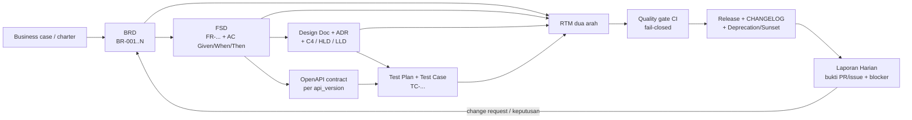

# Riset Best Practices Engineering

> BRD · FSD · Desain · Testing · Laporan Harian · Skema Folder & Project · API Versioning Zero Downtime V1/V2/V3
>
> Disusun: 2026-11-04 · Cakupan standar dan praktik: 2024–2026 · Bahasa: Indonesia
>
> Sumber utama: 6 catatan riset di `research_notes/Riset Best Practices Engineering/`. Template siap pakai: `templates/` (40 berkas).

---

## Cara membaca dokumen ini

| Penanda | Arti |
| --- | --- |
| **[Standar resmi]** | ISO/IEC/IEEE, W3C, RFC, OMG, dan badan standardisasi sejenis; klaim normatif mengikuti edisi yang disebut. |
| **[Dokumentasi resmi vendor/proyek]** | Dokumentasi first-party (GitHub, GitLab, AWS, Microsoft, Google, Kubernetes, Stripe, Pact, k6, Cucumber, dll.). Mengikat untuk produk tersebut, bukan standar universal. |
| **[Praktik industri]** | Konvensi komunitas, spesifikasi komunitas, atau opini praktisi pada situs resminya. |
| **[Rekomendasi peneliti/tim]** | Turunan/inferensi dan keputusan rancangan tim; **bukan** klaim bersumber. |

Setiap klaim normatif di bagian-bagian berikut menyertakan nama dokumen dan URL. Bila teks penuh standar berbayar atau tidak dapat diverifikasi, keterbatasannya dicatat eksplisit di bagian "Gaps" masing-masing bab dan dirangkum di Bab 8.

---

## Ringkasan eksekutif

1. **Artefak bukan sekumpulan dokumen, melainkan satu rantai keterlacakan.** BRD menyatakan kebutuhan dan *outcome* bisnis; FSD menerjemahkannya menjadi perilaku yang dapat diuji; design doc/ADR mencatat keputusan teknis; test plan membuktikan kriteria penerimaan; laporan harian melaporkan bukti kemajuan, blocker, dan keputusan. RTM dua arah menghubungkan semuanya — dari `BR-...` hingga `TC-...` dan `api_version`. **[Standar resmi]** [ISO/IEC/IEEE 29148:2018](https://www.iso.org/standard/72086.html), **[Standar resmi]** [ISO/IEC/IEEE 29119-3:2021](https://cdn.standards.iteh.ai/samples/79429/27623aa24dba41a2876884c0ec57f5d7/ISO-IEC-IEEE-29119-3-2021.pdf).
2. **Jangan mencari "template wajib" pada standar.** ISO/IEC/IEEE 29148 tidak mewajibkan akronim BRD/FSD, dan ISO/IEC/IEEE 42010:2022 secara eksplisit tidak menetapkan format, notasi, proses, maupun urutan bab *architecture description*. Struktur dokumen adalah keputusan tata kelola organisasi yang diselaraskan dengan standar, bukan salinan standar. **[Standar resmi]** [ISO/IEC/IEEE 42010:2022](https://www.iso.org/standard/74393.html).
3. **Spesifikasi yang dapat dieksekusi mengalahkan prosa panjang.** Acceptance criteria `Given/When/Then`, kontrak OpenAPI 3.1/3.2, decision table, authorization matrix, dan *consumer-driven contract* membuat FSD dapat diverifikasi otomatis di CI. **[Dokumentasi resmi vendor/proyek]** [Cucumber/Gherkin](https://cucumber.io/docs/gherkin/reference/), [OpenAPI Specification 3.2.0](https://spec.openapis.org/oas/v3.2.0.html), [Pact `can-i-deploy`](https://docs.pact.io/pact_broker/can_i_deploy).
4. **Quality gate harus fail-closed.** Required status checks, approval policy, `can-i-deploy`, dan threshold performa yang menghasilkan exit code non-zero lebih dapat dipercaya daripada "pass rate" tanpa denominator atau target 100% line coverage. **[Dokumentasi resmi vendor/proyek]** [GitHub protected branches](https://docs.github.com/en/repositories/configuring-branches-and-merges-in-your-repository/managing-protected-branches/about-protected-branches), [k6 thresholds](https://grafana.com/docs/k6/latest/using-k6/thresholds/), **[Praktik industri]** [DORA](https://dora.dev/).
5. **Laporan harian adalah alat keputusan, bukan surveilans.** Daily Scrum 15 menit adalah event internal Developers; format *yesterday/today/blockers* berasal dari praktik Atlassian, bukan Scrum Guide. Laporan tertulis untuk manajemen/klien wajib memuat bukti (PR/issue ID), blocker ber-owner, dan keputusan yang diminta — bukan persentase progres subyektif. **[Standar resmi]** [The 2020 Scrum Guide](https://scrumguides.org/scrum-guide.html), **[Praktik industri]** [Atlassian standup](https://www.atlassian.com/agile/scrum/standups), **[Dokumentasi resmi vendor/proyek]** [GitLab async communication](https://handbook.gitlab.com/handbook/company/culture/all-remote/asynchronous/).
6. **Rekomendasi utama untuk API: tanamkan major version di path** — `/api/v1`, `/api/v2`, `/api/v3` — dengan **satu OpenAPI Description dan satu SDK per major**. Jalankan migrasi tanpa downtime memakai **Expand → backfill → dual-write/read → canary/switch → Contract**, dengan feature flag, Pact, dan rollback bertahap. **[Praktik industri]** [SemVer 2.0.0](https://semver.org/spec/v2.0.0.html), [Martin Fowler — Parallel Change](https://martinfowler.com/bliki/ParallelChange.html), **[Standar resmi]** [RFC 8594](https://www.rfc-editor.org/rfc/rfc8594.html), [RFC 9745](https://www.rfc-editor.org/rfc/rfc9745.html), **[Dokumentasi resmi vendor/proyek]** [Stripe API versioning](https://docs.stripe.com/api/versioning).
7. **Koreksi fakta yang wajib dipakai tim:** **RFC 8594 = `Sunset`**, **RFC 9745 = `Deprecation`** (bukan sebaliknya); **Test Strategy adalah bagian dari Test Plan** pada ISO/IEC/IEEE 29119-3:2021 klausul 7.2.7; **WCAG 2.2 AA = seluruh kriteria A + AA**, sementara 2.3.3 *Animation from Interactions* berlevel **AAA**; IEEE 830-1998 sudah *superseded*. Detail di Bab 8. **[Standar resmi]** [W3C WCAG 2.2](https://www.w3.org/TR/WCAG22/), [ISO/IEC/IEEE 29119-3:2021](https://cdn.standards.iteh.ai/samples/79429/27623aa24dba41a2876884c0ec57f5d7/ISO-IEC-IEEE-29119-3-2021.pdf).

---

## Rekomendasi utama berprioritas

| Prioritas | Keputusan | Alasan ringkas | Artefak |
| --- | --- | --- | --- |
| P0 | Pakai `/api/vN` untuk major version; dokumentasi + SDK per major; kebijakan N-1/N-2 dengan tanggal deprecation & sunset | Paling visible, mudah di-routing/cache/di-observasi per versi, dan cocok untuk coexist V1/V2/V3 | `06-OpenAPI-Multi-Versi*.md`, `06-Routing-Gateway-Nginx.md`, `06-Header-Lifecycle-Deprecation-Sunset.md` |
| P0 | Terapkan Expand–Contract + feature flag + `can-i-deploy` untuk setiap breaking change | Satu-satunya urutan yang memisahkan perubahan skema/kontrak dari cutover | `06-Runbook-Expand-Contract.md`, `06-Checklist-Zero-Downtime.md` |
| P0 | Bangun RTM dua arah sejak BRD → FSD → AC → test case → `api_version` | Mencegah *orphan requirement* dan memastikan setiap perubahan punya bukti uji | `01-RTM.md`, `02-RTM.md`, `06-RTM.md` |
| P1 | Jadikan acceptance criteria, kontrak, dan quality gate sebagai bagian CI, bukan lampiran manual | Menggeser verifikasi ke kiri dan membuat status dapat diaudit | `02-FSD.md`, `04-Test-Plan.md`, `04-Quality-Gate-*.md` |
| P1 | Setiap keputusan arsitektur signifikan → ADR; gunakan status `Superseded` lewat record baru | Jejak keputusan tetap append-only dan dapat ditelusuri | `03-ADR.md`, `06-ADR.md` |
| P1 | Trunk-based + short-lived PR + feature flag + branch protection | Selaras dengan continuous delivery dan migrasi bertahap | `06-CODEOWNERS.md`, `06-CHANGELOG.md`, `06-Definition-of-Done.md` |
| P2 | Laporan harian asinkron berbasis bukti, dengan eskalasi blocker ber-owner | Mengurangi rapat duplikatif dan *status theater* | `05-Laporan-Harian.md` |
| P2 | Definisikan DoD lintas fase, termasuk aksesibilitas A+AA sebagai kewajiban dan reduced-motion sebagai kebijakan produk | Menghindari klaim konformasi yang keliru | `03-DoD-Aksesibilitas.md`, `06-Definition-of-Done.md` |

---

## Peta artefak end-to-end

| Fase | Artefak | ID keterlacakan | Pemilik tipikal | Gerbang keluar |
| --- | --- | --- | --- | --- |
| Bisnis | BRD + business acceptance criteria | `BR-...`, `KPI-...` | Product/Business Analyst + sponsor | Baselined & sign-off RACI |
| Fungsi | FSD, use case, decision table, Gherkin AC, OpenAPI | `FR-...`, `AC-...`, `RULE-...` | Product + Tech Lead | AC dapat diuji, RTM terisi |
| Desain | Design doc, ADR, C4, UI spec, DoD aksesibilitas | `ADR-...`, `DD-...` | Tech Lead/Architect | Design review + STRIDE + rollout/rollback |
| Uji | Test Plan, Test Case, bug/incident report, completion report | `TC-...`, `DEF-...` | QA + seluruh tim | Exit criteria + quality gate hijau |
| Rilis | CHANGELOG, release checklist, header lifecycle, OAD per versi | `api_version`, `vMAJOR.MINOR.PATCH` | Release owner | Canary sehat, metrik per versi stabil |
| Operasi | Laporan harian, metrik DORA/flow, alert per versi | `PR-...`, `ISSUE-...` | Tim + EM | Blocker ber-owner, keputusan tercatat |

**[Standar resmi]** Keterlacakan requirement: [ISO/IEC/IEEE 29148:2018](https://www.iso.org/standard/72086.html); dokumentasi pengujian: [ISO/IEC/IEEE 29119-3:2021](https://cdn.standards.iteh.ai/samples/79429/27623aa24dba41a2876884c0ec57f5d7/ISO-IEC-IEEE-29119-3-2021.pdf). **[Dokumentasi resmi vendor/proyek]** Praktik keterlacakan dua arah: [NASA SWE-047](https://swehb-pri.msfc.nasa.gov/help/SWE-047/). **[Rekomendasi peneliti/tim]** Tabel pemilik dan gerbang keluar di atas adalah rancangan tata kelola, bukan klausul standar.

---

## Indeks template siap pakai

Seluruh template berada di `templates/`, berisi placeholder `{{...}}`, dan memiliki baris `> Sumber:` serta `> Catatan:` di bagian atas. Indeks lengkap dengan kapan memakai tiap template ada di `templates/README.md`.

| Fase | Template utama | Pendukung |
| --- | --- | --- |
| 1. BRD | `01-BRD.md` | `01-RTM.md`, `01-Checklist-Review-BRD.md`, `01-Pola-Kalimat-Kebutuhan-Bisnis.md` |
| 2. FSD | `02-FSD.md` | `02-RTM.md`, `02-Checklist-Review.md` |
| 3. Desain | `03-Design-Doc.md`, `03-ADR.md`, `03-UI-UX-Spec.md` | `03-DoD-Aksesibilitas.md` |
| 4. Testing | `04-Test-Plan.md` | `04-Exit-Criteria-Matrix.md`, `04-Quality-Gate-GitHub-Actions.md`, `04-Quality-Gate-GitLab-CI.md`, `04-Quality-Gate-GitLab-Approval-Policy.md` |
| 5. Laporan Harian | `05-Laporan-Harian.md` | — |
| 6. Skema folder/project | `06-Struktur-Folder.md`, `06-Struktur-Folder-Monorepo.md`, `06-Documentation-Hub.md` | `06-CODEOWNERS.md`, `06-CHANGELOG.md`, `06-ADR.md`, `06-Definition-of-Done.md`, `06-RTM.md`, `06-RACI.md`, `06-Checklist-Release.md` |
| 7. API V1/V2/V3 | `06-OpenAPI-Multi-Versi.md`, `06-OpenAPI-Multi-Versi-V1.md`, `06-OpenAPI-Multi-Versi-V2.md`, `06-OpenAPI-Multi-Versi-V3.md` | `06-Matriks-Endpoint-Versi.md`, `06-Routing-Gateway-Nginx.md`, `06-Runbook-Expand-Contract.md`, `06-Timeline-Migrasi-V1-V2-V3.md`, `06-Header-Lifecycle-Deprecation-Sunset.md`, `06-Komunikasi-Konsumen-Deprecation.md`, `06-Kriteria-Sunset-Metrik.md`, `06-Observability-Alert-Per-Versi.md`, `06-Checklist-Zero-Downtime.md` |

**Total: 40 berkas template.**

---

## Daftar isi

1. [BRD (Business Requirements Document)](#1-brd-business-requirements-document)
2. [FSD (Functional Specification / Functional Design)](#2-fsd-functional-specification--functional-design)
3. [Desain (design doc, HLD/LLD, ADR, UI/UX, aksesibilitas)](#3-desain-design-doc-hldlld-adr-uiux-aksesibilitas)
4. [Testing / QA](#4-testing--qa)
5. [Laporan Harian](#5-laporan-harian)
6. [Lainnya — Skema folder dan skema project](#6-lainnya--skema-folder-dan-skema-project)
7. [Skema API versioning zero downtime: V1, V2, V3 di-embed pada API](#7-skema-api-versioning-zero-downtime-v1-v2-v3-di-embed-pada-api)
8. [Checklist, koreksi standar, keterbatasan, dan daftar sumber API versioning](#8-checklist-koreksi-standar-keterbatasan-dan-daftar-sumber-api-versioning)

---
