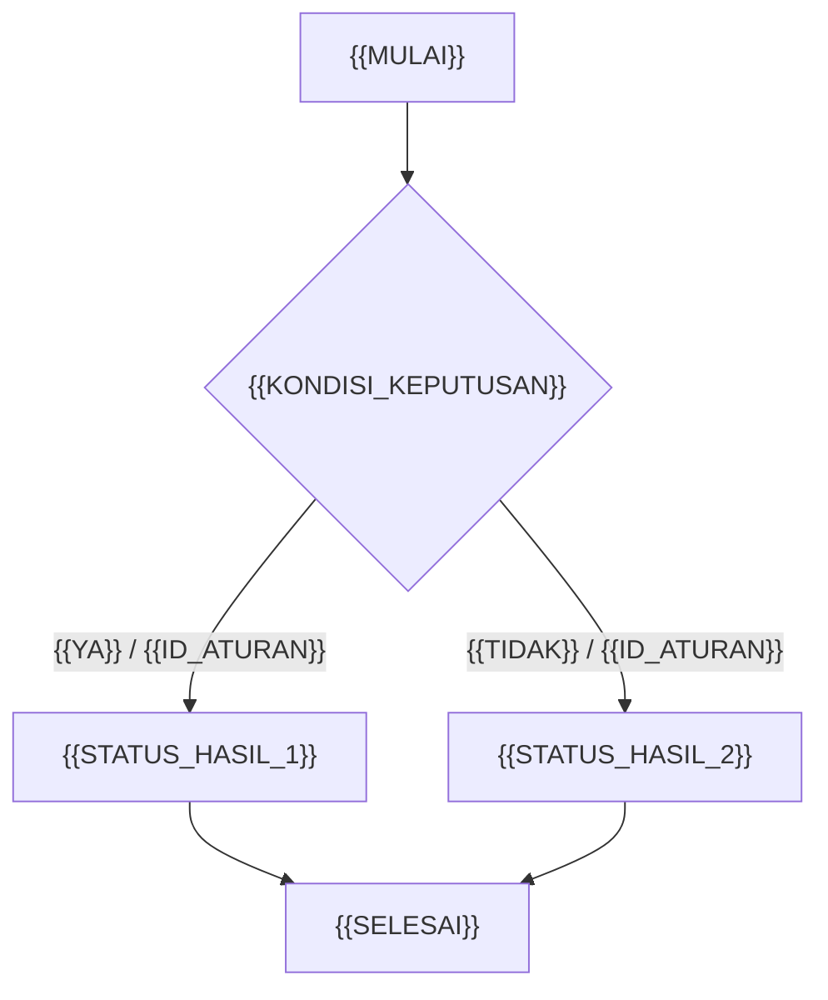
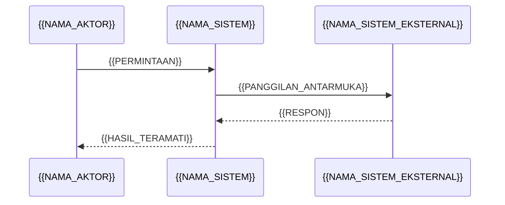

# FSD (Functional Specification / Functional Design Specification) — Referensi Best Practices 2024–2026

Catatan riset disusun pada **2026-11-04** untuk penulis laporan gabungan. **Legenda penanda sumber (wajib dibaca sebelum memakai klaim di bawah):**
- **[SR]** = standar atau spesifikasi resmi (ISO/IEC/IEEE, OMG, OpenAPI Initiative, Cucumber/Gherkin, Scrum Guide, IIBA *The Business Analysis Standard* / BABOK Guide, pedoman lembaga resmi).
- **[PI]** = praktik industri, konvensi tim, atau opini peneliti; **bukan** kewajiban normatif dari standar.
- **[VD]** = halaman berhasil dibuka langsung saat riset (HTTP 200); **[VI]** = hanya terkonfirmasi lewat indeks pencarian / pratinjau daftar isi, unduhan penuh tidak terbuka saat riset. Semua ketidakpastian dicatat di `### Gaps` pada tiap bagian.
- **Batas ruang lingkup sengaja dipatuhi:** BRD hanya disebut sebagai *referensi* dan *target keterlacakan balik*, tidak dibahas mendalam; desain arsitektur/UI, strategi testing, laporan harian, struktur folder/repo, dan **API versioning** tidak dibahas (topik peneliti 1 dan 3–6). Kontrak antarmuka dibahas sebatas *kontrak perilaku*, bukan strategi versi endpoint.

---

## 1. Apa beda FSD dengan BRD, SRS, SDS/HLD/LLD, dan user story backlog? Kapan FSD masih relevan vs digantikan spec-as-code?

### Takeaway
Tidak ada standar internasional yang mendefinisikan "FSD" sebagai *information item* baku — FSD adalah **konvensi industri** yang menempati jembatan antara kebutuhan bisnis (BRS/StRS/BRD) dan spesifikasi requirements (SRS menurut ISO/IEC/IEEE 29148:2018), sebelum desain teknis (SDD menurut IEEE 1016-2009). Ia tetap relevan sebagai **baseline perilaku yang disepakati**; spec-as-code (Gherkin + OpenAPI) lebih tepat dipandang sebagai **bagian yang dapat dieksekusi dari FSD**, bukan pengganti otomatis bagi konteks, asumsi, dan sign-off.

### Cited Findings
- **[SR][VD]** ISO/IEC/IEEE 29148:2018 (Edition 2, dipublikasikan 2018-11, 92 halaman, status *Published*, stage 90.92 *to be revised*, versi berikutnya ISO/IEC/IEEE DIS 29148 id 94091 sedang dikembangkan) menetapkan proses requirements engineering, **information items yang wajib dihasilkan beserta isinya**, serta panduan formatnya; berlaku terlepas dari metodologi, ukuran, atau kompleksitas proyek — [ISO/IEC/IEEE 29148:2018, *Systems and software engineering — Life cycle processes — Requirements engineering*, halaman katalog ISO](https://www.iso.org/standard/72089.html).
- **[SR][VD]** Abstrak resmi yang sama menyatakan standar ini "defines the construct of a good requirement, provides attributes and characteristics of requirements, and discusses the iterative and recursive application of requirements processes throughout the life cycle" serta "Information items applicable to the engineering of requirements and their content are defined" — [29148-2018, *ISO/IEC/IEEE International Standard — Requirements engineering*, IEEE Xplore document 8559686](https://ieeexplore.ieee.org/document/8559686).
- **[SR][VD]** IEEE 830-1998 berstatus **superseded** dan secara eksplisit "Superseded by ISO/IEC/IEEE 29148:2011"; dokumen itu berisi "content and qualities of a good software requirements specification (SRS)" dan beberapa contoh outline SRS — [830-1998, *IEEE Recommended Practice for Software Requirements Specifications*, IEEE Xplore document 720574](https://ieeexplore.ieee.org/document/720574).
- **[SR][VI]** Daftar isi resmi ISO/IEC/IEEE 29148:2018 memuat **Klausul 9.6 "Software requirements specification (SRS) content"** dengan sub-klausul 9.6.1 *SRS overview*, 9.6.2 *Purpose*, 9.6.3 *Scope*, 9.6.4 *Product perspective* (9.6.4.1 *System interfaces*), 9.6.6 *Product Functions / User Characteristics*, 9.6.7 *Limitations*, 9.6.8 *Assumptions and Dependencies*, 9.6.9 *Apportioning of Requirements*, 9.6.10 *Specific Requirements*, serta **8.5.2 "SRS example outline"** — [ISO/IEC/IEEE 29148:2018 (E), pratinjau daftar isi DIN](https://www.din.de/de/mitwirken/normenausschuesse/nia/veroeffentlichungen/wdc-beuth:din21:299567544/toc-3025650/download); [pratinjau daftar isi ILNAS/ECNOR](https://ilnas.services-publics.lu/ecnor/downloadPreview.action?documentReference=227133).
- **[SR][VD]** IEEE 1016-2009 mendefinisikan **SDD** sebagai "a representation of a software design to be used for recording design information and communicating that design information to key design stakeholders" — ini adalah ranah *bagaimana solusi dibangun*, bukan *apa perilakunya* — [1016-2009, *IEEE Standard for Information Technology—Systems Design—Software Design Descriptions*, IEEE Xplore document 5167255](https://ieeexplore.ieee.org/document/5167255); status katalog: *Inactive-Reserved* — [IEEE SA, halaman IEEE 1016-2009](https://standards.ieee.org/ieee/1016/4502/).
- **[PI][VD]** arc42 menyediakan 12 section yang "each with a clear purpose, tailorable to your specific needs", dikelompokkan menjadi *Requirements & quality*, *Structures & views*, dan *Concepts, technologies, decisions*; open source dan dipakai sejak 2005 — **pelengkap struktur, bukan standar** — [arc42, *Template Overview*](https://arc42.org/overview/); [arc42 Documentation](https://arc42.org/documentation/).
- **[SR][VI]** *The Scrum Guide* (2020) mendefinisikan "The Product Backlog is an emergent, ordered list of what is needed to improve the product" dan PBI yang dapat *Done* dalam satu Sprint dianggap siap dipilih di Sprint Planning — backlog adalah **artefak hidup yang berurutan**, bukan baseline spesifikasi yang ditandatangani — [The Scrum Guide 2020, Schwaber & Sutherland](https://scrumguides.org/scrum-guide.html).
- **[SR][VD]** Cucumber BDD: "BDD does not replace your existing agile process, it enhances it"; praktik *Discovery → Formulation → Automation* menghasilkan "system documentation that is automatically checked against the system's behaviour"; contoh yang didokumentasikan menjadi *executable specification* — [Cucumber, *Behaviour-Driven Development*](https://cucumber.io/docs/bdd/).
- **[SR][VD]** Gherkin: "In addition to being a specification and documentation, an example is also a test. As a whole, your examples are an executable specification of the system"; keyword `Rule` (sejak Gherkin v6) dipakai "to represent one business rule that should be implemented" dan mengelompokkan beberapa scenario — [Cucumber, *Gherkin Reference*](https://cucumber.io/docs/gherkin/reference/).
- **[SR][VD]** OAS 3.2.0: "The OpenAPI Specification (OAS) defines a standard, programming language-agnostic interface description for HTTP APIs ... removes guesswork in calling a service"; sebuah *OpenAPI Description* dapat dipakai untuk document generation, code generation, dan testing tools — [OpenAPI Specification v3.2.0](https://spec.openapis.org/oas/v3.2.0.html); pengumuman rilis 3.2.0 tertanggal 2025-09-23 — [OpenAPI Initiative, *Announcing OpenAPI v3.2*](https://www.openapis.org/blog/2025/09/23/announcing-openapi-v3-2).
- **[SR][VI]** IIBA menyebut BABOK® Guide v3 sebagai "The globally recognized standard for the practice of business analysis" dan menyediakan *BABOK® Guide v3 Errata* — [IIBA, *A Business Analysis Professional's Foundation for Success*](https://www.iiba.org/career-resources/a-business-analysis-professionals-foundation-for-success/).
- **[SR][VI]** IIBA *The Business Analysis Standard* (2022) menyatakan keterlacakan memungkinkan "effective impact analysis, discovery of mismatches and gaps between requirements and designs" serta menopang manajemen scope, perubahan, risiko, waktu, biaya, dan komunikasi; dokumen ini merujuk "BABOK Guide v3" untuk daftar teknik lengkap — [IIBA, *The Business Analysis Standard* (edisi JA, terjemahan bebas peneliti)](https://www.iiba.org/globalassets/business-analysis-resources/the-business-analysis-standard/files/the-business-analysis-standard-ja.pdf); [edisi fr-CA](https://www.iiba.org/globalassets/business-analysis-resources/the-business-analysis-standard/files/the-business-analysis-standard-fr-ca.pdf).

#### Tabel pembeda (ringkasan operasional, **[PI]** disusun dari sumber di atas)

| Artefak | Pertanyaan utama | Dasar | Hubungan ke FSD |
|---|---|---|---|
| BRD / BRS / StRS | *Mengapa* dan *apa kebutuhan bisnisnya* | **[SR]** [ISO/IEC/IEEE 29148:2018](https://www.iso.org/standard/72089.html) (keluarga information items BRS/StRS/SyRS/SRS); **[PI]** tidak dibahas mendalam di catatan ini | Sumber **keterlacakan balik**; FSD tidak mengulang argumen bisnisnya |
| **FSD** | *Apa perilaku fungsi yang disepakati*, aturan, kontrak, dan kriteria penerimaan | **[PI]** konvensi industri; menyerap praktik SRS dari [ISO/IEC/IEEE 29148:2018](https://www.iso.org/standard/72089.html) | **Jembatan**: kebutuhan → perilaku teruji → serah terima ke desain teknis |
| SRS | *Apa requirements perangkat lunak secara formal* | **[SR]** Klausul 9.6 [ISO/IEC/IEEE 29148:2018](https://www.din.de/de/mitwirken/normenausschuesse/nia/veroeffentlichungen/wdc-beuth:din21:299567544/toc-3025650/download) | FSD dapat dipetakan ke SRS atau dipakai sebagai SRS-ringan bila organisasi menyetujui |
| SDS / HLD / LLD / SDD | *Bagaimana* struktur dan komponen diimplementasikan | **[SR]** [IEEE 1016-2009](https://ieeexplore.ieee.org/document/5167255); **[PI]** [arc42](https://arc42.org/overview/) | **Di luar batas topik ini**; FSD hanya memberi *input* berupa perilaku & constraint |
| User story backlog | *Apa perubahan berikutnya yang bernilai* | **[SR]** [The Scrum Guide 2020](https://scrumguides.org/scrum-guide.html) | Backlog adalah unit perencanaan yang *emergent*; FSD adalah baseline perilaku per rilis/fitur |
| Spec-as-code (`.feature`, OAD) | *Bagaimana perilaku diverifikasi mesin* | **[SR]** [Gherkin Reference](https://cucumber.io/docs/gherkin/reference/), [OAS 3.2.0](https://spec.openapis.org/oas/v3.2.0.html), [Cucumber BDD](https://cucumber.io/docs/bdd/) | **Bagian dari FSD**, bukan pengganti konteks/asumsi/sign-off |

#### Kapan FSD masih relevan vs cukup spec-as-code ( **[PI]** )

| Kondisi | Rekomendasi | Dasar |
|---|---|---|
| Regulasi/audit, kontrak vendor, sistem safety-critical, banyak pihak yang harus *sign-off* | Pertahankan FSD sebagai **baseline berversi**; lampirkan `.feature` dan OAD sebagai artefak turunan | **[SR]** [ISO/IEC/IEEE 29148:2018](https://www.iso.org/standard/72089.html) menetapkan information items & isinya; **[PI]** [IIBA traceability](https://www.iiba.org/globalassets/business-analysis-resources/the-business-analysis-standard/files/the-business-analysis-standard-ja.pdf) |
| Aturan bisnis bercabang, banyak aktor, batas nilai, dan otorisasi | FSD tetap perlu: decision table + authorization matrix + asumsi tidak bisa hanya diwakili contoh | **[SR]** [OMG DMN 1.6](https://www.omg.org/spec/DMN/1.6/); **[SR]** [Gherkin `Rule`](https://cucumber.io/docs/gherkin/reference/) |
| Tim kecil, domain stabil, perilaku sudah sepenuhnya terekspresikan sebagai contoh + kontrak | FSD dokumen bisa dipangkas menjadi *living specification* (feature files + OAD + RTM ringkas), selama glossary, asumsi, dan persetujuan tetap tercatat | **[SR]** [Cucumber BDD](https://cucumber.io/docs/bdd/) ("does not replace ... it enhances it"); **[SR]** [OAS 3.2.0](https://spec.openapis.org/oas/v3.2.0.html) |
| Perlu diketahui *mengapa* keputusan diambil, siapa menyetujui, dan perubahan apa yang terjadi | spec-as-code **tidak cukup**; perlukan changelog, RTM, dan sign-off | **[PI]** [IIBA, *Maintain Requirements & Designs*](https://www.iiba.org/contentassets/9a74fc669ad34888b351ad04e9baf122/maintain-requirements-and-designs--infographic.pdf); **[SR]** [NASA SWE-047](https://swehb.msfc.nasa.gov/pages/viewpage.action?pageId=91030146) |

### Inferences
- **[PI]** Karena IEEE 830-1998 ditandai *superseded by 29148:2011* dan katalog ISO mencantumkan 29148:2018 sebagai **Edition 2**, rantai penggantian yang dapat ditulis di FSD adalah: *IEEE 830-1998 → ISO/IEC/IEEE 29148:2011 → ISO/IEC/IEEE 29148:2018 (edisi berlaku)*; langkah terakhir merupakan inferensi dari penomoran edisi, bukan kutipan eksplisit (lihat Gaps). Dasar: [IEEE Xplore 720574](https://ieeexplore.ieee.org/document/720574), [ISO 72089](https://www.iso.org/standard/72089.html), [IEEE Xplore 8559686](https://ieeexplore.ieee.org/document/8559686).
- **[PI]** "Digantikan spec-as-code" adalah dikotomi yang keliru: Cucumber secara eksplisit menyatakan BDD *meningkatkan* proses agile yang ada dan menghasilkan dokumentasi yang diperiksa otomatis terhadap perilaku; sehingga posisi yang konsisten adalah **FSD sebagai wadah tata kelola + spec-as-code sebagai isi yang dapat dieksekusi**. Dasar: [Cucumber BDD](https://cucumber.io/docs/bdd/), [Gherkin Reference](https://cucumber.io/docs/gherkin/reference/).
- **[PI]** Istilah HLD/LLD tidak memiliki padanan baku di ISO/IEC/IEEE 29148:2018 maupun IEEE 1016-2009; keduanya adalah konvensi organisasi. Catatan ini karenanya memakai istilah "desain teknis" hanya sebagai pembatas, tanpa membahas isinya. Dasar: [ISO 72089](https://www.iso.org/standard/72089.html), [IEEE 1016-2009](https://ieeexplore.ieee.org/document/5167255).

### Gaps
- **Tidak ditemukan standar resmi yang mendefinisikan "FSD" / "Functional Design Specification" sebagai information item baku.** Penelusuran terhadap katalog [ISO/IEC/IEEE 29148:2018](https://www.iso.org/standard/72089.html), [IEEE 830-1998](https://ieeexplore.ieee.org/document/720574), [IEEE 1016-2009](https://ieeexplore.ieee.org/document/5167255), dan [IIBA](https://www.iiba.org/career-resources/a-business-analysis-professionals-foundation-for-success/) hanya menemukan BRS/StRS/SyRS/SRS, SDD, serta "requirements and designs". **Semua definisi FSD dalam catatan ini harus dilabeli konvensi industri**, bukan kutipan standar.
- Teks penuh ISO/IEC/IEEE 29148:2018 berbayar; pratinjau DIN dan ILNAS mengembalikan 404 saat di-*fetch* langsung. Daftar klausul 9.6 di atas berasal dari **indeks pencarian**, jadi nomor sub-klausul sebaiknya diverifikasi ulang oleh penulis laporan sebelum dikutip sebagai rujukan pasal. Sumber: [DIN](https://www.din.de/de/mitwirken/normenausschuesse/nia/veroeffentlichungen/wdc-beuth:din21:299567544/toc-3025650/download), [ILNAS](https://ilnas.services-publics.lu/ecnor/downloadPreview.action?documentReference=227133), [ISO OBP](https://www.iso.org/obp/ui?_escaped_fragment_=iso%3Astd%3Aiso-iec-ieee%3A29148%3Aed-2%3Av1%3Aen) (hanya halaman login pratinjau yang terbuka).
- Halaman [DMN 1.6](https://www.omg.org/spec/DMN/1.6/) mencantumkan *Publication Date: September 2026* namun metadata hak cipta masih 2021–2024; inkonsistensi metadata ini tidak dapat dijelaskan dari sumber yang terbuka. Untuk klaim 2024–2026, [DMN 1.5 (Agustus 2024)](https://www.omg.org/spec/DMN/1.5/) adalah versi yang paling aman dikutip.
- Tidak ada sumber primer yang memberi **ambang kuantitatif** kapan sebuah organisasi "boleh" menghapus dokumen FSD; keputusan pada tabel di atas adalah **[PI]** pertimbangan peneliti, bukan hasil studi terukur.

---

## 2. Section wajib FSD: pendahuluan, referensi BRD, glossary, aktor/persona, use case, user story + acceptance criteria, alur proses, business rules dan decision table, model data dan validasi field, error/edge case, NFR, kontrak API/antarmuka, wireframe reference, asumsi & dependensi, RTM, sign-off

### Takeaway
Tidak ada daftar section FSD yang diwajibkan oleh standar; daftar "wajib" di bawah adalah **[PI]** konvensi industri yang **dipetakan** ke konten SRS Klausul 9.6 ISO/IEC/IEEE 29148:2018 (purpose, scope, product perspective, interfaces, user characteristics, limitations, assumptions & dependencies, specific requirements) dan dilengkapi Gherkin, DMN, OAS, serta keterlacakan IIBA/NASA.

### Cited Findings
- **[SR][VI]** ISO/IEC/IEEE 29148:2018 Klausul 9.6 memuat *Purpose*, *Scope*, *Product perspective* (termasuk *System interfaces*), *User Characteristics*, *Limitations*, *Assumptions and Dependencies*, dan *Specific Requirements*; Klausul 8.5.2 memberi *SRS example outline* — [ISO/IEC/IEEE 29148:2018 (E), daftar isi DIN](https://www.din.de/de/mitwirken/normenausschuesse/nia/veroeffentlichungen/wdc-beuth:din21:299567544/toc-3025650/download).
- **[SR][VI]** Turunan template komunitas yang mengutip klausul tersebut mencantumkan *Product Functions*, *User Characteristics*, *Limitations* (regulasi, antarmuka aplikasi lain, audit, control, safety/security), *Assumptions and Dependencies*, dan *Apportioning of Requirements*; 9.6.10 menyaratkan requirements dinyatakan "in conformance with all the characteristics described in ISO/IEC/IEEE 29148:2018 Section 5.2" dan "cross-referenced to earlier versions or related documents" — **[PI][VI]** bukan sumber standar, hanya penunjuk klausul — [IEEE-29148-SRS-LaTeX-Template, *IEEE-29148-2018-SRS-Template.tex*](https://github.com/wxinix/IEEE-29148-SRS-LaTeX-Template/blob/main/IEEE-29148-2018-SRS-Template.tex).
- **[SR][VD]** ISO/IEC/IEEE 29148:2018 menetapkan "the required contents of the required information items" dan "guidelines for the format of the required and related information items" — [ISO/IEC/IEEE 29148:2018, katalog ISO](https://www.iso.org/standard/72089.html).
- **[SR][VD]** Untuk **alur proses**: BPMN 2.0.2 menyediakan "easy-to-use flowchart-like notation that is independent of any particular implementation environment" dan telah dipublikasikan pula sebagai ISO/IEC 19510:2013 — [OMG, *About the Business Process Model and Notation Specification Version 2.0.2*](https://www.omg.org/spec/BPMN/2.0.2).
- **[SR][VD]** Untuk **aturan keputusan**: DMN 1.5 (Agustus 2024) menyatakan notasinya "creates a standardized bridge for the gap between the business decision design and decision implementation" dan dapat dipakai bersama BPMN — [OMG, *Decision Model and Notation 1.5*](https://www.omg.org/spec/DMN/1.5/); DMN 1.6 (formal, September 2026) menyebut *expression language* mencakup "decision tables" dengan detail "sufficient to allow execution" — [OMG, *Decision Model and Notation 1.6*](https://www.omg.org/spec/DMN/1.6/).
- **[SR][VD]** Untuk **NFR**: ISO/IEC 25010:2023 mendefinisikan product quality model dengan **sembilan karakteristik** (beserta subkarakteristik) untuk produk ICT dan perangkat lunak — [ISO/IEC 25010:2023, *SQuaRE — Product quality model*, katalog ISO/member body](https://mbs.isolutions.iso.org/standard/78176.html).
- **[SR][VD]** Untuk **kontrak antarmuka**: OAS 3.2.0 mewajibkan field `openapi` dan `info`, serta "at least one of the `components`, `paths`, or `webhooks` fields MUST be present"; tersedia `security`, `externalDocs`, dan `description` ber-CommonMark; `info.version` dinyatakan sebagai "the version of the OpenAPI document (which is distinct from the OpenAPI Specification version or the version of the API being described...)" — [OpenAPI Specification v3.2.0](https://spec.openapis.org/oas/v3.2.0.html). **Catatan batas:** `info.version` dipakai di catatan ini hanya sebagai metadata dokumen; **strategi API versioning sengaja tidak dibahas**.
- **[SR][VD]** Untuk **aktor/use case/acceptance criteria**: Gherkin menyediakan `Feature` (deskripsi tingkat tinggi + pengelompokan scenario, dapat memuat "a list of business rules (general acceptance criteria)"), `Rule`, `Background`, `Example`/`Scenario`, `Scenario Outline` + `Examples`, `Data Tables`, dan `Doc Strings` — [Cucumber, *Gherkin Reference*](https://cucumber.io/docs/gherkin/reference/).
- **[PI][VI]** Untuk **sign-off**: IIBA BABOK v3 (Knowledge Area *Requirements Life Cycle Management*, task *Approve Requirements*) bertujuan "to obtain agreement on and approval of requirements and designs for BA work to continue and/or solution construction to proceed" — **[PI][VI]** ringkasan pihak ketiga terhadap BABOK v3, bukan teks BABOK langsung; rujukan resminya [IIBA, *A Business Analysis Professional's Foundation for Success*](https://www.iiba.org/career-resources/a-business-analysis-professionals-foundation-for-success/) dan [IIBA, *CCBA Sample Questions*](http://www.iiba.org/Certification-Recognition/certification2016/new-ccba-sample-questions.aspx).
- **[SR][VI]** Untuk **RTM**: NASA lebih mem prefer "bidirectional traceability, which traces work products forward to the next life cycle phase as well as backward to the preceding phase", mencakup pasangan *higher-level requirements ↔ software requirements* dan *software test procedures ↔ software requirements* — [NASA Software Engineering Handbook, SWE-047 *Traceability Data*](https://swehb.msfc.nasa.gov/pages/viewpage.action?pageId=91030146).

#### Peta section → dasar ( **[PI]** penyusunan, **[SR]** rujukan tiap baris )

| # | Section FSD | Isi minimum | Dasar |
|---|---|---|---|
| 1 | Pendahuluan | tujuan, scope, *out of scope*, audiens, definisi FSD | **[SR]** [ISO/IEC/IEEE 29148:2018 §9.6.2–9.6.3](https://www.din.de/de/mitwirken/normenausschuesse/nia/veroeffentlichungen/wdc-beuth:din21:299567544/toc-3025650/download) |
| 2 | Referensi BRD | ID + versi BRD, dokumen acuan, status baseline | **[SR]** [ISO/IEC/IEEE 29148:2018](https://www.iso.org/standard/72089.html); **[SR]** [NASA SWE-047](https://swehb.msfc.nasa.gov/pages/viewpage.action?pageId=91030146) |
| 3 | Glossary | istilah kanonik, definisi, sinonim yang dilarang | **[SR]** [ISO/IEC/IEEE 29148:2018](https://www.iso.org/standard/72089.html); **[SR]** [Cucumber BDD, *shared language*](https://cucumber.io/docs/bdd/) |
| 4 | Aktor/persona | peran, hak, karakteristik pengguna | **[SR]** [ISO/IEC/IEEE 29148:2018 §9.6.6 *User Characteristics*](https://www.din.de/de/mitwirken/normenausschuesse/nia/veroeffentlichungen/wdc-beuth:din21:299567544/toc-3025650/download) |
| 5 | Use case | aktor, prekondisi, pemicu, alur utama/alternatif, postkondisi | **[SR]** [Gherkin `Given`/`When`/`Then`](https://cucumber.io/docs/gherkin/reference/); **[SR]** [BPMN 2.0.2](https://www.omg.org/spec/BPMN/2.0.2) |
| 6 | User story + AC | story, ID AC, skenario Given/When/Then | **[SR]** [Gherkin Reference](https://cucumber.io/docs/gherkin/reference/); **[SR]** [Cucumber BDD](https://cucumber.io/docs/bdd/) |
| 7 | Alur proses | flow/sequence/state + **narasi teks pendamping** | **[SR]** [BPMN 2.0.2](https://www.omg.org/spec/BPMN/2.0.2); **[PI]** [arc42](https://arc42.org/overview/) |
| 8 | Business rules & decision table | ID aturan, kondisi, keluaran, policy kecocokan, baris default | **[SR]** [OMG DMN 1.5](https://www.omg.org/spec/DMN/1.5/); **[SR]** [Gherkin `Rule`](https://cucumber.io/docs/gherkin/reference/) |
| 9 | Model data & validasi field | entitas, field, tipe, wajib, rentang, format, pesan | **[SR]** [OAS 3.2.0 Schema Object](https://spec.openapis.org/oas/v3.2.0.html); **[SR]** [ISO/IEC/IEEE 29148:2018](https://www.iso.org/standard/72089.html) |
| 10 | Error / edge case | kode, pemicu, perilaku, pesan, pemulihan, idempotensi | **[SR]** [OAS 3.2.0 responses](https://spec.openapis.org/oas/v3.2.0.html); **[SR]** [Gherkin `Scenario Outline`](https://cucumber.io/docs/gherkin/reference/) |
| 11 | NFR | SLA, performa, keamanan, audit — **terukur** | **[SR]** [ISO/IEC 25010:2023](https://mbs.isolutions.iso.org/standard/78176.html); **[SR]** [ISO/IEC/IEEE 29148:2018](https://ieeexplore.ieee.org/document/8559686) |
| 12 | Kontrak API/antarmuka | path/operasi, request/response, skema, keamanan, contoh | **[SR]** [OAS 3.2.0](https://spec.openapis.org/oas/v3.2.0.html) |
| 13 | Tampilan / wireframe reference | **hanya referensi** (ID, versi, tautan) + state yang terlihat | **[SR]** [ISO/IEC/IEEE 29148:2018 §9.6.4](https://www.din.de/de/mitwirken/normenausschuesse/nia/veroeffentlichungen/wdc-beuth:din21:299567544/toc-3025650/download); **[PI]** batas topik: desain UI tidak dibahas |
| 14 | Asumsi & dependensi | asumsi, dampak jika salah, sistem/pihak eksternal | **[SR]** [ISO/IEC/IEEE 29148:2018 §9.6.8](https://www.din.de/de/mitwirken/normenausschuesse/nia/veroeffentlichungen/wdc-beuth:din21:299567544/toc-3025650/download) |
| 15 | RTM | BRD → FSD → AC → test case, dua arah | **[SR]** [NASA SWE-047](https://swehb.msfc.nasa.gov/pages/viewpage.action?pageId=91030146); **[SR]** [IIBA *The Business Analysis Standard*](https://www.iiba.org/globalassets/business-analysis-resources/the-business-analysis-standard/files/the-business-analysis-standard-ja.pdf) |
| 16 | Versioning & perubahan | versi, status, CR, alasan, dampak, persetujuan | **[PI]** [IIBA, *Maintain Requirements & Designs*](https://www.iiba.org/contentassets/9a74fc669ad34888b351ad04e9baf122/maintain-requirements-and-designs--infographic.pdf) |
| 17 | Sign-off | nama, peran, versi yang disetujui, tanggal, catatan | **[PI][VI]** [IIBA BABOK v3 *Approve Requirements*](https://www.iiba.org/career-resources/a-business-analysis-professionals-foundation-for-success/) |

**Contoh bentuk NFR yang dapat diuji ( [PI] angka semata-ilustrasi, bukan nilai baku standar )** — dasar keharusan terukur: [ISO/IEC/IEEE 29148:2018](https://ieeexplore.ieee.org/document/8559686), [ISO/IEC 25010:2023](https://mbs.isolutions.iso.org/standard/78176.html):
- `FSD-NFR-001` — "≥ 95% pengajuan klaim memperoleh keputusan dalam ≤ 2 detik, diukur pada {{LINGKUNGAN_PENGUKURAN}} selama {{JENDELA_PENGUKURAN}}." (SLA/performa; dasar keharusan terukur: [ISO/IEC/IEEE 29148:2018](https://ieeexplore.ieee.org/document/8559686), [ISO/IEC 25010:2023](https://mbs.isolutions.iso.org/standard/78176.html))
- `FSD-NFR-002` — "Setiap perubahan status klaim menghasilkan catatan audit berisi {{AKTOR}}, {{WAKTU}}, {{STATUS_LAMA}}, {{STATUS_BARU}}, dan {{KODE_KEPUTUSAN}} yang dapat ditelusur ke {{ID_AC}}." (audit; dasar atribut requirement: [ISO/IEC/IEEE 29148:2018](https://ieeexplore.ieee.org/document/8559686))
- `FSD-NFR-003` — "Hanya peran {{PERAN}} yang boleh membaca field {{FIELD_SENSITIF}}; deklarasi mekanisme keamanan wajib eksplisit pada `security` dalam OAD." (keamanan, dasar: [OAS 3.2.0](https://spec.openapis.org/oas/v3.2.0.html))

### Inferences
- **[PI]** Section 13 (wireframe) sebaiknya berisi **referensi**, bukan rancangan: karena desain UI berada di luar batas topik ini, FSD cukup mencantumkan ID/versi artefak dan *state yang harus terlihat* agar AC tetap dapat diuji. Dasar: [ISO/IEC/IEEE 29148:2018 §9.6.4](https://www.din.de/de/mitwirken/normenausschuesse/nia/veroeffentlichungen/wdc-beuth:din21:299567544/toc-3025650/download), [Gherkin `Then` (observable outcome)](https://cucumber.io/docs/gherkin/reference/).
- **[PI]** Section 12 sebaiknya menunjuk ke **satu OAD sebagai sumber kebenaran kontrak** dan tidak menduplikasi skema ke dalam tabel naratif, karena OAS 3.2.0 menyebut tujuan OAD adalah menghilangkan *guesswork* dan dapat dipakai lintas tool (dokumentasi, codegen, testing). Dasar: [OAS 3.2.0](https://spec.openapis.org/oas/v3.2.0.html).
- **[PI]** Urutan 1–17 di atas bukan urutan baku standar; ISO/IEC/IEEE 29148:2018 memberi **konten information item**, bukan template FSD. arc42 sendiri menyatakan section-nya "tailorable to your specific needs". Dasar: [ISO 72089](https://www.iso.org/standard/72089.html), [arc42 Overview](https://arc42.org/overview/).

### Gaps
- Daftar klausul 9.6 bersumber dari **[VI]** pratinjau daftar isi yang tidak dapat dibuka penuh; penulis laporan **jangan** mengutip nomor sub-klausul sebagai kutipan langsung tanpa verifikasi terhadap salinan berlisensi. Sumber: [DIN](https://www.din.de/de/mitwirken/normenausschuesse/nia/veroeffentlichungen/wdc-beuth:din21:299567544/toc-3025650/download), [ILNAS](https://ilnas.services-publics.lu/ecnor/downloadPreview.action?documentReference=227133).
- Tidak ditemukan sumber primer yang mewajibkan **format diagram tertentu** (Mermaid vs BPMN vs UML state machine) di dalam FSD. BPMN 2.0.2 hanya menjanjikan notasi flowchart yang independen dari implementasi — [OMG BPMN 2.0.2](https://www.omg.org/spec/BPMN/2.0.2); pemilihan sequence/state diagram adalah **[PI]**.
- Tidak ada standar yang memberi **daftar field wajib** untuk "model data dan validasi field" di FSD; rujukan yang dipakai adalah Schema Object OAS 3.2.0 yang mengikat **kontrak HTTP**, bukan model domain internal — [OAS 3.2.0](https://spec.openapis.org/oas/v3.2.0.html). Pemodelan domain internal berada di luar batas catatan ini.
- Halaman [IIBA infographic](https://www.iiba.org/contentassets/9a74fc669ad34888b351ad04e9baf122/maintain-requirements-and-designs--infographic.pdf) dan [IIBA blog traceability](https://www.iiba.org/business-analysis-blogs/success-with-requirement-traceability/) mengembalikan 404 saat di-*fetch* langsung (2026-11-04); kutipannya berasal dari indeks pencarian. Untuk klaim keterlacakan, prioritaskan [IIBA *The Business Analysis Standard*](https://www.iiba.org/globalassets/business-analysis-resources/the-business-analysis-standard/files/the-business-analysis-standard-ja.pdf) dan [NASA SWE-047](https://swehb.msfc.nasa.gov/pages/viewpage.action?pageId=91030146) yang lebih stabil.

---

## 3. Bagaimana menulis acceptance criteria yang dapat diuji, termasuk format Given/When/Then (Gherkin)? Berikan contoh konkret minimal 3 skenario (happy path, edge case, kegagalan)

### Takeaway
AC yang dapat diuji ditulis sebagai **contoh konkret dengan konteks yang diketahui, satu peristiwa, dan hasil yang teramati**; Gherkin memberi struktur `Given`/`When`/`Then`, `Rule` untuk mengikat AC ke satu business rule, dan `Scenario Outline` untuk batas nilai — sehingga AC sekaligus menjadi *executable specification* dan bukan sekadar kalimat "sistem harus cepat/mudah".

### Cited Findings
- **[SR][VD]** `Given` menempatkan sistem pada "a well-defined state" dan merupakan prekondisi; **hindari interaksi pengguna di `Given`**. `When` mendeskripsikan "an event, or an action". `Then` mendeskripsikan "an expected outcome, or result" dan step definition-nya "should use an assertion to compare the actual outcome ... to the expected outcome" — [Cucumber, *Gherkin Reference*](https://cucumber.io/docs/gherkin/reference/).
- **[SR][VD]** `Then` harus berupa "an observable output ... (report, user interface, message), and not a behaviour deeply buried inside the system (like a record in a database)"; dokumentasi secara eksplisit menganjurkan untuk menahan godaan memeriksa database pada step `Then` — [Cucumber, *Gherkin Reference*](https://cucumber.io/docs/gherkin/reference/).
- **[SR][VD]** "You can have as many steps as you like, but we recommend 3-5 steps per example. Having too many steps will cause the example to lose its expressive power as a specification and documentation" — [Cucumber, *Gherkin Reference*](https://cucumber.io/docs/gherkin/reference/).
- **[SR][VD]** "Try hard to come up with examples that don't make any assumptions about technology or user interface. Imagine it's 1922 ... Implementation details should be hidden in the step definitions." — [Cucumber, *Gherkin Reference*](https://cucumber.io/docs/gherkin/reference/).
- **[SR][VD]** `Rule` (Gherkin v6) "is used to group together several scenarios that belong to this business rule"; deskripsi bebas di bawah `Feature` dapat memuat "a list of business rules (general acceptance criteria)" — [Cucumber, *Gherkin Reference*](https://cucumber.io/docs/gherkin/reference/).
- **[SR][VD]** `Scenario Outline` + `Examples` menjalankan template yang sama untuk "different combinations of values" dengan parameter `<...>`; `Doc Strings` dan `Data Tables` tersedia untuk argumen bertipe teks/tabel — [Cucumber, *Gherkin Reference*](https://cucumber.io/docs/gherkin/reference/).
- **[SR][VD]** Gherkin dilokalisasi ke "over 70 languages" melalui header `# language: xx`; bila header dihilangkan, defaultnya Inggris (`en`) — [Cucumber, *Gherkin Reference*](https://cucumber.io/docs/gherkin/reference/).
- **[SR][VD]** BDD: "document those examples in a way that can be automated, and check for agreement" (*Formulation*), lalu "implement the behaviour described by each documented example, starting with an automated test" (*Automation*) — [Cucumber, *Behaviour-Driven Development*](https://cucumber.io/docs/bdd/).
- **[SR][VD]** Kriteria requirement yang baik (atribut/karakteristik, termasuk dapat diverifikasi) didefinisikan dalam abstrak ISO/IEC/IEEE 29148:2018 — [29148-2018, IEEE Xplore 8559686](https://ieeexplore.ieee.org/document/8559686); untuk taksonomi kualitas lihat [ISO/IEC 25010:2023](https://mbs.isolutions.iso.org/standard/78176.html).
- **[PI][VI]** IIBA menekankan setiap requirement memiliki pengenal unik dan hubungan antar-dokumen (business process model, test plans, design plans) dapat ditelusuri — **[PI][VI]** blog resmi IIBA yang hanya terkonfirmasi lewat indeks pencarian — [IIBA, *Requirements Documenting – The Foundation of a Project's Success*](https://www.iiba.org/business-analysis-blogs/requirements-documenting--the-foundation-of-a-projects-success).

#### Contoh konkret — domain tunggal: **Pengajuan Klaim Garansi**

Konvensi contoh (**[PI]**, disusun agar konsisten dengan decision table di Bagian 4 dan RTM di Bagian 5): `batas otomatis = Rp 5.000.000`, status garansi `AKTIF | KEDALUWARSA`, dokumen `LENGKAP | TIDAK_LENGKAP`, keluaran `OTOMATIS_DISETUJUI | TINJAU_MANUAL | MINTA_DOKUMEN | DITOLAK`. Angka dan nama status adalah **ilustrasi**, bukan rekomendasi standar. Kata kunci Gherkin sengaja tetap dalam bahasa Inggris karena hanya varian `en` yang diverifikasi pada [Gherkin Reference](https://cucumber.io/docs/gherkin/reference/); teks step ditulis bahasa Indonesia seluruhnya.

```gherkin
Feature: Pengajuan Klaim Garansi
  Menentukan keputusan klaim berdasarkan status garansi, nilai klaim, dan kelengkapan dokumen.
  Aturan yang berlaku: FSD-BR-001. Batas nilai: Rp 5.000.000 (inklusif).

  Background:
    Given sistem mengenali mata uang "IDR" dan zona waktu "Asia/Jakarta"

  Rule: Klaim dengan garansi aktif, nilai sampai batas, dan dokumen lengkap disetujui otomatis

    Example: AC-001 — Happy path, klaim layak disetujui otomatis
      Given pelanggan "CUST-1001" memiliki garansi "GR-2026-0088" berstatus "AKTIF" hingga "2027-01-31"
      And klaim "CLM-2026-0001" memiliki dokumen "Faktur" dan "Foto kerusakan" berstatus "LENGKAP"
      When pelanggan mengajukan klaim "CLM-2026-0001" senilai 4750000 IDR pada "2026-11-04"
      Then pelanggan menerima notifikasi berstatus "OTOMATIS_DISETUJUI" dengan kode keputusan "FSD-BR-001/R1"
      And nomor referensi persetujuan yang diterima bersifat unik untuk "CLM-2026-0001"

    Example: AC-002 — Edge case, nilai tepat di batas atas (inklusif)
      Given pelanggan "CUST-1002" memiliki garansi "GR-2026-0091" berstatus "AKTIF" hingga "2027-03-31"
      And klaim "CLM-2026-0002" memiliki dokumen "Faktur" dan "Foto kerusakan" berstatus "LENGKAP"
      When pelanggan mengajukan klaim "CLM-2026-0002" senilai 5000000 IDR pada "2026-11-04"
      Then pelanggan menerima notifikasi berstatus "OTOMATIS_DISETUJUI" dengan kode keputusan "FSD-BR-001/R1"
      And klaim "CLM-2026-0002" tidak muncul dalam daftar kerja "TINJAU_MANUAL"

    Example: AC-003 — Kegagalan, garansi kedaluwarsa
      Given pelanggan "CUST-1003" memiliki garansi "GR-2025-0044" berstatus "KEDALUWARSA" sejak "2026-10-01"
      And klaim "CLM-2026-0003" memiliki dokumen "Faktur" dan "Foto kerusakan" berstatus "LENGKAP"
      When pelanggan mengajukan klaim "CLM-2026-0003" senilai 1200000 IDR pada "2026-11-04"
      Then pelanggan menerima notifikasi berstatus "DITOLAK" dengan alasan "GARANSI_KEDALUWARSA" dan kode keputusan "FSD-BR-001/R4"
      And tidak ada nomor referensi persetujuan yang diterbitkan untuk "CLM-2026-0003"

  Rule: Dokumen tidak lengkap tidak boleh menghasilkan keputusan akhir

    Scenario Outline: AC-004 — Kegagalan validasi dokumen pada beberapa nilai
      Given pelanggan "<pelanggan>" memiliki garansi "<garansi>" berstatus "AKTIF" hingga "2027-12-31"
      And klaim "<klaim>" memiliki dokumen berstatus "TIDAK_LENGKAP" dengan kekurangan "<kekurangan>"
      When pelanggan mengajukan klaim "<klaim>" senilai <nilai> IDR pada "2026-11-04"
      Then pelanggan menerima notifikasi berstatus "MINTA_DOKUMEN" yang menyebut kekurangan "<kekurangan>"
      And klaim "<klaim>" belum memiliki status keputusan akhir

      Examples:
        | pelanggan | garansi       | klaim          | kekurangan     | nilai   |
        | CUST-1004 | GR-2026-0101  | CLM-2026-0004  | Foto kerusakan | 2500000 |
        | CUST-1005 | GR-2026-0102  | CLM-2026-0005  | Faktur         | 7500000 |
```

**Mengapa contoh ini dapat diuji ( [PI] pemetaan ke aturan resmi ):**
| Properti | Bukti pada contoh | Dasar |
|---|---|---|
| Konteks deterministik | `Given` hanya berisi state (`AKTIF`, `LENGKAP`, tanggal), tanpa aksi | **[SR]** [Gherkin Reference, `Given`](https://cucumber.io/docs/gherkin/reference/) |
| Satu pemicu | `When pelanggan mengajukan klaim ...` | **[SR]** [Gherkin Reference, `When`](https://cucumber.io/docs/gherkin/reference/) |
| Hasil teramati | notifikasi + kode keputusan + nomor referensi; **bukan** "baris database tersimpan" | **[SR]** [Gherkin Reference, `Then`](https://cucumber.io/docs/gherkin/reference/) |
| 3–5 step | tiap `Example` berisi 4–5 step | **[SR]** [Gherkin Reference, `Example`](https://cucumber.io/docs/gherkin/reference/) |
| Bebas UI/teknologi | tidak ada "klik tombol", "halaman", atau nama framework | **[SR]** [Gherkin Reference, "Imagine it's 1922"](https://cucumber.io/docs/gherkin/reference/) |
| AC terikat aturan | `Rule` + `kode keputusan "FSD-BR-001/R1"` | **[SR]** [Gherkin Reference, `Rule`](https://cucumber.io/docs/gherkin/reference/); **[SR]** [OMG DMN 1.5](https://www.omg.org/spec/DMN/1.5/) |
| Batas nilai eksplisit | AC-002 menguji `= 5.000.000`, AC-004 memakai `Scenario Outline` | **[SR]** [Gherkin Reference, `Scenario Outline`](https://cucumber.io/docs/gherkin/reference/) |
| Dapat diverifikasi | setiap `Then` memiliki nilai yang dapat dibandingkan (bukan "cepat"/"mudah") | **[SR]** [ISO/IEC/IEEE 29148:2018](https://ieeexplore.ieee.org/document/8559686) |

### Inferences
- **[PI]** "Kode keputusan" pada `Then` (mis. `FSD-BR-001/R1`) adalah jembatan yang murah antara AC dan decision table sekaligus ke RTM: ia membuat hasil yang *teramati* sekaligus *tertaut* ke ID aturan, tanpa melanggar anjuran Gherkin untuk tidak memeriksa database. Dasar: [Gherkin Reference](https://cucumber.io/docs/gherkin/reference/), [OMG DMN 1.6](https://www.omg.org/spec/DMN/1.6/).
- **[PI]** Untuk organisasi berbahasa Indonesia, Gherkin memungkinkan lokalisasi melalui `# language:`; namun karena dukungan kode `id` tidak diverifikasi dalam riset ini, contoh di atas memakai keyword `en` dengan teks step bahasa Indonesia. Ini memenuhi "istilah teknis Inggris boleh dipertahankan" sekaligus menjaga contoh dapat langsung dijalankan. Dasar: [Gherkin Reference, *Spoken Languages*](https://cucumber.io/docs/gherkin/reference/).
- **[PI]** AC sebaiknya tidak ditulis ulang di narasi prosa dan di file `.feature` secara independen; Cucumber menyebut contoh yang didokumentasikan adalah "system documentation that is automatically checked against the system's behaviour", sehingga duplikasi berisiko drift. Dasar: [Cucumber BDD](https://cucumber.io/docs/bdd/).

### Gaps
- Dukungan lokalisasi Gherkin untuk kode bahasa `id` dan padanan keyword Indonesianya **tidak diverifikasi**. [Gherkin Reference](https://cucumber.io/docs/gherkin/reference/) hanya menampilkan contoh `no` (Norwegia) dan menyebut `fr` serta "over 70 languages" tanpa daftar lengkap yang terbuka di halaman tersebut.
- Tidak ditemukan sumber primer yang menetapkan **jumlah minimum skenario per AC** (happy/edge/failure). Angka 3 pada contoh berasal dari instruksi tugas dan praktik **[PI]**, bukan kewajiban [ISO/IEC/IEEE 29148:2018](https://www.iso.org/standard/72089.html) maupun [Cucumber](https://cucumber.io/docs/gherkin/reference/).
- Daftar lengkap sembilan karakteristik requirement pada ISO/IEC/IEEE 29148:2018 Klausul 5.2 tidak terbuka pada sumber yang diakses; klaim "dapat diverifikasi" di sini bersandar pada **abstrak resmi** [IEEE Xplore 8559686](https://ieeexplore.ieee.org/document/8559686) dan pada [ISO/IEC 25010:2023](https://mbs.isolutions.iso.org/standard/78176.html), bukan pada teks klausul.

---

## 4. Bagaimana mendokumentasikan aturan bisnis (decision table, constraint, authorization matrix) agar tidak ambigu?

### Takeaway
Ketidakambiguan dicapai dengan **tiga lapis yang saling merujuk**: (1) *constraint* bernomor dan terukur, (2) *decision table* lengkap dengan policy kecocokan serta baris default, dan (3) *authorization matrix* aktor × operasi × kondisi. DMN 1.5/1.6 memberi notasi yang menjembatani desain keputusan bisnis dan implementasinya; Gherkin `Rule` mengikat tiap baris ke skenario.

### Cited Findings
- **[SR][VD]** DMN 1.5 (Agustus 2024) menyatakan notasinya "creates a standardized bridge for the gap between the business decision design and decision implementation", dirancang agar dipahami "business analysts ... technical developers ... and businesspeople", serta "usable alongside the standard BPMN business process notation" — [OMG, *Decision Model and Notation 1.5*](https://www.omg.org/spec/DMN/1.5/).
- **[SR][VD]** DMN 1.6 (formal, September 2026): *expression language* "defines the decision logic underlying the decisions and business knowledge in sufficient detail to allow execution. It includes ... decision tables" dan model dapat dipertukarkan antar-organisasi via representasi XML — [OMG, *Decision Model and Notation 1.6*](https://www.omg.org/spec/DMN/1.6/).
- **[SR][VI]** Materi pengantar OMG menyebut DMN memberi "an unambiguous notation for decision tables, which are a clear, convenient and commonly understood way to express business rules as boxed expressions" — **[VI]** dokumen `intro/DMN.pdf` tidak berhasil dibuka langsung saat riset — [OMG, *Standard for Decision Model and Notation (intro)*](http://www.omg.org/intro/DMN.pdf).
- **[SR][VI]** Naskah ballot DMN 1.2 menjelaskan decision table "standardizes: the orientation (rules as rows, columns or crosstab)", dan dapat disajikan horizontal, vertikal, atau crosstab bergantung ukuran — **[VI]** lampiran isu OMG, bukan halaman spesifikasi final — [OMG DMN 1.2 ballot markup, *Decision tables*](https://issues.omg.org/secure/attachment/15420/DMN%201.2_ballot10%20markup%2070.pdf).
- **[SR][VD]** Gherkin `Rule` "represent one business rule that should be implemented" dan "should contain one or more scenarios that illustrate the particular rule" — [Cucumber, *Gherkin Reference*](https://cucumber.io/docs/gherkin/reference/).
- **[SR][VD]** OAS 3.2.0: field `security` mendeklarasikan mekanisme keamanan; "To make security explicitly optional, an empty security requirement (`{}`) can be included in the array"; operasi individual dapat menimpa deklarasi global — [OpenAPI Specification v3.2.0](https://spec.openapis.org/oas/v3.2.0.html).
- **[SR][VD]** OAS 3.2.0 memperingatkan agar penulis deskripsi menghindari *implementation-defined behavior* "in order to maximize interoperability" dan tidak bergantung pada *undefined behavior* — [OpenAPI Specification v3.2.0](https://spec.openapis.org/oas/v3.2.0.html).
- **[SR][VI]** BABOK v3 dikenal memuat teknik *Decision Tables/Trees* untuk "structure the presentation of a series of closely related Business Rules" — **[PI][VI]** materi ajar pihak ketiga yang mengutip BABOK; rujukan resmi: [IIBA, *A Business Analysis Professional's Foundation for Success*](https://www.iiba.org/career-resources/a-business-analysis-professionals-foundation-for-success/); [IIBA, *French BABOK v3 Glossary*](https://integration.iiba.org/globalassets/documents/french-glossary.pdf) (mencantumkan istilah *definitional business rule*).
- **[SR][VD]** ISO/IEC/IEEE 29148:2018 menetapkan atribut dan karakteristik requirement, termasuk konstruk requirement yang baik — [29148-2018, IEEE Xplore 8559686](https://ieeexplore.ieee.org/document/8559686).

#### (a) Constraint bernomor — **[PI]** format, dasar **[SR]** [ISO/IEC/IEEE 29148:2018](https://ieeexplore.ieee.org/document/8559686)

| ID | Pernyataan constraint | Terukur | Sumber | AC |
|---|---|---|---|---|
| `FSD-C-001` | `nilai_klaim` bertipe `integer` dalam IDR, `> 0`, dan `<= {{BATAS_MAKSIMAL_KLAIM}}` | Ya | `BRD-2026-014/BR-03` | AC-002, AC-004 |
| `FSD-C-002` | Batas otomatis `{{BATAS_OTOMATIS}}` bersifat **inklusif**; `=` termasuk, `+1` tidak | Ya | `BRD-2026-014/BR-03` | AC-002 |
| `FSD-C-003` | `status_garansi` hanya bernilai `AKTIF` atau `KEDALUWARSA`; `tanggal_berakhir` dihitung dalam zona waktu `{{ZONA_WAKTU}}` | Ya | `FSD-A-002` | AC-003 |
| `FSD-C-004` | Keputusan akhir hanya boleh berupa satu dari `OTOMATIS_DISETUJUI`, `TINJAU_MANUAL`, `DITOLAK`; `MINTA_DOKUMEN` bukan keputusan akhir | Ya | `FSD-BR-001` | AC-004 |

#### (b) Decision table `FSD-BR-001` — **[PI]** isi, **[SR]** notasi [OMG DMN 1.5](https://www.omg.org/spec/DMN/1.5/) / [DMN 1.6](https://www.omg.org/spec/DMN/1.6/)

**Policy kecocokan yang dinyatakan eksplisit:** "Tepat satu baris boleh cocok (`UNIQUE`); urutan baris bukan prioritas. Jika tidak ada baris yang cocok, berlaku baris `R-DEFAULT`." ( **[PI]** — penulisan policy secara eksplisit adalah praktik yang dianjurkan agar tidak ada *implementation-defined behavior*, mengacu pada [OAS 3.2.0](https://spec.openapis.org/oas/v3.2.0.html) dan [DMN 1.6](https://www.omg.org/spec/DMN/1.6/). )

| Baris | `status_garansi` | `nilai_klaim <= 5000000` | `dokumen_lengkap` | Keputusan | Kode | AC |
|---|---|---|---|---|---|---|
| R1 | `AKTIF` | `true` | `true` | `OTOMATIS_DISETUJUI` | `FSD-BR-001/R1` | AC-001, AC-002 |
| R2 | `AKTIF` | `false` | `true` | `TINJAU_MANUAL` | `FSD-BR-001/R2` | {{AC_TINJAU_MANUAL}} |
| R3 | `AKTIF` | `true` | `false` | `MINTA_DOKUMEN` | `FSD-BR-001/R3` | AC-004 |
| R4 | `AKTIF` | `false` | `false` | `MINTA_DOKUMEN` | `FSD-BR-001/R3` | AC-004 |
| R5 | `KEDALUWARSA` | `true` | `true` | `DITOLAK` (`GARANSI_KEDALUWARSA`) | `FSD-BR-001/R4` | AC-003 |
| R6 | `KEDALUWARSA` | `false` | `true` | `DITOLAK` (`GARANSI_KEDALUWARSA`) | `FSD-BR-001/R4` | AC-003 |
| R7 | `KEDALUWARSA` | `true` | `false` | `DITOLAK` (`GARANSI_KEDALUWARSA`) | `FSD-BR-001/R4` | AC-003 |
| R8 | `KEDALUWARSA` | `false` | `false` | `DITOLAK` (`GARANSI_KEDALUWARSA`) | `FSD-BR-001/R4` | AC-003 |
| `R-DEFAULT` | lainnya | lainnya | lainnya | `DITOLAK` (`KOMBINASI_TIDAK_VALID`) | `FSD-BR-001/R0` | {{AC_DEFAULT}} |

Catatan anti-ambiguitas (**[PI]**): (i) setiap kondisi dinyatakan **boolean**, bukan "nilai besar/kecil"; (ii) batas ditulis `<= 5000000` sehingga AC-002 tepat di batas tidak menimbulkan tafsir; (iii) `KEDALUWARSA` didominasi lebih dulu sehingga tidak bertabrakan dengan R1; (iv) `R-DEFAULT` menutup kombinasi tak terduga; (v) setiap baris memiliki **kode keputusan** yang sama persis dengan yang muncul di `Then` Gherkin. Dasar: [Cucumber, *Gherkin Reference*](https://cucumber.io/docs/gherkin/reference/), [OMG DMN 1.6](https://www.omg.org/spec/DMN/1.6/), [OAS 3.2.0 §2.2](https://spec.openapis.org/oas/v3.2.0.html).

#### (c) Authorization matrix — **[PI]** format, **[SR]** dasar deklarasi keamanan [OAS 3.2.0](https://spec.openapis.org/oas/v3.2.0.html)

| ID | Aktor / peran | Operasi | Kondisi tambahan | Diizinkan | Aturan terkait | Bukti pada kontrak |
|---|---|---|---|---|---|---|
| `FSD-AUTH-001` | `PELANGGAN` | `ajukan_klaim` | hanya untuk `pelanggan_id` miliknya | YA | `FSD-C-001` | `security` pada `POST {{PATH_KLAIM}}` |
| `FSD-AUTH-002` | `PELANGGAN` | `baca_klaim` | hanya klaim miliknya | YA | `FSD-NFR-003` | `security` pada `GET {{PATH_KLAIM}}/{id}` |
| `FSD-AUTH-003` | `PELANGGAN` | `ubah_keputusan` | apa pun | **TIDAK** | `FSD-BR-001` | operasi tidak dideklarasikan |
| `FSD-AUTH-004` | `PENINJAU` | `tetapkan_keputusan_manual` | hanya saat status `TINJAU_MANUAL` | YA | `FSD-BR-001/R2` | `security` pada `POST {{PATH_TINJAUAN}}` |
| `FSD-AUTH-005` | `AUDITOR` | `baca_jejak_audit` | read-only | YA | `FSD-NFR-002` | `security` pada `GET {{PATH_AUDIT}}` |
| `FSD-AUTH-DEFAULT` | siapa pun | selain kombinasi di atas | apa pun | **TIDAK** | `FSD-AUTH-*` | dinyatakan eksplisit, bukan diasumsikan |

Ketentuan tambahan yang mencegah ambiguitas (**[PI]**): setiap operasi **wajib memiliki deklarasi `security` yang eksplisit** (OAS 3.2.0 memperbolehkan `{}` untuk menyatakan *opsional* secara eksplisit), dan "tidak dideklarasikan" tidak boleh ditafsirkan sebagai "diizinkan" — [OpenAPI Specification v3.2.0](https://spec.openapis.org/oas/v3.2.0.html).

### Inferences
- **[PI]** Tiga lapis di atas sebaiknya memakai **satu kosakata yang sama** dengan glossary Bagian 2; Cucumber BDD menyebut *Formulation* membangun "a shared language for talking about the system" yang dipakai "all the way down into the code". Dasar: [Cucumber BDD](https://cucumber.io/docs/bdd/).
- **[PI]** `R-DEFAULT` dan `FSD-AUTH-DEFAULT` bukan keharusan DMN/OAS, melainkan **[PI]** penerapan prinsip OAS 3.2.0 agar penulis menghindari perilaku *implementation-defined*; penulis laporan sebaiknya tidak menyatakannya sebagai klausul standar. Dasar: [OAS 3.2.0 §2.2](https://spec.openapis.org/oas/v3.2.0.html).
- **[PI]** Karena DMN 1.5 (2024) dan 1.6 (2026) sama-sama *formal*, FSD yang ditulis 2024–2026 sebaiknya mencantumkan **versi DMN yang dipakai** agar notasi tidak ditafsirkan ulang saat toolchain diperbarui. Dasar: [OMG DMN 1.5](https://www.omg.org/spec/DMN/1.5/), [OMG DMN 1.6](https://www.omg.org/spec/DMN/1.6/).

### Gaps
- Daftar lengkap **hit policy** DMN (`UNIQUE`, `FIRST`, `PRIORITY`, dll.) beserta definisi normatifnya tidak terbuka pada halaman yang dapat diakses ([DMN 1.6](https://www.omg.org/spec/DMN/1.6/), [DMN 1.5](https://www.omg.org/spec/DMN/1.5/), tautan PDF `formal/24-01-01` hanya menampilkan banner cookie). Istilah `UNIQUE` dipakai di atas sebagai **[PI]** konvensi penamaan, **bukan** kutipan klausul; verifikasi terhadap PDF normatif diperlukan sebelum dipublikasikan.
- `[OMG intro/DMN.pdf](http://www.omg.org/intro/DMN.pdf)` dan [naskah ballot DMN 1.2](https://issues.omg.org/secure/attachment/15420/DMN%201.2_ballot10%20markup%2070.pdf) adalah **[VI]**: kutipan "unambiguous notation" dan orientasi tabel berasal dari indeks pencarian, bukan dari dokumen yang berhasil dibaca penuh.
- Teks BABOK v3 tentang teknik *Decision Tables/Trees* tidak tersedia terbuka; rujukan yang dipakai adalah halaman resmi IIBA yang menyebut BABOK v3 sebagai standar praktik plus glosarium resmi, sehingga **klaim "BABOK v3 mewajibkan decision table" tidak dapat dibuat** di catatan ini. Sumber: [IIBA](https://www.iiba.org/career-resources/a-business-analysis-professionals-foundation-for-success/), [IIBA French Glossary](https://integration.iiba.org/globalassets/documents/french-glossary.pdf).

---

## 5. Bagaimana FSD menangani versioning, perubahan requirement, dan keterlacakan bolak-balik ke BRD serta ke test case? Berikan contoh tabel RTM

### Takeaway
FSD diperlakukan sebagai **baseline berversi dengan ID requirement yang stabil**; setiap perubahan melalui *change request* yang mencatat alasan dan dampak, lalu **RTM diperiksa ulang dua arah** (mundur ke BRD, maju ke AC/test case). NASA SWE-047 secara eksplisit mem prefer *bidirectional traceability*, sementara IIBA menekankan versioning artefak dan peninjauan ulang keterlacakan setelah pemeliharaan.

### Cited Findings
- **[PI][VI]** Infografik resmi IIBA *Maintain Requirements & Designs* menyatakan: "Artifacts should be versioned so that a historical record is kept of what changed and when", menyarankan atribut seperti sumber requirement yang diperbarui, dan "After maintenance, revisit requirements traceability to ensure that new and modified requirements are fully traceable" — [IIBA, *Maintain Requirements & Designs (infographic)*](https://www.iiba.org/contentassets/9a74fc669ad34888b351ad04e9baf122/maintain-requirements-and-designs--infographic.pdf).
- **[SR][VI]** IIBA *The Business Analysis Standard*: keterlacakan memungkinkan analisis dampak yang efektif, menemukan ketidaksesuaian/celah antara requirements dan designs, serta menopang manajemen scope, perubahan, risiko, waktu, biaya, dan komunikasi — [IIBA, *The Business Analysis Standard* (JA)](https://www.iiba.org/globalassets/business-analysis-resources/the-business-analysis-standard/files/the-business-analysis-standard-ja.pdf).
- **[PI][VI]** Blog resmi IIBA: "Requirements traceability is a control measure. A way to ensure that all requirements are addressed and to prevent project scope creep"; setiap high-level requirement diberi ID dan setiap detailed requirement "must tie back to a high-level business requirement" — [IIBA, *Success with Requirement Traceability*](https://www.iiba.org/business-analysis-blogs/success-with-requirement-traceability/).
- **[PI][VI]** Blog resmi IIBA lain: keterlacakan hubungan antar-dokumen (business process model, test plans, design plans) krusial dan "each requirement itself must be traceable" dengan pengenal unik — [IIBA, *Requirements Documenting – The Foundation of a Project's Success*](https://www.iiba.org/business-analysis-blogs/requirements-documenting--the-foundation-of-a-projects-success).
- **[SR][VI]** NASA SWE-047: "The preferred traceability approach is bidirectional traceability, which traces work products forward to the next life cycle phase as well as backward to the preceding phase"; pasangan yang disebut: higher-level requirements ↔ software requirements, software requirements ↔ software design, software design ↔ code, dan software test procedures ↔ software requirements — [NASA Software Engineering Handbook, SWE-047](https://swehb.msfc.nasa.gov/pages/viewpage.action?pageId=91030146); [versi arsip SWEHB NASA](https://swehb.nasa.gov/pages/diffpagesbyversion.action?pageId=37159481&selectedPageVersions=5&selectedPageVersions=6).
- **[SR][VD]** ISO/IEC/IEEE 29148:2018 mendefinisikan "attributes and characteristics of requirements" serta proses requirements engineering yang diterapkan "iterative and recursive ... throughout the life cycle" — [29148-2018, IEEE Xplore 8559686](https://ieeexplore.ieee.org/document/8559686); standar juga menetapkan isi information items dan panduan formatnya — [ISO/IEC/IEEE 29148:2018, katalog ISO](https://www.iso.org/standard/72089.html).
- **[SR][VI]** Klausul 9.6.10 (SRS) menyaratkan requirements "cross-referenced to earlier versions or related documents" — **[VI]** penunjuk klausul dari template komunitas — [IEEE-29148-SRS-LaTeX-Template](https://github.com/wxinix/IEEE-29148-SRS-LaTeX-Template/blob/main/IEEE-29148-2018-SRS-Template.tex).
- **[SR][VD]** Gherkin `Scenario Outline`/`Examples` memungkinkan satu AC menaut ke banyak kombinasi nilai, sehingga perubahan batas nilai cukup dilacak pada satu baris `Examples` — [Cucumber, *Gherkin Reference*](https://cucumber.io/docs/gherkin/reference/).
- **[SR][VD]** OAS 3.2.0 membedakan `info.version` sebagai "the version of the OpenAPI document" dari versi spesifikasi OAS maupun versi API yang dideskripsikan; `externalDocs` tersedia untuk merujuk dokumentasi lain — [OpenAPI Specification v3.2.0](https://spec.openapis.org/oas/v3.2.0.html). **Batas topik:** ini dipakai hanya untuk memberi versi pada artefak kontrak; strategi API versioning tidak dibahas.

#### (a) Metadata versi FSD — **[PI]** format, dasar **[PI]** [IIBA infographic](https://www.iiba.org/contentassets/9a74fc669ad34888b351ad04e9baf122/maintain-requirements-and-designs--infographic.pdf) & **[SR]** [ISO/IEC/IEEE 29148:2018](https://ieeexplore.ieee.org/document/8559686)

| Atribut | Nilai contoh | Keterangan |
|---|---|---|
| `FSD_ID` | `FSD-2026-014` | Stabil, tidak berubah antar revisi |
| `VERSI` | `1.2` | `MAJOR.MINOR`; naik `MAJOR` bila perilaku yang disetujui berubah |
| `STATUS` | `DRAFT / REVIEW / DISETUJUI / DITARIK` | Menentukan apakah boleh dipakai sebagai baseline |
| `BASELINE_BRD` | `BRD-2026-014 rev.3` | Target keterlacakan mundur |
| `TANGGAL_EFEKTIF` | `2026-11-04` | Kapan versi berlaku |
| `PEMILIK` | `{{NAMA_BA}}` | Penanggung jawab isi |
| `PERSETUJUAN` | `{{NAMA}} / {{PERAN}} / {{TANGGAL}}` | Lihat Bagian 2 section 17 |

#### (b) Catatan perubahan / *Change Request* — **[PI]**, dasar **[PI]** [IIBA](https://www.iiba.org/contentassets/9a74fc669ad34888b351ad04e9baf122/maintain-requirements-and-designs--infographic.pdf), **[SR]** [IIBA *The Business Analysis Standard*](https://www.iiba.org/globalassets/business-analysis-resources/the-business-analysis-standard/files/the-business-analysis-standard-ja.pdf)

| CR | Versi | Tanggal | Objek | Sebelum | Sesudah | Alasan | Sumber | Dampak (ID terdampak) | Disetujui oleh |
|---|---|---|---|---|---|---|---|---|---|
| `CR-007` | `1.0 → 1.1` | `2026-10-12` | `FSD-C-002` | batas `< 5.000.000` | batas `<= 5.000.000` | Ambiguitas pada nilai tepat batas | `{{TIKET_DISKUSI}}` | `FSD-BR-001/R1`, `AC-002`, `TC-014-02` | `{{SPONSOR}}` |
| `CR-009` | `1.1 → 1.2` | `2026-11-03` | `FSD-BR-001` | tanpa baris default | `R-DEFAULT` ditambahkan | Kombinasi tak terduga belum ada perilaku | `{{HASIL_REVIEW}}` | `AC-004`, `TC-014-05`, `FSD-IF-001` | `{{SPONSOR}}` |

#### (c) Contoh **RTM dua arah** — **[PI]** format tabel; **[SR]** prinsip dua arah [NASA SWE-047](https://swehb.msfc.nasa.gov/pages/viewpage.action?pageId=91030146)

Arah **mundur** = kolom `Sumber BRD` (membuktikan setiap FSD punya justification bisnis). Arah **maju** = kolom `AC` + `Test case` + `Kontrak` (membuktikan setiap FSD mempunyai bukti pemenuhan). Kolom `Cakupan balik` dipakai untuk menandai BRD yang belum terpetakan maupun FSD tanpa sumber — [NASA SWE-047](https://swehb.msfc.nasa.gov/pages/viewpage.action?pageId=91030146), [IIBA, *Success with Requirement Traceability*](https://www.iiba.org/business-analysis-blogs/success-with-requirement-traceability/).

| ID FSD | Pernyataan perilaku (ringkas) | ← Sumber BRD | Aturan / constraint | Kontrak | → AC (Gherkin) | → Test case ID | Status | Versi | Cakupan balik |
|---|---|---|---|---|---|---|---|---|---|
| `FSD-FR-001` | Sistem menentukan keputusan klaim sesuai tabel `FSD-BR-001` | `BRD-2026-014/BR-03` | `FSD-BR-001`, `FSD-C-002` | `FSD-IF-001` | `AC-001`, `AC-002`, `AC-003`, `AC-004` | `TC-014-01`, `TC-014-02`, `TC-014-03`, `TC-014-04` | `DISETUJUI` | `1.2` | `OK` |
| `FSD-FR-002` | Sistem menolak `nilai_klaim <= 0` atau di atas `{{BATAS_MAKSIMAL_KLAIM}}` | `BRD-2026-014/BR-03` | `FSD-C-001` | `FSD-IF-001` | `{{AC_NILAI_INVALID}}` | `TC-014-05` | `DISETUJUI` | `1.2` | `OK` |
| `FSD-FR-003` | Dokumen tidak lengkap tidak menghasilkan keputusan akhir | `BRD-2026-014/BR-05` | `FSD-C-004`, `FSD-BR-001/R3` | `FSD-IF-001` | `AC-004` | `TC-014-04` | `DISETUJUI` | `1.2` | `OK` |
| `FSD-NFR-001` | ≥ 95% keputusan ≤ 2 detik pada `{{LINGKUNGAN}}` | `BRD-2026-014/NFR-01` | — | `FSD-IF-001` | `{{AC_SLA}}` | `TC-014-06` | `REVIEW` | `1.2` | `OK` |
| `FSD-NFR-002` | Jejak audit memuat aktor, waktu, status lama/baru, kode keputusan | `BRD-2026-014/NFR-04` | `FSD-BR-001/R*` | `FSD-IF-002` | `{{AC_AUDIT}}` | `TC-014-07` | `DISETUJUI` | `1.2` | `OK` |
| `FSD-NFR-003` | Akses field `{{FIELD_SENSITIF}}` hanya untuk `{{PERAN}}` | `BRD-2026-014/NFR-03` | `FSD-AUTH-002`, `FSD-AUTH-005` | `FSD-IF-002` | `{{AC_OTORISASI}}` | `TC-014-08` | `DISETUJUI` | `1.2` | `OK` |
| `FSD-IF-001` | Kontrak `POST {{PATH_KLAIM}}` sesuai OAD `{{PATH_OAD}}` | `BRD-2026-014/BR-03` | `FSD-C-001` | `FSD-IF-001` | `AC-001`, `AC-003` | `TC-014-09` | `DISETUJUI` | `1.2` | `OK` |
| `FSD-ORPHAN-01` | *Contoh baris kontrol:* requirement tanpa sumber BRD | **— (kosong)** | — | — | — | — | `DITOLAK` | `1.2` | **`GAP: belum ada justification bisnis`** |

**Baris kontrol terakhir sengaja disertakan** sebagai contoh mekanisme deteksi: IIBA menyebut traceability sebagai kontrol untuk memastikan semua requirements terpenuhi dan mencegah *scope creep*; NASA menyaratkan penelusuran ke fase sebelumnya. Dasar: [IIBA, *Success with Requirement Traceability*](https://www.iiba.org/business-analysis-blogs/success-with-requirement-traceability/), [NASA SWE-047](https://swehb.msfc.nasa.gov/pages/viewpage.action?pageId=91030146). **Catatan batas:** kolom `Test case ID` hanya dipakai sebagai **pengenal keterlacakan**, bukan pembahasan strategi, cakupan, atau desain testing (topik peneliti lain).

#### (d) Urutan proses perubahan — **[PI]**, disusun dari sumber di atas

1. Terima `CR` → catat sumber, alasan, dan pemohon — **[PI]** [IIBA infographic](https://www.iiba.org/contentassets/9a74fc669ad34888b351ad04e9baf122/maintain-requirements-and-designs--infographic.pdf).
2. Lakukan **analisis dampak** dengan membaca RTM dua arah — **[SR]** [IIBA *The Business Analysis Standard*](https://www.iiba.org/globalassets/business-analysis-resources/the-business-analysis-standard/files/the-business-analysis-standard-ja.pdf), **[SR]** [NASA SWE-047](https://swehb.msfc.nasa.gov/pages/viewpage.action?pageId=91030146).
3. Perbarui requirement + decision table + AC + OAD dalam **satu revisi yang sama** agar tidak ada drift — **[SR]** [Cucumber BDD](https://cucumber.io/docs/bdd/), **[SR]** [OAS 3.2.0](https://spec.openapis.org/oas/v3.2.0.html).
4. Naikkan `VERSI`, ubah `STATUS`, isi tabel CR — **[PI]** [IIBA infographic](https://www.iiba.org/contentassets/9a74fc669ad34888b351ad04e9baf122/maintain-requirements-and-designs--infographic.pdf).
5. **Revisit seluruh RTM** lalu minta sign-off ulang pada versi baru — **[PI]** [IIBA infographic](https://www.iiba.org/contentassets/9a74fc669ad34888b351ad04e9baf122/maintain-requirements-and-designs--infographic.pdf), **[PI][VI]** [IIBA BABOK v3 *Approve Requirements*](https://www.iiba.org/career-resources/a-business-analysis-professionals-foundation-for-success/).
6. Simpan `cross-reference` ke versi sebelumnya — **[SR][VI]** [ISO/IEC/IEEE 29148:2018 §9.6.10](https://github.com/wxinix/IEEE-29148-SRS-LaTeX-Template/blob/main/IEEE-29148-2018-SRS-Template.tex).

### Inferences
- **[PI]** Memisahkan `FSD_ID` (stabil) dari `VERSI` (berubah) adalah kunci agar RTM tidak putus saat revisi: IIBA meminta artefak berversi untuk menyimpan "what changed and when", sementara keterlacakan mensyaratkan pengenal yang dapat dirujuk balik. Dasar: [IIBA infographic](https://www.iiba.org/contentassets/9a74fc669ad34888b351ad04e9baf122/maintain-requirements-and-designs--infographic.pdf), [IIBA blog](https://www.iiba.org/business-analysis-blogs/requirements-documenting--the-foundation-of-a-projects-success).
- **[PI]** Karena Cucumber menyebut contoh yang didokumentasikan adalah dokumentasi yang "automatically checked against the system's behaviour", perubahan batas nilai sebaiknya **mengubah `Examples`/decision table**, lalu membiarkan AC yang menaut ke sana ikut terverifikasi — bukan menambah kalimat prosa baru. Dasar: [Cucumber BDD](https://cucumber.io/docs/bdd/), [Gherkin `Scenario Outline`](https://cucumber.io/docs/gherkin/reference/).
- **[PI]** RTM sebaiknya menyimpan **status per baris**, bukan hanya tautan, agar analisis dampak dapat langsung menunjukkan baris yang masih `REVIEW` atau `DITOLAK`. Ini inferensi dari fungsi keterlacakan menurut [IIBA *The Business Analysis Standard*](https://www.iiba.org/globalassets/business-analysis-resources/the-business-analysis-standard/files/the-business-analysis-standard-ja.pdf) dan [NASA SWE-047](https://swehb.msfc.nasa.gov/pages/viewpage.action?pageId=91030146), bukan format baku standar.

### Gaps
- **Tidak ada standar yang menentukan skema penomoran versi FSD** (`MAJOR.MINOR`, SemVer, dll.). Skema pada tabel (a) adalah **[PI]**; [ISO/IEC/IEEE 29148:2018](https://www.iso.org/standard/72089.html) hanya menetapkan atribut/karakteristik requirement dan isi information item, bukan format versi dokumen.
- Empat rujukan IIBA pada bagian ini adalah **[VI] / [PI]**: infografik, dua blog, dan halaman karir mengembalikan 404 atau hanya terkonfirmasi lewat indeks pencarian pada 2026-11-04. Untuk klaim yang lebih kokoh, pakai [IIBA *The Business Analysis Standard* (JA)](https://www.iiba.org/globalassets/business-analysis-resources/the-business-analysis-standard/files/the-business-analysis-standard-ja.pdf) dan [NASA SWE-047](https://swehb.msfc.nasa.gov/pages/viewpage.action?pageId=91030146).
- NASA SWE-047 adalah **pedoman internal lembaga** (bukan standar ISO/IEEE); penulis laporan harus melabelinya **[praktik industri / pedoman lembaga resmi]**, bukan "standar internasional". Sumber: [SWEHB NASA](https://swehb.msfc.nasa.gov/pages/viewpage.action?pageId=91030146).
- Kolom `→ Test case ID` tidak dapat diverifikasi lebih jauh karena **strategi testing berada di luar batas topik ini**; tidak ada klaim tentang desain, cakupan, atau hasil test case yang dibuat.

---

## 6. Apa anti-pattern FSD (terlalu teknis, duplikasi BRD, tidak ada kriteria penerimaan, diagram tanpa teks, dll.)?

### Takeaway
Anti-pattern FSD hampir selalu berakar pada **kaburnya batas peran artefak**: menulis *cara membangun* instead of *perilaku*, mengulang argumen bisnis BRD, atau menyajikan contoh/diagram yang tidak dapat diverifikasi. Obatnya adalah memetakan setiap section ke satu dasar resmi (ISO/IEC/IEEE 29148:2018, Gherkin, DMN, OAS) dan memastikan ada AC, ID, dan tautan RTM.

### Cited Findings
- **[SR][VD]** ISO/IEC/IEEE 29148:2018 menetapkan "the required contents of the required information items" — konten yang tidak termasuk information item requirements berisiko menjadi duplikasi/kebisingan — [ISO/IEC/IEEE 29148:2018](https://www.iso.org/standard/72089.html).
- **[SR][VD]** IEEE 1016-2009 memisahkan SDD sebagai "representation of a software design ... communicating that design information to key design stakeholders" — mencampurkan isi SDD ke FSD membuat batas requirements ↔ design hilang — [IEEE 1016-2009](https://ieeexplore.ieee.org/document/5167255); [IEEE SA](https://standards.ieee.org/ieee/1016/4502/).
- **[SR][VD]** Cucumber: "Try hard to come up with examples that don't make any assumptions about technology or user interface ... Implementation details should be hidden in the step definitions" — [Gherkin Reference](https://cucumber.io/docs/gherkin/reference/).
- **[SR][VD]** Cucumber: `Then` harus berupa keluaran yang *observable*, bukan "a behaviour deeply buried inside the system (like a record in a database)" — [Gherkin Reference](https://cucumber.io/docs/gherkin/reference/).
- **[SR][VD]** Cucumber: "In addition to being a specification and documentation, an example is also a test" dan `Feature` description dapat memuat "a list of business rules (general acceptance criteria)" — spesifikasi tanpa contoh kehilangan fungsi *executable specification* — [Gherkin Reference](https://cucumber.io/docs/gherkin/reference/).
- **[SR][VD]** Cucumber BDD: dokumentasi contoh menjadi "system documentation that is automatically checked against the system's behaviour" — diagram/gambar tanpa contoh yang dapat diverifikasi tidak memperoleh sifat ini — [Cucumber BDD](https://cucumber.io/docs/bdd/).
- **[SR][VD]** OAS 3.2.0: penulis deskripsi dianjurkan menghindari *implementation-defined behavior* "in order to maximize interoperability" dan tidak boleh bergantung pada *undefined behavior* — [OAS 3.2.0 §2.2](https://spec.openapis.org/oas/v3.2.0.html).
- **[SR][VD]** OAS 3.2.0 menyediakan satu *OpenAPI Description* yang dapat dipakai document generation, code generation, dan testing tools "removes guesswork in calling a service" — menduplikasi kontrak ke prosa berisiko drift — [OAS 3.2.0](https://spec.openapis.org/oas/v3.2.0.html).
- **[SR][VI]** NASA SWE-047 mem prefer *bidirectional traceability*; artefak tanpa tautan ke fase sebelumnya/berikutnya tidak memenuhi pendekatan yang disarankan — [NASA SWE-047](https://swehb.msfc.nasa.gov/pages/viewpage.action?pageId=91030146).
- **[PI][VI]** IIBA: "Requirements traceability is a control measure ... to prevent project scope creep" dan setiap detailed requirement harus kembali ke high-level business requirement — [IIBA, *Success with Requirement Traceability*](https://www.iiba.org/business-analysis-blogs/success-with-requirement-traceability/).
- **[PI][VI]** IIBA: artefak sebaiknya berversi agar ada "historical record ... of what changed and when", dan keterlacakan ditinjau ulang setelah pemeliharaan — [IIBA, *Maintain Requirements & Designs*](https://www.iiba.org/contentassets/9a74fc669ad34888b351ad04e9baf122/maintain-requirements-and-designs--infographic.pdf).
- **[PI][VD]** arc42 menyatakan 12 section-nya "tailorable to your specific needs" — mengkopi seluruh template tanpa menyesuaikan kebutuhan adalah penyalahgunaan template — [arc42 Overview](https://arc42.org/overview/).

### Anti-pattern yang sering terjadi

| # | Anti-pattern | Mengapa bermasalah | Perbaikan yang disarankan | Dasar |
|---|---|---|---|---|
| 1 | **Terlalu teknis** (nama framework, tabel database, kelas, query, topology) | FSD menjawab *apa perilakunya*, bukan *bagaimana membangun*; detail implementasi harus disembunyikan di step definition | Pindahkan ke desain teknis; `When`/`Then` ditulis bebas asumsi teknologi | **[SR]** [Gherkin Reference](https://cucumber.io/docs/gherkin/reference/); **[SR]** [IEEE 1016-2009](https://ieeexplore.ieee.org/document/5167255) |
| 2 | **Duplikasi BRD** (mengulang visi, business case, analisis manfaat) | Menimbulkan dua sumber kebenaran; perubahan bisnis harus diedit dua kali | Cukup `BRD-{{ID}} rev.{{NOMOR}}` + tautan RTM mundur | **[SR]** [ISO/IEC/IEEE 29148:2018](https://www.iso.org/standard/72089.html); **[PI][VI]** [IIBA traceability](https://www.iiba.org/business-analysis-blogs/success-with-requirement-traceability/) — *BRD sengaja tidak dibahas mendalam di catatan ini* |
| 3 | **Tidak ada kriteria penerimaan** ("sistem harus mudah/cepat/ramah") | Tidak dapat diverifikasi; kehilangan fungsi *executable specification* | Setiap requirement memiliki ≥1 AC Given/When/Then dengan nilai terukur | **[SR]** [ISO/IEC/IEEE 29148:2018](https://ieeexplore.ieee.org/document/8559686); **[SR]** [Gherkin Reference](https://cucumber.io/docs/gherkin/reference/) |
| 4 | **Diagram tanpa teks** (hanya gambar flow/state, tanpa prekondisi, pemicu, postkondisi, dan ID aturan) | Gambar tidak dapat diagregasi ke RTM dan tidak otomatis diperiksa terhadap perilaku | Sertakan narasi + tabel transisi + ID aturan + tautan AC | **[SR]** [BPMN 2.0.2](https://www.omg.org/spec/BPMN/2.0.2); **[SR]** [Cucumber BDD](https://cucumber.io/docs/bdd/) |
| 5 | **Aturan bisnis dalam prosa panjang** ("biasanya disetujui, kecuali...") | Prioritas dan kombinasi kondisi tidak tertutup; memicu *implementation-defined behavior* | Decision table lengkap + policy kecocokan + baris default | **[SR]** [OMG DMN 1.6](https://www.omg.org/spec/DMN/1.6/); **[SR]** [OAS 3.2.0 §2.2](https://spec.openapis.org/oas/v3.2.0.html) |
| 6 | **Kontrak diduplikasi** (skema request/response ditulis ulang di tabel naratif) | Dua versi kontrak mudah bertolak belakang | Satu OAD sebagai *single source of truth*, FSD hanya merujuk `{{PATH_OAD}}` | **[SR]** [OAS 3.2.0](https://spec.openapis.org/oas/v3.2.0.html) |
| 7 | **AC yang memeriksa database** (`Then record tersimpan dengan kolom X`) | `Then` wajib berupa keluaran yang teramati | Ubah ke notifikasi/pesan/laporan yang diterima aktor atau sistem eksternal | **[SR]** [Gherkin Reference](https://cucumber.io/docs/gherkin/reference/) |
| 8 | **Scenario terlalu panjang** (>5 step, banyak `When`) | "lose its expressive power as a specification and documentation" | Pecah memakai `Rule`, `Background` singkat (≤4 baris), atau `Scenario Outline` | **[SR]** [Gherkin Reference](https://cucumber.io/docs/gherkin/reference/) |
| 9 | **Tanpa ID, versi, dan status** | Perubahan tidak dapat dianalisis dampaknya; tidak ada Riwayat "what changed and when" | `FSD_ID` stabil + `VERSI` + `STATUS` + tabel CR | **[PI]** [IIBA infographic](https://www.iiba.org/contentassets/9a74fc669ad34888b351ad04e9baf122/maintain-requirements-and-designs--infographic.pdf) |
| 10 | **RTM satu arah** (hanya FSD → test case, tanpa balik ke BRD) | Tidak dapat membuktikan justification bisnis maupun mendeteksi *orphan requirement* | RTM dua arah + baris kontrol `GAP` | **[SR]** [NASA SWE-047](https://swehb.msfc.nasa.gov/pages/viewpage.action?pageId=91030146); **[SR]** [IIBA *The Business Analysis Standard*](https://www.iiba.org/globalassets/business-analysis-resources/the-business-analysis-standard/files/the-business-analysis-standard-ja.pdf) |
| 11 | **NFR tanpa angka/kondisi pengukuran** ("performa baik", "aman") | Tidak dapat diuji dan tidak dapat dipetakan ke quality model | Sertakan ambang, lingkungan, jendela pengukuran, dan pemilik | **[SR]** [ISO/IEC 25010:2023](https://mbs.isolutions.iso.org/standard/78176.html); **[SR]** [ISO/IEC/IEEE 29148:2018](https://ieeexplore.ieee.org/document/8559686) |
| 12 | **Mengkopi template utuh tanpa menyesuaikan** | Template bukan standar; section yang tidak relevan menambah noise | Nyatakan section yang dipakai/ditiadakan dan alasannya di Pendahuluan | **[PI]** [arc42 Overview](https://arc42.org/overview/); **[SR]** [ISO/IEC/IEEE 29148:2018](https://www.iso.org/standard/72089.html) |
| 13 | **Asumsi & dependensi tidak tercatat** | Perubahan lingkungan diam-diam membatalkan requirement | Daftar asumsi + dampak jika salah + pihak eksternal | **[SR][VI]** [ISO/IEC/IEEE 29148:2018 §9.6.8](https://www.din.de/de/mitwirken/normenausschuesse/nia/veroeffentlichungen/wdc-beuth:din21:299567544/toc-3025650/download) |
| 14 | **Sign-off tanpa menyebut versi** | Persetujuan mengambang; revisi berikutnya dianggap sudah disetujui | `{{NAMA}} / {{PERAN}} / {{VERSI_YANG_DISETUJUI}} / {{TANGGAL}}` | **[PI][VI]** [IIBA BABOK v3 *Approve Requirements*](https://www.iiba.org/career-resources/a-business-analysis-professionals-foundation-for-success/); **[PI]** [IIBA infographic](https://www.iiba.org/contentassets/9a74fc669ad34888b351ad04e9baf122/maintain-requirements-and-designs--infographic.pdf) |
| 15 | **Membahas API versioning di dalam FSD** | Tumpang tindih dengan topik peneliti lain | Batasi pada kontrak perilaku; `info.version` hanya metadata dokumen OAD | **[SR]** [OAS 3.2.0](https://spec.openapis.org/oas/v3.2.0.html) — *batas tugas* |

### Inferences
- **[PI]** Anti-pattern #1 dan #7 memiliki akar yang sama: keduanya membocorkan *implementasi* ke level spesifikasi perilaku. Karena Cucumber menempatkan detail implementasi di *step definitions*, FSD yang bersih seharusnya tetap terbaca oleh pemangku kepentingan bisnis. Dasar: [Gherkin Reference](https://cucumber.io/docs/gherkin/reference/), [Cucumber BDD](https://cucumber.io/docs/bdd/).
- **[PI]** Anti-pattern #2 dan #10 berpasangan: duplikasi BRD terjadi justru karena tidak ada RTM mundur yang dipercaya. Membangun RTM dua arah biasanya sekaligus menghilangkan dorongan untuk mengkopi isi BRD. Dasar: [NASA SWE-047](https://swehb.msfc.nasa.gov/pages/viewpage.action?pageId=91030146), [IIBA](https://www.iiba.org/business-analysis-blogs/success-with-requirement-traceability/).
- **[PI]** Daftar di atas adalah **[PI]** sintesis peneliti; tidak ada standar yang menerbitkan "15 anti-pattern FSD" secara resmi. Penulis laporan sebaiknya menyajikannya sebagai panduan review, bukan sebagai kutipan normatif.

### Gaps
- Tidak ditemukan **studi empiris atau daftar resmi** anti-pattern FSD dari ISO, IEEE, IIBA, maupun proyek primer lain; seluruh butir adalah **[PI]** turunan logis dari aturan pada sumber [SR]. Jangan menyajikan angka "15" sebagai temuan terukur.
- [OMG BPMN 2.0.2](https://www.omg.org/spec/BPMN/2.0.2) memberi notasi diagram, tetapi **tidak** memberi kewajiban "diagram harus disertai teks"; anti-pattern #4 adalah **[PI]** inferensi dari [Cucumber BDD](https://cucumber.io/docs/bdd/) dan [ISO/IEC/IEEE 29148:2018](https://www.iso.org/standard/72089.html) tentang isi information item.
- Sumber IIBA terkait *Approve Requirements* hanya berupa halaman resmi yang **[VI]** dan ringkasan pihak ketiga; teks BABOK v3 tidak tersedia terbuka, sehingga sign-off dilabeli **[PI][VI]**.

---

## 7. Template FSD lengkap siap pakai dan Checklist review

### Takeaway
Template di bawah adalah **[PI]** konvensi industri yang **lengkap dan langsung dapat dipakai** (seluruh nilai proyek memakai placeholder `{{...}}`); dasar normatifnya dipetakan eksplisit di pembuka blok agar setiap klaim "wajib/sebaiknya" di dalam template memiliki sitasi.

### Cited Findings
- **[SR][VD]** [ISO/IEC/IEEE 29148:2018, *Requirements engineering*](https://www.iso.org/standard/72089.html) — information items, konten wajib, panduan format.
- **[SR][VD]** [29148-2018, IEEE Xplore 8559686](https://ieeexplore.ieee.org/document/8559686) — konstruk requirement yang baik, atribut/karakteristik, proses iteratif sepanjang life cycle.
- **[SR][VD]** [IEEE 830-1998, IEEE Xplore 720574](https://ieeexplore.ieee.org/document/720574) — **legacy, superseded**; disebut hanya sebagai catatan sejarah.
- **[SR][VD]** [Cucumber, *Gherkin Reference*](https://cucumber.io/docs/gherkin/reference/) — `Feature`/`Rule`/`Example`/`Given`/`When`/`Then`/`Scenario Outline`/`Background`.
- **[SR][VD]** [Cucumber, *Behaviour-Driven Development*](https://cucumber.io/docs/bdd/) — Discovery/Formulation/Automation, *executable specification*.
- **[SR][VD]** [OpenAPI Specification v3.2.0](https://spec.openapis.org/oas/v3.2.0.html) — kontrak HTTP, `security`, `info`, Schema Object.
- **[SR][VD]** [OMG DMN 1.5](https://www.omg.org/spec/DMN/1.5/) & [OMG DMN 1.6](https://www.omg.org/spec/DMN/1.6/) — decision table/notasi keputusan.
- **[SR][VD]** [OMG BPMN 2.0.2](https://www.omg.org/spec/BPMN/2.0.2) — notasi alur proses.
- **[SR][VI]** [ISO/IEC 25010:2023](https://mbs.isolutions.iso.org/standard/78176.html) — product quality model sembilan karakteristik untuk NFR.
- **[SR][VI]** [NASA SWE-047](https://swehb.msfc.nasa.gov/pages/viewpage.action?pageId=91030146) — *bidirectional traceability*.
- **[SR][VI]** [IIBA, *The Business Analysis Standard*](https://www.iiba.org/globalassets/business-analysis-resources/the-business-analysis-standard/files/the-business-analysis-standard-ja.pdf) & [IIBA, *A Business Analysis Professional's Foundation for Success*](https://www.iiba.org/career-resources/a-business-analysis-professionals-foundation-for-success/) — keterlacakan, BABOK v3, persetujuan.
- **[PI][VI]** [IIBA, *Maintain Requirements & Designs*](https://www.iiba.org/contentassets/9a74fc669ad34888b351ad04e9baf122/maintain-requirements-and-designs--infographic.pdf) — versioning & revisi keterlacakan.
- **[PI][VD]** [arc42, *Template Overview*](https://arc42.org/overview/) — pelengkap struktur yang *tailorable*.
- **[SR][VI]** [The Scrum Guide 2020](https://scrumguides.org/scrum-guide.html) — pembeda Product Backlog.

### Template FSD lengkap siap pakai

````markdown
# {{NAMA_FITUR}} — Functional Specification / Functional Design Specification

> **Dasar normatif template ini (praktik industri, bukan satu standar tunggal):**
> ISO/IEC/IEEE 29148:2018, *Systems and software engineering — Life cycle processes — Requirements engineering* — https://www.iso.org/standard/72089.html ; catatan IEEE Xplore — https://ieeexplore.ieee.org/document/8559686 ; IEEE 830-1998 (**legacy, superseded**) — https://ieeexplore.ieee.org/document/720574 ; Cucumber, *Gherkin Reference* — https://cucumber.io/docs/gherkin/reference/ ; Cucumber, *Behaviour-Driven Development* — https://cucumber.io/docs/bdd/ ; OpenAPI Specification v3.2.0 — https://spec.openapis.org/oas/v3.2.0.html ; OMG DMN 1.6 — https://www.omg.org/spec/DMN/1.6/ ; OMG DMN 1.5 (2024) — https://www.omg.org/spec/DMN/1.5/ ; OMG BPMN 2.0.2 — https://www.omg.org/spec/BPMN/2.0.2 ; ISO/IEC 25010:2023 — https://mbs.isolutions.iso.org/standard/78176.html ; NASA SWE-047 — https://swehb.msfc.nasa.gov/pages/viewpage.action?pageId=91030146 ; IIBA, *The Business Analysis Standard* — https://www.iiba.org/globalassets/business-analysis-resources/the-business-analysis-standard/files/the-business-analysis-standard-ja.pdf ; IIBA, *Maintain Requirements & Designs* — https://www.iiba.org/contentassets/9a74fc669ad34888b351ad04e9baf122/maintain-requirements-and-designs--infographic.pdf ; arc42 *Template Overview* (pelengkap) — https://arc42.org/overview/ .
> **Batas dokumen:** BRD hanya dirujuk; desain arsitektur/UI, strategi testing, laporan harian, struktur folder/repo, dan **API versioning** berada di luar dokumen ini.

## Metadata dokumen

| Atribut | Nilai |
|---|---|
| `FSD_ID` | `{{FSD_ID}}` |
| Versi | `{{VERSI_FSD}}` |
| Status | `{{STATUS_ENUM_DRAFT_REVIEW_DISETUJUI_DITARIK}}` |
| Tanggal efektif | `{{TANGGAL_EFEKTIF}}` |
| Pemilik | `{{NAMA_BUSINESS_ANALYST}}` |
| Peninjau | `{{NAMA_REVIEWER}}` |
| Baseline BRD | `{{BRD_ID}}` rev. `{{REVISI_BRD}}` |
| Ruang lingkup rilis | `{{ID_RILIS}}` |

---

## 1. Pendahuluan

### 1.1 Tujuan
{{TUJUAN_DOKUMEN_SATU_PARAGRAF}}

### 1.2 Ruang lingkup
- **Di dalam:** {{DAFTAR_KAPABILITAS_DI_DALAM}}
- **Di luar:** {{DAFTAR_YANG_SENGAJA_TIDAK_DIBAHAS}}

### 1.3 Audiens dan cara membaca
| Audiens | Kegunaan | Section yang relevan |
|---|---|---|
| `{{PERAN_BISNIS}}` | menyetujui perilaku | §6, §8, §17 |
| `{{PERAN_PRODUK}}` | memastikan keterlacakan ke kebutuhan | §2, §15 |
| `{{PERAN_TEKNIS}}` | menerima kontrak & constraint | §9, §11, §12 |
| `{{PERAN_AUDIT}}` | memeriksa bukti keputusan | §11, §15, §16 |

### 1.4 Posisi dokumen
Dokumen ini menjembatani `{{BRD_ID}}` ke spesifikasi requirements/desain teknis. Ia **bukan** desain arsitektur, **bukan** strategi testing, dan **bukan** Product Backlog (backlog adalah daftar *emergent* menurut The Scrum Guide 2020 — https://scrumguides.org/scrum-guide.html). Standar acuan requirements adalah ISO/IEC/IEEE 29148:2018 (https://www.iso.org/standard/72089.html); IEEE 830-1998 hanya disebut sebagai pendahulu bersejarah yang sudah *superseded* (https://ieeexplore.ieee.org/document/720574).

### 1.5 Section yang dipakai / ditiadakan
| Section template | Dipakai | Alasan jika ditiadakan |
|---|---|---|
| `{{NAMA_SECTION}}` | `{{PILIHAN_YA_TIDAK}}` | `{{ALASAN}}` |

---

## 2. Referensi BRD dan dokumen acuan

| ID | Nama dokumen | Versi | Tanggal | Bagian yang dirujuk | Status |
|---|---|---|---|---|---|
| `{{BRD_ID}}` | `{{NAMA_BRD}}` | `{{REVISI_BRD}}` | `{{TANGGAL_BRD}}` | `{{ID_BAGIAN_BRD}}` | `{{STATUS_DISETUJUI_ATAU_REVIEW}}` |
| `{{DOC_ID}}` | `{{NAMA_DOKUMEN_ACUAN}}` | `{{VERSI_DOK}}` | `{{TANGGAL_DOK}}` | `{{BAGIAN}}` | `{{STATUS}}` |

> Catatan: BRD **tidak disalin ulang** di sini. Keterlacakan balik dikelola di §15, mengikuti prinsip *bidirectional traceability* NASA SWE-047 — https://swehb.msfc.nasa.gov/pages/viewpage.action?pageId=91030146 .

---

## 3. Glossary

| Istilah kanonik | Definisi | Sinonim yang DILARANG | Sumber | ID terkait |
|---|---|---|---|---|
| `{{ISTILAH}}` | `{{DEFINISI_OPERASIONAL}}` | `{{SINONIM_TERLARANG}}` | `{{SUMBER_ISTILAH}}` | `{{ID_REQUIREMENT}}` |

> Kosakata di sini dipakai identik pada §6, §8, §9, dan §12. Cucumber BDD menyebut *Formulation* membangun shared language yang dipakai hingga ke kode — https://cucumber.io/docs/bdd/ .

---

## 4. Aktor / persona

| ID | Aktor / persona | Deskripsi | Karakteristik yang memengaruhi perilaku | Hak utama |
|---|---|---|---|---|
| `{{ACTOR_ID}}` | `{{NAMA_AKTOR}}` | `{{DESKRIPSI}}` | `{{KARAKTERISTIK_PENGGUNA}}` | `{{HAK}}` |

> Karakteristik pengguna merupakan bagian dari konten SRS menurut ISO/IEC/IEEE 29148:2018 — https://www.iso.org/standard/72089.html .

---

## 5. Use case

| Atribut | Isi |
|---|---|
| `UC_ID` | `{{UC_ID}}` |
| Nama | `{{NAMA_USE_CASE}}` |
| Aktor utama | `{{ACTOR_ID}}` |
| Aktor sekunder / sistem eksternal | `{{AKTOR_SEKUNDER}}` |
| Prekondisi | `{{PREKONDISI}}` |
| Pemicu | `{{PEMICU}}` |
| Alur utama | 1. `{{LANGKAH_1}}` 2. `{{LANGKAH_2}}` 3. `{{LANGKAH_3}}` |
| Alur alternatif | `{{ID_ALUR}}`: `{{KONDISI}}` → `{{LANGKAH}}` |
| Alur pengecualian | `{{ID_ALUR}}`: `{{KONDISI}}` → `{{LANGKAH}}` |
| Postkondisi (sukses) | `{{POSTKONDISI_SUKSES}}` |
| Postkondisi (gagal) | `{{POSTKONDISI_GAGAL}}` |
| Aturan terkait | `{{ID_ATURAN}}` |
| AC terkait | `{{ID_AC}}` |

---

## 6. User story dan acceptance criteria

### 6.1 User story
| ID | Sebagai | Saya ingin | Agar | Sumber BRD | FSD ID |
|---|---|---|---|---|---|
| `{{US_ID}}` | `{{PERAN}}` | `{{KEBUTUHAN}}` | `{{NILAI}}` | `{{ID_BAGIAN_BRD}}` | `{{FSD_ID}}` |

### 6.2 Daftar acceptance criteria
| ID AC | User story | Ringkasan kriteria | File `.feature` | Aturan | Prioritas |
|---|---|---|---|---|---|
| `{{AC_ID}}` | `{{US_ID}}` | `{{KRITERIA_TERUKUR}}` | `{{PATH_FEATURE}}` | `{{ID_ATURAN}}` | `{{PRIORITAS}}` |

### 6.3 Skenario Given/When/Then
> Format mengikuti *Gherkin Reference* — https://cucumber.io/docs/gherkin/reference/ : `Given` = state awal, `When` = satu peristiwa, `Then` = keluaran **teramati** (bukan catatan database), 3–5 step per contoh, tanpa asumsi UI/teknologi. Keyword sengaja memakai varian `en` yang diverifikasi; teks step bebas bahasa domain.

```gherkin
Feature: {{NAMA_FITUR}}
  {{DESKRIPSI_SINGKAT}}
  Aturan yang berlaku: {{ID_ATURAN}}.

  Background:
    Given {{KONTEKS_BERSAMA_YANG_SINGKAT}}

  Rule: {{SATU_ATURAN_BISNIS}}

    Example: {{AC_ID_HAPPY_PATH}} — {{DESKRIPSI_HAPPY_PATH}}
      Given {{STATE_AWAL_1}}
      And {{STATE_AWAL_2}}
      When {{SATU_PERISTIWA}}
      Then {{HASIL_TERAMATI_DENGAN_KODE_KEPUTUSAN}}
      And {{HASIL_TAMBAHAN_YANG_DAPAT_DIASSERTASI}}

    Example: {{AC_ID_EDGE_CASE}} — {{DESKRIPSI_BATAS_NILAI}}
      Given {{STATE_AWAL_EDGE}}
      When {{PERISTIWA_PADA_NILAI_BATAS}}
      Then {{HASIL_PADA_BATAS}}

    Example: {{AC_ID_KEGAGALAN}} — {{DESKRIPSI_KEGAGALAN}}
      Given {{STATE_AWAL_GAGAL}}
      When {{PERISTIWA_GAGAL}}
      Then {{PENOLAKAN_DENGAN_ALASAN_DAN_KODE}}
      And {{TIDAK_ADA_KELUARAN_YANG_TIDAK_DIIZINKAN}}

  Rule: {{ATURAN_KEDUA}}

    Scenario Outline: {{AC_ID_PARAMETRIK}} — {{DESKRIPSI}}
      Given {{STATE_DENGAN_PLACEHOLDER}}
      When {{PERISTIWA_DENGAN_PLACEHOLDER}}
      Then {{HASIL_DENGAN_PLACEHOLDER}}

      Examples:
        | {{PARAM_1}} | {{PARAM_2}} | {{HASIL}} |
        | {{NILAI_1}} | {{NILAI_2}} | {{HASIL_1}} |
        | {{NILAI_3}} | {{NILAI_4}} | {{HASIL_2}} |
```

---

## 7. Alur proses (flow / sequence / state)

### 7.1 Narasi teks (wajib menyertai setiap diagram)
| ID langkah | Aktor | Pemicu | Kondisi / guard | Aksi | Keluaran | Status berikutnya | Aturan |
|---|---|---|---|---|---|---|---|
| `{{STEP_ID}}` | `{{ACTOR_ID}}` | `{{PEMICU}}` | `{{GUARD}}` | `{{AKSI}}` | `{{KELUARAN}}` | `{{STATUS_BERIKUTNYA}}` | `{{ID_ATURAN}}` |

### 7.2 Flow / process diagram


### 7.3 Sequence diagram


### 7.4 State diagram dan tabel transisi
```mermaid
stateDiagram-v2
  [*] --> {{STATUS_AWAL}}
  {{STATUS_AWAL}} --> {{STATUS_1}}: {{PEMICU_1}} / {{ID_ATURAN}}
  {{STATUS_1}} --> {{STATUS_2}}: {{PEMICU_2}} / {{ID_ATURAN}}
  {{STATUS_2}} --> [*]: {{PEMICU_SELESAI}}
```

| Status awal | Pemicu | Guard | Status akhir | Keluaran teramati | AC |
|---|---|---|---|---|---|
| `{{STATUS_AWAL}}` | `{{PEMICU}}` | `{{GUARD}}` | `{{STATUS_AKHIR}}` | `{{KELUARAN}}` | `{{AC_ID}}` |

> Notasi alur mengacu pada OMG BPMN 2.0.2 — https://www.omg.org/spec/BPMN/2.0.2 ; diagram **selalu** disertai narasi agar dapat ditautkan ke RTM, sesuai prinsip dokumentasi yang diperiksa otomatis pada Cucumber BDD — https://cucumber.io/docs/bdd/ .

---

## 8. Business rules dan decision table

### 8.1 Daftar aturan
| ID aturan | Pernyataan | Jenis | Sumber | Versi DMN | AC |
|---|---|---|---|---|---|
| `{{BR_ID}}` | `{{PERNYATAAN_ATURAN}}` | `{{JENIS_ATURAN}}` | `{{ID_BAGIAN_BRD}}` | `{{VERSI_DMN}}` | `{{AC_ID}}` |

### 8.2 Constraint
| ID | Pernyataan constraint (terukur) | Batas / nilai | Sumber | AC |
|---|---|---|---|---|
| `{{C_ID}}` | `{{PERNYATAAN}}` | `{{BATAS_ATAU_ENUMERASI}}` | `{{SUMBER}}` | `{{AC_ID}}` |

### 8.3 Decision table `{{BR_ID}}`
**Policy kecocokan (dinyatakan eksplisit):** `{{POLICY_KECOCOKAN}}`. **Baris default:** `{{ID_BARIS_DEFAULT}}`. **Versi notasi:** OMG DMN `{{VERSI_DMN}}` — https://www.omg.org/spec/DMN/1.6/ .

| Baris | `{{KONDISI_1}}` | `{{KONDISI_2}}` | `{{KONDISI_3}}` | Keputusan | Kode keputusan | AC |
|---|---|---|---|---|---|---|
| `{{R1}}` | `{{NILAI}}` | `{{NILAI}}` | `{{NILAI}}` | `{{KEPUTUSAN}}` | `{{KODE}}` | `{{AC_ID}}` |
| `{{R2}}` | `{{NILAI}}` | `{{NILAI}}` | `{{NILAI}}` | `{{KEPUTUSAN}}` | `{{KODE}}` | `{{AC_ID}}` |
| `{{R_DEFAULT}}` | `lainnya` | `lainnya` | `lainnya` | `{{KEPUTUSAN_DEFAULT}}` | `{{KODE_DEFAULT}}` | `{{AC_ID}}` |

### 8.4 Authorization matrix
| ID | Aktor / peran | Operasi | Kondisi tambahan | Diizinkan | Aturan | Deklarasi `security` pada OAD |
|---|---|---|---|---|---|---|
| `{{AUTH_ID}}` | `{{PERAN}}` | `{{OPERASI}}` | `{{KONDISI}}` | `{{PILIHAN_YA_TIDAK}}` | `{{BR_ID}}` | `{{PATH_OPERASI_OAD}}` |
| `{{AUTH_DEFAULT}}` | `siapa pun` | `selain kombinasi di atas` | `apa pun` | `TIDAK` | `{{AUTH_ID}}` | `dinyatakan eksplisit` |

> Setiap operasi memiliki deklarasi `security` yang eksplisit; OAS 3.2.0 memperbolehkan `{}` untuk menyatakan keamanan opsional secara eksplisit dan menganjurkan penulis menghindari perilaku *implementation-defined* — https://spec.openapis.org/oas/v3.2.0.html .

---

## 9. Model data dan validasi field

| Entitas | Field | Tipe | Wajib | Nullable | Rentang / format | Nilai default | Aturan validasi | Pesan | Sumber | AC |
|---|---|---|---|---|---|---|---|---|---|---|
| `{{ENTITAS}}` | `{{FIELD}}` | `{{TIPE}}` | `{{PILIHAN_YA_TIDAK}}` | `{{PILIHAN_YA_TIDAK}}` | `{{RENTANG_ATU_PATTERN}}` | `{{DEFAULT}}` | `{{C_ID}}` | `{{PESAN_VALIDASI}}` | `{{SUMBER}}` | `{{AC_ID}}` |

**Contoh payload valid (referensi ke OAD):**
```json
{
  "{{FIELD_1}}": "{{NILAI_CONTOH}}",
  "{{FIELD_2}}": "{{NILAI_CONTOH}}"
}
```

> Skema request/response otoritatif ada pada `{{PATH_OAD}}`; tabel ini hanya menjelaskan **validasi perilaku** yang harus tampak pada AC. Sumber: OpenAPI Specification v3.2.0 — https://spec.openapis.org/oas/v3.2.0.html .

---

## 10. Penanganan error dan edge case

| ID | Kode | Pemicu / edge case | Perilaku sistem | Pesan ke aktor | Status akhir | Dapat diulang | Idempoten | Aturan | AC |
|---|---|---|---|---|---|---|---|---|---|
| `{{ERR_ID}}` | `{{KODE_ERROR}}` | `{{PEMICU}}` | `{{PERILAKU}}` | `{{PESAN}}` | `{{STATUS_AKHIR}}` | `{{PILIHAN_YA_TIDAK}}` | `{{PILIHAN_YA_TIDAK}}` | `{{BR_ID}}` | `{{AC_ID}}` |

**Daftar edge case yang sengaja diuji:** `{{NILAI_BATAS_BAWAH}}`, `{{NILAI_TEPAT_BATAS}}`, `{{NILAI_BATAS_ATAS_PLUS_SATU}}`, `{{INPUT_KOSONG}}`, `{{DUPLIKASI_PERMINTAAN}}`, `{{SISTEM_EKSTERNAL_TIDAK_TERSEDIA}}`.

> Kombinasi batas nilai sebaiknya dinyatakan sebagai `Scenario Outline`/`Examples` agar satu AC mencakup banyak nilai — *Gherkin Reference* — https://cucumber.io/docs/gherkin/reference/ .

---

## 11. Non-functional requirements (SLA, performa, keamanan, audit)

| ID | Kategori (ISO/IEC 25010:2023) | Pernyataan terukur | Ambang | Lingkungan & jendela pengukuran | Cara pembuktian | Sumber BRD | AC / Test case | Pemilik |
|---|---|---|---|---|---|---|---|---|
| `{{NFR_ID}}` | `{{KARAKTERISTIK_KUALITAS}}` | `{{PERNYATAAN}}` | `{{AMBANG}}` | `{{LINGKUNGAN}}` / `{{JENDELA}}` | `{{BUKTI}}` | `{{ID_BAGIAN_BRD}}` | `{{AC_ID}}` / `{{TC_ID}}` | `{{PEMILIK}}` |

| ID | Kebutuhan audit | Field jejak minimum | Retensi | Aktor yang boleh membaca | Aturan |
|---|---|---|---|---|---|
| `{{NFR_AUDIT_ID}}` | `{{PERISTIWA_YANG_DIAUDIT}}` | `{{AKTOR}}`, `{{WAKTU}}`, `{{STATUS_LAMA}}`, `{{STATUS_BARU}}`, `{{KODE_KEPUTUSAN}}` | `{{RETENSI}}` | `{{PERAN_AUDIT}}` | `{{AUTH_ID}}` |

> Taksonomi kualitas mengacu ISO/IEC 25010:2023 — https://mbs.isolutions.iso.org/standard/78176.html ; keharusan requirement dapat diverifikasi mengacu ISO/IEC/IEEE 29148:2018 — https://ieeexplore.ieee.org/document/8559686 . Hindari kata sifat subyektif tanpa ambang.

---

## 12. Kontrak API / antarmuka

| ID kontrak | Operasi | Arah | Sistem lawan | OAD | Bagian OAD | AC | Pemilik |
|---|---|---|---|---|---|---|---|
| `{{IF_ID}}` | `{{OPERASI}}` | `{{ARAH_INBOUND_OUTBOUND}}` | `{{SISTEM_EKSTERNAL}}` | `{{PATH_OAD}}` | `{{PATH_ITEM}}` | `{{AC_ID}}` | `{{PEMILIK}}` |

**Cuplikan `{{PATH_OAD}}` (OpenAPI Specification v3.2.0 — https://spec.openapis.org/oas/v3.2.0.html):**
```yaml
openapi: 3.2.0
info:
  title: "{{NAMA_KONTRAK}}"
  version: "{{VERSI_DOKUMEN_OAD}}"
  description: |
    {{DESKRIPSI_SINGKAT}}. Keterlacakan: {{IF_ID}} -> {{FSD_ID}} -> {{ID_BAGIAN_BRD}}.
servers:
  - url: "{{BASE_URL}}"
paths:
  "{{PATH_OPERASI}}":
    post:
      operationId: "{{OPERATION_ID}}"
      summary: "{{RINGKASAN}}"
      security:
        - "{{SKEMA_KEAMANAN}}": []
      requestBody:
        required: true
        content:
          application/json:
            schema:
              $ref: "{{REF_SKEMA_REQUEST}}"
      responses:
        "200":
          description: "{{HASIL_SUKSES}}"
          content:
            application/json:
              schema:
                $ref: "{{REF_SKEMA_RESPONSE}}"
        "{{KODE_ERROR}}":
          description: "{{DESKRIPSI_ERROR}}"
components:
  schemas:
    "{{NAMA_SKEMA}}":
      type: object
      required: ["{{FIELD_WAJIB}}"]
      properties:
        "{{FIELD}}":
          type: "{{TIPE}}"
  securitySchemes:
    "{{SKEMA_KEAMANAN}}":
      type: "{{TIPE_KEAMANAN}}"
externalDocs:
  description: "FSD {{FSD_ID}} versi {{VERSI_FSD}}"
  url: "{{URL_FSD}}"
```

> **Batas eksplisit:** `info.version` di atas adalah **versi dokumen OAD**, bukan strategi versi API. Pembahasan API versioning, arsitektur, dan desain UI sengaja tidak termasuk dokumen ini. Rujukan: OAS 3.2.0 — https://spec.openapis.org/oas/v3.2.0.html .

---

## 13. Tampilan / wireframe reference

| ID referensi | Nama artefak | Versi | Lokasi | State / informasi yang harus terlihat | AC | Catatan |
|---|---|---|---|---|---|---|
| `{{WIRE_ID}}` | `{{NAMA_ARTEFAK_TAMPILAN}}` | `{{VERSI_ARTEFAK}}` | `{{TAUTAN_REFERENSI}}` | `{{STATE_YANG_TERLIHAT}}` | `{{AC_ID}}` | referensi saja, bukan desain UI |

> FSD hanya mencantumkan **referensi** dan *state yang teramati* agar `Then` tetap dapat diuji. Desain UI berada di luar ruang lingkup dokumen ini. Dasar: *Gherkin Reference* — https://cucumber.io/docs/gherkin/reference/ ; ISO/IEC/IEEE 29148:2018 — https://www.iso.org/standard/72089.html .

---

## 14. Asumsi dan dependensi

| ID | Jenis | Pernyataan | Jika tidak terpenuhi (dampak) | Pihak / sistem terkait | Status | Tanggal ditinjau |
|---|---|---|---|---|---|---|
| `{{A_ID}}` | `ASUMSI/DEPENDENSI` | `{{PERNYATAAN}}` | `{{DAMPAK}}` | `{{PIHAK}}` | `{{STATUS_ASUMSI}}` | `{{TANGGAL}}` |

> Asumsi dan dependensi termasuk konten spesifikasi requirements menurut ISO/IEC/IEEE 29148:2018 — https://www.iso.org/standard/72089.html ; keduanya wajib ditinjau ulang bila `{{PIHAK}}` berubah.

---

## 15. Matriks keterlacakan (RTM dua arah)

**Arah mundur:** `Sumber BRD`. **Arah maju:** `AC` → `Test case` → `Kontrak`. Prinsip *bidirectional traceability*: NASA SWE-047 — https://swehb.msfc.nasa.gov/pages/viewpage.action?pageId=91030146 ; analisis dampak: IIBA *The Business Analysis Standard* — https://www.iiba.org/globalassets/business-analysis-resources/the-business-analysis-standard/files/the-business-analysis-standard-ja.pdf .

| ID FSD | Pernyataan perilaku | ← Sumber BRD | Aturan / constraint | → AC | → Test case ID | → Kontrak | Status | Versi | Cakupan balik |
|---|---|---|---|---|---|---|---|---|---|
| `{{FSD_FR_ID}}` | `{{PERNYATAAN}}` | `{{ID_BAGIAN_BRD}}` | `{{BR_ID}}` / `{{C_ID}}` | `{{AC_ID}}` | `{{TC_ID}}` | `{{IF_ID}}` | `{{STATUS}}` | `{{VERSI_FSD}}` | `{{HASIL_CAKUPAN_BALIK}}` |
| `{{FSD_NFR_ID}}` | `{{PERNYATAAN}}` | `{{ID_BAGIAN_BRD}}` | `{{NFR_ID}}` | `{{AC_ID}}` | `{{TC_ID}}` | `{{IF_ID}}` | `{{STATUS}}` | `{{VERSI_FSD}}` | `{{HASIL_CAKUPAN_BALIK}}` |
| `{{FSD_ORPHAN_ID}}` | `{{PERNYATAAN}}` | `—` | `—` | `—` | `—` | `—` | `DITOLAK` | `{{VERSI_FSD}}` | `GAP: {{KETERANGAN}}` |

| Pemeriksaan | Hasil | Tindakan |
|---|---|---|
| Setiap baris FSD memiliki `Sumber BRD` | `{{PILIHAN_YA_TIDAK}}` | `{{TINDAKAN}}` |
| Setiap `ID_BAGIAN_BRD` memiliki minimal satu baris FSD | `{{PILIHAN_YA_TIDAK}}` | `{{TINDAKAN}}` |
| Setiap baris FSD memiliki minimal satu `AC` dan `TC_ID` | `{{PILIHAN_YA_TIDAK}}` | `{{TINDAKAN}}` |
| Setiap `AC` memiliki kode keputusan yang cocok dengan §8 | `{{PILIHAN_YA_TIDAK}}` | `{{TINDAKAN}}` |
| Tidak ada `FSD_ORPHAN` yang masih `DISETUJUI` | `{{PILIHAN_YA_TIDAK}}` | `{{TINDAKAN}}` |

> Kolom `Test case ID` hanya berfungsi sebagai **pengenal keterlacakan**; strategi testing tidak dibahas di sini.

---

## 16. Versioning dan perubahan requirement

### 16.1 Riwayat versi
| Versi | Tanggal | Status | Ringkasan perubahan | CR | Disetujui oleh |
|---|---|---|---|---|---|
| `{{VERSI_FSD}}` | `{{TANGGAL}}` | `{{STATUS}}` | `{{RINGKASAN}}` | `{{CR_ID}}` | `{{NAMA}}` |

### 16.2 Change request
| CR | Versi | Tanggal | Objek | Sebelum | Sesudah | Alasan | Sumber | Dampak (ID terdampak) | Disetujui oleh |
|---|---|---|---|---|---|---|---|---|---|
| `{{CR_ID}}` | `{{VERSI_LAMA}} → {{VERSI_BARU}}` | `{{TANGGAL}}` | `{{ID_OBJEK}}` | `{{NILAI_LAMA}}` | `{{NILAI_BARU}}` | `{{ALASAN}}` | `{{SUMBER_CR}}` | `{{DAFTAR_ID_TERDAMPAK}}` | `{{NAMA}}` |

### 16.3 Urutan penanganan perubahan
1. Catat CR berserta sumber dan alasan.
2. Analisis dampak lewat RTM dua arah (§15).
3. Perbarui **bersamaan**: requirement, decision table (§8), AC/`.feature` (§6), dan OAD (§12).
4. Naikkan `VERSI`, perbarui `STATUS`, isi §16.1 dan §16.2.
5. Tinjau ulang **seluruh** RTM, lalu minta sign-off ulang untuk versi baru (§17).
6. Simpan *cross-reference* ke versi sebelumnya.

> Versioning artefak dan peninjauan ulang keterlacakan setelah pemeliharaan: IIBA, *Maintain Requirements & Designs* — https://www.iiba.org/contentassets/9a74fc669ad34888b351ad04e9baf122/maintain-requirements-and-designs--infographic.pdf ; dokumentasi contoh yang diperiksa otomatis terhadap perilaku: Cucumber BDD — https://cucumber.io/docs/bdd/ .

---

## 17. Sign-off

| Peran | Nama | Versi yang disetujui | Tanggal | Tanda tangan / referensi persetujuan | Catatan |
|---|---|---|---|---|---|
| `{{PERAN_SPONSOR}}` | `{{NAMA}}` | `{{VERSI_FSD}}` | `{{TANGGAL}}` | `{{REFERENSI_PERSETUJUAN}}` | `{{CATATAN}}` |
| `{{PERAN_BISNIS}}` | `{{NAMA}}` | `{{VERSI_FSD}}` | `{{TANGGAL}}` | `{{REFERENSI_PERSETUJUAN}}` | `{{CATATAN}}` |
| `{{PERAN_PRODUK}}` | `{{NAMA}}` | `{{VERSI_FSD}}` | `{{TANGGAL}}` | `{{REFERENSI_PERSETUJUAN}}` | `{{CATATAN}}` |
| `{{PERAN_TEKNIS}}` | `{{NAMA}}` | `{{VERSI_FSD}}` | `{{TANGGAL}}` | `{{REFERENSI_PERSETUJUAN}}` | `{{CATATAN}}` |

> **Persetujuan mengikat hanya pada versi yang tercantum.** Setiap perubahan pada §16 memerlukan sign-off ulang. Praktik persetujuan requirements dan designs merujuk IIBA BABOK® Guide v3 — https://www.iiba.org/career-resources/a-business-analysis-professionals-foundation-for-success/ (**praktik industri, bukan standar ISO**).

---

## Lampiran A — Daftar sumber primer yang dipakai template ini

| Sumber | Status | URL lengkap |
|---|---|---|
| ISO/IEC/IEEE 29148:2018, *Requirements engineering* | **[SR]** standar resmi, aktif (Edisi 2, 2018-11) | https://www.iso.org/standard/72089.html |
| 29148-2018, catatan IEEE Xplore | **[SR]** standar resmi, *active - Approved* | https://ieeexplore.ieee.org/document/8559686 |
| IEEE 830-1998 | **[SR]** **legacy, superseded** oleh 29148:2011 | https://ieeexplore.ieee.org/document/720574 |
| Cucumber, *Gherkin Reference* | **[SR]** dokumentasi resmi proyek | https://cucumber.io/docs/gherkin/reference/ |
| Cucumber, *Behaviour-Driven Development* | **[SR]** dokumentasi resmi proyek | https://cucumber.io/docs/bdd/ |
| OpenAPI Specification v3.2.0 | **[SR]** spesifikasi resmi (2025) | https://spec.openapis.org/oas/v3.2.0.html |
| OMG DMN 1.6 | **[SR]** standar resmi (formal, 2026) | https://www.omg.org/spec/DMN/1.6/ |
| OMG DMN 1.5 | **[SR]** standar resmi (2024) | https://www.omg.org/spec/DMN/1.5/ |
| OMG BPMN 2.0.2 / ISO/IEC 19510:2013 | **[SR]** standar resmi | https://www.omg.org/spec/BPMN/2.0.2 |
| ISO/IEC 25010:2023 | **[SR]** standar resmi | https://mbs.isolutions.iso.org/standard/78176.html |
| IEEE 1016-2009 (pembatas: desain teknis) | **[SR]** *Inactive-Reserved* | https://ieeexplore.ieee.org/document/5167255 |
| NASA SWE-047 | **[SR]** pedoman lembaga resmi, **bukan** standar ISO | https://swehb.msfc.nasa.gov/pages/viewpage.action?pageId=91030146 |
| IIBA, *The Business Analysis Standard* | **[SR]** standar praktik IIBA | https://www.iiba.org/globalassets/business-analysis-resources/the-business-analysis-standard/files/the-business-analysis-standard-ja.pdf |
| IIBA BABOK® Guide v3 | **[SR]** standar praktik IIBA (2015) | https://www.iiba.org/career-resources/a-business-analysis-professionals-foundation-for-success/ |
| IIBA, *Maintain Requirements & Designs* | **[PI]** infografik resmi | https://www.iiba.org/contentassets/9a74fc669ad34888b351ad04e9baf122/maintain-requirements-and-designs--infographic.pdf |
| arc42, *Template Overview* | **[PI]** pelengkap struktur | https://arc42.org/overview/ |
| The Scrum Guide 2020 | **[SR]** spesifikasi framework resmi | https://scrumguides.org/scrum-guide.html |
````

### Checklist review

> Setiap butir adalah **[PI]** daftar periksa yang diturunkan dari **[SR]** sumber yang disebutkan pada butir itu sendiri. Centang sebelum FSD diajukan ke sign-off (§17 template).

- [ ] `FSD_ID`, `VERSI`, `STATUS`, `TANGGAL_EFEKTIF`, dan `PEMILIK` terisi; versi mengikat sign-off — **[PI]** [IIBA, *Maintain Requirements & Designs*](https://www.iiba.org/contentassets/9a74fc669ad34888b351ad04e9baf122/maintain-requirements-and-designs--infographic.pdf).
- [ ] Pendahuluan memuat tujuan, **di dalam/di luar ruang lingkup**, dan audiens — **[SR]** [ISO/IEC/IEEE 29148:2018](https://www.iso.org/standard/72089.html).
- [ ] Referensi BRD mencantumkan ID + revisi, dan **isi BRD tidak disalin ulang** — **[SR]** [NASA SWE-047](https://swehb.msfc.nasa.gov/pages/viewpage.action?pageId=91030146); **[PI][VI]** [IIBA, *Success with Requirement Traceability*](https://www.iiba.org/business-analysis-blogs/success-with-requirement-traceability/).
- [ ] IEEE 830-1998 disebut **hanya** sebagai legacy *superseded*; acuan berlaku adalah 29148:2018 — **[SR]** [IEEE 830-1998, IEEE Xplore 720574](https://ieeexplore.ieee.org/document/720574); **[SR]** [ISO/IEC/IEEE 29148:2018](https://www.iso.org/standard/72089.html).
- [ ] Setiap istilah glossary memiliki definisi operasional dan dipakai konsisten di AC, decision table, dan kontrak — **[SR]** [Cucumber BDD, *shared language*](https://cucumber.io/docs/bdd/).
- [ ] Setiap requirement memiliki ID unik dan paling sedikit satu AC — **[SR]** [ISO/IEC/IEEE 29148:2018](https://ieeexplore.ieee.org/document/8559686); **[SR]** [Gherkin Reference](https://cucumber.io/docs/gherkin/reference/).
- [ ] Setiap AC memakai `Given` (state) → `When` (satu peristiwa) → `Then` (**keluaran teramati**), 3–5 step, tanpa nama UI/framework — **[SR]** [Cucumber, *Gherkin Reference*](https://cucumber.io/docs/gherkin/reference/).
- [ ] Tersedia minimal satu skenario *happy path*, satu tepat di batas nilai, dan satu kegagalan; batas dinyatakan inklusif/eksklusif — **[SR]** [Gherkin Reference, `Scenario Outline`](https://cucumber.io/docs/gherkin/reference/).
- [ ] Setiap `Rule` pada `.feature` menunjuk ke satu `ID aturan` pada decision table, dan kode keputusan di `Then` identik dengan kode pada tabel — **[SR]** [Gherkin Reference, `Rule`](https://cucumber.io/docs/gherkin/reference/); **[SR]** [OMG DMN 1.6](https://www.omg.org/spec/DMN/1.6/).
- [ ] Decision table memiliki **policy kecocokan**, semua kombinasi kondisi, dan baris default; tidak ada kalimat "biasanya/kecuali" — **[SR]** [OMG DMN 1.5](https://www.omg.org/spec/DMN/1.5/); **[SR]** [OAS 3.2.0 §2.2](https://spec.openapis.org/oas/v3.2.0.html).
- [ ] Authorization matrix memiliki baris default `TIDAK` dan setiap operasi memiliki deklarasi `security` eksplisit — **[SR]** [OpenAPI Specification v3.2.0](https://spec.openapis.org/oas/v3.2.0.html).
- [ ] Setiap diagram (flow/sequence/state) disertai **narasi teks** berisi prekondisi, pemicu, guard, keluaran, dan ID aturan — **[SR]** [OMG BPMN 2.0.2](https://www.omg.org/spec/BPMN/2.0.2); **[SR]** [Cucumber BDD](https://cucumber.io/docs/bdd/).
- [ ] Model data memuat tipe, wajib/opsional, rentang/format, dan pesan validasi; tidak ada field tanpa aturan — **[SR]** [OAS 3.2.0, Schema Object](https://spec.openapis.org/oas/v3.2.0.html).
- [ ] Error/edge case mencantumkan kode, perilaku, pesan, status akhir, dan sifat idempoten — **[SR]** [OAS 3.2.0](https://spec.openapis.org/oas/v3.2.0.html); **[SR]** [Gherkin Reference](https://cucumber.io/docs/gherkin/reference/).
- [ ] NFR memiliki **ambang + lingkungan + jendela pengukuran + cara pembuktian**, bukan kata sifat subyektif — **[SR]** [ISO/IEC 25010:2023](https://mbs.isolutions.iso.org/standard/78176.html); **[SR]** [ISO/IEC/IEEE 29148:2018](https://ieeexplore.ieee.org/document/8559686).
- [ ] Kebutuhan audit menyebut field jejak minimum dan peran yang boleh membaca — **[SR]** [ISO/IEC/IEEE 29148:2018](https://www.iso.org/standard/72089.html); **[SR]** [OAS 3.2.0](https://spec.openapis.org/oas/v3.2.0.html).
- [ ] Kontrak merujuk **satu OAD** (`openapi`, `info`, `paths`/`components`/`webhooks`, `security`); skema tidak diduplikasi ke prosa — **[SR]** [OpenAPI Specification v3.2.0](https://spec.openapis.org/oas/v3.2.0.html).
- [ ] `info.version` dipahami sebagai versi **dokumen OAD**; tidak ada pembahasan strategi API versioning — **[SR]** [OAS 3.2.0](https://spec.openapis.org/oas/v3.2.0.html) — *batas tugas*.
- [ ] Bagian tampilan berisi **hanya referensi** artefak + state yang teramati, bukan rancangan UI — **[SR]** [Gherkin Reference, `Then`](https://cucumber.io/docs/gherkin/reference/).
- [ ] Asumsi & dependensi mencantumkan dampak jika tidak terpenuhi serta pihak terkait — **[SR][VI]** [ISO/IEC/IEEE 29148:2018, daftar isi §9.6.8](https://www.din.de/de/mitwirken/normenausschuesse/nia/veroeffentlichungen/wdc-beuth:din21:299567544/toc-3025650/download).
- [ ] RTM **dua arah**: setiap FSD punya `Sumber BRD` dan setiap FSD punya `AC`/`Test case`; tidak ada baris `GAP` berstatus `DISETUJUI` — **[SR]** [NASA SWE-047](https://swehb.msfc.nasa.gov/pages/viewpage.action?pageId=91030146); **[SR]** [IIBA *The Business Analysis Standard*](https://www.iiba.org/globalassets/business-analysis-resources/the-business-analysis-standard/files/the-business-analysis-standard-ja.pdf).
- [ ] Setiap CR mencantumkan alasan, sumber, dan **daftar ID terdampak**, lalu RTM ditinjau ulang — **[PI]** [IIBA, *Maintain Requirements & Designs*](https://www.iiba.org/contentassets/9a74fc669ad34888b351ad04e9baf122/maintain-requirements-and-designs--infographic.pdf).
- [ ] Sign-off menyebut **versi yang disetujui**, peran, nama, dan tanggal — **[PI][VI]** [IIBA BABOK® Guide v3](https://www.iiba.org/career-resources/a-business-analysis-professionals-foundation-for-success/).
- [ ] Tidak ada konten desain arsitektur/UI, strategi testing, laporan harian, struktur folder/repo, atau API versioning — **[SR]** batas peran SDD [IEEE 1016-2009](https://ieeexplore.ieee.org/document/5167255); **[PI]** [arc42 Overview](https://arc42.org/overview/) — *batas tugas peneliti lain*.
- [ ] Semua klaim normatif di dalam dokumen memiliki sitasi **nama dokumen + URL lengkap**, dan praktik industri dibedakan dari standar resmi — **[SR]** [ISO/IEC/IEEE 29148:2018](https://www.iso.org/standard/72089.html) — *persyaratan dokumentasi tugas ini*.

### Inferences
- **[PI]** Template sengaja memakai **satu domain placeholder** yang sama di §6, §8, §9, §10, §12, dan §15 agar kode keputusan, kode error, dan ID AC tidak drift; ini penerapan langsung dari prinsip Cucumber bahwa contoh yang didokumentasikan menjadi dokumentasi yang diperiksa otomatis terhadap perilaku sistem. Dasar: [Cucumber BDD](https://cucumber.io/docs/bdd/), [Gherkin Reference](https://cucumber.io/docs/gherkin/reference/).
- **[PI]** "Lampiran A" ditempatkan **di dalam** template agar dokumen yang disalin tetap *self-contained* bagi penulis laporan yang tidak melakukan riset tambahan — sesuai instruksi [researcher.md](catatan-riset-internal) bahwa catatan harus komprehensif dan berdiri sendiri.
- **[PI]** Checklist sengaja mengulang URL lengkap pada tiap butir alih-alih memakai singkatan, karena persyaratan tugas mensyaratkan sitasi pada **setiap** klaim normatif; penulis laporan boleh meringkasnya menjadi tabel rujukan bila format akhir menghendaki kepadatan lebih tinggi.

### Gaps
- Template di atas **bukan template resmi** ISO, IEEE, IIBA, maupun OMG; tidak ada organisasi standar yang menerbitkan "FSD template" baku. arc42 sendiri menyatakan section-nya *tailorable* — [arc42 Overview](https://arc42.org/overview/). Karena itu template harus selalu dilabeli **[PI]**.
- Nomor sub-klausul 29148:2018 (§9.6.x) yang dipakai pada checklist berstatus **[VI]**; verifikasi terhadap salinan berlisensi diperlukan sebelum nomor pasal dipublikasikan. Sumber: [DIN](https://www.din.de/de/mitwirken/normenausschuesse/nia/veroeffentlichungen/wdc-beuth:din21:299567544/toc-3025650/download), [ISO OBP](https://www.iso.org/obp/ui?_escaped_fragment_=iso%3Astd%3Aiso-iec-ieee%3A29148%3Aed-2%3Av1%3Aen).
- Dukungan `# language: id` untuk Gherkin tidak diverifikasi (lihat Gaps Bagian 3); template memakai keyword `en` dan teks step bebas bahasa. Sumber: [Gherkin Reference](https://cucumber.io/docs/gherkin/reference/).
- Halaman spesifikasi [OAS 3.2.0](https://spec.openapis.org/oas/v3.2.0.html) juga mencantumkan `v3.2.1` di daftar *Other versions*; catatan ini tidak meneliti perbedaannya karena **API/spec versioning berada di luar batas topik**. Tim penerima sebaiknya mengunci versi OAS yang didukung toolchain mereka tanpa membahasnya di FSD.
- Beberapa rujukan IIBA (infografik, blog, halaman karir) berstatus **[VI]** karena 404 / hanya indeks pencarian pada 2026-11-04; rujukan **[SR]** yang lebih stabil adalah [IIBA *The Business Analysis Standard*](https://www.iiba.org/globalassets/business-analysis-resources/the-business-analysis-standard/files/the-business-analysis-standard-ja.pdf) dan [NASA SWE-047](https://swehb.msfc.nasa.gov/pages/viewpage.action?pageId=91030146).
