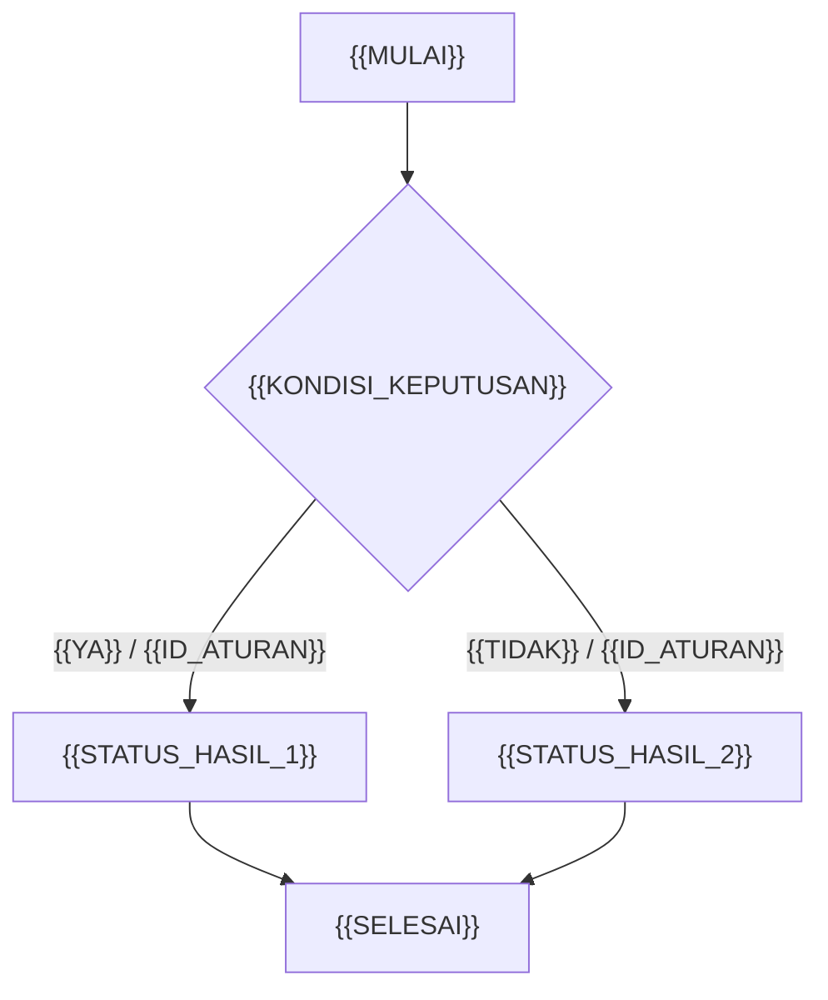
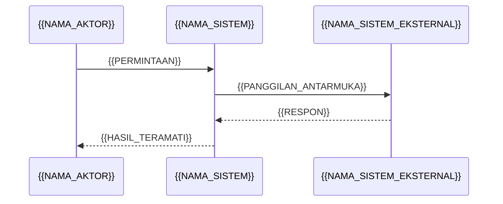

> Sumber: ISO/IEC/IEEE 29148:2018 — https://www.iso.org/standard/72089.html
> Catatan: Dipakai saat menyusun spesifikasi fungsi baru yang akan ditetapkan sebagai baseline perilaku sebelum serah terima ke desain teknis.
# {{NAMA_FITUR}} — Functional Specification / Functional Design Specification

> **Dasar normatif template ini (praktik industri, bukan satu standar tunggal):**
> ISO/IEC/IEEE 29148:2018, *Systems and software engineering — Life cycle processes — Requirements engineering* — https://www.iso.org/standard/72089.html ; catatan IEEE Xplore — https://ieeexplore.ieee.org/document/8559686 ; IEEE 830-1998 (**legacy, superseded**) — https://ieeexplore.ieee.org/document/720574 ; Cucumber, *Gherkin Reference* — https://cucumber.io/docs/gherkin/reference/ ; Cucumber, *Behaviour-Driven Development* — https://cucumber.io/docs/bdd/ ; OpenAPI Specification v3.2.0 — https://spec.openapis.org/oas/v3.2.0.html ; OMG DMN 1.6 — https://www.omg.org/spec/DMN/1.6/ ; OMG DMN 1.5 (2024) — https://www.omg.org/spec/DMN/1.5/ ; OMG BPMN 2.0.2 — https://www.omg.org/spec/BPMN/2.0.2 ; ISO/IEC 25010:2023 — https://mbs.isolutions.iso.org/standard/78176.html ; NASA SWE-047 — https://swehb.msfc.nasa.gov/pages/viewpage.action?pageId=91030146 ; IIBA, *The Business Analysis Standard* — https://www.iiba.org/globalassets/business-analysis-resources/the-business-analysis-standard/files/the-business-analysis-standard-ja.pdf ; IIBA, *Maintain Requirements & Designs* — https://www.iiba.org/contentassets/9a74fc669ad34888b351ad04e9baf122/maintain-requirements-and-designs--infographic.pdf ; arc42 *Template Overview* (pelengkap) — https://arc42.org/overview/ .
> **Batas dokumen:** BRD hanya dirujuk; desain arsitektur/UI, strategi testing, laporan harian, struktur folder/repo, dan **API versioning** berada di luar dokumen ini.

## Metadata dokumen

| Atribut | Nilai |
|---|---|
| `FSD_ID` | `{{FSD_ID}}` |
| Versi | `{{VERSI_FSD}}` |
| Status | `{{STATUS_ENUM_DRAFT_REVIEW_DISETUJUI_DITARIK}}` |
| Tanggal efektif | `{{TANGGAL_EFEKTIF}}` |
| Pemilik | `{{NAMA_BUSINESS_ANALYST}}` |
| Peninjau | `{{NAMA_REVIEWER}}` |
| Baseline BRD | `{{BRD_ID}}` rev. `{{REVISI_BRD}}` |
| Ruang lingkup rilis | `{{ID_RILIS}}` |

---

## 1. Pendahuluan

### 1.1 Tujuan
{{TUJUAN_DOKUMEN_SATU_PARAGRAF}}

### 1.2 Ruang lingkup
- **Di dalam:** {{DAFTAR_KAPABILITAS_DI_DALAM}}
- **Di luar:** {{DAFTAR_YANG_SENGAJA_TIDAK_DIBAHAS}}

### 1.3 Audiens dan cara membaca
| Audiens | Kegunaan | Section yang relevan |
|---|---|---|
| `{{PERAN_BISNIS}}` | menyetujui perilaku | §6, §8, §17 |
| `{{PERAN_PRODUK}}` | memastikan keterlacakan ke kebutuhan | §2, §15 |
| `{{PERAN_TEKNIS}}` | menerima kontrak & constraint | §9, §11, §12 |
| `{{PERAN_AUDIT}}` | memeriksa bukti keputusan | §11, §15, §16 |

### 1.4 Posisi dokumen
Dokumen ini menjembatani `{{BRD_ID}}` ke spesifikasi requirements/desain teknis. Ia **bukan** desain arsitektur, **bukan** strategi testing, dan **bukan** Product Backlog (backlog adalah daftar *emergent* menurut The Scrum Guide 2020 — https://scrumguides.org/scrum-guide.html). Standar acuan requirements adalah ISO/IEC/IEEE 29148:2018 (https://www.iso.org/standard/72089.html); IEEE 830-1998 hanya disebut sebagai pendahulu bersejarah yang sudah *superseded* (https://ieeexplore.ieee.org/document/720574).

### 1.5 Section yang dipakai / ditiadakan
| Section template | Dipakai | Alasan jika ditiadakan |
|---|---|---|
| `{{NAMA_SECTION}}` | `{{PILIHAN_YA_TIDAK}}` | `{{ALASAN}}` |

---

## 2. Referensi BRD dan dokumen acuan

| ID | Nama dokumen | Versi | Tanggal | Bagian yang dirujuk | Status |
|---|---|---|---|---|---|
| `{{BRD_ID}}` | `{{NAMA_BRD}}` | `{{REVISI_BRD}}` | `{{TANGGAL_BRD}}` | `{{ID_BAGIAN_BRD}}` | `{{STATUS_DISETUJUI_ATAU_REVIEW}}` |
| `{{DOC_ID}}` | `{{NAMA_DOKUMEN_ACUAN}}` | `{{VERSI_DOK}}` | `{{TANGGAL_DOK}}` | `{{BAGIAN}}` | `{{STATUS}}` |

> Catatan: BRD **tidak disalin ulang** di sini. Keterlacakan balik dikelola di §15, mengikuti prinsip *bidirectional traceability* NASA SWE-047 — https://swehb.msfc.nasa.gov/pages/viewpage.action?pageId=91030146 .

---

## 3. Glossary

| Istilah kanonik | Definisi | Sinonim yang DILARANG | Sumber | ID terkait |
|---|---|---|---|---|
| `{{ISTILAH}}` | `{{DEFINISI_OPERASIONAL}}` | `{{SINONIM_TERLARANG}}` | `{{SUMBER_ISTILAH}}` | `{{ID_REQUIREMENT}}` |

> Kosakata di sini dipakai identik pada §6, §8, §9, dan §12. Cucumber BDD menyebut *Formulation* membangun shared language yang dipakai hingga ke kode — https://cucumber.io/docs/bdd/ .

---

## 4. Aktor / persona

| ID | Aktor / persona | Deskripsi | Karakteristik yang memengaruhi perilaku | Hak utama |
|---|---|---|---|---|
| `{{ACTOR_ID}}` | `{{NAMA_AKTOR}}` | `{{DESKRIPSI}}` | `{{KARAKTERISTIK_PENGGUNA}}` | `{{HAK}}` |

> Karakteristik pengguna merupakan bagian dari konten SRS menurut ISO/IEC/IEEE 29148:2018 — https://www.iso.org/standard/72089.html .

---

## 5. Use case

| Atribut | Isi |
|---|---|
| `UC_ID` | `{{UC_ID}}` |
| Nama | `{{NAMA_USE_CASE}}` |
| Aktor utama | `{{ACTOR_ID}}` |
| Aktor sekunder / sistem eksternal | `{{AKTOR_SEKUNDER}}` |
| Prekondisi | `{{PREKONDISI}}` |
| Pemicu | `{{PEMICU}}` |
| Alur utama | 1. `{{LANGKAH_1}}` 2. `{{LANGKAH_2}}` 3. `{{LANGKAH_3}}` |
| Alur alternatif | `{{ID_ALUR}}`: `{{KONDISI}}` → `{{LANGKAH}}` |
| Alur pengecualian | `{{ID_ALUR}}`: `{{KONDISI}}` → `{{LANGKAH}}` |
| Postkondisi (sukses) | `{{POSTKONDISI_SUKSES}}` |
| Postkondisi (gagal) | `{{POSTKONDISI_GAGAL}}` |
| Aturan terkait | `{{ID_ATURAN}}` |
| AC terkait | `{{ID_AC}}` |

---

## 6. User story dan acceptance criteria

### 6.1 User story
| ID | Sebagai | Saya ingin | Agar | Sumber BRD | FSD ID |
|---|---|---|---|---|---|
| `{{US_ID}}` | `{{PERAN}}` | `{{KEBUTUHAN}}` | `{{NILAI}}` | `{{ID_BAGIAN_BRD}}` | `{{FSD_ID}}` |

### 6.2 Daftar acceptance criteria
| ID AC | User story | Ringkasan kriteria | File `.feature` | Aturan | Prioritas |
|---|---|---|---|---|---|
| `{{AC_ID}}` | `{{US_ID}}` | `{{KRITERIA_TERUKUR}}` | `{{PATH_FEATURE}}` | `{{ID_ATURAN}}` | `{{PRIORITAS}}` |

### 6.3 Skenario Given/When/Then
> Format mengikuti *Gherkin Reference* — https://cucumber.io/docs/gherkin/reference/ : `Given` = state awal, `When` = satu peristiwa, `Then` = keluaran **teramati** (bukan catatan database), 3–5 step per contoh, tanpa asumsi UI/teknologi. Keyword sengaja memakai varian `en` yang diverifikasi; teks step bebas bahasa domain.

```gherkin
Feature: {{NAMA_FITUR}}
  {{DESKRIPSI_SINGKAT}}
  Aturan yang berlaku: {{ID_ATURAN}}.

  Background:
    Given {{KONTEKS_BERSAMA_YANG_SINGKAT}}

  Rule: {{SATU_ATURAN_BISNIS}}

    Example: {{AC_ID_HAPPY_PATH}} — {{DESKRIPSI_HAPPY_PATH}}
      Given {{STATE_AWAL_1}}
      And {{STATE_AWAL_2}}
      When {{SATU_PERISTIWA}}
      Then {{HASIL_TERAMATI_DENGAN_KODE_KEPUTUSAN}}
      And {{HASIL_TAMBAHAN_YANG_DAPAT_DIASSERTASI}}

    Example: {{AC_ID_EDGE_CASE}} — {{DESKRIPSI_BATAS_NILAI}}
      Given {{STATE_AWAL_EDGE}}
      When {{PERISTIWA_PADA_NILAI_BATAS}}
      Then {{HASIL_PADA_BATAS}}

    Example: {{AC_ID_KEGAGALAN}} — {{DESKRIPSI_KEGAGALAN}}
      Given {{STATE_AWAL_GAGAL}}
      When {{PERISTIWA_GAGAL}}
      Then {{PENOLAKAN_DENGAN_ALASAN_DAN_KODE}}
      And {{TIDAK_ADA_KELUARAN_YANG_TIDAK_DIIZINKAN}}

  Rule: {{ATURAN_KEDUA}}

    Scenario Outline: {{AC_ID_PARAMETRIK}} — {{DESKRIPSI}}
      Given {{STATE_DENGAN_PLACEHOLDER}}
      When {{PERISTIWA_DENGAN_PLACEHOLDER}}
      Then {{HASIL_DENGAN_PLACEHOLDER}}

      Examples:
        | {{PARAM_1}} | {{PARAM_2}} | {{HASIL}} |
        | {{NILAI_1}} | {{NILAI_2}} | {{HASIL_1}} |
        | {{NILAI_3}} | {{NILAI_4}} | {{HASIL_2}} |
```

---

## 7. Alur proses (flow / sequence / state)

### 7.1 Narasi teks (wajib menyertai setiap diagram)
| ID langkah | Aktor | Pemicu | Kondisi / guard | Aksi | Keluaran | Status berikutnya | Aturan |
|---|---|---|---|---|---|---|---|
| `{{STEP_ID}}` | `{{ACTOR_ID}}` | `{{PEMICU}}` | `{{GUARD}}` | `{{AKSI}}` | `{{KELUARAN}}` | `{{STATUS_BERIKUTNYA}}` | `{{ID_ATURAN}}` |

### 7.2 Flow / process diagram


### 7.3 Sequence diagram


### 7.4 State diagram dan tabel transisi
```mermaid
stateDiagram-v2
  [*] --> {{STATUS_AWAL}}
  {{STATUS_AWAL}} --> {{STATUS_1}}: {{PEMICU_1}} / {{ID_ATURAN}}
  {{STATUS_1}} --> {{STATUS_2}}: {{PEMICU_2}} / {{ID_ATURAN}}
  {{STATUS_2}} --> [*]: {{PEMICU_SELESAI}}
```

| Status awal | Pemicu | Guard | Status akhir | Keluaran teramati | AC |
|---|---|---|---|---|---|
| `{{STATUS_AWAL}}` | `{{PEMICU}}` | `{{GUARD}}` | `{{STATUS_AKHIR}}` | `{{KELUARAN}}` | `{{AC_ID}}` |

> Notasi alur mengacu pada OMG BPMN 2.0.2 — https://www.omg.org/spec/BPMN/2.0.2 ; diagram **selalu** disertai narasi agar dapat ditautkan ke RTM, sesuai prinsip dokumentasi yang diperiksa otomatis pada Cucumber BDD — https://cucumber.io/docs/bdd/ .

---

## 8. Business rules dan decision table

### 8.1 Daftar aturan
| ID aturan | Pernyataan | Jenis | Sumber | Versi DMN | AC |
|---|---|---|---|---|---|
| `{{BR_ID}}` | `{{PERNYATAAN_ATURAN}}` | `{{JENIS_ATURAN}}` | `{{ID_BAGIAN_BRD}}` | `{{VERSI_DMN}}` | `{{AC_ID}}` |

### 8.2 Constraint
| ID | Pernyataan constraint (terukur) | Batas / nilai | Sumber | AC |
|---|---|---|---|---|
| `{{C_ID}}` | `{{PERNYATAAN}}` | `{{BATAS_ATAU_ENUMERASI}}` | `{{SUMBER}}` | `{{AC_ID}}` |

### 8.3 Decision table `{{BR_ID}}`
**Policy kecocokan (dinyatakan eksplisit):** `{{POLICY_KECOCOKAN}}`. **Baris default:** `{{ID_BARIS_DEFAULT}}`. **Versi notasi:** OMG DMN `{{VERSI_DMN}}` — https://www.omg.org/spec/DMN/1.6/ .

| Baris | `{{KONDISI_1}}` | `{{KONDISI_2}}` | `{{KONDISI_3}}` | Keputusan | Kode keputusan | AC |
|---|---|---|---|---|---|---|
| `{{R1}}` | `{{NILAI}}` | `{{NILAI}}` | `{{NILAI}}` | `{{KEPUTUSAN}}` | `{{KODE}}` | `{{AC_ID}}` |
| `{{R2}}` | `{{NILAI}}` | `{{NILAI}}` | `{{NILAI}}` | `{{KEPUTUSAN}}` | `{{KODE}}` | `{{AC_ID}}` |
| `{{R_DEFAULT}}` | `lainnya` | `lainnya` | `lainnya` | `{{KEPUTUSAN_DEFAULT}}` | `{{KODE_DEFAULT}}` | `{{AC_ID}}` |

### 8.4 Authorization matrix
| ID | Aktor / peran | Operasi | Kondisi tambahan | Diizinkan | Aturan | Deklarasi `security` pada OAD |
|---|---|---|---|---|---|---|
| `{{AUTH_ID}}` | `{{PERAN}}` | `{{OPERASI}}` | `{{KONDISI}}` | `{{PILIHAN_YA_TIDAK}}` | `{{BR_ID}}` | `{{PATH_OPERASI_OAD}}` |
| `{{AUTH_DEFAULT}}` | `siapa pun` | `selain kombinasi di atas` | `apa pun` | `TIDAK` | `{{AUTH_ID}}` | `dinyatakan eksplisit` |

> Setiap operasi memiliki deklarasi `security` yang eksplisit; OAS 3.2.0 memperbolehkan `{}` untuk menyatakan keamanan opsional secara eksplisit dan menganjurkan penulis menghindari perilaku *implementation-defined* — https://spec.openapis.org/oas/v3.2.0.html .

---

## 9. Model data dan validasi field

| Entitas | Field | Tipe | Wajib | Nullable | Rentang / format | Nilai default | Aturan validasi | Pesan | Sumber | AC |
|---|---|---|---|---|---|---|---|---|---|---|
| `{{ENTITAS}}` | `{{FIELD}}` | `{{TIPE}}` | `{{PILIHAN_YA_TIDAK}}` | `{{PILIHAN_YA_TIDAK}}` | `{{RENTANG_ATU_PATTERN}}` | `{{DEFAULT}}` | `{{C_ID}}` | `{{PESAN_VALIDASI}}` | `{{SUMBER}}` | `{{AC_ID}}` |

**Contoh payload valid (referensi ke OAD):**
```json
{
  "{{FIELD_1}}": "{{NILAI_CONTOH}}",
  "{{FIELD_2}}": "{{NILAI_CONTOH}}"
}
```

> Skema request/response otoritatif ada pada `{{PATH_OAD}}`; tabel ini hanya menjelaskan **validasi perilaku** yang harus tampak pada AC. Sumber: OpenAPI Specification v3.2.0 — https://spec.openapis.org/oas/v3.2.0.html .

---

## 10. Penanganan error dan edge case

| ID | Kode | Pemicu / edge case | Perilaku sistem | Pesan ke aktor | Status akhir | Dapat diulang | Idempoten | Aturan | AC |
|---|---|---|---|---|---|---|---|---|---|
| `{{ERR_ID}}` | `{{KODE_ERROR}}` | `{{PEMICU}}` | `{{PERILAKU}}` | `{{PESAN}}` | `{{STATUS_AKHIR}}` | `{{PILIHAN_YA_TIDAK}}` | `{{PILIHAN_YA_TIDAK}}` | `{{BR_ID}}` | `{{AC_ID}}` |

**Daftar edge case yang sengaja diuji:** `{{NILAI_BATAS_BAWAH}}`, `{{NILAI_TEPAT_BATAS}}`, `{{NILAI_BATAS_ATAS_PLUS_SATU}}`, `{{INPUT_KOSONG}}`, `{{DUPLIKASI_PERMINTAAN}}`, `{{SISTEM_EKSTERNAL_TIDAK_TERSEDIA}}`.

> Kombinasi batas nilai sebaiknya dinyatakan sebagai `Scenario Outline`/`Examples` agar satu AC mencakup banyak nilai — *Gherkin Reference* — https://cucumber.io/docs/gherkin/reference/ .

---

## 11. Non-functional requirements (SLA, performa, keamanan, audit)

| ID | Kategori (ISO/IEC 25010:2023) | Pernyataan terukur | Ambang | Lingkungan & jendela pengukuran | Cara pembuktian | Sumber BRD | AC / Test case | Pemilik |
|---|---|---|---|---|---|---|---|---|
| `{{NFR_ID}}` | `{{KARAKTERISTIK_KUALITAS}}` | `{{PERNYATAAN}}` | `{{AMBANG}}` | `{{LINGKUNGAN}}` / `{{JENDELA}}` | `{{BUKTI}}` | `{{ID_BAGIAN_BRD}}` | `{{AC_ID}}` / `{{TC_ID}}` | `{{PEMILIK}}` |

| ID | Kebutuhan audit | Field jejak minimum | Retensi | Aktor yang boleh membaca | Aturan |
|---|---|---|---|---|---|
| `{{NFR_AUDIT_ID}}` | `{{PERISTIWA_YANG_DIAUDIT}}` | `{{AKTOR}}`, `{{WAKTU}}`, `{{STATUS_LAMA}}`, `{{STATUS_BARU}}`, `{{KODE_KEPUTUSAN}}` | `{{RETENSI}}` | `{{PERAN_AUDIT}}` | `{{AUTH_ID}}` |

> Taksonomi kualitas mengacu ISO/IEC 25010:2023 — https://mbs.isolutions.iso.org/standard/78176.html ; keharusan requirement dapat diverifikasi mengacu ISO/IEC/IEEE 29148:2018 — https://ieeexplore.ieee.org/document/8559686 . Hindari kata sifat subyektif tanpa ambang.

---

## 12. Kontrak API / antarmuka

| ID kontrak | Operasi | Arah | Sistem lawan | OAD | Bagian OAD | AC | Pemilik |
|---|---|---|---|---|---|---|---|
| `{{IF_ID}}` | `{{OPERASI}}` | `{{ARAH_INBOUND_OUTBOUND}}` | `{{SISTEM_EKSTERNAL}}` | `{{PATH_OAD}}` | `{{PATH_ITEM}}` | `{{AC_ID}}` | `{{PEMILIK}}` |

**Cuplikan `{{PATH_OAD}}` (OpenAPI Specification v3.2.0 — https://spec.openapis.org/oas/v3.2.0.html):**
```yaml
openapi: 3.2.0
info:
  title: "{{NAMA_KONTRAK}}"
  version: "{{VERSI_DOKUMEN_OAD}}"
  description: |
    {{DESKRIPSI_SINGKAT}}. Keterlacakan: {{IF_ID}} -> {{FSD_ID}} -> {{ID_BAGIAN_BRD}}.
servers:
  - url: "{{BASE_URL}}"
paths:
  "{{PATH_OPERASI}}":
    post:
      operationId: "{{OPERATION_ID}}"
      summary: "{{RINGKASAN}}"
      security:
        - "{{SKEMA_KEAMANAN}}": []
      requestBody:
        required: true
        content:
          application/json:
            schema:
              $ref: "{{REF_SKEMA_REQUEST}}"
      responses:
        "200":
          description: "{{HASIL_SUKSES}}"
          content:
            application/json:
              schema:
                $ref: "{{REF_SKEMA_RESPONSE}}"
        "{{KODE_ERROR}}":
          description: "{{DESKRIPSI_ERROR}}"
components:
  schemas:
    "{{NAMA_SKEMA}}":
      type: object
      required: ["{{FIELD_WAJIB}}"]
      properties:
        "{{FIELD}}":
          type: "{{TIPE}}"
  securitySchemes:
    "{{SKEMA_KEAMANAN}}":
      type: "{{TIPE_KEAMANAN}}"
externalDocs:
  description: "FSD {{FSD_ID}} versi {{VERSI_FSD}}"
  url: "{{URL_FSD}}"
```

> **Batas eksplisit:** `info.version` di atas adalah **versi dokumen OAD**, bukan strategi versi API. Pembahasan API versioning, arsitektur, dan desain UI sengaja tidak termasuk dokumen ini. Rujukan: OAS 3.2.0 — https://spec.openapis.org/oas/v3.2.0.html .

---

## 13. Tampilan / wireframe reference

| ID referensi | Nama artefak | Versi | Lokasi | State / informasi yang harus terlihat | AC | Catatan |
|---|---|---|---|---|---|---|
| `{{WIRE_ID}}` | `{{NAMA_ARTEFAK_TAMPILAN}}` | `{{VERSI_ARTEFAK}}` | `{{TAUTAN_REFERENSI}}` | `{{STATE_YANG_TERLIHAT}}` | `{{AC_ID}}` | referensi saja, bukan desain UI |

> FSD hanya mencantumkan **referensi** dan *state yang teramati* agar `Then` tetap dapat diuji. Desain UI berada di luar ruang lingkup dokumen ini. Dasar: *Gherkin Reference* — https://cucumber.io/docs/gherkin/reference/ ; ISO/IEC/IEEE 29148:2018 — https://www.iso.org/standard/72089.html .

---

## 14. Asumsi dan dependensi

| ID | Jenis | Pernyataan | Jika tidak terpenuhi (dampak) | Pihak / sistem terkait | Status | Tanggal ditinjau |
|---|---|---|---|---|---|---|
| `{{A_ID}}` | `ASUMSI/DEPENDENSI` | `{{PERNYATAAN}}` | `{{DAMPAK}}` | `{{PIHAK}}` | `{{STATUS_ASUMSI}}` | `{{TANGGAL}}` |

> Asumsi dan dependensi termasuk konten spesifikasi requirements menurut ISO/IEC/IEEE 29148:2018 — https://www.iso.org/standard/72089.html ; keduanya wajib ditinjau ulang bila `{{PIHAK}}` berubah.

---

## 15. Matriks keterlacakan (RTM dua arah)

**Arah mundur:** `Sumber BRD`. **Arah maju:** `AC` → `Test case` → `Kontrak`. Prinsip *bidirectional traceability*: NASA SWE-047 — https://swehb.msfc.nasa.gov/pages/viewpage.action?pageId=91030146 ; analisis dampak: IIBA *The Business Analysis Standard* — https://www.iiba.org/globalassets/business-analysis-resources/the-business-analysis-standard/files/the-business-analysis-standard-ja.pdf .

| ID FSD | Pernyataan perilaku | ← Sumber BRD | Aturan / constraint | → AC | → Test case ID | → Kontrak | Status | Versi | Cakupan balik |
|---|---|---|---|---|---|---|---|---|---|
| `{{FSD_FR_ID}}` | `{{PERNYATAAN}}` | `{{ID_BAGIAN_BRD}}` | `{{BR_ID}}` / `{{C_ID}}` | `{{AC_ID}}` | `{{TC_ID}}` | `{{IF_ID}}` | `{{STATUS}}` | `{{VERSI_FSD}}` | `{{HASIL_CAKUPAN_BALIK}}` |
| `{{FSD_NFR_ID}}` | `{{PERNYATAAN}}` | `{{ID_BAGIAN_BRD}}` | `{{NFR_ID}}` | `{{AC_ID}}` | `{{TC_ID}}` | `{{IF_ID}}` | `{{STATUS}}` | `{{VERSI_FSD}}` | `{{HASIL_CAKUPAN_BALIK}}` |
| `{{FSD_ORPHAN_ID}}` | `{{PERNYATAAN}}` | `—` | `—` | `—` | `—` | `—` | `DITOLAK` | `{{VERSI_FSD}}` | `GAP: {{KETERANGAN}}` |

| Pemeriksaan | Hasil | Tindakan |
|---|---|---|
| Setiap baris FSD memiliki `Sumber BRD` | `{{PILIHAN_YA_TIDAK}}` | `{{TINDAKAN}}` |
| Setiap `ID_BAGIAN_BRD` memiliki minimal satu baris FSD | `{{PILIHAN_YA_TIDAK}}` | `{{TINDAKAN}}` |
| Setiap baris FSD memiliki minimal satu `AC` dan `TC_ID` | `{{PILIHAN_YA_TIDAK}}` | `{{TINDAKAN}}` |
| Setiap `AC` memiliki kode keputusan yang cocok dengan §8 | `{{PILIHAN_YA_TIDAK}}` | `{{TINDAKAN}}` |
| Tidak ada `FSD_ORPHAN` yang masih `DISETUJUI` | `{{PILIHAN_YA_TIDAK}}` | `{{TINDAKAN}}` |

> Kolom `Test case ID` hanya berfungsi sebagai **pengenal keterlacakan**; strategi testing tidak dibahas di sini.

---

## 16. Versioning dan perubahan requirement

### 16.1 Riwayat versi
| Versi | Tanggal | Status | Ringkasan perubahan | CR | Disetujui oleh |
|---|---|---|---|---|---|
| `{{VERSI_FSD}}` | `{{TANGGAL}}` | `{{STATUS}}` | `{{RINGKASAN}}` | `{{CR_ID}}` | `{{NAMA}}` |

### 16.2 Change request
| CR | Versi | Tanggal | Objek | Sebelum | Sesudah | Alasan | Sumber | Dampak (ID terdampak) | Disetujui oleh |
|---|---|---|---|---|---|---|---|---|---|
| `{{CR_ID}}` | `{{VERSI_LAMA}} → {{VERSI_BARU}}` | `{{TANGGAL}}` | `{{ID_OBJEK}}` | `{{NILAI_LAMA}}` | `{{NILAI_BARU}}` | `{{ALASAN}}` | `{{SUMBER_CR}}` | `{{DAFTAR_ID_TERDAMPAK}}` | `{{NAMA}}` |

### 16.3 Urutan penanganan perubahan
1. Catat CR berserta sumber dan alasan.
2. Analisis dampak lewat RTM dua arah (§15).
3. Perbarui **bersamaan**: requirement, decision table (§8), AC/`.feature` (§6), dan OAD (§12).
4. Naikkan `VERSI`, perbarui `STATUS`, isi §16.1 dan §16.2.
5. Tinjau ulang **seluruh** RTM, lalu minta sign-off ulang untuk versi baru (§17).
6. Simpan *cross-reference* ke versi sebelumnya.

> Versioning artefak dan peninjauan ulang keterlacakan setelah pemeliharaan: IIBA, *Maintain Requirements & Designs* — https://www.iiba.org/contentassets/9a74fc669ad34888b351ad04e9baf122/maintain-requirements-and-designs--infographic.pdf ; dokumentasi contoh yang diperiksa otomatis terhadap perilaku: Cucumber BDD — https://cucumber.io/docs/bdd/ .

---

## 17. Sign-off

| Peran | Nama | Versi yang disetujui | Tanggal | Tanda tangan / referensi persetujuan | Catatan |
|---|---|---|---|---|---|
| `{{PERAN_SPONSOR}}` | `{{NAMA}}` | `{{VERSI_FSD}}` | `{{TANGGAL}}` | `{{REFERENSI_PERSETUJUAN}}` | `{{CATATAN}}` |
| `{{PERAN_BISNIS}}` | `{{NAMA}}` | `{{VERSI_FSD}}` | `{{TANGGAL}}` | `{{REFERENSI_PERSETUJUAN}}` | `{{CATATAN}}` |
| `{{PERAN_PRODUK}}` | `{{NAMA}}` | `{{VERSI_FSD}}` | `{{TANGGAL}}` | `{{REFERENSI_PERSETUJUAN}}` | `{{CATATAN}}` |
| `{{PERAN_TEKNIS}}` | `{{NAMA}}` | `{{VERSI_FSD}}` | `{{TANGGAL}}` | `{{REFERENSI_PERSETUJUAN}}` | `{{CATATAN}}` |

> **Persetujuan mengikat hanya pada versi yang tercantum.** Setiap perubahan pada §16 memerlukan sign-off ulang. Praktik persetujuan requirements dan designs merujuk IIBA BABOK® Guide v3 — https://www.iiba.org/career-resources/a-business-analysis-professionals-foundation-for-success/ (**praktik industri, bukan standar ISO**).

---

## Lampiran A — Daftar sumber primer yang dipakai template ini

| Sumber | Status | URL lengkap |
|---|---|---|
| ISO/IEC/IEEE 29148:2018, *Requirements engineering* | **[SR]** standar resmi, aktif (Edisi 2, 2018-11) | https://www.iso.org/standard/72089.html |
| 29148-2018, catatan IEEE Xplore | **[SR]** standar resmi, *active - Approved* | https://ieeexplore.ieee.org/document/8559686 |
| IEEE 830-1998 | **[SR]** **legacy, superseded** oleh 29148:2011 | https://ieeexplore.ieee.org/document/720574 |
| Cucumber, *Gherkin Reference* | **[SR]** dokumentasi resmi proyek | https://cucumber.io/docs/gherkin/reference/ |
| Cucumber, *Behaviour-Driven Development* | **[SR]** dokumentasi resmi proyek | https://cucumber.io/docs/bdd/ |
| OpenAPI Specification v3.2.0 | **[SR]** spesifikasi resmi (2025) | https://spec.openapis.org/oas/v3.2.0.html |
| OMG DMN 1.6 | **[SR]** standar resmi (formal, 2026) | https://www.omg.org/spec/DMN/1.6/ |
| OMG DMN 1.5 | **[SR]** standar resmi (2024) | https://www.omg.org/spec/DMN/1.5/ |
| OMG BPMN 2.0.2 / ISO/IEC 19510:2013 | **[SR]** standar resmi | https://www.omg.org/spec/BPMN/2.0.2 |
| ISO/IEC 25010:2023 | **[SR]** standar resmi | https://mbs.isolutions.iso.org/standard/78176.html |
| IEEE 1016-2009 (pembatas: desain teknis) | **[SR]** *Inactive-Reserved* | https://ieeexplore.ieee.org/document/5167255 |
| NASA SWE-047 | **[SR]** pedoman lembaga resmi, **bukan** standar ISO | https://swehb.msfc.nasa.gov/pages/viewpage.action?pageId=91030146 |
| IIBA, *The Business Analysis Standard* | **[SR]** standar praktik IIBA | https://www.iiba.org/globalassets/business-analysis-resources/the-business-analysis-standard/files/the-business-analysis-standard-ja.pdf |
| IIBA BABOK® Guide v3 | **[SR]** standar praktik IIBA (2015) | https://www.iiba.org/career-resources/a-business-analysis-professionals-foundation-for-success/ |
| IIBA, *Maintain Requirements & Designs* | **[PI]** infografik resmi | https://www.iiba.org/contentassets/9a74fc669ad34888b351ad04e9baf122/maintain-requirements-and-designs--infographic.pdf |
| arc42, *Template Overview* | **[PI]** pelengkap struktur | https://arc42.org/overview/ |
| The Scrum Guide 2020 | **[SR]** spesifikasi framework resmi | https://scrumguides.org/scrum-guide.html |
