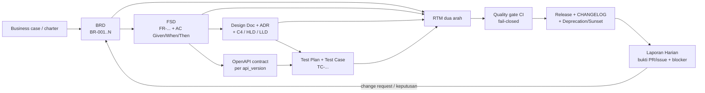

# Riset Best Practices Engineering

> BRD · FSD · Desain · Testing · Laporan Harian · Skema Folder & Project · API Versioning Zero Downtime V1/V2/V3
>
> Disusun: 2026-11-04 · Cakupan standar dan praktik: 2024–2026 · Bahasa: Indonesia
>
> Sumber utama: 6 catatan riset di `research_notes/Riset Best Practices Engineering/`. Template siap pakai: `templates/` (40 berkas).

---

## Cara membaca dokumen ini

| Penanda | Arti |
| --- | --- |
| **[Standar resmi]** | ISO/IEC/IEEE, W3C, RFC, OMG, dan badan standardisasi sejenis; klaim normatif mengikuti edisi yang disebut. |
| **[Dokumentasi resmi vendor/proyek]** | Dokumentasi first-party (GitHub, GitLab, AWS, Microsoft, Google, Kubernetes, Stripe, Pact, k6, Cucumber, dll.). Mengikat untuk produk tersebut, bukan standar universal. |
| **[Praktik industri]** | Konvensi komunitas, spesifikasi komunitas, atau opini praktisi pada situs resminya. |
| **[Rekomendasi peneliti/tim]** | Turunan/inferensi dan keputusan rancangan tim; **bukan** klaim bersumber. |

Setiap klaim normatif di bagian-bagian berikut menyertakan nama dokumen dan URL. Bila teks penuh standar berbayar atau tidak dapat diverifikasi, keterbatasannya dicatat eksplisit di bagian "Gaps" masing-masing bab dan dirangkum di Bab 8.

---

## Ringkasan eksekutif

1. **Artefak bukan sekumpulan dokumen, melainkan satu rantai keterlacakan.** BRD menyatakan kebutuhan dan *outcome* bisnis; FSD menerjemahkannya menjadi perilaku yang dapat diuji; design doc/ADR mencatat keputusan teknis; test plan membuktikan kriteria penerimaan; laporan harian melaporkan bukti kemajuan, blocker, dan keputusan. RTM dua arah menghubungkan semuanya — dari `BR-...` hingga `TC-...` dan `api_version`. **[Standar resmi]** [ISO/IEC/IEEE 29148:2018](https://www.iso.org/standard/72086.html), **[Standar resmi]** [ISO/IEC/IEEE 29119-3:2021](https://cdn.standards.iteh.ai/samples/79429/27623aa24dba41a2876884c0ec57f5d7/ISO-IEC-IEEE-29119-3-2021.pdf).
2. **Jangan mencari "template wajib" pada standar.** ISO/IEC/IEEE 29148 tidak mewajibkan akronim BRD/FSD, dan ISO/IEC/IEEE 42010:2022 secara eksplisit tidak menetapkan format, notasi, proses, maupun urutan bab *architecture description*. Struktur dokumen adalah keputusan tata kelola organisasi yang diselaraskan dengan standar, bukan salinan standar. **[Standar resmi]** [ISO/IEC/IEEE 42010:2022](https://www.iso.org/standard/74393.html).
3. **Spesifikasi yang dapat dieksekusi mengalahkan prosa panjang.** Acceptance criteria `Given/When/Then`, kontrak OpenAPI 3.1/3.2, decision table, authorization matrix, dan *consumer-driven contract* membuat FSD dapat diverifikasi otomatis di CI. **[Dokumentasi resmi vendor/proyek]** [Cucumber/Gherkin](https://cucumber.io/docs/gherkin/reference/), [OpenAPI Specification 3.2.0](https://spec.openapis.org/oas/v3.2.0.html), [Pact `can-i-deploy`](https://docs.pact.io/pact_broker/can_i_deploy).
4. **Quality gate harus fail-closed.** Required status checks, approval policy, `can-i-deploy`, dan threshold performa yang menghasilkan exit code non-zero lebih dapat dipercaya daripada "pass rate" tanpa denominator atau target 100% line coverage. **[Dokumentasi resmi vendor/proyek]** [GitHub protected branches](https://docs.github.com/en/repositories/configuring-branches-and-merges-in-your-repository/managing-protected-branches/about-protected-branches), [k6 thresholds](https://grafana.com/docs/k6/latest/using-k6/thresholds/), **[Praktik industri]** [DORA](https://dora.dev/).
5. **Laporan harian adalah alat keputusan, bukan surveilans.** Daily Scrum 15 menit adalah event internal Developers; format *yesterday/today/blockers* berasal dari praktik Atlassian, bukan Scrum Guide. Laporan tertulis untuk manajemen/klien wajib memuat bukti (PR/issue ID), blocker ber-owner, dan keputusan yang diminta — bukan persentase progres subyektif. **[Standar resmi]** [The 2020 Scrum Guide](https://scrumguides.org/scrum-guide.html), **[Praktik industri]** [Atlassian standup](https://www.atlassian.com/agile/scrum/standups), **[Dokumentasi resmi vendor/proyek]** [GitLab async communication](https://handbook.gitlab.com/handbook/company/culture/all-remote/asynchronous/).
6. **Rekomendasi utama untuk API: tanamkan major version di path** — `/api/v1`, `/api/v2`, `/api/v3` — dengan **satu OpenAPI Description dan satu SDK per major**. Jalankan migrasi tanpa downtime memakai **Expand → backfill → dual-write/read → canary/switch → Contract**, dengan feature flag, Pact, dan rollback bertahap. **[Praktik industri]** [SemVer 2.0.0](https://semver.org/spec/v2.0.0.html), [Martin Fowler — Parallel Change](https://martinfowler.com/bliki/ParallelChange.html), **[Standar resmi]** [RFC 8594](https://www.rfc-editor.org/rfc/rfc8594.html), [RFC 9745](https://www.rfc-editor.org/rfc/rfc9745.html), **[Dokumentasi resmi vendor/proyek]** [Stripe API versioning](https://docs.stripe.com/api/versioning).
7. **Koreksi fakta yang wajib dipakai tim:** **RFC 8594 = `Sunset`**, **RFC 9745 = `Deprecation`** (bukan sebaliknya); **Test Strategy adalah bagian dari Test Plan** pada ISO/IEC/IEEE 29119-3:2021 klausul 7.2.7; **WCAG 2.2 AA = seluruh kriteria A + AA**, sementara 2.3.3 *Animation from Interactions* berlevel **AAA**; IEEE 830-1998 sudah *superseded*. Detail di Bab 8. **[Standar resmi]** [W3C WCAG 2.2](https://www.w3.org/TR/WCAG22/), [ISO/IEC/IEEE 29119-3:2021](https://cdn.standards.iteh.ai/samples/79429/27623aa24dba41a2876884c0ec57f5d7/ISO-IEC-IEEE-29119-3-2021.pdf).

---

## Rekomendasi utama berprioritas

| Prioritas | Keputusan | Alasan ringkas | Artefak |
| --- | --- | --- | --- |
| P0 | Pakai `/api/vN` untuk major version; dokumentasi + SDK per major; kebijakan N-1/N-2 dengan tanggal deprecation & sunset | Paling visible, mudah di-routing/cache/di-observasi per versi, dan cocok untuk coexist V1/V2/V3 | `06-OpenAPI-Multi-Versi*.md`, `06-Routing-Gateway-Nginx.md`, `06-Header-Lifecycle-Deprecation-Sunset.md` |
| P0 | Terapkan Expand–Contract + feature flag + `can-i-deploy` untuk setiap breaking change | Satu-satunya urutan yang memisahkan perubahan skema/kontrak dari cutover | `06-Runbook-Expand-Contract.md`, `06-Checklist-Zero-Downtime.md` |
| P0 | Bangun RTM dua arah sejak BRD → FSD → AC → test case → `api_version` | Mencegah *orphan requirement* dan memastikan setiap perubahan punya bukti uji | `01-RTM.md`, `02-RTM.md`, `06-RTM.md` |
| P1 | Jadikan acceptance criteria, kontrak, dan quality gate sebagai bagian CI, bukan lampiran manual | Menggeser verifikasi ke kiri dan membuat status dapat diaudit | `02-FSD.md`, `04-Test-Plan.md`, `04-Quality-Gate-*.md` |
| P1 | Setiap keputusan arsitektur signifikan → ADR; gunakan status `Superseded` lewat record baru | Jejak keputusan tetap append-only dan dapat ditelusuri | `03-ADR.md`, `06-ADR.md` |
| P1 | Trunk-based + short-lived PR + feature flag + branch protection | Selaras dengan continuous delivery dan migrasi bertahap | `06-CODEOWNERS.md`, `06-CHANGELOG.md`, `06-Definition-of-Done.md` |
| P2 | Laporan harian asinkron berbasis bukti, dengan eskalasi blocker ber-owner | Mengurangi rapat duplikatif dan *status theater* | `05-Laporan-Harian.md` |
| P2 | Definisikan DoD lintas fase, termasuk aksesibilitas A+AA sebagai kewajiban dan reduced-motion sebagai kebijakan produk | Menghindari klaim konformasi yang keliru | `03-DoD-Aksesibilitas.md`, `06-Definition-of-Done.md` |

---

## Peta artefak end-to-end



| Fase | Artefak | ID keterlacakan | Pemilik tipikal | Gerbang keluar |
| --- | --- | --- | --- | --- |
| Bisnis | BRD + business acceptance criteria | `BR-...`, `KPI-...` | Product/Business Analyst + sponsor | Baselined & sign-off RACI |
| Fungsi | FSD, use case, decision table, Gherkin AC, OpenAPI | `FR-...`, `AC-...`, `RULE-...` | Product + Tech Lead | AC dapat diuji, RTM terisi |
| Desain | Design doc, ADR, C4, UI spec, DoD aksesibilitas | `ADR-...`, `DD-...` | Tech Lead/Architect | Design review + STRIDE + rollout/rollback |
| Uji | Test Plan, Test Case, bug/incident report, completion report | `TC-...`, `DEF-...` | QA + seluruh tim | Exit criteria + quality gate hijau |
| Rilis | CHANGELOG, release checklist, header lifecycle, OAD per versi | `api_version`, `vMAJOR.MINOR.PATCH` | Release owner | Canary sehat, metrik per versi stabil |
| Operasi | Laporan harian, metrik DORA/flow, alert per versi | `PR-...`, `ISSUE-...` | Tim + EM | Blocker ber-owner, keputusan tercatat |

**[Standar resmi]** Keterlacakan requirement: [ISO/IEC/IEEE 29148:2018](https://www.iso.org/standard/72086.html); dokumentasi pengujian: [ISO/IEC/IEEE 29119-3:2021](https://cdn.standards.iteh.ai/samples/79429/27623aa24dba41a2876884c0ec57f5d7/ISO-IEC-IEEE-29119-3-2021.pdf). **[Dokumentasi resmi vendor/proyek]** Praktik keterlacakan dua arah: [NASA SWE-047](https://swehb-pri.msfc.nasa.gov/help/SWE-047/). **[Rekomendasi peneliti/tim]** Tabel pemilik dan gerbang keluar di atas adalah rancangan tata kelola, bukan klausul standar.

---

## Indeks template siap pakai

Seluruh template berada di `templates/`, berisi placeholder `{{...}}`, dan memiliki baris `> Sumber:` serta `> Catatan:` di bagian atas. Indeks lengkap dengan kapan memakai tiap template ada di `templates/README.md`.

| Fase | Template utama | Pendukung |
| --- | --- | --- |
| 1. BRD | `01-BRD.md` | `01-RTM.md`, `01-Checklist-Review-BRD.md`, `01-Pola-Kalimat-Kebutuhan-Bisnis.md` |
| 2. FSD | `02-FSD.md` | `02-RTM.md`, `02-Checklist-Review.md` |
| 3. Desain | `03-Design-Doc.md`, `03-ADR.md`, `03-UI-UX-Spec.md` | `03-DoD-Aksesibilitas.md` |
| 4. Testing | `04-Test-Plan.md` | `04-Exit-Criteria-Matrix.md`, `04-Quality-Gate-GitHub-Actions.md`, `04-Quality-Gate-GitLab-CI.md`, `04-Quality-Gate-GitLab-Approval-Policy.md` |
| 5. Laporan Harian | `05-Laporan-Harian.md` | — |
| 6. Skema folder/project | `06-Struktur-Folder.md`, `06-Struktur-Folder-Monorepo.md`, `06-Documentation-Hub.md` | `06-CODEOWNERS.md`, `06-CHANGELOG.md`, `06-ADR.md`, `06-Definition-of-Done.md`, `06-RTM.md`, `06-RACI.md`, `06-Checklist-Release.md` |
| 7. API V1/V2/V3 | `06-OpenAPI-Multi-Versi.md`, `06-OpenAPI-Multi-Versi-V1.md`, `06-OpenAPI-Multi-Versi-V2.md`, `06-OpenAPI-Multi-Versi-V3.md` | `06-Matriks-Endpoint-Versi.md`, `06-Routing-Gateway-Nginx.md`, `06-Runbook-Expand-Contract.md`, `06-Timeline-Migrasi-V1-V2-V3.md`, `06-Header-Lifecycle-Deprecation-Sunset.md`, `06-Komunikasi-Konsumen-Deprecation.md`, `06-Kriteria-Sunset-Metrik.md`, `06-Observability-Alert-Per-Versi.md`, `06-Checklist-Zero-Downtime.md` |

**Total: 40 berkas template.**

---

## Daftar isi

1. [BRD (Business Requirements Document)](#1-brd-business-requirements-document)
2. [FSD (Functional Specification / Functional Design)](#2-fsd-functional-specification--functional-design)
3. [Desain (design doc, HLD/LLD, ADR, UI/UX, aksesibilitas)](#3-desain-design-doc-hldlld-adr-uiux-aksesibilitas)
4. [Testing / QA](#4-testing--qa)
5. [Laporan Harian](#5-laporan-harian)
6. [Lainnya — Skema folder dan skema project](#6-lainnya--skema-folder-dan-skema-project)
7. [Skema API versioning zero downtime: V1, V2, V3 di-embed pada API](#7-skema-api-versioning-zero-downtime-v1-v2-v3-di-embed-pada-api)
8. [Checklist, koreksi standar, keterbatasan, dan daftar sumber API versioning](#8-checklist-koreksi-standar-keterbatasan-dan-daftar-sumber-api-versioning)

---

## 1. BRD (Business Requirements Document)

> Template terkait: `templates/01-BRD.md`, `templates/01-RTM.md`, `templates/01-Checklist-Review-BRD.md`, `templates/01-Pola-Kalimat-Kebutuhan-Bisnis.md`.

Keempat template sudah berdiri sebagai berkas mandiri dan **tidak disalin** ke bagian ini; yang dirujuk hanya section kuncinya. `templates/01-BRD.md` memuat Metadata & status, Ringkasan eksekutif, Latar belakang dan konteks, Tujuan bisnis dan nilai, Current vs Future state, Ruang lingkup bisnis (In/Out), Stakeholder dan RACI, Kebutuhan bisnis bernomor beserta Kriteria penerimaan bisnis, KPI/OKR, Estimasi nilai/biaya/keyakinan, Asumsi/constraint/dependensi/risiko, Referensi traceability (RTM ringkas), Tata kelola/approval/sign-off, Riwayat perubahan, serta Lampiran dan daftar referensi. `templates/01-RTM.md` memuat peta jejak BRD → FSD → desain → test case; `templates/01-Checklist-Review-BRD.md` memuat checklist review; `templates/01-Pola-Kalimat-Kebutuhan-Bisnis.md` memuat pola `BR-{{NNN}}` dan contoh perbaikan kalimat. Placeholder `{{...}}` sengaja dibiarkan di dalam template, bukan diisi di sini.

**Konvensi penanda sitasi.** **[Standar resmi]** = rujukan [S] pada catatan: ISO/IEEE beserta katalog, abstract, dan daftar isi resminya. **[Praktik industri]** = rujukan [P] pada catatan (dokumentasi primer badan profesi/vendor/proyek: IIBA, PMI, Microsoft Learn, Atlassian) **ditambah** heuristik industri yang di catatan bertanda [I], yakni SMART/INVEST; keduanya bukan standar formal. **[Rekomendasi peneliti/tim]** = sintesis [I] pada catatan: tabel batas, daftar section, pola kalimat, status, versi, RTM, checklist, dan anti-pattern. Pemetaan ini dinyatakan agar setiap klaim tetap dapat diaudit ke legenda catatan tanpa menambah klaim baru.

### 1.1 Ringkasan best practices

1. **[Rekomendasi peneliti/tim]** Perlakukan "BRD" sebagai **nama artefak organisasi**, bukan *information item* wajib ISO 29148; padanan normatifnya adalah **BRS**. Dasar: [Standar resmi] [DIN: Table of contents ISO/IEC/IEEE 29148:2018 (E)](https://www.din.de/de/mitwirken/normenausschuesse/nia/veroeffentlichungen/wdc-beuth:din21:299567544/toc-3025650/download); [Praktik industri] [IIBA: BABOK Guide v3 Celebrates 1 Year Anniversary](https://production.iiba.org/professional-development/knowledge-centre/ba-connection/babok-guide-v3-celebrates-1-year-anniversary/).
2. **[Standar resmi]** Posisikan BRD/BRS di hulu, terpisah dari spesifikasi stakeholder/system: klausul 8.2 dan 9.3 memuat *BRS overview*, *Business purpose*, *Business scope* — [DIN: Table of contents ISO/IEC/IEEE 29148:2018 (E)](https://www.din.de/de/mitwirken/normenausschuesse/nia/veroeffentlichungen/wdc-beuth:din21:299567544/toc-3025650/download); [IEEE Xplore: ISO/IEC/IEEE 29148:2018](https://ieeexplore.ieee.org/document/8559686).
3. **[Praktik industri]** Tulis kebutuhan bisnis sebagai pernyataan tujuan/objektif/kebutuhan enterprise level tinggi dan **bebas elemen solusi** — [IIBA: REQUIREMENTS – INFOGRAPH](https://www.iiba.org/contentassets/38e412c7b77d456297d953de5bf5ca61/requirement-types-infograph.pdf).
4. **[Rekomendasi peneliti/tim]** Bedakan secara eksplisit business case (kelayakan/nilai), charter (otorisasi), BRD (need/outcome), PRD (kebutuhan produk), SRS/FSD (kebutuhan solusi); rujuk business case dan charter dengan ID + versi. Dasar: [Praktik industri] [PMI: What makes a project charter work](https://www.pmi.org/blog/project-charter), [PMI: And away we go](https://www.pmi.org/learning/library/concise-project-charter-team-focus-2157); [Standar resmi] [ISO: ISO 21502:2020](https://www.iso.org/standard/74947.html).
5. **[Standar resmi]** Pakai konstruk *good requirement* beserta atribut dan karakteristiknya sebagai dasar kualitas, bukan sekadar gaya bahasa — [IEEE Xplore: ISO/IEC/IEEE 29148:2018](https://ieeexplore.ieee.org/document/8559686); [ISO/IEC JTC 1/SC 7: ISO/IEC/IEEE 29148:2018](https://committee.iso.org/fr/standard/72089.html?browse=ics).
6. **[Praktik industri]** SMART dan INVEST hanya **heuristik industri**, bukan kewajiban standar; tidak ada halaman resmi ISO/IIBA/PMI dalam catatan yang menetapkannya untuk BRD — [IEEE Xplore: ISO/IEC/IEEE 29148:2018](https://ieeexplore.ieee.org/document/8559686); [IIBA: The Business Analysis Standard](http://go.iiba.org/The-Standard-Corporate).
7. **[Praktik industri]** Kejar *outcome* terukur dan nilai, bukan sekadar daftar deliverables — [IIBA: The Business Analysis Standard](http://go.iiba.org/The-Standard-Corporate); [PMI: PMBOK Guide Seventh Edition FAQs](https://www.pmi.org/-/media/pmi/documents/public/pdf/pmbok-standards/pmbok-guide-public-faqs-1-july-2021.pdf).
8. **[Praktik industri]** Kelola requirement sepanjang life cycle: Trace → Maintain → Prioritize → Assess Requirements Changes → Approve Requirements — [IIBA: Guide to Business Data Analytics](https://production.iiba.org/knowledgehub/guide-to-business-data-analytics/).
9. **[Standar resmi]** Terapkan proses requirements secara iteratif dan rekursif sepanjang life cycle; BRD sekali jadi lalu diarsipkan bertentangan dengan sifat ini — [IEEE Xplore: ISO/IEC/IEEE 29148:2018](https://ieeexplore.ieee.org/document/8559686); [ISO: ISO/IEC/IEEE 15288:2023](https://committee.iso.org/standard/81702.html?browse=ics).
10. **[Rekomendasi peneliti/tim]** Satu `BR-xxx` = satu outcome = satu metrik = satu sumber verifikasi; simpan UI, field, endpoint, teknologi, dan algoritma di artefak downstream. Dasar: [Praktik industri] [IIBA: REQUIREMENTS – INFOGRAPH](https://www.iiba.org/contentassets/38e412c7b77d456297d953de5bf5ca61/requirement-types-infograph.pdf).
11. **[Praktik industri]** Jadikan asosiasi requirement ke test case, bug, dan perubahan kode sebagai aspek fundamental traceability; alat (Azure DevOps atau Jira) mengikuti kebijakan organisasi — [Microsoft Learn: Tracking requirements](https://learn.microsoft.com/en-us/training/modules/analysis-solution-intelligent-order-management/tracking-requirements).
12. **[Rekomendasi peneliti/tim]** Status `Draft/Review/Approved/Baselined` dan nomor `v0.x/v1.0/v1.y/v2.0` adalah **rancangan praktis tim**, bukan ketentuan ISO; keduanya mengikat versi yang disetujui, approver, dan CR. Dasar: [Standar resmi] [DIN: Table of contents ISO 21502:2020 (E)](https://www.din.de/en/getting-involved/standards-committees/nqsz/publications/wdc-beuth:din21:334145134/toc-3233385/download); [Praktik industri] [IIBA: Guide to Business Data Analytics](https://production.iiba.org/knowledgehub/guide-to-business-data-analytics/).
13. **[Rekomendasi peneliti/tim]** Jangan mengklaim "ISO 29148 mewajibkan 15 section BRD" atau "SMART wajib ISO"; pisahkan penanda sitasi dan gunakan katalog/ToC resmi. Dasar: [Standar resmi] [ISO/IEC JTC 1/SC 7: ISO/IEC/IEEE 29148:2018](https://committee.iso.org/fr/standard/72089.html?browse=ics), [ISO: ISO/IEC/IEEE 15288:2023](https://committee.iso.org/standard/81702.html?browse=ics).

### 1.2 Landasan normatif dan status BRD

**BRD bukan information item wajib ISO/IEC/IEEE 29148:2018.** Standar mengenal **Business Requirements Specification (BRS)** pada 8.2 (*General*, *BRS example outline*) dan 9.3 (*BRS overview*, *Business purpose*, *Business scope*), sedangkan IIBA memakai konsep *business requirements*. Akronim "BRD" hidup sebagai nama artefak industri. Dengan demikian, setiap klaim "sesuai ISO" harus diartikan "memetakan ke BRS", bukan "ISO mewajibkan dokumen bernama BRD". **[Standar resmi]** [DIN: Table of contents ISO/IEC/IEEE 29148:2018 (E)](https://www.din.de/de/mitwirken/normenausschuesse/nia/veroeffentlichungen/wdc-beuth:din21:299567544/toc-3025650/download); [IEEE Xplore: ISO/IEC/IEEE 29148:2018](https://ieeexplore.ieee.org/document/8559686); **[Praktik industri]** [IIBA: BABOK Guide v3 Celebrates 1 Year Anniversary](https://production.iiba.org/professional-development/knowledge-centre/ba-connection/babok-guide-v3-celebrates-1-year-anniversary/); **[Rekomendasi peneliti/tim]** inferensi peneliti dengan dasar dua rujukan tersebut.

| Rujukan | Penanda | Peran untuk BRD | Batas klaim |
|---|---|---|---|
| ISO/IEC/IEEE 29148:2018, ed. 2, 30 November 2018, *active/approved* — [IEEE Xplore: ISO/IEC/IEEE 29148:2018](https://ieeexplore.ieee.org/document/8559686); [ISO/IEC JTC 1/SC 7: ISO/IEC/IEEE 29148:2018](https://committee.iso.org/fr/standard/72089.html?browse=ics) | **[Standar resmi]** | Proses, *information items*, isi/format, konstruk *good requirement*, atribut dan karakteristik | Tidak menetapkan akronim "BRD", jumlah section BRD, atau urutan sign-off universal |
| [DIN: Table of contents ISO/IEC/IEEE 29148:2018 (E)](https://www.din.de/de/mitwirken/normenausschuesse/nia/veroeffentlichungen/wdc-beuth:din21:299567544/toc-3025650/download) | **[Standar resmi]** | Bukti primer BRS 8.2/9.3: *overview, business purpose, business scope* | Hanya daftar isi publik; isi lengkap 8.2.2/9.3 tidak terverifikasi verbatim |
| ISO/IEC/IEEE 15288:2023, ed. 2, Mei 2023 — [ISO: ISO/IEC/IEEE 15288:2023](https://committee.iso.org/standard/81702.html?browse=ics) | **[Standar resmi]** | Kerangka proses *conception*→*retirement*, keterlibatan stakeholder, pertukaran informasi acquirer/supplier | Tidak menetapkan model life cycle, metodologi, teknik, maupun nama/format/content eksplisit *information item* (dirujuk ke 15289) |
| ISO 21502:2020, ed. 1, Desember 2020 — [ISO: ISO 21502:2020](https://www.iso.org/standard/74947.html); [ISO/TC 258: Published ISO 21502](https://committee.iso.org/sites/tc258/home/projects/published/iso-21502.html) | **[Standar resmi]** | *Guidance* manajemen proyek lintas predictive/incremental/iterative/adaptive/hybrid/agile; 4.3.2 *Business case*, 7.10 *Change control* | Guidelines high-level, bukan spesifikasi dokumen BRD; tidak menetapkan empat status, format versi, atau daftar signer |
| [DIN: Table of contents ISO 21502:2020 (E)](https://www.din.de/en/getting-involved/standards-committees/nqsz/publications/wdc-beuth:din21:334145134/toc-3233385/download) | **[Standar resmi]** | 7.10.2 *framework*, 7.10.3 *identifying and assessing change requests*, 7.10.4 *planning the implementation* | Daftar isi, bukan teks klausul lengkap |
| BABOK Guide v3 (2015, rilis ke-4) — [IIBA: BABOK Guide v3 Celebrates 1 Year Anniversary](https://production.iiba.org/professional-development/knowledge-centre/ba-connection/babok-guide-v3-celebrates-1-year-anniversary/) | **[Praktik industri]** | Rujukan BA IIBA; memperkenalkan lima perspektif termasuk Agile | Primer badan profesi, bukan standar formal |
| [IIBA: The Business Analysis Standard](http://go.iiba.org/The-Standard-Corporate); [IIBA: The Business Analysis Standard (Preface, PDF)](https://www.iiba.org/globalassets/business-analysis-resources/the-business-analysis-standard/files/the-business-analysis-standard.pdf) | **[Praktik industri]** | *Outcome-driven focus*, hasil terukur, nilai; BACCM: *change, need, solution, stakeholder, value, context* | Bukan daftar section BRD |
| [IIBA: Guide to Business Data Analytics](https://production.iiba.org/knowledgehub/guide-to-business-data-analytics/) | **[Praktik industri]** | 5.1 Trace, 5.2 Maintain, 5.3 Prioritize, 5.4 Assess Changes, 5.5 Approve | Daftar isi RLM, bukan template RTM universal |
| [PMI: PMBOK Guide Seventh Edition FAQs](https://www.pmi.org/-/media/pmi/documents/public/pdf/pmbok-standards/pmbok-guide-public-faqs-1-july-2021.pdf) | **[Praktik industri]** | Relevan untuk predictive/hybrid/adaptive; fokus *project outcomes* selain deliverables | FAQ, bukan standar dokumen BRD |
| [Atlassian: Business requirements document template](https://www.atlassian.com/software/confluence/resources/guides/how-to/business-requirements) | **[Praktik industri]** | BRD sebagai *essential needs and expectations* dan *common reference point*; manfaat konsistensi, kejelasan, komunikasi, pengurangan omisi/inconsistency | Template vendor; section-nya bertabrakan dengan IIBA (lihat 1.3) |

### 1.3 Batas dokumen dan konflik *solution elements*

**[Rekomendasi peneliti/tim]** Tabel berikut adalah sintesis peneliti dari pemisahan level requirement IIBA/ISO dan peran artefak PMI/ISO, bukan tabel verbatim satu standar. Dasar: [Praktik industri] [IIBA: REQUIREMENTS – INFOGRAPH](https://www.iiba.org/contentassets/38e412c7b77d456297d953de5bf5ca61/requirement-types-infograph.pdf), [PMI: What makes a project charter work](https://www.pmi.org/blog/project-charter); [Standar resmi] [DIN: Table of contents ISO/IEC/IEEE 29148:2018 (E)](https://www.din.de/de/mitwirken/normenausschuesse/nia/veroeffentlichungen/wdc-beuth:din21:299567544/toc-3025650/download), [ISO: ISO 21502:2020](https://www.iso.org/standard/74947.html).

| Artefak | Pertanyaan inti | Batas tegas | Penulis / pemilik **[Rekomendasi peneliti/tim]** | Dasar |
|---|---|---|---|---|
| **Business case** | "Mengapa investasi ini layak?" | Kelayakan, manfaat, target nilai/biaya; **bukan** daftar kebutuhan operasional; menjadi input ke charter | Sponsor/portfolio/PMO dengan dukungan BA/Finance; akuntabel: sponsor/eksekutif pemilik manfaat | [PMI: And away we go](https://www.pmi.org/learning/library/concise-project-charter-team-focus-2157); [DIN: Table of contents ISO 21502:2020 (E)](https://www.din.de/en/getting-involved/standards-committees/nqsz/publications/wdc-beuth:din21:334145134/toc-3233385/download) |
| **Project charter** | "Siapa mengotorisasi proyek dan apa kewenangannya?" | Otorisasi + pemimpin + batas kewenangan + ringkasan tujuan; **bukan** requirement detail. Bisa satu halaman, email, atau rekaman formal asalkan jelas | PM menyusun; **sponsor mengotorisasi** | [PMI: What makes a project charter work](https://www.pmi.org/blog/project-charter) |
| **BRD / BRS** | "Kebutuhan bisnis/outcome apa yang harus dipenuhi?" | Tujuan, ruang lingkup bisnis, kebutuhan bisnis, KPI, kriteria penerimaan bisnis, asumsi/constraint/risiko/dependensi; **hindari desain solusi** | BA/Product Owner bisnis menyusun (custodian); sponsor bisnis/*business owner* pemilik | [IIBA: REQUIREMENTS – INFOGRAPH](https://www.iiba.org/contentassets/38e412c7b77d456297d953de5bf5ca61/requirement-types-infograph.pdf); [DIN: Table of contents ISO/IEC/IEEE 29148:2018 (E)](https://www.din.de/de/mitwirken/normenausschuesse/nia/veroeffentlichungen/wdc-beuth:din21:299567544/toc-3025650/download) |
| **PRD** | "Produk/pengalaman pengguna apa yang dibangun?" | Kebutuhan produk, persona, user flows, prioritas; turunan dari kebutuhan bisnis. **Nama dan isi PRD tidak distandardisasi ISO/IIBA; ini praktik industri** | Product Manager/Product Owner; Head of Product/Product Owner | [Atlassian: Business requirements document template](https://www.atlassian.com/software/confluence/resources/guides/how-to/business-requirements); [IIBA: REQUIREMENTS – INFOGRAPH](https://www.iiba.org/contentassets/38e412c7b77d456297d953de5bf5ca61/requirement-types-infograph.pdf) |
| **SRS / FSD** | "Apa requirement sistem/solusi secara terverifikasi?" | *Stakeholder/system/solution requirements*, bukan lagi *business need*; **di luar cakupan bagian ini** | BA/System Analyst/Engineering; pemilik produk/sistem atau arsitek sesuai tata kelola | [DIN: Table of contents ISO/IEC/IEEE 29148:2018 (E)](https://www.din.de/de/mitwirken/normenausschuesse/nia/veroeffentlichungen/wdc-beuth:din21:299567544/toc-3025650/download); [IIBA: REQUIREMENTS – INFOGRAPH](https://www.iiba.org/contentassets/38e412c7b77d456297d953de5bf5ca61/requirement-types-infograph.pdf) |

**Aturan batas [Rekomendasi peneliti/tim].** Kalimat BRD boleh menyebut *capability/outcome*, tetapi begitu menyebut teknologi, field, screen, endpoint, algoritma, atau urutan UI, itu **solusi terselubung** dan harus dipindahkan ke artefak downstream. Dasar normatif: larangan memuat *solution elements* pada business requirements — [Praktik industri] [IIBA: REQUIREMENTS – INFOGRAPH](https://www.iiba.org/contentassets/38e412c7b77d456297d953de5bf5ca61/requirement-types-infograph.pdf).

**Konflik sumber IIBA BABOK vs template Atlassian — harus diputus eksplisit.** **[Praktik industri]** [IIBA: REQUIREMENTS – INFOGRAPH](https://www.iiba.org/contentassets/38e412c7b77d456297d953de5bf5ca61/requirement-types-infograph.pdf) menyatakan *business requirements* tidak boleh berisi *solution elements* dan menempatkan *functional* serta *non-functional/quality/service requirements* sebagai **solution requirements** yang dijembatani oleh *stakeholder requirements*. Sebaliknya, **[Praktik industri]** [Atlassian: Business requirements document template](https://www.atlassian.com/software/confluence/resources/guides/how-to/business-requirements) dan [Atlassian CDN: 中文版 BRD template](https://wac-cdn-a.atlassian.com/zh/software/confluence/resources/guides/how-to/business-requirements) menyertakan *functional/non-functional requirements* sebagai section tipikal BRD, di samping business objectives, project scope, key stakeholders, limitations/assumptions. Keduanya **berpotensi tumpang tindih** dan tidak boleh dipakai simultan tanpa keputusan batas. **[Rekomendasi peneliti/tim]** Keputusan yang dipakai di bagian ini: BRD memakai istilah **kebutuhan bisnis** dan menolak requirement solusi; template `templates/01-BRD.md` sengaja menghindari section *functional/non-functional* agar BRD tidak berubah menjadi spesifikasi solusi. Ini keputusan tata kelola peneliti, bukan kutipan standar. Dasar: [DIN: Table of contents ISO/IEC/IEEE 29148:2018 (E)](https://www.din.de/de/mitwirken/normenausschuesse/nia/veroeffentlichungen/wdc-beuth:din21:299567544/toc-3025650/download), [IIBA: REQUIREMENTS – INFOGRAPH](https://www.iiba.org/contentassets/38e412c7b77d456297d953de5bf5ca61/requirement-types-infograph.pdf), [Atlassian: Business requirements document template](https://www.atlassian.com/software/confluence/resources/guides/how-to/business-requirements), [DIN: Table of contents ISO 21502:2020 (E)](https://www.din.de/en/getting-involved/standards-committees/nqsz/publications/wdc-beuth:din21:334145134/toc-3233385/download).

### 1.4 Posisi dalam siklus hidup requirement

**[Rekomendasi peneliti/tim]** Peta posisi berikut bukan diagram standar: `Need/Change → Business case → Project charter → BRD/BRS (business purpose, scope, business requirements, KPI, acceptance) → [serah terima ke artefak downstream] → RTM → perubahan/approval ulang`. Rujukan: [Standar resmi] [DIN: Table of contents ISO 21502:2020 (E)](https://www.din.de/en/getting-involved/standards-committees/nqsz/publications/wdc-beuth:din21:334145134/toc-3233385/download), [IEEE Xplore: ISO/IEC/IEEE 29148:2018](https://ieeexplore.ieee.org/document/8559686); [Praktik industri] [PMI: What makes a project charter work](https://www.pmi.org/blog/project-charter), [IIBA: Guide to Business Data Analytics](https://production.iiba.org/knowledgehub/guide-to-business-data-analytics/).

- **[Standar resmi]** Proses requirements iteratif dan rekursif sepanjang life cycle; 15288:2023 mencakup *conception, development, production, utilization, support, retirement*, dengan proses yang dapat dipilih, diterapkan iteratif/konkuren dan rekursif, tanpa satu model life cycle yang diwajibkan — [IEEE Xplore: ISO/IEC/IEEE 29148:2018](https://ieeexplore.ieee.org/document/8559686); [ISO: ISO/IEC/IEEE 15288:2023](https://committee.iso.org/standard/81702.html?browse=ics).
- **[Praktik industri]** *Lifecycle management* tidak berhenti di approval: Trace → Maintain → Prioritize → Assess Requirements Changes → Approve Requirements — [IIBA: Guide to Business Data Analytics](https://production.iiba.org/knowledgehub/guide-to-business-data-analytics/).
- **[Praktik industri]** BACCM memusatkan *change, need, solution, stakeholder, value, context*; standar terbaru IIBA menekankan *measurable outcomes*, dan persetujuan atas *requirements and designs* diperoleh sebelum aktivitas lanjutan — [IIBA: The Business Analysis Standard (Preface, PDF)](https://www.iiba.org/globalassets/business-analysis-resources/the-business-analysis-standard/files/the-business-analysis-standard.pdf); [IIBA: The Business Analysis Standard (fr-CA PDF)](https://www.iiba.org/globalassets/business-analysis-resources/the-business-analysis-standard/files/the-business-analysis-standard-fr-ca.pdf).
- **[Standar resmi]** *Business case* (4.3.2) dan *change control* (7.10) tercantum dalam daftar isi resmi ISO 21502:2020 — [DIN: Table of contents ISO 21502:2020 (E)](https://www.din.de/en/getting-involved/standards-committees/nqsz/publications/wdc-beuth:din21:334145134/toc-3233385/download); [ISO: ISO 21502:2020](https://www.iso.org/standard/74947.html).

### 1.5 Konvensi section, ID, status, dan versi

**[Rekomendasi peneliti/tim]** Daftar section "wajib" di bawah adalah **kontrak dokumentasi organisasi**, bukan daftar wajib ISO. Yang benar-benar dapat ditunjuk dari standar hanyalah *overview/purpose/scope* BRS; sisanya melengkapi tata kelola agar BRD dapat diverifikasi, diprioritaskan, dan disetujui. Dasar: [Standar resmi] [DIN: Table of contents ISO/IEC/IEEE 29148:2018 (E)](https://www.din.de/de/mitwirken/normenausschuesse/nia/veroeffentlichungen/wdc-beuth:din21:299567544/toc-3025650/download); [Praktik industri] [IIBA: Guide to Business Data Analytics](https://production.iiba.org/knowledgehub/guide-to-business-data-analytics/), [Atlassian: Business requirements document template](https://www.atlassian.com/software/confluence/resources/guides/how-to/business-requirements).

| Section | Fungsi minimum | Dasar |
|---|---|---|
| Metadata & status | ID, versi, status `Draft/Review/Approved/Baselined`, tanggal, pemilik | **[Rekomendasi peneliti/tim]** dari [IIBA: Guide to Business Data Analytics](https://production.iiba.org/knowledgehub/guide-to-business-data-analytics/) + [DIN: Table of contents ISO 21502:2020 (E)](https://www.din.de/en/getting-involved/standards-committees/nqsz/publications/wdc-beuth:din21:334145134/toc-3233385/download) |
| Latar belakang & *need/change* | Masalah/pemicu perubahan, konteks organisasi | **[Praktik industri]** BACCM — [IIBA: The Business Analysis Standard (Preface, PDF)](https://www.iiba.org/globalassets/business-analysis-resources/the-business-analysis-standard/files/the-business-analysis-standard.pdf) |
| Tujuan bisnis & nilai | Objectives, outcome terukur, value | **[Praktik industri]** [IIBA: The Business Analysis Standard](http://go.iiba.org/The-Standard-Corporate); [PMI: PMBOK Guide Seventh Edition FAQs](https://www.pmi.org/-/media/pmi/documents/public/pdf/pmbok-standards/pmbok-guide-public-faqs-1-july-2021.pdf) |
| *Current vs future state* | Proses/metrik saat ini vs target; gap | **[Rekomendasi peneliti/tim]** didasari BACCM *need/change/value* — [IIBA: The Business Analysis Standard (Preface, PDF)](https://www.iiba.org/globalassets/business-analysis-resources/the-business-analysis-standard/files/the-business-analysis-standard.pdf) |
| Business scope (in/out) | Batas proses, unit bisnis, data/otoritas, eksklusi | **[Standar resmi]** *Business scope* BRS — [DIN: Table of contents ISO/IEC/IEEE 29148:2018 (E)](https://www.din.de/de/mitwirken/normenausschuesse/nia/veroeffentlichungen/wdc-beuth:din21:299567544/toc-3025650/download) |
| Stakeholder + RACI | Siapa consulted/informed/responsible/accountable; tepat satu `A` per keputusan utama | **[Rekomendasi peneliti/tim]** dari [PMI: What makes a project charter work](https://www.pmi.org/blog/project-charter) dan [ISO: ISO/IEC/IEEE 15288:2023](https://committee.iso.org/standard/81702.html?browse=ics) |
| Kebutuhan bisnis bernomor | `BR-001…`, atomic, terverifikasi, prioritas | **[Praktik industri]** [IIBA: REQUIREMENTS – INFOGRAPH](https://www.iiba.org/contentassets/38e412c7b77d456297d953de5bf5ca61/requirement-types-infograph.pdf); **[Standar resmi]** [IEEE Xplore: ISO/IEC/IEEE 29148:2018](https://ieeexplore.ieee.org/document/8559686) |
| Asumsi, constraint, dependensi | Kondisi yang dipercaya, batas yang mengikat, pihak/artefak eksternal | **[Praktik industri]** [Atlassian: Business requirements document template](https://www.atlassian.com/software/confluence/resources/guides/how-to/business-requirements); **[Standar resmi]** [ISO: ISO 21502:2020](https://www.iso.org/standard/74947.html) |
| Risiko bisnis | Risiko terhadap nilai/outcome, owner, mitigasi | **[Rekomendasi peneliti/tim]** dari [ISO: ISO 21502:2020](https://www.iso.org/standard/74947.html) |
| KPI/OKR & baseline/target | Metrik, baseline, target, horizon, sumber data | **[Praktik industri]** [IIBA: The Business Analysis Standard](http://go.iiba.org/The-Standard-Corporate); [PMI: PMBOK Guide Seventh Edition FAQs](https://www.pmi.org/-/media/pmi/documents/public/pdf/pmbok-standards/pmbok-guide-public-faqs-1-july-2021.pdf) |
| Kriteria penerimaan bisnis | Kondisi objektif yang dapat diverifikasi sponsor | **[Rekomendasi peneliti/tim]** dari *construct of a good requirement* — [IEEE Xplore: ISO/IEC/IEEE 29148:2018](https://ieeexplore.ieee.org/document/8559686) |
| Estimasi nilai/biaya | Manfaat, biaya, sumber estimasi, tingkat keyakinan; bukan pengganti business case | **[Praktik industri]** [PMI: And away we go](https://www.pmi.org/learning/library/concise-project-charter-team-focus-2157); **[Standar resmi]** [DIN: Table of contents ISO 21502:2020 (E)](https://www.din.de/en/getting-involved/standards-committees/nqsz/publications/wdc-beuth:din21:334145134/toc-3233385/download) |
| RTM reference | ID BRD ↔ ID artefak downstream | **[Praktik industri]** [Microsoft Learn: Tracking requirements](https://learn.microsoft.com/en-us/training/modules/analysis-solution-intelligent-order-management/tracking-requirements); [IIBA: Guide to Business Data Analytics](https://production.iiba.org/knowledgehub/guide-to-business-data-analytics/) |
| Approval/sign-off | Nama, peran, keputusan, tanggal, versi yang disetujui | **[Praktik industri]** [IIBA: Guide to Business Data Analytics](https://production.iiba.org/knowledgehub/guide-to-business-data-analytics/); **[Standar resmi]** [DIN: Table of contents ISO 21502:2020 (E)](https://www.din.de/en/getting-involved/standards-committees/nqsz/publications/wdc-beuth:din21:334145134/toc-3233385/download) |
| Riwayat perubahan | Versi, alasan, section/ID terdampak, referensi CR | **[Praktik industri]** [IIBA: Guide to Business Data Analytics](https://production.iiba.org/knowledgehub/guide-to-business-data-analytics/); **[Standar resmi]** [DIN: Table of contents ISO 21502:2020 (E)](https://www.din.de/en/getting-involved/standards-committees/nqsz/publications/wdc-beuth:din21:334145134/toc-3233385/download) |

**Konvensi ID [Rekomendasi peneliti/tim]:** `BR-{{NNN}}` (kebutuhan bisnis), `GOAL-{{NN}}`, `KPI-{{NN}}`, `AC-{{NN}}` (kriteria penerimaan bisnis), `A-{{NNN}}`/`C-{{NNN}}`/`DEP-{{NNN}}`/`R-{{NNN}}`, `SC-IN-{{NNN}}`/`SC-OUT-{{NNN}}`, `ST-{{NNN}}`, `CR-{{NNN}}`, serta `FSD-ID`/`DESIGN-ID`/`TC-ID` hanya sebagai referensi. ID tidak dipakai ulang setelah dihapus. Dasar: [Praktik industri] [IIBA: Guide to Business Data Analytics](https://production.iiba.org/knowledgehub/guide-to-business-data-analytics/), [Microsoft Learn: Tracking requirements](https://learn.microsoft.com/en-us/training/modules/analysis-solution-intelligent-order-management/tracking-requirements).

**Status dokumen [Rekomendasi peneliti/tim] — rancangan praktis, bukan ketentuan ISO.** Dasar: [Praktik industri] [IIBA: Guide to Business Data Analytics](https://production.iiba.org/knowledgehub/guide-to-business-data-analytics/), [IIBA: The Business Analysis Standard (fr-CA PDF)](https://www.iiba.org/globalassets/business-analysis-resources/the-business-analysis-standard/files/the-business-analysis-standard-fr-ca.pdf); [Standar resmi] [DIN: Table of contents ISO 21502:2020 (E)](https://www.din.de/en/getting-involved/standards-committees/nqsz/publications/wdc-beuth:din21:334145134/toc-3233385/download), [ISO/IEC JTC 1/SC 7: ISO/IEC/IEEE 29148:2018](https://committee.iso.org/fr/standard/72089.html?browse=ics); [Praktik industri] [PMI: What makes a project charter work](https://www.pmi.org/blog/project-charter).

| Status | Makna | Penanggung jawab | Keluar menuju |
|---|---|---|---|
| `Draft` | BA menyusun; ID requirement boleh berubah; belum ada komitmen | Business Analyst | `Review` |
| `Review` | Stakeholder, SME, Finance/Risk/Legal/Compliance memeriksa; komentar dan dampak dicatat | BA memfasilitasi; reviewer sesuai RACI | `Approved` atau kembali `Draft` |
| `Approved` | Versi `vX.Y` disetujui; requirement siap ditelusuri ke artefak downstream | Sponsor bisnis / business owner + approver wajib | `Baselined` |
| `Baselined` | Pasangan **BRD vX.Y + RTM vX.Y** dibekukan sebagai acuan perubahan | PMO/Configuration owner mencatat; business owner tetap akuntabel | Perubahan hanya lewat `CR-{{NNN}}` |

**Versioning [Rekomendasi peneliti/tim]:** `v0.x` = Draft/Review; `v1.0` = Approved baseline pertama; `v1.y` = perubahan minor setelah CR; `v2.0` = perubahan scope/tujuan/KPI material. Nomor ini konvensi peneliti, bukan aturan ISO — [Standar resmi] [ISO/IEC JTC 1/SC 7: ISO/IEC/IEEE 29148:2018](https://committee.iso.org/fr/standard/72089.html?browse=ics). **Jangan menimpa baseline**: simpan `Approved vX.Y` sebagai referensi agar riwayat keputusan dapat diaudit — [Praktik industri] [IIBA: Guide to Business Data Analytics](https://production.iiba.org/knowledgehub/guide-to-business-data-analytics/); [Standar resmi] [DIN: Table of contents ISO 21502:2020 (E)](https://www.din.de/en/getting-involved/standards-committees/nqsz/publications/wdc-beuth:din21:334145134/toc-3233385/download).

### 1.6 Kualitas kebutuhan bisnis dan SMART/INVEST

**[Standar resmi]** ISO/IEC/IEEE 29148:2018 mendefinisikan *construct of a good requirement* serta atribut dan karakteristik requirement — [IEEE Xplore: ISO/IEC/IEEE 29148:2018](https://ieeexplore.ieee.org/document/8559686); [ISO/IEC JTC 1/SC 7: ISO/IEC/IEEE 29148:2018](https://committee.iso.org/fr/standard/72089.html?browse=ics). **[Praktik industri]** Business requirements adalah pernyataan *higher-level goals/objectives/needs* enterprise dan harus diwaspadai agar tidak berisi *solution elements* — [IIBA: REQUIREMENTS – INFOGRAPH](https://www.iiba.org/contentassets/38e412c7b77d456297d953de5bf5ca61/requirement-types-infograph.pdf). Atribut prioritas/status/versi perlu ada sejak awal karena *Maintain, Prioritize, Assess Changes, Approve* melekat pada requirement — [IIBA: Guide to Business Data Analytics](https://production.iiba.org/knowledgehub/guide-to-business-data-analytics/).

**Pola kalimat [Rekomendasi peneliti/tim]** (bukan kutipan standar; section kunci ada di `templates/01-Pola-Kalimat-Kebutuhan-Bisnis.md`):

> `BR-{{NNN}} — {{Unit bisnis/aktor organisasi}} harus dapat {{outcome/capability bisnis}} untuk {{proses/konteks}} sehingga {{nilai/KPI}} berubah dari {{baseline}} menjadi {{target}} paling lambat {{tanggal/periode}}; diverifikasi melalui {{sumber data/keputusan bisnis}}; prioritas {{MoSCoW/urutan}}; status {{Draft|Review|Approved|Baselined}}; sumber {{stakeholder/dokumen}}; terkait {{KPI-ID}} / {{AC-ID}}.`

Dasar: [Standar resmi] [IEEE Xplore: ISO/IEC/IEEE 29148:2018](https://ieeexplore.ieee.org/document/8559686); [Praktik industri] [IIBA: REQUIREMENTS – INFOGRAPH](https://www.iiba.org/contentassets/38e412c7b77d456297d953de5bf5ca61/requirement-types-infograph.pdf), [IIBA: The Business Analysis Standard](http://go.iiba.org/The-Standard-Corporate), [PMI: PMBOK Guide Seventh Edition FAQs](https://www.pmi.org/-/media/pmi/documents/public/pdf/pmbok-standards/pmbok-guide-public-faqs-1-july-2021.pdf), [IIBA: Guide to Business Data Analytics](https://production.iiba.org/knowledgehub/guide-to-business-data-analytics/).

| Heuristik | Penanda | Pemakaian | Batas klaim |
|---|---|---|---|
| **SMART** — *Specific, Measurable, Achievable, Relevant, Time-bound* untuk tujuan/metrik | **[Praktik industri]** | Checklist tambahan untuk tujuan dan KPI | Bukan kewajiban BRD; tidak ada halaman resmi ISO/IIBA/PMI dalam catatan yang menetapkannya — [IEEE Xplore: ISO/IEC/IEEE 29148:2018](https://ieeexplore.ieee.org/document/8559686); [IIBA: The Business Analysis Standard](http://go.iiba.org/The-Standard-Corporate) |
| **INVEST** — *Independent, Negotiable, Valuable, Estimable, Small, Testable* untuk unit kerja/requirement | **[Praktik industri]** | Checklist tambahan untuk ke-atomic-an dan keterujian `BR-xxx` | **Heuristik industri, bukan kewajiban standar**; selaras dengan konstruk *good requirement* ISO 29148 — [IEEE Xplore: ISO/IEC/IEEE 29148:2018](https://ieeexplore.ieee.org/document/8559686) |

**Contoh perbaikan [Rekomendasi peneliti/tim]** — ringkasan dari `templates/01-Pola-Kalimat-Kebutuhan-Bisnis.md`:

| Buruk | Mengapa buruk | Perbaikan |
|---|---|---|
| "Sistem harus cepat dan user-friendly." | Ambiguous, tidak terukur, memaksa "sistem" dan kualitas solusi masuk ke BRD | `BR-014` — Unit Layanan Pelanggan menyelesaikan verifikasi data pelanggan dalam ≤ `{{X}}` menit per kasus untuk `{{periode}}`, diukur dari `{{sumber data}}`, target `{{Y}}%`, diverifikasi lewat laporan KPI `{{KPI-ID}}` |
| "Buat dashboard real-time dengan filter tanggal." | Solusi terselubung (dashboard/filter = desain), bukan kebutuhan bisnis | `BR-015` — Manajer Operasional memperoleh status `{{objek bisnis}}` dengan keterkinian ≤ `{{X}}` menit agar keputusan `{{keputusan}}` dapat diambil pada `{{siklus}}`; kriteria `{{AC-ID}}` |
| "Semua proses harus otomatis, efisien, dan sesuai best practice." | Kata universal, tidak atomic, tidak dapat diverifikasi | Pecah menjadi `BR-016`, `BR-017`, `BR-018`; masing-masing satu proses + satu metrik + satu sumber verifikasi |
| "Jika memungkinkan, tingkatkan kepuasan pelanggan." | "Jika memungkinkan" memberi jalan keluar; tanpa baseline/target/horizon | `BR-019` — `{{Unit}}` menaikkan `{{metrik kepuasan}}` dari `{{baseline}}` ke `{{target}}` pada `{{periode}}`, diukur `{{instrumen/sumber}}`; asumsi `{{A-ID}}` |

**Checklist kualitas per requirement [Rekomendasi peneliti/tim]:** satu ID; satu subjek organisasi; satu outcome; tanpa kata "dll/cepat/mudah/optimal/sebagaimana mestinya"; ada baseline/target/unit/waktu; ada sumber verifikasi; ada prioritas, status, sumber, dan owner; tidak menyebut UI/teknologi/API/field; dapat ditelusuri ke tujuan dan kriteria penerimaan bisnis. Dasar: [Standar resmi] [IEEE Xplore: ISO/IEC/IEEE 29148:2018](https://ieeexplore.ieee.org/document/8559686); [Praktik industri] [IIBA: REQUIREMENTS – INFOGRAPH](https://www.iiba.org/contentassets/38e412c7b77d456297d953de5bf5ca61/requirement-types-infograph.pdf), [IIBA: Guide to Business Data Analytics](https://production.iiba.org/knowledgehub/guide-to-business-data-analytics/), [Microsoft Learn: Tracking requirements](https://learn.microsoft.com/en-us/training/modules/analysis-solution-intelligent-order-management/tracking-requirements).

### 1.7 RTM, change control, dan approval

**[Praktik industri]** RTM bukan dokumen testing dan bukan desain; *Trace Requirements* adalah tugas eksplisit RLM, dan asosiasi requirement ke test case, bug, serta perubahan kode disebut *fundamental aspect of requirements traceability* — [IIBA: Guide to Business Data Analytics](https://production.iiba.org/knowledgehub/guide-to-business-data-analytics/); [Microsoft Learn: Tracking requirements](https://learn.microsoft.com/en-us/training/modules/analysis-solution-intelligent-order-management/tracking-requirements). **[Standar resmi]** ISO/IEC/IEEE 29148:2018 menetapkan *required information items* dan *required contents*, sedangkan 15288:2023 tidak menetapkan nama/format/content eksplisit *information item* — [ISO/IEC JTC 1/SC 7: ISO/IEC/IEEE 29148:2018](https://committee.iso.org/fr/standard/72089.html?browse=ics); [ISO: ISO/IEC/IEEE 15288:2023](https://committee.iso.org/standard/81702.html?browse=ics).

**Konvensi tabel RTM [Rekomendasi peneliti/tim]** — hanya *identifier* downstream yang dicantumkan; isi FSD, desain, dan test case sengaja tidak dibahas sesuai batas topik. Detail ada di `templates/01-RTM.md`. Dasar: [Praktik industri] [IIBA: Guide to Business Data Analytics](https://production.iiba.org/knowledgehub/guide-to-business-data-analytics/), [Microsoft Learn: Tracking requirements](https://learn.microsoft.com/en-us/training/modules/analysis-solution-intelligent-order-management/tracking-requirements); [Standar resmi] [ISO/IEC JTC 1/SC 7: ISO/IEC/IEEE 29148:2018](https://committee.iso.org/fr/standard/72089.html?browse=ics).

| BRD ID | Kebutuhan bisnis (ringkas) | Tujuan / KPI | AC | FSD ref | Desain ref | Test case ref | Status | Baseline | Pemilik | Catatan perubahan |
|---|---|---|---|---|---|---|---|---|---|---|
| `BR-001` | `{{outcome bisnis 1}}` | `GOAL-{{NN}}` / `KPI-{{NN}}` | `AC-{{NN}}` | `{{FSD-ID}}` | `{{DESIGN-ID}}` | `{{TC-ID}}` | `Approved` | `v1.0` | `{{business owner}}` | `{{CR-001 atau —}}` |
| `BR-002` | `{{outcome bisnis 2}}` | `GOAL-{{NN}}` / `KPI-{{NN}}` | `AC-{{NN}}` | `{{FSD-ID}}` | `{{DESIGN-ID}}` | `{{TC-ID}}` | `Draft` | `—` | `{{business owner}}` | `{{alasan belum ada turunan}}` |
| `BR-003` | `{{outcome bisnis 3}}` | `GOAL-{{NN}}` / `KPI-{{NN}}` | `AC-{{NN}}` | `{{FSD-ID}}` | `{{DESIGN-ID}}` | `{{TC-ID}}` | `Baselined` | `v1.2` | `{{business owner}}` | `{{CR-002}}` |

**Aturan RTM [Rekomendasi peneliti/tim]:**

1. **Satu baris per BR ID**, bukan satu baris per paragraf; ID tidak dipakai ulang setelah dihapus — [Praktik industri] [IIBA: Guide to Business Data Analytics](https://production.iiba.org/knowledgehub/guide-to-business-data-analytics/).
2. **Arah jejak dua arah**: dari BR ke turunan, dan dari turunan kembali ke BR/KPI/AC — [Praktik industri] [Microsoft Learn: Tracking requirements](https://learn.microsoft.com/en-us/training/modules/analysis-solution-intelligent-order-management/tracking-requirements).
3. **Kolom ref downstream hanya ID + versi**; konten FSD/desain/test case berada di dokumen pemiliknya masing-masing — [Standar resmi] [ISO: ISO/IEC/IEEE 15288:2023](https://committee.iso.org/standard/81702.html?browse=ics).
4. **Baris tanpa turunan harus punya status/alasan** agar bukan *silent orphan*; baris turunan tanpa BR ditolak atau diminta CR — [Praktik industri] [IIBA: Guide to Business Data Analytics](https://production.iiba.org/knowledgehub/guide-to-business-data-analytics/), [Atlassian: Business requirements document template](https://www.atlassian.com/software/confluence/resources/guides/how-to/business-requirements).
5. RTM diperbarui pada **setiap perubahan yang disetujui**, lalu versi BRD dan baseline RTM direferensikan bersama pada sign-off — [Praktik industri] [IIBA: Guide to Business Data Analytics](https://production.iiba.org/knowledgehub/guide-to-business-data-analytics/); [Standar resmi] [DIN: Table of contents ISO 21502:2020 (E)](https://www.din.de/en/getting-involved/standards-committees/nqsz/publications/wdc-beuth:din21:334145134/toc-3233385/download).

**Aturan sign-off [Rekomendasi peneliti/tim]** (urutan workflow bukan kewajiban standar). Yang menandatangani **bukan sekadar "tim IT"**: minimal Sponsor/Business owner (akuntabel nilai & scope), Finance/Value owner (estimasi nilai/biaya), Risk/Compliance owner bila ada dampak regulasi, dan BA sebagai penyusun/custodian; PM/PMO mencatat baseline dan CR. Dasar: [Praktik industri] [PMI: What makes a project charter work](https://www.pmi.org/blog/project-charter), [PMI: And away we go](https://www.pmi.org/learning/library/concise-project-charter-team-focus-2157), [IIBA: The Business Analysis Standard (fr-CA PDF)](https://www.iiba.org/globalassets/business-analysis-resources/the-business-analysis-standard/files/the-business-analysis-standard-fr-ca.pdf).

**Isi minimum setiap CR [Rekomendasi peneliti/tim]:** ID, peminta, alasan bisnis, requirement/section terdampak, dampak KPI/nilai/biaya/risiko/dependensi/RTM, keputusan, approver, tanggal, versi baru. Dasar: [Standar resmi] [DIN: Table of contents ISO 21502:2020 (E)](https://www.din.de/en/getting-involved/standards-committees/nqsz/publications/wdc-beuth:din21:334145134/toc-3233385/download) (7.10.3–7.10.4); [Praktik industri] [IIBA: Guide to Business Data Analytics](https://production.iiba.org/knowledgehub/guide-to-business-data-analytics/) (5.4). **[Praktik industri]** Azure DevOps direkomendasikan dan Jira disebut alternatif **sesuai kebijakan organisasi**; alat bukan penentu tata kelola — [Microsoft Learn: Tracking requirements](https://learn.microsoft.com/en-us/training/modules/analysis-solution-intelligent-order-management/tracking-requirements). **[Praktik industri]** BRD berfungsi sebagai *common reference point* yang dikonsultasikan dan diperbarui bersama — [Atlassian: Business requirements document template](https://www.atlassian.com/software/confluence/resources/guides/how-to/business-requirements).

### 1.8 Checklist review

> **[Rekomendasi peneliti/tim]** Checklist disusun peneliti dari konstruk *good requirement* ISO 29148, larangan solusi terselubung IIBA, tugas RLM IIBA, dan kerangka *change control* ISO 21502; **bukan checklist sertifikasi resmi**. Salinan siap pakai ada di `templates/01-Checklist-Review-BRD.md`. Dasar: [Standar resmi] [IEEE Xplore: ISO/IEC/IEEE 29148:2018](https://ieeexplore.ieee.org/document/8559686), [DIN: Table of contents ISO 21502:2020 (E)](https://www.din.de/en/getting-involved/standards-committees/nqsz/publications/wdc-beuth:din21:334145134/toc-3233385/download); [Praktik industri] [IIBA: REQUIREMENTS – INFOGRAPH](https://www.iiba.org/contentassets/38e412c7b77d456297d953de5bf5ca61/requirement-types-infograph.pdf), [IIBA: Guide to Business Data Analytics](https://production.iiba.org/knowledgehub/guide-to-business-data-analytics/).

- [ ] **Definisi & batas:** BRD menjawab *need/outcome*, bukan menggantikan business case atau charter; keduanya dirujuk dengan ID+versi — [Praktik industri] [PMI: What makes a project charter work](https://www.pmi.org/blog/project-charter); [Standar resmi] [ISO: ISO 21502:2020](https://www.iso.org/standard/74947.html).
- [ ] **Tidak ada solusi terselubung:** tidak ada UI, field, endpoint, teknologi, algoritma, atau nama fitur pada `BR-xxx` — [Praktik industri] [IIBA: REQUIREMENTS – INFOGRAPH](https://www.iiba.org/contentassets/38e412c7b77d456297d953de5bf5ca61/requirement-types-infograph.pdf).
- [ ] **Konflik template diputus:** section *functional/non-functional* ala Atlassian tidak dipindahkan ke BRD tanpa keputusan batas — [Praktik industri] [Atlassian: Business requirements document template](https://www.atlassian.com/software/confluence/resources/guides/how-to/business-requirements) vs [IIBA: REQUIREMENTS – INFOGRAPH](https://www.iiba.org/contentassets/38e412c7b77d456297d953de5bf5ca61/requirement-types-infograph.pdf).
- [ ] **Section inti lengkap:** overview/purpose/scope, tujuan, current–future, in/out, stakeholder+RACI, BR, asumsi/constraint/dependensi/risiko, KPI/OKR, AC, nilai/biaya, RTM, approval, change log — [Standar resmi] [DIN: Table of contents ISO/IEC/IEEE 29148:2018 (E)](https://www.din.de/de/mitwirken/normenausschuesse/nia/veroeffentlichungen/wdc-beuth:din21:299567544/toc-3025650/download); [Praktik industri] [Atlassian: Business requirements document template](https://www.atlassian.com/software/confluence/resources/guides/how-to/business-requirements).
- [ ] **Atomic:** satu ID = satu outcome = satu pemilik; tidak ada "dan/atau" yang menggabungkan dua kebutuhan — [Standar resmi] [IEEE Xplore: ISO/IEC/IEEE 29148:2018](https://ieeexplore.ieee.org/document/8559686).
- [ ] **Terukur & terverifikasi:** setiap BR punya baseline/target/unit/periode, sumber kebenaran, dan `AC-ID`; tanpa "cepat/mudah/optimal/dll/sebagaimana mestinya" — [Standar resmi] [IEEE Xplore: ISO/IEC/IEEE 29148:2018](https://ieeexplore.ieee.org/document/8559686); [Praktik industri] [IIBA: The Business Analysis Standard](http://go.iiba.org/The-Standard-Corporate).
- [ ] **SMART/INVEST dipakai sebagai heuristik** dan ditandai bukan kewajiban standar — [Standar resmi] [IEEE Xplore: ISO/IEC/IEEE 29148:2018](https://ieeexplore.ieee.org/document/8559686).
- [ ] **Status dan versi bukan klaim ISO:** `Draft/Review/Approved/Baselined` serta `v0.x/v1.0` dicatat sebagai konvensi tim — [Standar resmi] [ISO: ISO 21502:2020](https://www.iso.org/standard/74947.html); [Praktik industri] [IIBA: Guide to Business Data Analytics](https://production.iiba.org/knowledgehub/guide-to-business-data-analytics/).
- [ ] **KPI jelas definisinya:** rumus/denominator/exclusion, baseline, target, horizon, sumber data, owner — [Praktik industri] [IIBA: The Business Analysis Standard](http://go.iiba.org/The-Standard-Corporate), [PMI: PMBOK Guide Seventh Edition FAQs](https://www.pmi.org/-/media/pmi/documents/public/pdf/pmbok-standards/pmbok-guide-public-faqs-1-july-2021.pdf).
- [ ] **RACI valid:** tepat satu `A` untuk keputusan utama; reviewer risiko/finance/compliance hadir bila relevan — [Praktik industri] [PMI: What makes a project charter work](https://www.pmi.org/blog/project-charter); [Standar resmi] [ISO: ISO/IEC/IEEE 15288:2023](https://committee.iso.org/standard/81702.html?browse=ics).
- [ ] **Asumsi punya owner validasi**; constraint punya sumber normatif; dependensi punya tanggal dibutuhkan; risiko punya owner dan mitigasi — [Standar resmi] [ISO: ISO 21502:2020](https://www.iso.org/standard/74947.html).
- [ ] **Estimasi tidak menggantikan business case**, dan perbedaan angka sejak business case dijelaskan — [Praktik industri] [PMI: And away we go](https://www.pmi.org/learning/library/concise-project-charter-team-focus-2157); [Standar resmi] [DIN: Table of contents ISO 21502:2020 (E)](https://www.din.de/en/getting-involved/standards-committees/nqsz/publications/wdc-beuth:din21:334145134/toc-3233385/download).
- [ ] **RTM dua arah:** setiap `BR` memiliki `GOAL/KPI/AC` dan ID downstream; setiap turunan dapat kembali ke `BR`; orphan diberi status/alasan — [Praktik industri] [IIBA: Guide to Business Data Analytics](https://production.iiba.org/knowledgehub/guide-to-business-data-analytics/), [Microsoft Learn: Tracking requirements](https://learn.microsoft.com/en-us/training/modules/analysis-solution-intelligent-order-management/tracking-requirements).
- [ ] **Approval mengikat versi:** tabel sign-off menyebut `vX.Y`, keputusan, tanggal, dan approver; baseline BRD dan RTM memiliki versi yang sama — [Praktik industri] [IIBA: Guide to Business Data Analytics](https://production.iiba.org/knowledgehub/guide-to-business-data-analytics/); [Standar resmi] [DIN: Table of contents ISO 21502:2020 (E)](https://www.din.de/en/getting-involved/standards-committees/nqsz/publications/wdc-beuth:din21:334145134/toc-3233385/download).
- [ ] **Perubahan lewat CR:** dampak terhadap KPI/nilai/biaya/risiko/RTM dinilai sebelum approve; baseline lama tidak ditimpa — [Standar resmi] [DIN: Table of contents ISO 21502:2020 (E)](https://www.din.de/en/getting-involved/standards-committees/nqsz/publications/wdc-beuth:din21:334145134/toc-3233385/download); [Praktik industri] [IIBA: Guide to Business Data Analytics](https://production.iiba.org/knowledgehub/guide-to-business-data-analytics/).
- [ ] **Sumber primer dikutip:** klaim normatif memuat nama dokumen + URL; standar, praktik, dan rekomendasi peneliti dibedakan penandanya — [Standar resmi] [IEEE Xplore: ISO/IEC/IEEE 29148:2018](https://ieeexplore.ieee.org/document/8559686), [ISO/IEC JTC 1/SC 7: ISO/IEC/IEEE 29148:2018](https://committee.iso.org/fr/standard/72089.html?browse=ics).

### 1.9 Anti-pattern

> **[Rekomendasi peneliti/tim]** Daftar ini adalah sintesis peneliti tentang kegagalan yang *diturunkan* dari batas dan kewajiban pada sumber primer, bukan kutipan verbatim satu dokumen. Dasar untuk setiap baris disertakan.

| Anti-pattern | Mengapa merugikan / gejala | Perbaikan | Dasar |
|---|---|---|---|
| BRD dijadikan PRD/SRS: memuat screen, field, endpoint, atau teknologi | Mengunci solusi sebelum kebutuhan bisnis disepakati; gejala: "klik", "tampilkan kolom", "pakai `{{vendor}}`" di `BR-xxx` | Pindahkan ke artefak downstream; simpan hanya outcome+metrik | [Praktik industri] [IIBA: REQUIREMENTS – INFOGRAPH](https://www.iiba.org/contentassets/38e412c7b77d456297d953de5bf5ca61/requirement-types-infograph.pdf); [Standar resmi] [DIN: Table of contents ISO/IEC/IEEE 29148:2018 (E)](https://www.din.de/de/mitwirken/normenausschuesse/nia/veroeffentlichungen/wdc-beuth:din21:299567544/toc-3025650/download) |
| BRD menggantikan business case atau charter | Kelayakan investasi/otorisasi tidak jelas; gejala: tidak ada `BC-ID`/`CHARTER-ID`, target finansial hanya di BRD | Rujuk business case & charter; BRD fokus need/scope/outcome | [Praktik industri] [PMI: And away we go](https://www.pmi.org/learning/library/concise-project-charter-team-focus-2157), [PMI: What makes a project charter work](https://www.pmi.org/blog/project-charter); [Standar resmi] [DIN: Table of contents ISO 21502:2020 (E)](https://www.din.de/en/getting-involved/standards-committees/nqsz/publications/wdc-beuth:din21:334145134/toc-3233385/download) |
| Mengklaim "BRD adalah *information item* wajib ISO 29148" | *Overclaim* standar; audit kepatuhan salah sasaran | Nyatakan BRD memetakan ke **BRS**, bukan diwajibkan ISO | [Standar resmi] [DIN: Table of contents ISO/IEC/IEEE 29148:2018 (E)](https://www.din.de/de/mitwirken/normenausschuesse/nia/veroeffentlichungen/wdc-beuth:din21:299567544/toc-3025650/download); [ISO/IEC JTC 1/SC 7: ISO/IEC/IEEE 29148:2018](https://committee.iso.org/fr/standard/72089.html?browse=ics) |
| Requirement kabur: "cepat, mudah, user-friendly, optimal, dll." | Tidak dapat diverifikasi; acceptance jadi negosiasi di akhir | Tulis baseline→target+periode+sumber kebenaran | [Standar resmi] [IEEE Xplore: ISO/IEC/IEEE 29148:2018](https://ieeexplore.ieee.org/document/8559686); [Praktik industri] [IIBA: The Business Analysis Standard](http://go.iiba.org/The-Standard-Corporate) |
| Satu paragraf berisi banyak kebutuhan ("dan", "serta", "termasuk") | Tidak atomic; sulit diprioritaskan dan dinilai dampaknya; gejala: satu `BR` punya >1 KPI atau >1 owner | Pecah menjadi beberapa `BR-xxx`, satu outcome per ID | [Standar resmi] [IEEE Xplore: ISO/IEC/IEEE 29148:2018](https://ieeexplore.ieee.org/document/8559686); [Praktik industri] [IIBA: Guide to Business Data Analytics](https://production.iiba.org/knowledgehub/guide-to-business-data-analytics/) |
| KPI/OKR tanpa baseline, definisi, atau owner | "Sukses" tidak dapat dibuktikan; manfaat tidak bisa direalisasi | Lengkapi definisi operasional, baseline, horizon, owner | [Praktik industri] [IIBA: The Business Analysis Standard](http://go.iiba.org/The-Standard-Corporate), [PMI: PMBOK Guide Seventh Edition FAQs](https://www.pmi.org/-/media/pmi/documents/public/pdf/pmbok-standards/pmbok-guide-public-faqs-1-july-2021.pdf) |
| Scope hanya daftar "in", tanpa "out" dan kewenangan keputusan | Scope creep; eksklusi diperdebatkan saat delivery; gejala: `SC-OUT` kosong | Isi in/out + batas kewenangan + owner eksklusi | [Standar resmi] [DIN: Table of contents ISO/IEC/IEEE 29148:2018 (E)](https://www.din.de/de/mitwirken/normenausschuesse/nia/veroeffentlichungen/wdc-beuth:din21:299567544/toc-3025650/download), [DIN: Table of contents ISO 21502:2020 (E)](https://www.din.de/en/getting-involved/standards-committees/nqsz/publications/wdc-beuth:din21:334145134/toc-3233385/download) |
| Asumsi tak bertuan dan constraint tanpa sumber | Keputusan bisnis rapuh; pelanggaran regulasi ketahuan belakangan | Tambahkan owner, tanggal validasi, sumber normatif | [Praktik industri] [Atlassian: Business requirements document template](https://www.atlassian.com/software/confluence/resources/guides/how-to/business-requirements); [Standar resmi] [ISO: ISO 21502:2020](https://www.iso.org/standard/74947.html) |
| Risiko dan dependensi sekadar daftar, tanpa kaitan ke KPI/AC | Mitigasi tidak memprioritaskan nilai bisnis | Hubungkan setiap `R-xxx`/`DEP-xxx` ke KPI/AC dan owner | [Praktik industri] [IIBA: The Business Analysis Standard (Preface, PDF)](https://www.iiba.org/globalassets/business-analysis-resources/the-business-analysis-standard/files/the-business-analysis-standard.pdf); [Standar resmi] [ISO: ISO 21502:2020](https://www.iso.org/standard/74947.html) |
| RTM dibuat setelah delivery, atau hanya satu arah | Requirement hilang/orphan; dampak perubahan tidak terlihat | RTM sejak approval; dua arah; orphan diberi status | [Praktik industri] [IIBA: Guide to Business Data Analytics](https://production.iiba.org/knowledgehub/guide-to-business-data-analytics/), [Microsoft Learn: Tracking requirements](https://learn.microsoft.com/en-us/training/modules/analysis-solution-intelligent-order-management/tracking-requirements) |
| "Approved" tanpa menyebut versi, atau baseline ditimpa diam-diam | Auditor/stakeholder tidak tahu keputusan mana yang berlaku; gejala: change log kosong, `v1.0` berubah tanpa `CR` | Sign-off mengikat `vX.Y`; simpan baseline; perubahan lewat CR | [Praktik industri] [IIBA: Guide to Business Data Analytics](https://production.iiba.org/knowledgehub/guide-to-business-data-analytics/); [Standar resmi] [DIN: Table of contents ISO 21502:2020 (E)](https://www.din.de/en/getting-involved/standards-committees/nqsz/publications/wdc-beuth:din21:334145134/toc-3233385/download) |
| Semua pihak "A" di RACI, atau approver hanya tim teknis | Akuntabilitas nilai hilang; keputusan bisnis didelegasikan tanpa kewenangan | Tepat satu `A`; sponsor/business owner akuntabel; BA custodian | [Praktik industri] [PMI: What makes a project charter work](https://www.pmi.org/blog/project-charter); [Standar resmi] [ISO: ISO/IEC/IEEE 15288:2023](https://committee.iso.org/standard/81702.html?browse=ics) |
| Mengklaim "ISO 29148 mewajibkan 15 section BRD" / "SMART wajib ISO" / "status Baselined diwajibkan ISO" | *Overclaim* standar; sitasi hanya blog, penanda `[Standar resmi]` dipakai untuk opini | Pisahkan ketiga penanda; gunakan katalog/ToC resmi | [Standar resmi] [ISO/IEC JTC 1/SC 7: ISO/IEC/IEEE 29148:2018](https://committee.iso.org/fr/standard/72089.html?browse=ics), [IEEE Xplore: ISO/IEC/IEEE 29148:2018](https://ieeexplore.ieee.org/document/8559686), [ISO: ISO/IEC/IEEE 15288:2023](https://committee.iso.org/standard/81702.html?browse=ics) |
| BRD sekali jadi lalu diarsipkan | Bertentangan dengan lifecycle iteratif; perubahan bisnis tidak tercermin | Terapkan Maintain–Prioritize–Assess–Approve sepanjang inisiatif | [Standar resmi] [IEEE Xplore: ISO/IEC/IEEE 29148:2018](https://ieeexplore.ieee.org/document/8559686); [Praktik industri] [IIBA: Guide to Business Data Analytics](https://production.iiba.org/knowledgehub/guide-to-business-data-analytics/) |

### 1.10 Konflik sumber dan keterbatasan (Gaps)

- **Konflik utama — *solution elements*.** **[Praktik industri]** [IIBA: REQUIREMENTS – INFOGRAPH](https://www.iiba.org/contentassets/38e412c7b77d456297d953de5bf5ca61/requirement-types-infograph.pdf) melarang elemen solusi pada business requirements dan mengklasifikasikan functional/non-functional sebagai *solution requirements*; **[Praktik industri]** [Atlassian: Business requirements document template](https://www.atlassian.com/software/confluence/resources/guides/how-to/business-requirements) memasukkan keduanya ke template BRD. **[Rekomendasi peneliti/tim]** Bagian ini memihak batas IIBA dan mencatat konfliknya secara eksplisit, bukan menyatukan keduanya.
- **Perbedaan terminologi.** ISO memakai **BRS**, IIBA memakai konsep **business requirements**, industri memakai **BRD**; tidak ada standar resmi dalam catatan yang menetapkan akronim "BRD", jumlah section BRD, atau urutan sign-off secara universal — [Standar resmi] [DIN: Table of contents ISO/IEC/IEEE 29148:2018 (E)](https://www.din.de/de/mitwirken/normenausschuesse/nia/veroeffentlichungen/wdc-beuth:din21:299567544/toc-3025650/download); [Praktik industri] [IIBA: BABOK Guide v3 Celebrates 1 Year Anniversary](https://production.iiba.org/professional-development/knowledge-centre/ba-connection/babok-guide-v3-celebrates-1-year-anniversary/).
- **[Rekomendasi peneliti/tim]** Teks lengkap BABOK v3, ISO 29148:2018, ISO 21502:2020, dan PMBOK 7 berbayar/terbatas; catatan hanya mengutip halaman katalog resmi, abstract, daftar isi resmi, dan materi terbuka resmi. Daftar *semantic* klausul yang tidak ditampilkan penuh ditandai inferensi/praktik, bukan kutipan verbatim — [IEEE Xplore: ISO/IEC/IEEE 29148:2018](https://ieeexplore.ieee.org/document/8559686); [ISO: ISO 21502:2020](https://www.iso.org/standard/74947.html).
- **[Rekomendasi peneliti/tim]** Status edisi/revisi dapat berubah: catatan mencatat 29148:2018 dan 15288:2023 masih aktif, ISO 21502:2020 berstatus *to be revised*, BABOK v3 tetap rujukan BA IIBA, dan PMBOK 7 tetap edisi yang dirujuk FAQ resmi. Jangan mengutip angka/edisi tanpa mengecek katalog — [ISO/TC 258: Published ISO 21502](https://committee.iso.org/sites/tc258/home/projects/published/iso-21502.html); [PMI: PMBOK Guide Seventh Edition FAQs](https://www.pmi.org/-/media/pmi/documents/public/pdf/pmbok-standards/pmbok-guide-public-faqs-1-july-2021.pdf).
- **[Rekomendasi peneliti/tim]** Daftar isi ISO 29148 yang tersedia publik hanya menampilkan sebagian sub-klausul 9.3; isi lengkap *BRS outline* 8.2.2/9.3 tidak terverifikasi verbatim. Jangan mengklaim "ISO mewajibkan 15 section BRD" — [DIN: Table of contents ISO/IEC/IEEE 29148:2018 (E)](https://www.din.de/de/mitwirken/normenausschuesse/nia/veroeffentlichungen/wdc-beuth:din21:299567544/toc-3025650/download).
- **[Rekomendasi peneliti/tim]** Daftar **lengkap sembilan karakteristik individual requirement** ISO 29148:2018 tidak dapat dikutip verbatim dari teks standar terbuka; catatan hanya menyatakan standar *memiliki* konstruk/atribut/karakteristik. Untuk nama atribut satu per satu, perlu salinan berlisensi — [IEEE Xplore: ISO/IEC/IEEE 29148:2018](https://ieeexplore.ieee.org/document/8559686).
- **[Rekomendasi peneliti/tim]** SMART/INVEST tidak memiliki rujukan standar resmi dalam sumber yang diverifikasi; keduanya ditandai **[Praktik industri]**, bukan **[Standar resmi]** — [IEEE Xplore: ISO/IEC/IEEE 29148:2018](https://ieeexplore.ieee.org/document/8559686); [IIBA: The Business Analysis Standard](http://go.iiba.org/The-Standard-Corporate).
- **[Rekomendasi peneliti/tim]** ISO 21502:2020 adalah *guidance* high-level; ia tidak menetapkan empat status `Draft/Review/Approved/Baselined`, format nomor versi, atau daftar jabatan signer. Semua itu rancangan praktis tim — [ISO: ISO 21502:2020](https://www.iso.org/standard/74947.html); [DIN: Table of contents ISO 21502:2020 (E)](https://www.din.de/en/getting-involved/standards-committees/nqsz/publications/wdc-beuth:din21:334145134/toc-3233385/download).
- **[Rekomendasi peneliti/tim]** Sumber resmi yang dibaca tidak memberi ketentuan bahwa BRD harus ditandatangani secara elektronik/legal; kebutuhan itu bergantung kebijakan organisasi/regulasi — [IIBA: The Business Analysis Standard (fr-CA PDF)](https://www.iiba.org/globalassets/business-analysis-resources/the-business-analysis-standard/files/the-business-analysis-standard-fr-ca.pdf).
- **[Rekomendasi peneliti/tim]** RACI bukan istilah yang ditemukan ditetapkan oleh ISO 29148/15288 dalam sumber terbuka yang dibaca; RACI adalah praktik tata kelola — [ISO: ISO/IEC/IEEE 15288:2023](https://committee.iso.org/standard/81702.html?browse=ics).
- **[Rekomendasi peneliti/tim]** PMI/IIBA/ISO tidak memberi satu matriks universal "penulis vs pemilik" untuk **PRD**; kolom tersebut praktik industri. Tidak ada pula template RTM universal yang diwajibkan ISO/IIBA — [Atlassian: Business requirements document template](https://www.atlassian.com/software/confluence/resources/guides/how-to/business-requirements); [IIBA: Guide to Business Data Analytics](https://production.iiba.org/knowledgehub/guide-to-business-data-analytics/).
- **[Rekomendasi peneliti/tim]** Microsoft Learn menyarankan asosiasi ke *code changes*, tetapi karena struktur repo/API berada di luar cakupan catatan ini, kolom tersebut tidak dikembangkan — [Microsoft Learn: Tracking requirements](https://learn.microsoft.com/en-us/training/modules/analysis-solution-intelligent-order-management/tracking-requirements).
- **[Rekomendasi peneliti/tim]** Daftar anti-pattern adalah sintesis peneliti; tidak ada standar tunggal yang mempublikasikan daftar anti-pattern BRD dengan frekuensi/statistik kerugian proyek, sehingga klaim angka kerugian sengaja tidak dibuat. Beberapa halaman vendor memuat klaim statistik manfaat template yang tidak diverifikasi ke sumber primer dan tidak dipakai sebagai dasar normatif — [Atlassian: Business requirements document template](https://www.atlassian.com/software/confluence/resources/guides/how-to/business-requirements).

### Sumber bagian ini

**[Standar resmi]**

- ISO/IEC/IEEE 29148:2018, *Systems and software engineering — Life cycle processes — Requirements engineering* — [IEEE Xplore: ISO/IEC/IEEE 29148:2018](https://ieeexplore.ieee.org/document/8559686)
- ISO/IEC JTC 1/SC 7, ruang lingkup resmi 29148:2018 — [ISO/IEC JTC 1/SC 7: ISO/IEC/IEEE 29148:2018](https://committee.iso.org/fr/standard/72089.html?browse=ics)
- DIN, daftar isi 29148:2018 — [DIN: Table of contents ISO/IEC/IEEE 29148:2018 (E)](https://www.din.de/de/mitwirken/normenausschuesse/nia/veroeffentlichungen/wdc-beuth:din21:299567544/toc-3025650/download)
- ISO/IEC/IEEE 15288:2023 — [ISO: ISO/IEC/IEEE 15288:2023](https://committee.iso.org/standard/81702.html?browse=ics)
- ISO 21502:2020 — [ISO: ISO 21502:2020](https://www.iso.org/standard/74947.html)
- ISO/TC 258 — [ISO/TC 258: Published ISO 21502](https://committee.iso.org/sites/tc258/home/projects/published/iso-21502.html)
- DIN, daftar isi 21502:2020 — [DIN: Table of contents ISO 21502:2020 (E)](https://www.din.de/en/getting-involved/standards-committees/nqsz/publications/wdc-beuth:din21:334145134/toc-3233385/download)

**[Praktik industri]**

- IIBA, *A Guide to the Business Analysis Body of Knowledge (BABOK Guide) v3* — [IIBA: BABOK Guide v3 Celebrates 1 Year Anniversary](https://production.iiba.org/professional-development/knowledge-centre/ba-connection/babok-guide-v3-celebrates-1-year-anniversary/)
- IIBA, *The Business Analysis Standard* — [IIBA: The Business Analysis Standard](http://go.iiba.org/The-Standard-Corporate)
- IIBA, *The Business Analysis Standard* (Preface, PDF) — [IIBA: The Business Analysis Standard (Preface, PDF)](https://www.iiba.org/globalassets/business-analysis-resources/the-business-analysis-standard/files/the-business-analysis-standard.pdf)
- IIBA, *The Business Analysis Standard* (fr-CA PDF) — [IIBA: The Business Analysis Standard (fr-CA PDF)](https://www.iiba.org/globalassets/business-analysis-resources/the-business-analysis-standard/files/the-business-analysis-standard-fr-ca.pdf)
- IIBA, *REQUIREMENTS – INFOGRAPH* — [IIBA: REQUIREMENTS – INFOGRAPH](https://www.iiba.org/contentassets/38e412c7b77d456297d953de5bf5ca61/requirement-types-infograph.pdf)
- IIBA, *Guide to Business Data Analytics* (Requirements Life Cycle Management) — [IIBA: Guide to Business Data Analytics](https://production.iiba.org/knowledgehub/guide-to-business-data-analytics/)
- PMI, *PMBOK Guide – Seventh Edition FAQs* — [PMI: PMBOK Guide Seventh Edition FAQs](https://www.pmi.org/-/media/pmi/documents/public/pdf/pmbok-standards/pmbok-guide-public-faqs-1-july-2021.pdf)
- PMI, *What makes a project charter work* — [PMI: What makes a project charter work](https://www.pmi.org/blog/project-charter)
- PMI, *And away we go* — [PMI: And away we go](https://www.pmi.org/learning/library/concise-project-charter-team-focus-2157)
- Microsoft Learn, *Tracking requirements* — [Microsoft Learn: Tracking requirements](https://learn.microsoft.com/en-us/training/modules/analysis-solution-intelligent-order-management/tracking-requirements)
- Atlassian/Confluence, *Business requirements document template* — [Atlassian: Business requirements document template](https://www.atlassian.com/software/confluence/resources/guides/how-to/business-requirements)
- Atlassian CDN, versi lokal BRD template — [Atlassian CDN: 中文版 BRD template](https://wac-cdn-a.atlassian.com/zh/software/confluence/resources/guides/how-to/business-requirements)

**[Rekomendasi peneliti/tim]**

- Seluruh inferensi, tabel batas/konvensi, pola kalimat, status/versi, checklist, dan anti-pattern pada bagian ini adalah sintesis peneliti yang bersandar pada rujukan **[Standar resmi]** dan **[Praktik industri]** di atas; bukan kutipan verbatim standar, bukan checklist sertifikasi resmi, dan tidak memakai URL tambahan.

## 2. FSD (Functional Specification / Functional Design)

> Template terkait: templates/02-FSD.md, templates/02-RTM.md, templates/02-Checklist-Review.md.

Ketiga berkas tersebut sudah berdiri sendiri; bagian ini tidak menyalin isinya, hanya menunjuk section kuncinya sesuai peta catatan riset. `templates/02-FSD.md`: §6 (user story + AC Given/When/Then), §8 (business rules, decision table, authorization matrix), §12 (kontrak OAS 3.2.0), §15 (RTM dua arah), §16 (versioning/CR), §17 (sign-off). `templates/02-RTM.md`: kolom `← Sumber BRD`, `→ AC`, `→ Test case ID`, `Cakupan balik`, serta baris kontrol orphan. `templates/02-Checklist-Review.md`: butir periksa dari metadata dokumen sampai batas ruang lingkup. **[Praktik industri]** [arc42, *Template Overview*](https://arc42.org/overview/) menegaskan section template bersifat *tailorable*, bukan standar.

### 2.1 Penanda sumber dan posisi FSD

| Penanda | Makna dalam bagian ini | Padanan pada catatan riset |
|---|---|---|
| **[Standar resmi]** | ISO/IEC/IEEE, OMG, OpenAPI Initiative, Cucumber/Gherkin, Scrum Guide, standar praktik IIBA | `[SR]` |
| **[Praktik industri]** | Konvensi industri, infografik/blog resmi, pedoman lembaga resmi, pelengkap struktur | `[PI]` + koreksi NASA |
| **[Rekomendasi peneliti/tim]** | Inferensi, sintesis tabel, contoh, checklist, dan format bentukan peneliti | `[PI]` pada *Inferences* |

Catatan riset disusun pada **2026-11-04** dan memakai `[VD]` (halaman terbuka langsung, HTTP 200) serta `[VI]` (hanya indeks pencarian/pratinjau daftar isi). Kedua status akses itu dipertahankan pada **§2.9**; tabel **Sumber bagian ini** hanya memuat nama dokumen + URL tanpa menambahkan status yang tidak diverifikasi. Satu koreksi eksplisit diterapkan: **[Praktik industri]** [NASA Software Engineering Handbook, SWE-047](https://swehb.msfc.nasa.gov/pages/viewpage.action?pageId=91030146) adalah pedoman internal lembaga resmi, **bukan standar internasional**, sesuai peringatan Gaps Bagian 5 catatan.

**Posisi.** **[Praktik industri]** Tidak ada standar internasional yang mendefinisikan "FSD" / "Functional Design Specification" sebagai *information item* baku. FSD adalah **konvensi industri** yang menjembatani kebutuhan bisnis (BRS/StRS/BRD) ke spesifikasi requirements menurut **[Standar resmi]** [ISO/IEC/IEEE 29148:2018, *Systems and software engineering — Life cycle processes — Requirements engineering*](https://www.iso.org/standard/72089.html), sebelum desain teknis menurut **[Standar resmi]** [IEEE 1016-2009, *Software Design Descriptions*](https://ieeexplore.ieee.org/document/5167255). FSD berperan sebagai **baseline perilaku yang disepakati**; spec-as-code adalah bagian yang dapat dieksekusi, bukan pengganti konteks, asumsi, dan sign-off. **[Standar resmi]** [Cucumber, *Behaviour-Driven Development*](https://cucumber.io/docs/bdd/) menyatakan "BDD does not replace your existing agile process, it enhances it" dan menghasilkan "system documentation that is automatically checked against the system's behaviour".

**Status IEEE 830-1998.** **[Standar resmi]** [830-1998, *IEEE Recommended Practice for Software Requirements Specifications*](https://ieeexplore.ieee.org/document/720574) berstatus **superseded**, secara eksplisit "Superseded by ISO/IEC/IEEE 29148:2011"; dokumen itu hanya disebut sebagai catatan sejarah. **[Rekomendasi peneliti/tim]** Rantai yang dapat ditulis di FSD: *IEEE 830-1998 → ISO/IEC/IEEE 29148:2011 → ISO/IEC/IEEE 29148:2018 (edisi berlaku)*; langkah terakhir merupakan inferensi dari penomoran edisi, bukan kutipan eksplisit. **[Standar resmi]** [ISO/IEC/IEEE 29148:2018, katalog ISO](https://www.iso.org/standard/72089.html) mencatat Edition 2, dipublikasikan 2018-11, 92 halaman, status *Published*, stage 90.92 *to be revised*, dengan ISO/IEC/IEEE DIS 29148 id 94091 sedang dikembangkan; **[Standar resmi]** [29148-2018, IEEE Xplore 8559686](https://ieeexplore.ieee.org/document/8559686) mendefinisikan "the construct of a good requirement" beserta atribut dan karakteristiknya.

| Artefak | Pertanyaan utama | Dasar | Hubungan ke FSD |
|---|---|---|---|
| BRD / BRS / StRS | *Mengapa* dan *apa kebutuhan bisnisnya* | **[Standar resmi]** [ISO/IEC/IEEE 29148:2018](https://www.iso.org/standard/72089.html) | Sumber **keterlacakan balik**; FSD tidak mengulang argumen bisnis |
| **FSD** | *Apa perilaku fungsi yang disepakati*: aturan, kontrak, AC | **[Praktik industri]** konvensi industri; menyerap praktik SRS dari [ISO/IEC/IEEE 29148:2018](https://www.iso.org/standard/72089.html) | **Jembatan** BRD → perilaku teruji → serah terima ke SRS/desain |
| SRS | *Apa* requirements perangkat lunak secara formal | **[Standar resmi]** [ISO/IEC/IEEE 29148:2018, daftar isi DIN](https://www.din.de/de/mitwirken/normenausschuesse/nia/veroeffentlichungen/wdc-beuth:din21:299567544/toc-3025650/download) | FSD dipetakan ke SRS atau dipakai sebagai SRS-ringan bila organisasi menyetujui |
| SDS / HLD / LLD / SDD | *Bagaimana* struktur dan komponen diimplementasikan | **[Standar resmi]** [IEEE 1016-2009](https://ieeexplore.ieee.org/document/5167255); **[Praktik industri]** [arc42 Overview](https://arc42.org/overview/) | Di luar batas topik; FSD hanya memberi *input* perilaku & constraint |
| Product Backlog | *Apa perubahan berikutnya yang bernilai* | **[Standar resmi]** [The Scrum Guide 2020, Schwaber & Sutherland](https://scrumguides.org/scrum-guide.html) | Artefak hidup yang *emergent*; FSD adalah baseline perilaku per rilis/fitur |
| Spec-as-code (`.feature`, OAD) | *Bagaimana* perilaku diverifikasi mesin | **[Standar resmi]** [Gherkin Reference](https://cucumber.io/docs/gherkin/reference/), [OAS 3.2.0](https://spec.openapis.org/oas/v3.2.0.html), [Cucumber BDD](https://cucumber.io/docs/bdd/) | **Bagian dari FSD**, bukan pengganti konteks/asumsi/sign-off |

**[Rekomendasi peneliti/tim]** Kapan baseline FSD dipertahankan versus dipangkas:

| Kondisi | Rekomendasi | Dasar |
|---|---|---|
| Regulasi/audit, kontrak vendor, safety-critical, banyak pihak *sign-off* | Pertahankan FSD sebagai **baseline berversi**; lampirkan `.feature` dan OAD sebagai artefak turunan | **[Standar resmi]** [ISO/IEC/IEEE 29148:2018](https://www.iso.org/standard/72089.html); **[Standar resmi]** [IIBA, *The Business Analysis Standard* (JA)](https://www.iiba.org/globalassets/business-analysis-resources/the-business-analysis-standard/files/the-business-analysis-standard-ja.pdf) |
| Aturan bercabang, banyak aktor, batas nilai, otorisasi | FSD tetap perlu: decision table + authorization matrix + asumsi tidak cukup diwakili contoh | **[Standar resmi]** [OMG DMN 1.6](https://www.omg.org/spec/DMN/1.6/); **[Standar resmi]** [Gherkin `Rule`](https://cucumber.io/docs/gherkin/reference/) |
| Tim kecil, domain stabil, perilaku penuh sebagai contoh + kontrak | Pangkas menjadi *living specification* (feature files + OAD + RTM ringkas), selama glossary, asumsi, persetujuan tetap tercatat | **[Standar resmi]** [Cucumber BDD](https://cucumber.io/docs/bdd/); **[Standar resmi]** [OAS 3.2.0](https://spec.openapis.org/oas/v3.2.0.html) |
| Perlu diketahui *mengapa* keputusan diambil, siapa menyetujui, apa yang berubah | spec-as-code **tidak cukup**; perlukan changelog, RTM, dan sign-off | **[Praktik industri]** [IIBA, *Maintain Requirements & Designs*](https://www.iiba.org/contentassets/9a74fc669ad34888b351ad04e9baf122/maintain-requirements-and-designs--infographic.pdf); **[Praktik industri]** [NASA SWE-047](https://swehb.msfc.nasa.gov/pages/viewpage.action?pageId=91030146) |

### 2.2 Ringkasan best practices

1. **[Praktik industri]** Labeli FSD sebagai **konvensi industri**, bukan kutipan standar; rujuk konten SRS ke **[Standar resmi]** [ISO/IEC/IEEE 29148:2018](https://www.iso.org/standard/72089.html) dan batas desain ke **[Standar resmi]** [IEEE 1016-2009](https://ieeexplore.ieee.org/document/5167255).
2. **[Standar resmi]** acuan berlaku adalah 29148:2018; **[Standar resmi]** [IEEE 830-1998](https://ieeexplore.ieee.org/document/720574) hanya disebut sebagai *legacy, superseded*.
3. **[Rekomendasi peneliti/tim]** Tetapkan `FSD_ID` stabil + `VERSI` + `STATUS` + `TANGGAL_EFEKTIF` + `PEMILIK`; **[Praktik industri]** [IIBA, *Maintain Requirements & Designs*](https://www.iiba.org/contentassets/9a74fc669ad34888b351ad04e9baf122/maintain-requirements-and-designs--infographic.pdf) meminta artefak berversi agar ada "historical record ... of what changed and when".
4. **[Standar resmi]** Tulis AC sebagai contoh `Given`/`When`/`Then`: `Given` = state awal tanpa interaksi, `When` = satu peristiwa, `Then` = keluaran **teramati** dengan assertion, 3–5 step, bebas asumsi UI/teknologi — [Cucumber, *Gherkin Reference*](https://cucumber.io/docs/gherkin/reference/).
5. **[Standar resmi]** Jadikan satu *OpenAPI Description* sebagai **sumber kebenaran kontrak**: OAS 3.2.0 "removes guesswork in calling a service" dan dapat dipakai document generation, code generation, serta testing tools — [OpenAPI Specification v3.2.0](https://spec.openapis.org/oas/v3.2.0.html); rilis 3.2.0 diumumkan 2025-09-23 — [OpenAPI Initiative, *Announcing OpenAPI v3.2*](https://www.openapis.org/blog/2025/09/23/announcing-openapi-v3-2).
6. **[Standar resmi]** Nyatakan aturan keputusan sebagai decision table DMN, bukan prosa "biasanya/kecuali"; DMN 1.5 "creates a standardized bridge for the gap between the business decision design and decision implementation" — [OMG, *Decision Model and Notation 1.5*](https://www.omg.org/spec/DMN/1.5/) (Agustus 2024).
7. **[Standar resmi]** Deklarasikan `security` secara eksplisit per operasi; OAS 3.2.0 memperbolehkan `{}` untuk menyatakan keamanan opsional secara eksplisit — [OAS 3.2.0](https://spec.openapis.org/oas/v3.2.0.html).
8. **[Praktik industri]** Pakai **RTM dua arah** BRD → FSD → AC → test case; NASA lebih mem prefer "*bidirectional traceability*, which traces work products forward to the next life cycle phase as well as backward to the preceding phase" — [NASA SWE-047](https://swehb.msfc.nasa.gov/pages/viewpage.action?pageId=91030146).
9. **[Standar resmi]** Keterlacakan menopang "effective impact analysis, discovery of mismatches and gaps between requirements and designs" — [IIBA, *The Business Analysis Standard* (JA)](https://www.iiba.org/globalassets/business-analysis-resources/the-business-analysis-standard/files/the-business-analysis-standard-ja.pdf).
10. **[Standar resmi]** NFR harus terukur dengan ambang, lingkungan, dan jendela pengukuran; taksonomi kualitas merujuk sembilan karakteristik **[Standar resmi]** [ISO/IEC 25010:2023, *SQuaRE — Product quality model*](https://mbs.isolutions.iso.org/standard/78176.html), keharusan dapat diverifikasi merujuk **[Standar resmi]** [29148-2018, IEEE Xplore 8559686](https://ieeexplore.ieee.org/document/8559686).
11. **[Rekomendasi peneliti/tim]** Perbarui requirement, decision table, AC/`.feature`, dan OAD **dalam satu revisi yang sama** agar tidak drift, lalu tinjau ulang seluruh RTM dan minta sign-off ulang. Dasar: **[Standar resmi]** [Cucumber BDD](https://cucumber.io/docs/bdd/), **[Standar resmi]** [OAS 3.2.0](https://spec.openapis.org/oas/v3.2.0.html).
12. **[Rekomendasi peneliti/tim]** Batasi ruang lingkup: BRD hanya dirujuk; desain arsitektur/UI, strategi testing, laporan harian, struktur folder/repo, dan **API versioning** tidak dibahas. `info.version` pada OAS 3.2.0 adalah "the version of the OpenAPI document", bukan strategi versi API — [OAS 3.2.0](https://spec.openapis.org/oas/v3.2.0.html).

### 2.3 Konvensi penting: section, ID, dan metadata

**[Rekomendasi peneliti/tim]** Tidak ada daftar section FSD yang diwajibkan standar; peta 17 section berikut adalah konvensi industri yang **dipetakan** ke konten SRS Klausul 9.6 (*Purpose, Scope, Product perspective, System interfaces, User Characteristics, Limitations, Assumptions and Dependencies, Specific Requirements*) dan Klausul 8.5.2 *SRS example outline* — **[Standar resmi]** [ISO/IEC/IEEE 29148:2018, pratinjau daftar isi DIN](https://www.din.de/de/mitwirken/normenausschuesse/nia/veroeffentlichungen/wdc-beuth:din21:299567544/toc-3025650/download), **[Standar resmi]** [pratinjau daftar isi ILNAS/ECNOR](https://ilnas.services-publics.lu/ecnor/downloadPreview.action?documentReference=227133).

| # | Section FSD | Isi minimum | Dasar |
|---|---|---|---|
| 1 | Pendahuluan | tujuan, scope, *out of scope*, audiens, definisi FSD | **[Standar resmi]** [ISO/IEC/IEEE 29148:2018](https://www.iso.org/standard/72089.html) |
| 2 | Referensi BRD | ID + versi BRD, dokumen acuan, status baseline | **[Standar resmi]** [ISO/IEC/IEEE 29148:2018](https://www.iso.org/standard/72089.html); **[Praktik industri]** [NASA SWE-047](https://swehb.msfc.nasa.gov/pages/viewpage.action?pageId=91030146) |
| 3 | Glossary | istilah kanonik, definisi, sinonim yang dilarang | **[Standar resmi]** [Cucumber BDD, *shared language*](https://cucumber.io/docs/bdd/) |
| 4 | Aktor/persona | peran, hak, *User Characteristics* | **[Standar resmi]** [ISO/IEC/IEEE 29148:2018, daftar isi DIN](https://www.din.de/de/mitwirken/normenausschuesse/nia/veroeffentlichungen/wdc-beuth:din21:299567544/toc-3025650/download) |
| 5 | Use case | prekondisi, pemicu, alur utama/alternatif, postkondisi | **[Standar resmi]** [Gherkin `Given`/`When`/`Then`](https://cucumber.io/docs/gherkin/reference/); **[Standar resmi]** [OMG BPMN 2.0.2](https://www.omg.org/spec/BPMN/2.0.2) |
| 6 | User story + AC | story, ID AC, skenario Given/When/Then | **[Standar resmi]** [Gherkin Reference](https://cucumber.io/docs/gherkin/reference/) |
| 7 | Alur proses | flow/sequence/state + **narasi teks pendamping** | **[Standar resmi]** [OMG BPMN 2.0.2](https://www.omg.org/spec/BPMN/2.0.2) ("easy-to-use flowchart-like notation ... independent of any particular implementation environment", juga ISO/IEC 19510:2013); **[Praktik industri]** [arc42 Overview](https://arc42.org/overview/) |
| 8 | Business rules & decision table | ID aturan, kondisi, keluaran, policy kecocokan, baris default | **[Standar resmi]** [OMG DMN 1.5](https://www.omg.org/spec/DMN/1.5/); **[Standar resmi]** [Gherkin `Rule`](https://cucumber.io/docs/gherkin/reference/) |
| 9 | Model data & validasi field | entitas, field, tipe, wajib, rentang, format, pesan | **[Standar resmi]** [OAS 3.2.0 Schema Object](https://spec.openapis.org/oas/v3.2.0.html) |
| 10 | Error / edge case | kode, pemicu, perilaku, pesan, pemulihan, idempotensi | **[Standar resmi]** [OAS 3.2.0 responses](https://spec.openapis.org/oas/v3.2.0.html); **[Standar resmi]** [Gherkin `Scenario Outline`](https://cucumber.io/docs/gherkin/reference/) |
| 11 | NFR | SLA, performa, keamanan, audit — **terukur** | **[Standar resmi]** [ISO/IEC 25010:2023](https://mbs.isolutions.iso.org/standard/78176.html) |
| 12 | Kontrak API/antarmuka | path/operasi, request/response, skema, keamanan, contoh | **[Standar resmi]** [OAS 3.2.0](https://spec.openapis.org/oas/v3.2.0.html) |
| 13 | Tampilan / wireframe reference | **hanya referensi** (ID, versi, tautan) + state yang terlihat | **[Standar resmi]** [ISO/IEC/IEEE 29148:2018, daftar isi DIN](https://www.din.de/de/mitwirken/normenausschuesse/nia/veroeffentlichungen/wdc-beuth:din21:299567544/toc-3025650/download) |
| 14 | Asumsi & dependensi | asumsi, dampak jika salah, sistem/pihak eksternal | **[Standar resmi]** [ISO/IEC/IEEE 29148:2018, daftar isi DIN](https://www.din.de/de/mitwirken/normenausschuesse/nia/veroeffentlichungen/wdc-beuth:din21:299567544/toc-3025650/download) |
| 15 | RTM | BRD → FSD → AC → test case, dua arah | **[Praktik industri]** [NASA SWE-047](https://swehb.msfc.nasa.gov/pages/viewpage.action?pageId=91030146); **[Standar resmi]** [IIBA, *The Business Analysis Standard* (JA)](https://www.iiba.org/globalassets/business-analysis-resources/the-business-analysis-standard/files/the-business-analysis-standard-ja.pdf) |
| 16 | Versioning & perubahan | versi, status, CR, alasan, dampak, persetujuan | **[Praktik industri]** [IIBA, *Maintain Requirements & Designs*](https://www.iiba.org/contentassets/9a74fc669ad34888b351ad04e9baf122/maintain-requirements-and-designs--infographic.pdf) |
| 17 | Sign-off | nama, peran, versi yang disetujui, tanggal, catatan | **[Praktik industri]** [IIBA BABOK® Guide v3, *Approve Requirements*](https://www.iiba.org/career-resources/a-business-analysis-professionals-foundation-for-success/) |

**[Rekomendasi peneliti/tim]** Metadata versi (skema penomoran `MAJOR.MINOR` adalah konvensi tim, bukan format baku standar):

| Atribut | Nilai contoh | Keterangan |
|---|---|---|
| `FSD_ID` | `FSD-2026-014` | Stabil, tidak berubah antar revisi |
| `VERSI` | `1.2` | Naik `MAJOR` bila perilaku yang disetujui berubah |
| `STATUS` | `DRAFT / REVIEW / DISETUJUI / DITARIK` | Menentukan apakah boleh dipakai sebagai baseline |
| `BASELINE_BRD` | `BRD-2026-014 rev.3` | Target keterlacakan mundur |
| `TANGGAL_EFEKTIF` | `2026-11-04` | Kapan versi berlaku |
| `PEMILIK` | `{{NAMA_BA}}` | Penanggung jawab isi |
| `PERSETUJUAN` | `{{NAMA}} / {{PERAN}} / {{TANGGAL}}` | Terikat pada section 17 |

**[Rekomendasi peneliti/tim]** Konvensi bentuk NFR yang dapat diuji (angka **semata-ilustrasi**, bukan nilai baku): `FSD-NFR-001` "≥ 95% pengajuan klaim memperoleh keputusan dalam ≤ 2 detik, diukur pada `{{LINGKUNGAN_PENGUKURAN}}` selama `{{JENDELA_PENGUKURAN}}`"; `FSD-NFR-002` jejak audit memuat `{{AKTOR}}`, `{{WAKTU}}`, `{{STATUS_LAMA}}`, `{{STATUS_BARU}}`, `{{KODE_KEPUTUSAN}}`; `FSD-NFR-003` hanya `{{PERAN}}` boleh membaca `{{FIELD_SENSITIF}}` dengan deklarasi `security` eksplisit pada OAD. Dasar keharusan terukur: **[Standar resmi]** [29148-2018, IEEE Xplore 8559686](https://ieeexplore.ieee.org/document/8559686), **[Standar resmi]** [ISO/IEC 25010:2023](https://mbs.isolutions.iso.org/standard/78176.html), **[Standar resmi]** [OAS 3.2.0](https://spec.openapis.org/oas/v3.2.0.html).

**[Standar resmi]** Kontrak OAD 3.2.0 mewajibkan field `openapi` dan `info`, serta "at least one of the `components`, `paths`, or `webhooks` fields MUST be present"; tersedia `security`, `externalDocs`, dan `description` ber-CommonMark — [OpenAPI Specification v3.2.0](https://spec.openapis.org/oas/v3.2.0.html). **[Rekomendasi peneliti/tim]** Section 12 sebaiknya menunjuk **satu OAD** dan tidak menduplikasi skema ke tabel naratif; section 13 hanya menyimpan ID/versi artefak tampilan dan *state yang harus terlihat* agar `Then` tetap dapat diuji.

### 2.4 Spesifikasi yang dapat diverifikasi: Given/When/Then dan OpenAPI 3.2

**[Standar resmi]** [Cucumber, *Gherkin Reference*](https://cucumber.io/docs/gherkin/reference/) menetapkan: `Given` menempatkan sistem pada "a well-defined state" dan **hindari interaksi pengguna** di dalamnya; `When` mendeskripsikan "an event, or an action"; `Then` mendeskripsikan "an expected outcome, or result" yang step definition-nya memakai assertion, berupa "an observable output ... (report, user interface, message), and not a behaviour deeply buried inside the system (like a record in a database)". Dokumentasi yang sama menganjurkan 3–5 step per contoh, menyembunyikan detail implementasi di step definitions ("Imagine it's 1922"), menyediakan `Rule` sejak Gherkin v6 untuk "represent one business rule that should be implemented", serta `Scenario Outline` + `Examples`, `Data Tables`, `Doc Strings`, `Background`, dan lokalisasi "over 70 languages" via `# language: xx` (default `en`). **[Standar resmi]** [Cucumber, *Behaviour-Driven Development*](https://cucumber.io/docs/bdd/) merangkum alur *Discovery → Formulation → Automation* yang menghasilkan *executable specification*.

**[Standar resmi]** [OpenAPI Specification v3.2.0](https://spec.openapis.org/oas/v3.2.0.html) mendefinisikan "a standard, programming language-agnostic interface description for HTTP APIs"; satu *OpenAPI Description* dapat dipakai document generation, code generation, dan testing tools, serta memperingatkan penulis agar menghindari *implementation-defined behavior* "in order to maximize interoperability" dan tidak bergantung pada *undefined behavior*. Dengan demikian AC Gherkin dan OAD 3.2.0 bersama-sama menjadikan FSD **dapat diverifikasi mesin**, sementara konteks, asumsi, dan sign-off tetap berada di dokumen FSD.

**[Rekomendasi peneliti/tim]** Konvensi contoh domain tunggal **Pengajuan Klaim Garansi**: batas otomatis `Rp 5.000.000` inklusif, status garansi `AKTIF | KEDALUWARSA`, dokumen `LENGKAP | TIDAK_LENGKAP`, keluaran `OTOMATIS_DISETUJUI | TINJAU_MANUAL | MINTA_DOKUMEN | DITOLAK`. Angka, ID, dan nama status adalah **ilustrasi**, bukan rekomendasi standar. Kata kunci Gherkin tetap `en` karena hanya varian itu yang diverifikasi pada **[Standar resmi]** [Gherkin Reference](https://cucumber.io/docs/gherkin/reference/); teks step berbahasa Indonesia.

| ID / jenis | `Given` (state, tanpa aksi) | `When` (satu peristiwa) | `Then` (keluaran teramati) | Kode keputusan |
|---|---|---|---|---|
| `AC-001` — **Happy path** | `CUST-1001` punya garansi `GR-2026-0088` `AKTIF` hingga `2027-01-31`; klaim `CLM-2026-0001` dokumen `LENGKAP` | Pelanggan mengajukan `CLM-2026-0001` senilai `4750000 IDR` pada `2026-11-04` | Notifikasi `OTOMATIS_DISETUJUI` + nomor referensi persetujuan yang unik untuk klaim tersebut | `FSD-BR-001/R1` |
| `AC-002` — **Edge case**, nilai tepat di batas atas inklusif | `CUST-1002` punya garansi `GR-2026-0091` `AKTIF` hingga `2027-03-31`; dokumen `LENGKAP` | Pelanggan mengajukan `CLM-2026-0002` senilai `5000000 IDR` pada `2026-11-04` | Notifikasi `OTOMATIS_DISETUJUI`; klaim tidak muncul dalam daftar kerja `TINJAU_MANUAL` | `FSD-BR-001/R1` |
| `AC-003` — **Gagal**, garansi kedaluwarsa | `CUST-1003` punya garansi `GR-2025-0044` `KEDALUWARSA` sejak `2026-10-01`; dokumen `LENGKAP` | Pelanggan mengajukan `CLM-2026-0003` senilai `1200000 IDR` pada `2026-11-04` | Notifikasi `DITOLAK` dengan alasan `GARANSI_KEDALUWARSA`; tidak ada nomor referensi persetujuan diterbitkan | `FSD-BR-001/R4` |

**[Rekomendasi peneliti/tim]** Pelengkap parametrik `AC-004` memakai `Scenario Outline` + `Examples` untuk dokumen `TIDAK_LENGKAP` (kekurangan "Foto kerusakan" pada `2500000 IDR` dan "Faktur" pada `7500000 IDR`), menghasilkan `MINTA_DOKUMEN` tanpa keputusan akhir dengan kode `FSD-BR-001/R3`. Background bersama: sistem mengenali mata uang `IDR` dan zona waktu `Asia/Jakarta`. Dasar: **[Standar resmi]** [Gherkin Reference, `Scenario Outline`](https://cucumber.io/docs/gherkin/reference/).

| Properti AC | Bukti pada contoh | Dasar |
|---|---|---|
| Konteks deterministik | `Given` hanya state (`AKTIF`, `LENGKAP`, tanggal), tanpa aksi | **[Standar resmi]** [Gherkin Reference, `Given`](https://cucumber.io/docs/gherkin/reference/) |
| Satu pemicu | `When pelanggan mengajukan klaim ...` | **[Standar resmi]** [Gherkin Reference, `When`](https://cucumber.io/docs/gherkin/reference/) |
| Hasil teramati | notifikasi + kode keputusan + nomor referensi, **bukan** "baris database tersimpan" | **[Standar resmi]** [Gherkin Reference, `Then`](https://cucumber.io/docs/gherkin/reference/) |
| 3–5 step | tiap `Example` berisi 4–5 step | **[Standar resmi]** [Gherkin Reference, `Example`](https://cucumber.io/docs/gherkin/reference/) |
| Bebas UI/teknologi | tidak ada "klik tombol", "halaman", atau nama framework | **[Standar resmi]** [Gherkin Reference](https://cucumber.io/docs/gherkin/reference/) |
| AC terikat aturan | `Rule` + kode keputusan `FSD-BR-001/R1` | **[Standar resmi]** [Gherkin Reference, `Rule`](https://cucumber.io/docs/gherkin/reference/); **[Standar resmi]** [OMG DMN 1.5](https://www.omg.org/spec/DMN/1.5/) |
| Batas nilai eksplisit | `AC-002` menguji `= 5.000.000`, `AC-004` memakai `Scenario Outline` | **[Standar resmi]** [Gherkin Reference](https://cucumber.io/docs/gherkin/reference/) |
| Dapat diverifikasi | setiap `Then` bernilai dapat dibandingkan, bukan "cepat"/"mudah" | **[Standar resmi]** [29148-2018, IEEE Xplore 8559686](https://ieeexplore.ieee.org/document/8559686) |

**[Rekomendasi peneliti/tim]** "Kode keputusan" pada `Then` adalah jembatan murah antara AC, decision table, dan RTM: hasil tetap *teramati* sekaligus *tertaut* ke ID aturan tanpa melanggar anjuran untuk tidak memeriksa database. AC juga **jangan ditulis ulang** di prosa dan di `.feature` secara independen karena berisiko drift — **[Standar resmi]** [Cucumber BDD](https://cucumber.io/docs/bdd/).

### 2.5 Aturan bisnis: decision table DMN dan authorization matrix

**[Standar resmi]** [OMG, *Decision Model and Notation 1.5*](https://www.omg.org/spec/DMN/1.5/) menyatakan notasinya menjembatani desain keputusan bisnis dan implementasinya, dipahami oleh "business analysts ... technical developers ... and businesspeople", serta "usable alongside the standard BPMN business process notation". **[Standar resmi]** [OMG, *Decision Model and Notation 1.6*](https://www.omg.org/spec/DMN/1.6/) (formal, September 2026) menyebut *expression language* mencakup "decision tables" dengan detail "sufficient to allow execution" dan model dapat dipertukarkan via representasi XML. **[Rekomendasi peneliti/tim]** Karena 1.5 (2024) dan 1.6 (2026) sama-sama *formal*, cantumkan **versi DMN yang dipakai** agar notasi tidak ditafsirkan ulang saat toolchain diperbarui.

**[Rekomendasi peneliti/tim]** Tiga lapis yang saling merujuk memakai **satu kosakata glossary yang sama**; **[Standar resmi]** [Cucumber BDD](https://cucumber.io/docs/bdd/) menyebut *Formulation* membangun "a shared language for talking about the system" yang dipakai hingga ke kode.

**(a) Constraint bernomor** — **[Rekomendasi peneliti/tim]** format, dasar **[Standar resmi]** [29148-2018, IEEE Xplore 8559686](https://ieeexplore.ieee.org/document/8559686):

| ID | Pernyataan constraint | Terukur | Sumber | AC |
|---|---|---|---|---|
| `FSD-C-001` | `nilai_klaim` bertipe `integer` dalam IDR, `> 0`, `<= {{BATAS_MAKSIMAL_KLAIM}}` | Ya | `BRD-2026-014/BR-03` | AC-002, AC-004 |
| `FSD-C-002` | Batas otomatis `{{BATAS_OTOMATIS}}` **inklusif**; `=` termasuk, `+1` tidak | Ya | `BRD-2026-014/BR-03` | AC-002 |
| `FSD-C-003` | `status_garansi` hanya `AKTIF` atau `KEDALUWARSA`; `tanggal_berakhir` dihitung dalam `{{ZONA_WAKTU}}` | Ya | `FSD-A-002` | AC-003 |
| `FSD-C-004` | Keputusan akhir hanya `OTOMATIS_DISETUJUI`, `TINJAU_MANUAL`, `DITOLAK`; `MINTA_DOKUMEN` bukan keputusan akhir | Ya | `FSD-BR-001` | AC-004 |

**(b) Decision table `FSD-BR-001`** — **[Rekomendasi peneliti/tim]** isi, **[Standar resmi]** notasi [OMG DMN 1.5](https://www.omg.org/spec/DMN/1.5/) / [OMG DMN 1.6](https://www.omg.org/spec/DMN/1.6/). **Policy kecocokan dinyatakan eksplisit:** "Tepat satu baris boleh cocok (`UNIQUE`); urutan baris bukan prioritas. Jika tidak ada baris yang cocok, berlaku baris `R-DEFAULT`." **[Rekomendasi peneliti/tim]** Penulisan policy ini mengacu pada anjuran **[Standar resmi]** [OAS 3.2.0](https://spec.openapis.org/oas/v3.2.0.html) untuk menghindari *implementation-defined behavior*.

| Baris | `status_garansi` | `nilai_klaim <= 5000000` | `dokumen_lengkap` | Keputusan | Kode | AC |
|---|---|---|---|---|---|---|
| R1 | `AKTIF` | `true` | `true` | `OTOMATIS_DISETUJUI` | `FSD-BR-001/R1` | AC-001, AC-002 |
| R2 | `AKTIF` | `false` | `true` | `TINJAU_MANUAL` | `FSD-BR-001/R2` | `{{AC_TINJAU_MANUAL}}` |
| R3 | `AKTIF` | `true` | `false` | `MINTA_DOKUMEN` | `FSD-BR-001/R3` | AC-004 |
| R4 | `AKTIF` | `false` | `false` | `MINTA_DOKUMEN` | `FSD-BR-001/R3` | AC-004 |
| R5 | `KEDALUWARSA` | `true` | `true` | `DITOLAK` (`GARANSI_KEDALUWARSA`) | `FSD-BR-001/R4` | AC-003 |
| R6 | `KEDALUWARSA` | `false` | `true` | `DITOLAK` (`GARANSI_KEDALUWARSA`) | `FSD-BR-001/R4` | AC-003 |
| R7 | `KEDALUWARSA` | `true` | `false` | `DITOLAK` (`GARANSI_KEDALUWARSA`) | `FSD-BR-001/R4` | AC-003 |
| R8 | `KEDALUWARSA` | `false` | `false` | `DITOLAK` (`GARANSI_KEDALUWARSA`) | `FSD-BR-001/R4` | AC-003 |
| `R-DEFAULT` | lainnya | lainnya | lainnya | `DITOLAK` (`KOMBINASI_TIDAK_VALID`) | `FSD-BR-001/R0` | `{{AC_DEFAULT}}` |

**[Rekomendasi peneliti/tim]** Catatan anti-ambiguitas: (i) kondisi dinyatakan **boolean**, bukan "nilai besar/kecil"; (ii) batas ditulis `<= 5000000` sehingga AC-002 tidak menimbulkan tafsir; (iii) `KEDALUWARSA` didominasi lebih dulu agar tidak bertabrakan dengan R1; (iv) `R-DEFAULT` menutup kombinasi tak terduga; (v) kode keputusan tiap baris **sama persis** dengan yang muncul di `Then`. Dasar: **[Standar resmi]** [Gherkin Reference](https://cucumber.io/docs/gherkin/reference/), **[Standar resmi]** [OMG DMN 1.6](https://www.omg.org/spec/DMN/1.6/), **[Standar resmi]** [OAS 3.2.0](https://spec.openapis.org/oas/v3.2.0.html). `R-DEFAULT` **bukan** keharusan DMN/OAS, melainkan penerapan prinsip tersebut.

**(c) Authorization matrix** — **[Rekomendasi peneliti/tim]** format, **[Standar resmi]** dasar deklarasi keamanan [OAS 3.2.0](https://spec.openapis.org/oas/v3.2.0.html):

| ID | Aktor / peran | Operasi | Kondisi tambahan | Diizinkan | Aturan terkait | Bukti pada kontrak |
|---|---|---|---|---|---|---|
| `FSD-AUTH-001` | `PELANGGAN` | `ajukan_klaim` | hanya `pelanggan_id` miliknya | YA | `FSD-C-001` | `security` pada `POST {{PATH_KLAIM}}` |
| `FSD-AUTH-002` | `PELANGGAN` | `baca_klaim` | hanya klaim miliknya | YA | `FSD-NFR-003` | `security` pada `GET {{PATH_KLAIM}}/{id}` |
| `FSD-AUTH-003` | `PELANGGAN` | `ubah_keputusan` | apa pun | **TIDAK** | `FSD-BR-001` | operasi tidak dideklarasikan |
| `FSD-AUTH-004` | `PENINJAU` | `tetapkan_keputusan_manual` | hanya saat `TINJAU_MANUAL` | YA | `FSD-BR-001/R2` | `security` pada `POST {{PATH_TINJAUAN}}` |
| `FSD-AUTH-005` | `AUDITOR` | `baca_jejak_audit` | read-only | YA | `FSD-NFR-002` | `security` pada `GET {{PATH_AUDIT}}` |
| `FSD-AUTH-DEFAULT` | siapa pun | selain kombinasi di atas | apa pun | **TIDAK** | `FSD-AUTH-*` | dinyatakan eksplisit, bukan diasumsikan |

**[Rekomendasi peneliti/tim]** Setiap operasi **wajib memiliki deklarasi `security` eksplisit** (OAS 3.2.0 memperbolehkan `{}` untuk menyatakan *opsional* secara eksplisit, dan operasi individual dapat menimpa deklarasi global); "tidak dideklarasikan" tidak boleh ditafsirkan sebagai "diizinkan" — **[Standar resmi]** [OpenAPI Specification v3.2.0](https://spec.openapis.org/oas/v3.2.0.html).

### 2.6 RTM dua arah dan perubahan requirement

**[Praktik industri]** [NASA SWE-047](https://swehb.msfc.nasa.gov/pages/viewpage.action?pageId=91030146) menyebut pasangan *higher-level requirements ↔ software requirements* dan *software test procedures ↔ software requirements*; **[Standar resmi]** [IIBA, *The Business Analysis Standard* (JA)](https://www.iiba.org/globalassets/business-analysis-resources/the-business-analysis-standard/files/the-business-analysis-standard-ja.pdf) menambahkan fungsi analisis dampak dan deteksi ketidaksesuaian/celah. **[Rekomendasi peneliti/tim]** Arah **mundur** = kolom `Sumber BRD` (justification bisnis); arah **maju** = `AC` + `Test case` + `Kontrak` (bukti pemenuhan). Rantai yang dijaga: **BRD → FSD → AC → test case**.

| ID FSD | Pernyataan perilaku (ringkas) | ← Sumber BRD | Aturan / constraint | Kontrak | → AC (Gherkin) | → Test case ID | Status | Versi | Cakupan balik |
|---|---|---|---|---|---|---|---|---|---|
| `FSD-FR-001` | Keputusan klaim sesuai tabel `FSD-BR-001` | `BRD-2026-014/BR-03` | `FSD-BR-001`, `FSD-C-002` | `FSD-IF-001` | `AC-001`, `AC-002`, `AC-003`, `AC-004` | `TC-014-01` … `TC-014-04` | `DISETUJUI` | `1.2` | `OK` |
| `FSD-FR-002` | Tolak `nilai_klaim <= 0` atau di atas `{{BATAS_MAKSIMAL_KLAIM}}` | `BRD-2026-014/BR-03` | `FSD-C-001` | `FSD-IF-001` | `{{AC_NILAI_INVALID}}` | `TC-014-05` | `DISETUJUI` | `1.2` | `OK` |
| `FSD-FR-003` | Dokumen tidak lengkap tidak menghasilkan keputusan akhir | `BRD-2026-014/BR-05` | `FSD-C-004`, `FSD-BR-001/R3` | `FSD-IF-001` | `AC-004` | `TC-014-04` | `DISETUJUI` | `1.2` | `OK` |
| `FSD-NFR-001` | ≥ 95% keputusan ≤ 2 detik pada `{{LINGKUNGAN}}` | `BRD-2026-014/NFR-01` | — | `FSD-IF-001` | `{{AC_SLA}}` | `TC-014-06` | `REVIEW` | `1.2` | `OK` |
| `FSD-NFR-002` | Jejak audit memuat aktor, waktu, status lama/baru, kode keputusan | `BRD-2026-014/NFR-04` | `FSD-BR-001/R*` | `FSD-IF-002` | `{{AC_AUDIT}}` | `TC-014-07` | `DISETUJUI` | `1.2` | `OK` |
| `FSD-NFR-003` | Akses `{{FIELD_SENSITIF}}` hanya untuk `{{PERAN}}` | `BRD-2026-014/NFR-03` | `FSD-AUTH-002`, `FSD-AUTH-005` | `FSD-IF-002` | `{{AC_OTORISASI}}` | `TC-014-08` | `DISETUJUI` | `1.2` | `OK` |
| `FSD-IF-001` | Kontrak `POST {{PATH_KLAIM}}` sesuai OAD `{{PATH_OAD}}` | `BRD-2026-014/BR-03` | `FSD-C-001` | `FSD-IF-001` | `AC-001`, `AC-003` | `TC-014-09` | `DISETUJUI` | `1.2` | `OK` |
| `FSD-ORPHAN-01` | *Baris kontrol:* requirement tanpa sumber BRD | **— (kosong)** | — | — | — | — | `DITOLAK` | `1.2` | **`GAP: belum ada justification bisnis`** |

**[Rekomendasi peneliti/tim]** Baris kontrol terakhir adalah mekanisme deteksi orphan; kolom `Test case ID` **hanya pengenal keterlacakan**, bukan pembahasan strategi, cakupan, atau desain testing. **[Praktik industri]** [IIBA, *Success with Requirement Traceability*](https://www.iiba.org/business-analysis-blogs/success-with-requirement-traceability/) menyebut traceability sebagai kontrol untuk mencegah *scope creep*; **[Standar resmi]** [Gherkin Reference](https://cucumber.io/docs/gherkin/reference/) memungkinkan satu AC menaut ke banyak kombinasi nilai lewat `Scenario Outline`/`Examples`, sehingga perubahan batas cukup dilacak pada satu baris `Examples`. **[Standar resmi]** [OAS 3.2.0](https://spec.openapis.org/oas/v3.2.0.html) membedakan `info.version` sebagai versi **dokumen OAD** dari versi spesifikasi OAS maupun versi API yang dideskripsikan.

**[Rekomendasi peneliti/tim]** Catatan *change request* (contoh, angka ilustrasi):

| CR | Versi | Tanggal | Objek | Sebelum | Sesudah | Alasan | Dampak (ID terdampak) | Disetujui oleh |
|---|---|---|---|---|---|---|---|---|
| `CR-007` | `1.0 → 1.1` | `2026-10-12` | `FSD-C-002` | batas `< 5.000.000` | batas `<= 5.000.000` | Ambiguitas pada nilai tepat batas | `FSD-BR-001/R1`, `AC-002`, `TC-014-02` | `{{SPONSOR}}` |
| `CR-009` | `1.1 → 1.2` | `2026-11-03` | `FSD-BR-001` | tanpa baris default | `R-DEFAULT` ditambahkan | Kombinasi tak terduga belum ada perilaku | `AC-004`, `TC-014-05`, `FSD-IF-001` | `{{SPONSOR}}` |

**[Rekomendasi peneliti/tim]** Urutan penanganan perubahan: (1) terima `CR`, catat sumber, alasan, pemohon — **[Praktik industri]** [IIBA, *Maintain Requirements & Designs*](https://www.iiba.org/contentassets/9a74fc669ad34888b351ad04e9baf122/maintain-requirements-and-designs--infographic.pdf); (2) analisis dampak lewat RTM dua arah — **[Standar resmi]** [IIBA, *The Business Analysis Standard* (JA)](https://www.iiba.org/globalassets/business-analysis-resources/the-business-analysis-standard/files/the-business-analysis-standard-ja.pdf), **[Praktik industri]** [NASA SWE-047](https://swehb.msfc.nasa.gov/pages/viewpage.action?pageId=91030146); (3) perbarui requirement + decision table + AC + OAD **dalam satu revisi** — **[Standar resmi]** [Cucumber BDD](https://cucumber.io/docs/bdd/), **[Standar resmi]** [OAS 3.2.0](https://spec.openapis.org/oas/v3.2.0.html); (4) naikkan `VERSI`, ubah `STATUS`, isi tabel CR; (5) **revisit seluruh RTM** lalu sign-off ulang — **[Praktik industri]** [IIBA, *Maintain Requirements & Designs*](https://www.iiba.org/contentassets/9a74fc669ad34888b351ad04e9baf122/maintain-requirements-and-designs--infographic.pdf), **[Praktik industri]** [IIBA BABOK® Guide v3](https://www.iiba.org/career-resources/a-business-analysis-professionals-foundation-for-success/); (6) simpan *cross-reference* ke versi sebelumnya — **[Standar resmi]** [IEEE-29148-SRS-LaTeX-Template, *IEEE-29148-2018-SRS-Template.tex*](https://github.com/wxinix/IEEE-29148-SRS-LaTeX-Template/blob/main/IEEE-29148-2018-SRS-Template.tex) (**[Praktik industri]** penunjuk klausul komunitas, bukan teks standar).

**[Rekomendasi peneliti/tim]** Memisahkan `FSD_ID` (stabil) dari `VERSI` (berubah) menjaga RTM tidak putus saat revisi; menyimpan **status per baris** membuat baris `REVIEW`/`DITOLAK` langsung terlihat saat analisis dampak. Keduanya inferensi, bukan format baku standar.

### 2.7 Checklist review

**[Rekomendasi peneliti/tim]** Daftar periksa ringkas, diturunkan dari sumber pada tiap butir; centang sebelum FSD diajukan ke sign-off.

- [ ] `FSD_ID`, `VERSI`, `STATUS`, `TANGGAL_EFEKTIF`, `PEMILIK` terisi; versi mengikat sign-off — **[Praktik industri]** [IIBA, *Maintain Requirements & Designs*](https://www.iiba.org/contentassets/9a74fc669ad34888b351ad04e9baf122/maintain-requirements-and-designs--infographic.pdf).
- [ ] Pendahuluan memuat tujuan, **di dalam/di luar ruang lingkup**, dan audiens — **[Standar resmi]** [ISO/IEC/IEEE 29148:2018](https://www.iso.org/standard/72089.html).
- [ ] Referensi BRD mencantumkan ID + revisi, dan **isi BRD tidak disalin ulang** — **[Praktik industri]** [NASA SWE-047](https://swehb.msfc.nasa.gov/pages/viewpage.action?pageId=91030146); **[Praktik industri]** [IIBA, *Success with Requirement Traceability*](https://www.iiba.org/business-analysis-blogs/success-with-requirement-traceability/).
- [ ] IEEE 830-1998 disebut **hanya** sebagai legacy *superseded*; acuan berlaku 29148:2018 — **[Standar resmi]** [IEEE 830-1998](https://ieeexplore.ieee.org/document/720574); **[Standar resmi]** [ISO/IEC/IEEE 29148:2018](https://www.iso.org/standard/72089.html).
- [ ] Glossary berisi definisi operasional dan dipakai konsisten di AC, decision table, dan kontrak — **[Standar resmi]** [Cucumber BDD](https://cucumber.io/docs/bdd/).
- [ ] Setiap requirement punya ID unik dan paling sedikit satu AC — **[Standar resmi]** [29148-2018, IEEE Xplore 8559686](https://ieeexplore.ieee.org/document/8559686); **[Standar resmi]** [Gherkin Reference](https://cucumber.io/docs/gherkin/reference/).
- [ ] Setiap AC memakai `Given` (state) → `When` (satu peristiwa) → `Then` (**keluaran teramati**), 3–5 step, tanpa nama UI/framework — **[Standar resmi]** [Gherkin Reference](https://cucumber.io/docs/gherkin/reference/).
- [ ] Tersedia skenario *happy path*, tepat di batas nilai, dan kegagalan; batas dinyatakan inklusif/eksklusif — **[Standar resmi]** [Gherkin Reference, `Scenario Outline`](https://cucumber.io/docs/gherkin/reference/).
- [ ] Setiap `Rule` menunjuk satu `ID aturan` pada decision table; kode keputusan di `Then` identik dengan kode tabel — **[Standar resmi]** [Gherkin Reference, `Rule`](https://cucumber.io/docs/gherkin/reference/); **[Standar resmi]** [OMG DMN 1.6](https://www.omg.org/spec/DMN/1.6/).
- [ ] Decision table memiliki **policy kecocokan**, semua kombinasi kondisi, dan baris default; tidak ada "biasanya/kecuali" — **[Standar resmi]** [OMG DMN 1.5](https://www.omg.org/spec/DMN/1.5/); **[Standar resmi]** [OAS 3.2.0](https://spec.openapis.org/oas/v3.2.0.html).
- [ ] Authorization matrix punya baris default `TIDAK` dan setiap operasi punya deklarasi `security` eksplisit — **[Standar resmi]** [OpenAPI Specification v3.2.0](https://spec.openapis.org/oas/v3.2.0.html).
- [ ] Setiap diagram disertai **narasi teks** berisi prekondisi, pemicu, guard, keluaran, dan ID aturan — **[Standar resmi]** [OMG BPMN 2.0.2](https://www.omg.org/spec/BPMN/2.0.2); **[Standar resmi]** [Cucumber BDD](https://cucumber.io/docs/bdd/).
- [ ] Model data memuat tipe, wajib/opsional, rentang/format, dan pesan validasi — **[Standar resmi]** [OAS 3.2.0, Schema Object](https://spec.openapis.org/oas/v3.2.0.html).
- [ ] Error/edge case mencantumkan kode, perilaku, pesan, status akhir, dan sifat idempoten — **[Standar resmi]** [OAS 3.2.0](https://spec.openapis.org/oas/v3.2.0.html); **[Standar resmi]** [Gherkin Reference](https://cucumber.io/docs/gherkin/reference/).
- [ ] NFR memiliki **ambang + lingkungan + jendela pengukuran + cara pembuktian** — **[Standar resmi]** [ISO/IEC 25010:2023](https://mbs.isolutions.iso.org/standard/78176.html); **[Standar resmi]** [29148-2018, IEEE Xplore 8559686](https://ieeexplore.ieee.org/document/8559686).
- [ ] Kebutuhan audit menyebut field jejak minimum dan peran yang boleh membaca — **[Standar resmi]** [ISO/IEC/IEEE 29148:2018](https://www.iso.org/standard/72089.html); **[Standar resmi]** [OAS 3.2.0](https://spec.openapis.org/oas/v3.2.0.html).
- [ ] Kontrak merujuk **satu OAD** (`openapi`, `info`, `paths`/`components`/`webhooks`, `security`); skema tidak diduplikasi ke prosa — **[Standar resmi]** [OpenAPI Specification v3.2.0](https://spec.openapis.org/oas/v3.2.0.html).
- [ ] `info.version` dipahami sebagai versi **dokumen OAD**; tidak ada pembahasan strategi API versioning — **[Standar resmi]** [OAS 3.2.0](https://spec.openapis.org/oas/v3.2.0.html).
- [ ] Bagian tampilan berisi **hanya referensi** artefak + state yang teramati, bukan rancangan UI — **[Standar resmi]** [Gherkin Reference, `Then`](https://cucumber.io/docs/gherkin/reference/).
- [ ] Asumsi & dependensi mencantumkan dampak jika tidak terpenuhi serta pihak terkait — **[Standar resmi]** [ISO/IEC/IEEE 29148:2018, daftar isi DIN](https://www.din.de/de/mitwirken/normenausschuesse/nia/veroeffentlichungen/wdc-beuth:din21:299567544/toc-3025650/download).
- [ ] RTM **dua arah**: tiap FSD punya `Sumber BRD` dan `AC`/`Test case`; tidak ada baris `GAP` berstatus `DISETUJUI` — **[Praktik industri]** [NASA SWE-047](https://swehb.msfc.nasa.gov/pages/viewpage.action?pageId=91030146); **[Standar resmi]** [IIBA, *The Business Analysis Standard* (JA)](https://www.iiba.org/globalassets/business-analysis-resources/the-business-analysis-standard/files/the-business-analysis-standard-ja.pdf).
- [ ] Tiap CR mencantumkan alasan, sumber, **daftar ID terdampak**, lalu RTM ditinjau ulang — **[Praktik industri]** [IIBA, *Maintain Requirements & Designs*](https://www.iiba.org/contentassets/9a74fc669ad34888b351ad04e9baf122/maintain-requirements-and-designs--infographic.pdf).
- [ ] Sign-off menyebut **versi yang disetujui**, peran, nama, dan tanggal — **[Praktik industri]** [IIBA BABOK® Guide v3](https://www.iiba.org/career-resources/a-business-analysis-professionals-foundation-for-success/).
- [ ] Tidak ada konten desain arsitektur/UI, strategi testing, laporan harian, struktur folder/repo, atau API versioning — **[Standar resmi]** [IEEE 1016-2009](https://ieeexplore.ieee.org/document/5167255); **[Praktik industri]** [arc42 Overview](https://arc42.org/overview/).
- [ ] Semua klaim normatif bersitasi **nama dokumen + URL lengkap**, dan praktik industri dibedakan dari standar resmi — **[Standar resmi]** [ISO/IEC/IEEE 29148:2018](https://www.iso.org/standard/72089.html).

### 2.8 Anti-pattern

**[Rekomendasi peneliti/tim]** Sintesis peneliti sebagai panduan review, **bukan** daftar normatif; akar masalahnya hampir selalu kaburnya batas peran artefak.

| # | Anti-pattern | Mengapa bermasalah | Perbaikan | Dasar |
|---|---|---|---|---|
| 1 | **Terlalu teknis** (framework, tabel DB, kelas, query, topology) | FSD menjawab *apa perilakunya*, bukan *bagaimana membangun* | Pindahkan ke desain teknis; `When`/`Then` bebas asumsi teknologi | **[Standar resmi]** [Gherkin Reference](https://cucumber.io/docs/gherkin/reference/); **[Standar resmi]** [IEEE 1016-2009](https://ieeexplore.ieee.org/document/5167255) |
| 2 | **Duplikasi BRD** (visi, business case, analisis manfaat) | Dua sumber kebenaran; perubahan bisnis diedit dua kali | Cukup `BRD-{{ID}} rev.{{NOMOR}}` + tautan RTM mundur | **[Standar resmi]** [ISO/IEC/IEEE 29148:2018](https://www.iso.org/standard/72089.html); **[Praktik industri]** [IIBA, *Success with Requirement Traceability*](https://www.iiba.org/business-analysis-blogs/success-with-requirement-traceability/) |
| 3 | **Tanpa kriteria penerimaan** ("sistem harus mudah/cepat/ramah") | Tidak dapat diverifikasi; kehilangan *executable specification* | ≥1 AC Given/When/Then bernilai terukur per requirement | **[Standar resmi]** [29148-2018, IEEE Xplore 8559686](https://ieeexplore.ieee.org/document/8559686); **[Standar resmi]** [Gherkin Reference](https://cucumber.io/docs/gherkin/reference/) |
| 4 | **Diagram tanpa teks** | Gambar tidak dapat diagregasi ke RTM dan tidak otomatis diperiksa | Narasi + tabel transisi + ID aturan + tautan AC | **[Standar resmi]** [OMG BPMN 2.0.2](https://www.omg.org/spec/BPMN/2.0.2); **[Standar resmi]** [Cucumber BDD](https://cucumber.io/docs/bdd/) |
| 5 | **Aturan bisnis dalam prosa panjang** ("biasanya disetujui, kecuali...") | Prioritas/kombinasi tidak tertutup; memicu *implementation-defined behavior* | Decision table lengkap + policy kecocokan + baris default | **[Standar resmi]** [OMG DMN 1.6](https://www.omg.org/spec/DMN/1.6/); **[Standar resmi]** [OAS 3.2.0](https://spec.openapis.org/oas/v3.2.0.html) |
| 6 | **Kontrak diduplikasi** (skema ditulis ulang di tabel naratif) | Dua versi kontrak mudah bertolak belakang | Satu OAD sebagai *single source of truth*; FSD hanya merujuk `{{PATH_OAD}}` | **[Standar resmi]** [OAS 3.2.0](https://spec.openapis.org/oas/v3.2.0.html) |
| 7 | **AC memeriksa database** (`Then record tersimpan dengan kolom X`) | `Then` wajib keluaran yang teramati | Ubah ke notifikasi/pesan/laporan yang diterima aktor | **[Standar resmi]** [Gherkin Reference](https://cucumber.io/docs/gherkin/reference/) |
| 8 | **Scenario terlalu panjang** (>5 step, banyak `When`) | "lose its expressive power as a specification and documentation" | Pecah memakai `Rule`, `Background` singkat, atau `Scenario Outline` | **[Standar resmi]** [Gherkin Reference](https://cucumber.io/docs/gherkin/reference/) |
| 9 | **Tanpa ID, versi, dan status** | Perubahan tidak dapat dianalisis dampaknya | `FSD_ID` stabil + `VERSI` + `STATUS` + tabel CR | **[Praktik industri]** [IIBA, *Maintain Requirements & Designs*](https://www.iiba.org/contentassets/9a74fc669ad34888b351ad04e9baf122/maintain-requirements-and-designs--infographic.pdf) |
| 10 | **RTM satu arah** (hanya FSD → test case) | Tidak dapat membuktikan justification bisnis atau mendeteksi orphan | RTM dua arah + baris kontrol `GAP` | **[Praktik industri]** [NASA SWE-047](https://swehb.msfc.nasa.gov/pages/viewpage.action?pageId=91030146); **[Standar resmi]** [IIBA, *The Business Analysis Standard* (JA)](https://www.iiba.org/globalassets/business-analysis-resources/the-business-analysis-standard/files/the-business-analysis-standard-ja.pdf) |
| 11 | **NFR tanpa angka/kondisi pengukuran** | Tidak dapat diuji, tidak dapat dipetakan ke quality model | Ambang + lingkungan + jendela pengukuran + pemilik | **[Standar resmi]** [ISO/IEC 25010:2023](https://mbs.isolutions.iso.org/standard/78176.html); **[Standar resmi]** [29148-2018, IEEE Xplore 8559686](https://ieeexplore.ieee.org/document/8559686) |
| 12 | **Mengkopi template utuh tanpa menyesuaikan** | Template bukan standar; section tak relevan menambah noise | Nyatakan section dipakai/ditiadakan dan alasannya | **[Praktik industri]** [arc42 Overview](https://arc42.org/overview/); **[Standar resmi]** [ISO/IEC/IEEE 29148:2018](https://www.iso.org/standard/72089.html) |
| 13 | **Asumsi & dependensi tidak tercatat** | Perubahan lingkungan diam-diam membatalkan requirement | Daftar asumsi + dampak jika salah + pihak eksternal | **[Standar resmi]** [ISO/IEC/IEEE 29148:2018, daftar isi DIN](https://www.din.de/de/mitwirken/normenausschuesse/nia/veroeffentlichungen/wdc-beuth:din21:299567544/toc-3025650/download) |
| 14 | **Sign-off tanpa menyebut versi** | Persetujuan mengambang; revisi berikutnya dianggap sudah disetujui | `{{NAMA}} / {{PERAN}} / {{VERSI_YANG_DISETUJUI}} / {{TANGGAL}}` | **[Praktik industri]** [IIBA BABOK® Guide v3](https://www.iiba.org/career-resources/a-business-analysis-professionals-foundation-for-success/); **[Praktik industri]** [IIBA, *Maintain Requirements & Designs*](https://www.iiba.org/contentassets/9a74fc669ad34888b351ad04e9baf122/maintain-requirements-and-designs--infographic.pdf) |
| 15 | **Membahas API versioning di dalam FSD** | Tumpang tindih dengan topik peneliti lain | Batasi pada kontrak perilaku; `info.version` hanya metadata dokumen OAD | **[Standar resmi]** [OAS 3.2.0](https://spec.openapis.org/oas/v3.2.0.html) |

**[Rekomendasi peneliti/tim]** Butir #1 dan #7 berakar sama (kebocoran implementasi ke level spesifikasi); #2 dan #10 berpasangan (duplikasi BRD terjadi karena tidak ada RTM mundur yang dipercaya). Dasar: **[Standar resmi]** [Gherkin Reference](https://cucumber.io/docs/gherkin/reference/), **[Standar resmi]** [Cucumber BDD](https://cucumber.io/docs/bdd/), **[Praktik industri]** [NASA SWE-047](https://swehb.msfc.nasa.gov/pages/viewpage.action?pageId=91030146).

### 2.9 Konflik sumber dan keterbatasan (Gaps)

1. **Konflik pelabelan NASA.** Legenda catatan memasukkan "pedoman lembaga resmi" ke dalam `[SR]`, tetapi Gaps Bagian 5 memerintahkan **[Praktik industri]** [NASA SWE-047](https://swehb.msfc.nasa.gov/pages/viewpage.action?pageId=91030146) dilabeli "praktik industri / pedoman lembaga resmi", bukan standar internasional. Bagian ini mengikuti koreksi Gaps; **[Praktik industri]** [versi arsip SWEHB NASA](https://swehb.nasa.gov/pages/diffpagesbyversion.action?pageId=37159481&selectedPageVersions=5&selectedPageVersions=6) tetap dipakai hanya sebagai rujukan pendamping.
2. **Konflik versi DMN.** Halaman **[Standar resmi]** [OMG DMN 1.6](https://www.omg.org/spec/DMN/1.6/) mencantumkan *Publication Date: September 2026*, namun metadata hak cipta masih 2021–2024; inkonsistensi ini tidak dapat dijelaskan dari sumber terbuka. Untuk klaim 2024–2026, **[Standar resmi]** [OMG DMN 1.5 (Agustus 2024)](https://www.omg.org/spec/DMN/1.5/) adalah versi paling aman dikutip.
3. **`UNIQUE` bukan kutipan klausul.** Daftar lengkap *hit policy* DMN beserta definisi normatifnya tidak terbuka pada **[Standar resmi]** [DMN 1.6](https://www.omg.org/spec/DMN/1.6/) dan **[Standar resmi]** [DMN 1.5](https://www.omg.org/spec/DMN/1.5/) (tautan PDF `formal/24-01-01` hanya menampilkan banner cookie). Istilah `UNIQUE` di §2.5 adalah **[Rekomendasi peneliti/tim]** konvensi penamaan; verifikasi terhadap PDF normatif diperlukan sebelum dipublikasikan.
4. **Nomor sub-klausul 29148:2018 berstatus `[VI]`.** Teks penuh berbayar; pratinjau **[Standar resmi]** [DIN](https://www.din.de/de/mitwirken/normenausschuesse/nia/veroeffentlichungen/wdc-beuth:din21:299567544/toc-3025650/download) dan **[Standar resmi]** [ILNAS/ECNOR](https://ilnas.services-publics.lu/ecnor/downloadPreview.action?documentReference=227133) mengembalikan 404 saat di-*fetch* langsung, dan **[Standar resmi]** [ISO OBP](https://www.iso.org/obp/ui?_escaped_fragment_=iso%3Astd%3Aiso-iec-ieee%3A29148%3Aed-2%3Av1%3Aen) hanya membuka halaman login pratinjau. Daftar klausul 9.6/8.5.2 berasal dari indeks pencarian; **jangan** kutip nomor sub-klausul sebagai kutipan langsung tanpa verifikasi salinan berlisensi.
5. **Rujukan IIBA tidak stabil.** **[Praktik industri]** [IIBA, *Maintain Requirements & Designs*](https://www.iiba.org/contentassets/9a74fc669ad34888b351ad04e9baf122/maintain-requirements-and-designs--infographic.pdf), **[Praktik industri]** [IIBA, *Success with Requirement Traceability*](https://www.iiba.org/business-analysis-blogs/success-with-requirement-traceability/), **[Praktik industri]** [IIBA, *Requirements Documenting*](https://www.iiba.org/business-analysis-blogs/requirements-documenting--the-foundation-of-a-projects-success), dan **[Praktik industri]** [IIBA, *A Business Analysis Professional's Foundation for Success*](https://www.iiba.org/career-resources/a-business-analysis-professionals-foundation-for-success/) berstatus 404 atau hanya terkonfirmasi lewat indeks pencarian pada 2026-11-04. Prioritaskan **[Standar resmi]** [IIBA, *The Business Analysis Standard* (JA)](https://www.iiba.org/globalassets/business-analysis-resources/the-business-analysis-standard/files/the-business-analysis-standard-ja.pdf) ([edisi fr-CA](https://www.iiba.org/globalassets/business-analysis-resources/the-business-analysis-standard/files/the-business-analysis-standard-fr-ca.pdf)) dan **[Praktik industri]** [NASA SWE-047](https://swehb.msfc.nasa.gov/pages/viewpage.action?pageId=91030146).
6. **BABOK v3 tidak terbuka.** Teks BABOK v3 tentang *Decision Tables/Trees* tidak tersedia terbuka; rujukan yang dipakai hanyalah **[Standar resmi]** [IIBA, halaman karir](https://www.iiba.org/career-resources/a-business-analysis-professionals-foundation-for-success/), **[Standar resmi]** [IIBA, *French BABOK v3 Glossary*](https://integration.iiba.org/globalassets/documents/french-glossary.pdf), dan **[Praktik industri]** [IIBA, *CCBA Sample Questions*](http://www.iiba.org/Certification-Recognition/certification2016/new-ccba-sample-questions.aspx). Klaim "BABOK v3 mewajibkan decision table" **tidak dapat dibuat**; sign-off dilabeli **[Praktik industri]**.
7. **Sumber DMN/BPMN tambahan `[VI]`.** **[Standar resmi]** [OMG, *Standard for Decision Model and Notation (intro)*](http://www.omg.org/intro/DMN.pdf) dan **[Standar resmi]** [OMG DMN 1.2 ballot markup, *Decision tables*](https://issues.omg.org/secure/attachment/15420/DMN%201.2_ballot10%20markup%2070.pdf) tidak berhasil dibuka penuh; kutipan "unambiguous notation" dan orientasi tabel berasal dari indeks pencarian. **[Standar resmi]** [OMG BPMN 2.0.2](https://www.omg.org/spec/BPMN/2.0.2) memberi notasi, tetapi **tidak** mewajibkan "diagram disertai teks"; anti-pattern #4 adalah **[Rekomendasi peneliti/tim]**.
8. **FSD bukan information item baku.** Penelusuran **[Standar resmi]** [ISO/IEC/IEEE 29148:2018](https://www.iso.org/standard/72089.html), **[Standar resmi]** [IEEE 830-1998](https://ieeexplore.ieee.org/document/720574), **[Standar resmi]** [IEEE 1016-2009](https://ieeexplore.ieee.org/document/5167255), dan **[Standar resmi]** [IIBA](https://www.iiba.org/career-resources/a-business-analysis-professionals-foundation-for-success/) hanya menemukan BRS/StRS/SyRS/SRS, SDD, serta "requirements and designs". Istilah HLD/LLD juga tidak punya padanan baku; keduanya konvensi organisasi. **[Standar resmi]** [IEEE SA, halaman IEEE 1016-2009](https://standards.ieee.org/ieee/1016/4502/) mencatat status *Inactive-Reserved*.
9. **Tidak ada ambang kuantitatif penghapusan FSD.** Tidak ada sumber primer yang memberi ambang kapan organisasi "boleh" menghapus dokumen FSD; tabel §2.1 adalah **[Rekomendasi peneliti/tim]**, bukan hasil studi terukur. Demikian pula tidak ada standar skema penomoran versi FSD, tidak ada daftar field wajib untuk model data (Schema Object **[Standar resmi]** [OAS 3.2.0](https://spec.openapis.org/oas/v3.2.0.html) mengikat kontrak HTTP, bukan model domain internal), dan tidak ada format diagram tertentu yang diwajibkan.
10. **Jumlah skenario dan daftar anti-pattern.** Tidak ada sumber primer yang menetapkan **jumlah minimum skenario per AC**; tiga skenario pada §2.4 berasal dari instruksi tugas dan praktik **[Rekomendasi peneliti/tim]**, bukan kewajiban **[Standar resmi]** [ISO/IEC/IEEE 29148:2018](https://www.iso.org/standard/72089.html) maupun **[Standar resmi]** [Cucumber, *Gherkin Reference*](https://cucumber.io/docs/gherkin/reference/). Tidak ditemukan studi empiris atau daftar resmi anti-pattern FSD; jangan sajikan angka "15" sebagai temuan terukur. Daftar lengkap sembilan karakteristik requirement Klausul 5.2 juga tidak terbuka, sehingga klaim "dapat diverifikasi" bersandar pada abstrak resmi **[Standar resmi]** [IEEE Xplore 8559686](https://ieeexplore.ieee.org/document/8559686) dan **[Standar resmi]** [ISO/IEC 25010:2023](https://mbs.isolutions.iso.org/standard/78176.html).
11. **Lokalisasi Gherkin `id` tidak diverifikasi.** **[Standar resmi]** [Gherkin Reference](https://cucumber.io/docs/gherkin/reference/) hanya menampilkan contoh `no` serta menyebut `fr` dan "over 70 languages" tanpa daftar lengkap; contoh §2.4 sengaja memakai keyword `en` dengan teks step bahasa Indonesia.
12. **Versi OAS dan batas topik.** Halaman **[Standar resmi]** [OAS 3.2.0](https://spec.openapis.org/oas/v3.2.0.html) mencantumkan `v3.2.1` di daftar *Other versions*; perbedaannya tidak diteliti karena API/spec versioning berada di luar batas topik — tim penerima sebaiknya mengunci versi OAS yang didukung toolchain tanpa membahasnya di FSD. Kolom `→ Test case ID` juga tidak diverifikasi lebih jauh karena strategi testing di luar batas. **[Praktik industri]** [arc42, *Template Overview*](https://arc42.org/overview/) dan **[Praktik industri]** [arc42 Documentation](https://arc42.org/documentation/) menegaskan template adalah pelengkap *tailorable*, bukan standar; tidak ada organisasi standar yang menerbitkan "FSD template" baku.

### Sumber bagian ini

| Penanda | Nama dokumen | URL |
|---|---|---|
| **[Standar resmi]** | ISO/IEC/IEEE 29148:2018, *Systems and software engineering — Life cycle processes — Requirements engineering* (katalog ISO) | https://www.iso.org/standard/72089.html |
| **[Standar resmi]** | 29148-2018, *ISO/IEC/IEEE International Standard — Requirements engineering* (IEEE Xplore 8559686) | https://ieeexplore.ieee.org/document/8559686 |
| **[Standar resmi]** | 830-1998, *IEEE Recommended Practice for Software Requirements Specifications* (IEEE Xplore 720574) | https://ieeexplore.ieee.org/document/720574 |
| **[Standar resmi]** | ISO/IEC/IEEE 29148:2018 (E), pratinjau daftar isi DIN | https://www.din.de/de/mitwirken/normenausschuesse/nia/veroeffentlichungen/wdc-beuth:din21:299567544/toc-3025650/download |
| **[Standar resmi]** | ISO/IEC/IEEE 29148:2018 (E), pratinjau daftar isi ILNAS/ECNOR | https://ilnas.services-publics.lu/ecnor/downloadPreview.action?documentReference=227133 |
| **[Standar resmi]** | ISO OBP, pratinjau 29148 ed. 2 | https://www.iso.org/obp/ui?_escaped_fragment_=iso%3Astd%3Aiso-iec-ieee%3A29148%3Aed-2%3Av1%3Aen |
| **[Standar resmi]** | 1016-2009, *IEEE Standard for Information Technology—Systems Design—Software Design Descriptions* | https://ieeexplore.ieee.org/document/5167255 |
| **[Standar resmi]** | IEEE SA, halaman IEEE 1016-2009 | https://standards.ieee.org/ieee/1016/4502/ |
| **[Standar resmi]** | Cucumber, *Behaviour-Driven Development* | https://cucumber.io/docs/bdd/ |
| **[Standar resmi]** | Cucumber, *Gherkin Reference* | https://cucumber.io/docs/gherkin/reference/ |
| **[Standar resmi]** | OpenAPI Specification v3.2.0 | https://spec.openapis.org/oas/v3.2.0.html |
| **[Standar resmi]** | OpenAPI Initiative, *Announcing OpenAPI v3.2* | https://www.openapis.org/blog/2025/09/23/announcing-openapi-v3-2 |
| **[Standar resmi]** | OMG, *Decision Model and Notation 1.5* | https://www.omg.org/spec/DMN/1.5/ |
| **[Standar resmi]** | OMG, *Decision Model and Notation 1.6* | https://www.omg.org/spec/DMN/1.6/ |
| **[Standar resmi]** | OMG, *Standard for Decision Model and Notation (intro)* | http://www.omg.org/intro/DMN.pdf |
| **[Standar resmi]** | OMG DMN 1.2 ballot markup, *Decision tables* | https://issues.omg.org/secure/attachment/15420/DMN%201.2_ballot10%20markup%2070.pdf |
| **[Standar resmi]** | OMG, *About the Business Process Model and Notation Specification Version 2.0.2* | https://www.omg.org/spec/BPMN/2.0.2 |
| **[Standar resmi]** | ISO/IEC 25010:2023, *SQuaRE — Product quality model* | https://mbs.isolutions.iso.org/standard/78176.html |
| **[Standar resmi]** | The Scrum Guide 2020, Schwaber & Sutherland | https://scrumguides.org/scrum-guide.html |
| **[Standar resmi]** | IIBA, *The Business Analysis Standard* (edisi JA) | https://www.iiba.org/globalassets/business-analysis-resources/the-business-analysis-standard/files/the-business-analysis-standard-ja.pdf |
| **[Standar resmi]** | IIBA, *The Business Analysis Standard* (edisi fr-CA) | https://www.iiba.org/globalassets/business-analysis-resources/the-business-analysis-standard/files/the-business-analysis-standard-fr-ca.pdf |
| **[Standar resmi]** | IIBA, *A Business Analysis Professional's Foundation for Success* (BABOK® Guide v3) | https://www.iiba.org/career-resources/a-business-analysis-professionals-foundation-for-success/ |
| **[Standar resmi]** | IIBA, *French BABOK v3 Glossary* | https://integration.iiba.org/globalassets/documents/french-glossary.pdf |
| **[Praktik industri]** | IEEE-29148-SRS-LaTeX-Template, *IEEE-29148-2018-SRS-Template.tex* (penunjuk klausul komunitas, bukan teks standar) | https://github.com/wxinix/IEEE-29148-SRS-LaTeX-Template/blob/main/IEEE-29148-2018-SRS-Template.tex |
| **[Praktik industri]** | NASA Software Engineering Handbook, SWE-047 *Traceability Data* | https://swehb.msfc.nasa.gov/pages/viewpage.action?pageId=91030146 |
| **[Praktik industri]** | Versi arsip SWEHB NASA | https://swehb.nasa.gov/pages/diffpagesbyversion.action?pageId=37159481&selectedPageVersions=5&selectedPageVersions=6 |
| **[Praktik industri]** | IIBA, *Maintain Requirements & Designs (infographic)* | https://www.iiba.org/contentassets/9a74fc669ad34888b351ad04e9baf122/maintain-requirements-and-designs--infographic.pdf |
| **[Praktik industri]** | IIBA, *Success with Requirement Traceability* | https://www.iiba.org/business-analysis-blogs/success-with-requirement-traceability/ |
| **[Praktik industri]** | IIBA, *Requirements Documenting – The Foundation of a Project's Success* | https://www.iiba.org/business-analysis-blogs/requirements-documenting--the-foundation-of-a-projects-success |
| **[Praktik industri]** | IIBA, *CCBA Sample Questions* | http://www.iiba.org/Certification-Recognition/certification2016/new-ccba-sample-questions.aspx |
| **[Praktik industri]** | arc42, *Template Overview* | https://arc42.org/overview/ |
| **[Praktik industri]** | arc42 Documentation | https://arc42.org/documentation/ |

## 3. Desain (design doc, HLD/LLD, ADR, UI/UX, aksesibilitas)

> Template terkait: `templates/03-Design-Doc.md`, `templates/03-ADR.md`, `templates/03-UI-UX-Spec.md`, `templates/03-DoD-Aksesibilitas.md`.
> Section kunci yang dirujuk: Design Doc §6/§8/§11/§12/§13/§14/§16; ADR front matter status + `Decision Outcome`/`Consequences`/`Confirmation`/`More Information`; UI/UX Spec §2/§4/§5/§7; DoD Aksesibilitas §A/§B/§C/§D. Keempatnya berkas mandiri dan tidak disalin ke bagian ini.

### 3.1 Konvensi penanda dan ringkasan best practices

Catatan sumber memakai label asal yang lebih rinci; di sini dinormalkan menjadi tiga penanda tanpa mengubah status dokumennya: **[Standar resmi]** untuk ISO/IEC/IEEE, W3C Recommendation, dan OMG formal specification; **[Praktik industri]** untuk dokumen resmi vendor/proyek, spesifikasi komunitas, Working Draft, serta panduan informatif (status tepatnya selalu disebutkan); **[Rekomendasi peneliti/tim]** untuk sintesis dan inferensi yang bukan mandat standar. Setiap sitasi memuat nama dokumen dan URL yang ada di catatan sumber.

**Ringkasan best practices**

1. **[Standar resmi]** Jadikan *concern* stakeholder, *architecture viewpoint*, dan *model kind* sebagai kerangka, bukan urutan bab wajib: ISO/IEC/IEEE 42010:2022 menetapkan persyaratan *Architecture Description*, ADF, ADL, *viewpoint*, dan *model kind*, tetapi **tidak menetapkan format, notasi, media, proses, metode, model, teknik, alat, maupun urutan bab** — [IEEE SA, "IEEE/ISO/IEC 42010-2022"](https://standards.ieee.org/ieee/42010/6846/).
2. **[Praktik industri]** Susun design doc dari motivasi/constraints → goals dan non-goals → keputusan beserta alternatif yang ditolak → risiko → adopsi/migrasi → production readiness, mengikuti konvensi [Kubernetes Enhancements, "KEP-NNNN template README"](https://raw.githubusercontent.com/kubernetes/enhancements/master/keps/NNNN-kep-template/README.md), [rust-lang/rfcs, "0000-template.md"](https://raw.githubusercontent.com/rust-lang/rfcs/master/0000-template.md), dan [reactjs/rfcs, "0000-template.md"](https://raw.githubusercontent.com/reactjs/rfcs/main/0000-template.md).
3. **[Praktik industri]** Tulis 3–5 *quality goals* teratas dengan skenario konkret dan tabel stakeholder; letakkan *crosscutting concepts* sekali secara terpusat dengan peringatan **"DO NOT ATTEMPT to cover all of the topics"** — [arc42, "1. Introduction and Goals"](https://docs.arc42.org/section-1/), [arc42, "8. Crosscutting Concepts"](https://docs.arc42.org/section-8/).
4. **[Praktik industri]** Observability, rollback, dan failure mode adalah syarat *Production Readiness* sebelum status `implementable`, bukan lampiran pasca-implementasi; PRR menuntut fitur **"observable, scalable and supportable"** serta **"can be disabled or rolled back"** — [Kubernetes Enhancements, "KEP-NNNN template README"](https://raw.githubusercontent.com/kubernetes/enhancements/master/keps/NNNN-kep-template/README.md).
5. **[Praktik industri]** Bedakan HLD/LLD sebagai level abstraksi; C4 L1–L2 cukup untuk kebanyakan tim dan L3/L4 hanya bila menambah nilai. **C4 bukan standar formal** dan bersifat *notation independent* serta *tooling independent* — [C4 model, "Diagrams"](https://c4model.com/diagrams), [C4 model, "The C4 model for visualising software architecture"](https://c4model.com/).
6. **[Praktik industri]** Catat satu keputusan arsitektural per ADR dengan rasional, alternatif, dan konsekuensi baik/buruk/netral; **MADR 4.0.0 dirilis 2024-09-17** dengan template *bare* dan *minimal* — [adr.github.io/madr, "Markdown Architectural Decision Records"](https://adr.github.io/madr/), [adr/madr 4.0.0, "adr-template.md"](https://github.com/adr/madr/blob/4.0.0/template/adr-template.md).
7. **[Praktik industri]** Log ADR bersifat *append-only*: jangan sunting record yang sudah `Accepted`; **status `Superseded` ditempuh dengan menulis record baru yang *supersedes* record lama dan menautkan keduanya** — [Microsoft Learn, "Maintain an architecture decision record (ADR)"](https://learn.microsoft.com/en-us/azure/well-architected/architect-role/architecture-decision-record).
8. **[Praktik industri]** Jadikan token `ref → sys → comp` sebagai *single source of truth* desain–kode, lalu spesifikasikan state komponen dan accessible name dalam handoff — [Material Design 3, "Design tokens"](https://m3.material.io/foundations/design-tokens/overview), [W3C WAI-ARIA APG, "Providing Accessible Names and Descriptions"](https://www.w3.org/WAI/ARIA/apg/practices/names-and-descriptions/).
9. **[Standar resmi]** Targetkan **WCAG 2.2 Level AA = seluruh kriteria A + AA**, diuji pada *full page*, seluruh halaman dalam satu proses, dan **setiap variasi responsif** — [W3C, "Web Content Accessibility Guidelines (WCAG) 2.2"](https://www.w3.org/TR/WCAG22/), [W3C WAI, "WCAG 2 Level AA Conformance"](https://www.w3.org/WAI/WCAG2AA-Conformance).
10. **[Rekomendasi peneliti/tim]** Review gabungkan enam pilar AWS Well-Architected, STRIDE, dan Kubernetes PRR; hasilnya harus keputusan terdokumentasi (approve / approve-with-conditions / reject + ADR baru), bukan sekadar komentar — [AWS, "Well-Architected Framework — Definitions"](https://docs.aws.amazon.com/wellarchitected/latest/framework/definitions.md), [Microsoft Learn, "Threat Modeling Tool threats"](https://learn.microsoft.com/en-us/azure/security/develop/threat-modeling-tool-threats), [Kubernetes Enhancements, "KEP-NNNN template README"](https://raw.githubusercontent.com/kubernetes/enhancements/master/keps/NNNN-kep-template/README.md).

### 3.2 Design doc / RFC: struktur minimum dan batas standar

**[Standar resmi]** Edisi 2022 menggeneralisasi *System of Interest* menjadi **Entity of Interest**, mengubah *Architecture Model* menjadi **View Component**, serta memperkenalkan **Stakeholder Perspectives** dan **Architecture Aspects**; model 2011 mendefinisikan *Architecture Rationale* sebagai penjelasan keputusan **dan alternatif yang tidak dipilih** — [ISO/IEC/IEEE 42010 Conceptual Model, "A Conceptual Model of Architecture Description"](http://www.iso-architecture.org/42010/cm/) (panduan konseptual resmi, bukan teks standar). Karena standar menolak menentukan format, struktur berikut adalah **sintesis praktik**, bukan kepatuhan standar.

**[Rekomendasi peneliti/tim]** Struktur minimum 12 blok yang dapat dipertanggungjawabkan:

| # | Blok | Isi minimum | Dasar |
| --- | --- | --- | --- |
| 1 | Konteks/motivasi | Keadaan saat ini, pemicu, dampak bila tidak berubah; tulis constraints, bukan solusi | [reactjs/rfcs, "0000-template.md"](https://raw.githubusercontent.com/reactjs/rfcs/main/0000-template.md) |
| 2 | Goals, non-goals, kriteria sukses | Ruang lingkup eksplisit + metrik terukur | [Kubernetes Enhancements, "KEP-NNNN template README"](https://raw.githubusercontent.com/kubernetes/enhancements/master/keps/NNNN-kep-template/README.md) |
| 3 | Stakeholder, concern, quality goals | 3–5 quality goals dengan skenario terukur | [arc42, "1. Introduction and Goals"](https://docs.arc42.org/section-1/) |
| 4 | Constraints & asumsi | Asumsi kritis + cara memvalidasinya | [rust-lang/rfcs, "0000-template.md"](https://raw.githubusercontent.com/rust-lang/rfcs/master/0000-template.md) |
| 5 | Keputusan desain | Tabel keputusan + tautan ADR | [arc42, "9. Architecture Decisions"](https://docs.arc42.org/section-9/) |
| 6 | Alternatif ditolak | Opsi, kelebihan/kekurangan, alasan penolakan, termasuk *do nothing* | [rust-lang/rfcs, "0000-template.md"](https://raw.githubusercontent.com/rust-lang/rfcs/master/0000-template.md) |
| 7 | Model struktural/perilaku/data | C4 + sequence/state/ER, invariants, jalur error | [arc42, "6. Runtime View"](https://docs.arc42.org/section-6/) |
| 8 | Keamanan | STRIDE dengan kontrol, pemilik, status | [Microsoft Learn, "Threat Modeling Tool threats"](https://learn.microsoft.com/en-us/azure/security/develop/threat-modeling-tool-threats) |
| 9 | Observability | SLI/SLO, sinyal, dashboard, playbook | [Kubernetes Enhancements, "KEP-NNNN template README"](https://raw.githubusercontent.com/kubernetes/enhancements/master/keps/NNNN-kep-template/README.md) |
| 10 | Migrasi & kompatibilitas | Transformasi state, backfill, rekonsiliasi, pemulihan state | [Kubernetes Enhancements, "KEP-NNNN template README"](https://raw.githubusercontent.com/kubernetes/enhancements/master/keps/NNNN-kep-template/README.md) |
| 11 | Rollout/rollback | Enable/disable, metrik pemicu rollback, dampak pada beban berjalan | [Kubernetes Enhancements, "KEP-NNNN template README"](https://raw.githubusercontent.com/kubernetes/enhancements/master/keps/NNNN-kep-template/README.md) |
| 12 | Risiko/open questions | Risiko berurutan prioritas + mitigasi + penentu keputusan | [arc42, "11. Risks and Technical Debt"](https://docs.arc42.org/section-11/) |

**[Praktik industri]** Konvensi proyek memperkuat blok di atas: KEP memuat `Summary`, `Motivation` → `Goals`/`Non-Goals`, `Proposal` → `Risks and Mitigations` (termasuk pertanyaan *"How will security be reviewed, and by whom? How will UX be reviewed, and by whom?"*), `Design Details`, `Upgrade / Downgrade Strategy`, `Version Skew Strategy`, `Implementation History`, `Drawbacks`, `Alternatives`; PRR menambah `Feature Enablement and Rollback`, `Rollout, Upgrade and Rollback Planning`, `Monitoring Requirements`, `Dependencies`, `Scalability`, `Troubleshooting` — [Kubernetes Enhancements, "KEP-NNNN template README"](https://raw.githubusercontent.com/kubernetes/enhancements/master/keps/NNNN-kep-template/README.md). Rust RFC memuat `Guide-level explanation` (termasuk *migration guidance*), `Reference-level explanation`, `Prior art`, `Unresolved questions`, `Future possibilities`; React RFC meminta `Motivation` berisi constraints agar tetap berguna bila RFC ditolak, serta `Adoption strategy` dan `How we teach this` — [rust-lang/rfcs, "0000-template.md"](https://raw.githubusercontent.com/rust-lang/rfcs/master/0000-template.md), [reactjs/rfcs, "0000-template.md"](https://raw.githubusercontent.com/reactjs/rfcs/main/0000-template.md).

**[Rekomendasi peneliti/tim]** `Non-Goals` dan `Drawbacks` berfungsi ganda sebagai kontrol ruang lingkup dan kejujuran epistemik; rasional sebaiknya ditautkan ke *concern* stakeholder agar traceability antar elemen AD terjaga. Rujukan section kunci ada di `templates/03-Design-Doc.md` (§6, §8, §11–§14, §16).

### 3.3 HLD/LLD, C4, serta UML/sequence/ER

**[Standar resmi]** HLD/LLD **bukan istilah yang didefinisikan normatif** oleh ISO/IEC/IEEE 42010:2022; standar membedakan *architecture viewpoint* dari *architecture view* dan menetapkan persyaratan ADF/ADL/viewpoint/model kind **tanpa menentukan notasi** — [IEEE SA, "IEEE/ISO/IEC 42010-2022"](https://standards.ieee.org/ieee/42010/6846/).

**[Praktik industri]** C4 resmi mendefinisikan abstraksi hierarkis *software system* → *container* → *component* → *code element* dan menegaskan **"you don't need to use all 4 levels of diagram; only those that add value — the system context and container diagrams are sufficient for most software development teams"**, dengan tiga diagram pendukung (*system landscape*, *dynamic*, *deployment*) — [C4 model, "Abstractions"](https://c4model.com/abstractions), [C4 model, "Diagrams"](https://c4model.com/diagrams). **C4 bukan standar formal**: ia pendekatan resmi pembuatnya yang *notation independent* dan *tooling independent* — [C4 model, "The C4 model for visualising software architecture"](https://c4model.com/).

**[Rekomendasi peneliti/tim]** Pemisahan operasional HLD/LLD berikut adalah inferensi praktik, bukan definisi standar:

| Dimensi | HLD | LLD |
| --- | --- | --- |
| Pertanyaan utama | Sistem apa, batasnya, siapa pemanggilnya, quality goal apa | Bagaimana satu container bekerja: komponen, interface, state, urutan pesan, error, data |
| Audiens | Stakeholder, arsitek, SRE, reviewer lintas tim | Engineer implementator, data owner, reviewer komponen |
| Padanan C4 | L1 Context + L2 Container (+ landscape/deployment) | L3 Component, L4 Code **hanya bila menambah nilai** |
| Padanan arc42 | §1, §3, §5 Level 1, §7 | §5 Level 2/3, §6, §8 |
| Notasi pelengkap | Context/container + deployment | UML sequence/state/class, ER, tabel interface |

Dasar: [C4 model, "Diagrams"](https://c4model.com/diagrams), [arc42, "5. Building Block View"](https://docs.arc42.org/section-5/), [arc42, "6. Runtime View"](https://docs.arc42.org/section-6/), [Microsoft Learn, "Model your app's architecture"](https://learn.microsoft.com/en-us/visualstudio/modeling/model-your-app-s-architecture?view=visualstudio).

| Konvensi | Isi | Penanda & sumber |
| --- | --- | --- |
| arc42 §5 | Dekomposisi statis black-box/white-box, *mandatory* dalam kerangka arc42, **"prefer relevance over completeness"**, hanya blok penting/mengejutkan/berisiko/kompleks/volatile | **[Praktik industri]** [arc42, "5. Building Block View"](https://docs.arc42.org/section-5/) |
| arc42 §6 | Runtime view: use case penting, interface eksternal kritis, start/stop, **skenario error dan exception**; notasi numbered steps, sequence diagram, BPMN, atau state machine; cukup *representative selection* | **[Praktik industri]** [arc42, "6. Runtime View"](https://docs.arc42.org/section-6/) |
| arc42 §7 | Deployment view memetakan building block ke infrastruktur; UML deployment diagram salah satu notasi | **[Praktik industri]** [arc42, "7. Deployment view"](https://docs.arc42.org/section-7/) |
| UML 2.5.1 | OMG `formal/17-12-05`, Desember 2017, status *formal*: bahasa grafis untuk visualizing, specifying, constructing, documenting artefak sistem | **[Standar resmi]** [OMG, "UML 2.5.1 specification"](https://www.omg.org/spec/UML/2.5.1/) |
| ER | Peter P. Chen, *"The Entity-Relationship Model — Toward a Unified View of Data"*, ACM TODS Vol. 1 No. 1, Maret 1976, hlm. 9–36 | **[Praktik industri]** [Peter Chen, "Research Papers Online"](http://csc.lsu.edu/~chen/papers.html), [ACM DOI 10.1145/320434.320440](https://dl.acm.org/doi/10.1145/320434.320440) |
| HLD/LLD vendor | Microsoft: HLD "describes the major components and how they interact"; model bukan spesifikasi lengkap, **"Avoid trying to complete one of these aspects before you start another"**. Oracle: *high-level deployment architecture* vs *implementation specification* berisi *low-level details* | **[Praktik industri, dokumen resmi lama]** [Microsoft Learn, "Model your app's architecture"](https://learn.microsoft.com/en-us/visualstudio/modeling/model-your-app-s-architecture?view=visualstudio), [Oracle Docs, "Deployment Design Phase"](https://docs.oracle.com/cd/E19636-01/819-2136/fwbea/index.html) |

**[Rekomendasi peneliti/tim]** C4 **bukan pengganti** UML/ER: C4 memberi peta zoom dan kosakata abstraksi, UML/sequence/state machine menjawab perilaku, ER menjawab struktur data. Karena 42010 tidak menetapkan notasi, kombinasi diperbolehkan selama setiap view menyatakan *viewpoint/concern*-nya. Diagram perilaku wajib mencakup jalur error, bukan hanya happy path.

### 3.4 ADR: format MADR 4.0.0 dan tata kelola status

**[Praktik industri]** ADR menangkap **satu** *Architectural Decision* beserta rationale; kumpulannya membentuk *decision log* dalam *Architectural Knowledge Management* — [adr.github.io, "Architecture Decision Records"](https://adr.github.io/). **MADR 4.0.0 dirilis 2024-09-17** untuk membuat penulisan dan pem-versian keputusan semudah mungkin — [adr.github.io/madr, "Markdown Architectural Decision Records"](https://adr.github.io/madr/).

| Aspek | Konvensi | Penanda & sumber |
| --- | --- | --- |
| Isi MADR 4.0.0 | `Context and Problem Statement`, `Decision Drivers`, `Considered Options`, `Decision Outcome` ("Chosen option: ... because ..."), `Consequences` (Good/Bad/Neutral), `Confirmation`, `Pros and Cons of the Options`, `More Information` | **[Praktik industri]** [adr/madr 4.0.0, "adr-template.md"](https://github.com/adr/madr/blob/4.0.0/template/adr-template.md), [adr.github.io/madr, "Full template"](https://adr.github.io/madr/) |
| Metadata | `status: "{proposed \| rejected \| accepted \| deprecated \| … \| superseded by ADR-0123}"`, `date`, `decision-makers`, `consulted`, `informed` | **[Praktik industri]** [adr/madr 4.0.0, "adr-template.md"](https://github.com/adr/madr/blob/4.0.0/template/adr-template.md) |
| Penamaan | Identifier berurutan `NNNN-title-with-dashes.md` + konfigurasi `markdownlint` | **[Praktik industri]** [adr.github.io/madr, "Applying MADR to your project"](https://adr.github.io/madr/) |
| Cakupan | Hanya keputusan yang memengaruhi struktur, quality characteristic, dependensi/interface penting, atau construction technique; hindari redundansi | **[Praktik industri]** [arc42, "9. Architecture Decisions"](https://docs.arc42.org/section-9/) |
| Status arc42 | `proposed` → `accepted` → `deprecated`/`superseded` **"hopefully with a reference to its replacement"**; semua konsekuensi dicantumkan | **[Praktik industri]** [arc42, "9. Architecture Decisions"](https://docs.arc42.org/section-9/) |
| Tata kelola | **"The ADR serves as an append-only log. Don't go back and edit accepted records. If a decision changes, write a new record that supersedes the original and link the two together."** | **[Praktik industri]** [Microsoft Learn, "Maintain an architecture decision record (ADR)"](https://learn.microsoft.com/en-us/azure/well-architected/architect-role/architecture-decision-record) |
| Anatomi Microsoft | Problem statement + context, options, outcome, tradeoff penting, **confidence level**, status `Proposed`/`Accepted`/`Superseded`; satu keputusan bertahap dipecah menjadi beberapa record | **[Praktik industri]** [Microsoft Learn, "Maintain an architecture decision record (ADR)"](https://learn.microsoft.com/en-us/azure/well-architected/architect-role/architecture-decision-record) |

**[Praktik industri]** Mulai ADR **"at the onset of a workload and maintain it throughout the workload's lifespan"**, termasuk brownfield dengan rekonstruksi retroaktif bila data tersedia; catat pilihan yang memengaruhi struktur, key quality attributes, atau **sulit dibalik**. Microsoft mencatat ADR juga direkomendasikan AWS Prescriptive Guidance dan situs adr.github.io memfiturkan Azure Well-Architected Framework pada 2024-11-10 — [Microsoft Learn, "Maintain an architecture decision record (ADR)"](https://learn.microsoft.com/en-us/azure/well-architected/architect-role/architecture-decision-record), [adr.github.io, "Motivation and Definitions"](https://adr.github.io/).

**[Rekomendasi peneliti/tim]** Pemicu praktis: awal workload/perubahan besar; dampak pada struktur/quality attribute/interface/sulit dibalik; ada alternatif yang dikalahkan; keyakinan rendah sehingga perlu *revisit date*; keputusan brownfield belum tercatat. Transisi aman: `Proposed` → `Accepted` → **`Superseded by ADR-XXXX` melalui record baru**, record lama tidak diedit, hanya ditambahi penunjuk, dengan tautan dua arah. `Confirmation` menjembatani ADR ke design review: kepatuhan diverifikasi, tidak dianggap otomatis. Section kunci ada di `templates/03-ADR.md`.

### 3.5 UI/UX: token, state, dan handoff

**[Praktik industri]** Design tokens adalah *building blocks* semua elemen UI; **token yang sama dipakai di desain, tools, dan kode**, menggantikan nilai statis dengan nama *self-explanatory*, menjadi **single source of truth**, dan **"help designers and engineers 'speak the same language,' reducing confusion during handoff from design to implementation"** — [Material Design 3, "Design tokens"](https://m3.material.io/foundations/design-tokens/overview).

| Kelas token | Peran | Konvensi |
| --- | --- | --- |
| `ref` (Reference) | Semua opsi nilai | Sumber nilai dasar |
| `sys` (System) | Peran/tema | Sebisa mungkin menunjuk `ref`; `contexts` (dark theme, dense layout, RTL, form factor) dapat meng-override |
| `comp` (Component) | Properti elemen komponen | Sebisa mungkin menunjuk `sys`/`ref`, **bukan hardcoded**; nama bertingkat umum → spesifik |

Spesifikasi komponen Material mengelompokkan token **berdasarkan state** (enabled, disabled, hover) baru kemudian elemen (container, label text, icon), dengan kolom Name / Token ID / Description / Context-value — [Material Design 3, "Design tokens"](https://m3.material.io/foundations/design-tokens/overview).

> **Koreksi status.** **[Praktik industri]** *Design Tokens Format Module 2025.10* adalah **Community Group Final Specification** yang dinyatakan *stable*, namun **"not a W3C Standard nor is it on the W3C Standards Track"** — **bukan W3C Standard**. Isinya: token minimum pasangan nama/`$value`, `$type`, `$description`, `$deprecated`, `$extensions`, alias, composite token, `$extends`; file JSON; **"If no explicit type has been set for a token, tools MUST consider the token invalid and not attempt to infer any other type from the value"**; tipe `color`, `dimension`, `fontFamily`, `fontWeight`, `duration`, `cubicBezier`, `number` serta composite `strokeStyle`, `border`, `transition`, `shadow`, `gradient`, `typography`; media type `application/design-tokens+json` — [W3C Design Tokens Community Group, "Format Module 2025.10"](https://www.w3.org/community/reports/design-tokens/CG-FINAL-format-20251028/).

**[Praktik industri]** Material 3: **< 200 ms → tanpa indikator; 200 ms–5 s → loading indicator; > 5 s → progress indicator**; determinate harus akurat; **"A process should be represented by the same variant of progress indicator throughout the product"**; satu indikator per grup; konsistensi penempatan, RTL, dan kontras minimum **3:1** — [Material Design 3, "Progress indicators"](https://m3.material.io/components/progress-indicators/guidelines). Apple HIG: indikator **transient**, utamakan determinate, **"If a process stalls for some reason, provide feedback that helps people understand the problem and what they can do about it"**, hindari label samar *"loading"*, sediakan Cancel/Pause bila aman — [Apple HIG, "Progress indicators"](https://developer.apple.com/design/human-interface-guidelines/progress-indicators). *Feedback* menjelaskan *what's happening, what they can do next, results of actions* — [Apple HIG, "Feedback"](https://developer.apple.com/design/human-interface-guidelines/feedback). State text field harus terlihat sekilas dengan label dan pesan error ringkas — [Material Design 3, "Text fields overview"](https://m3.material.io/components/text-fields/overview); USWDS meminta *contextual helper text*, *inline validation*, dan **"Be polite in error messages — don't blame the user"** — [U.S. Web Design System, "Form"](https://designsystem.digital.gov/components/form/), [U.S. Web Design System, "Alert"](https://designsystem.digital.gov/components/alert/). WAI-ARIA APG (panduan informatif, bukan normatif): **"Prefer Visible Text"**, **"Prefer Native Techniques"**, **"Avoid Browser Fallback"**, nama *brief, useful*, berisi fungsi bukan bentuk — [W3C WAI-ARIA APG, "Providing Accessible Names and Descriptions"](https://www.w3.org/WAI/ARIA/apg/practices/names-and-descriptions/).

**[Rekomendasi peneliti/tim]** Matriks state minimum per komponen (section kunci `templates/03-UI-UX-Spec.md` §4):

| State | Pemicu | Perlakuan minimum |
| --- | --- | --- |
| Empty | Belum ada data | Ajakan aksi pertama, `aria-describedby` |
| Loading < 200 ms | Latensi rendah | Tanpa indikator |
| Loading 200 ms–5 s | Proses singkat | Loading indicator, `aria-busy="true"`, `role="status"`, Cancel jika aman |
| Loading > 5 s | Proses panjang | Progress determinate, `aria-valuenow`, Cancel/Pause |
| Populated | Data ada | Tampilan normal, name/role/value benar |
| Error | Gagal muat/validasi | Warna + ikon + teks (bukan warna saja), pesan sopan dapat ditindaklanjuti, `aria-invalid`, `role="alert"`, aksi pemulihan |
| Stalled | Proses macet | Penjelasan + langkah, Cancel/Pause/Diagnosa |
| Disabled / Success | Tidak tersedia / berhasil | `aria-disabled` + alasan; `role="status"`, `aria-live="polite"` |
| Reduced-motion fallback | Preferensi pengguna | Hilangkan transisi, ganti dengan fade |

**[Rekomendasi peneliti/tim]** Handoff bukan sekadar ekspor aset, melainkan **kontrak token + state + semantics**: ID token identik di mockup dan kode, tabel state per komponen, serta accessible name/role tertulis. Hierarki sebaiknya keputusan token berskala sistem, bukan nilai per-layout; `$deprecated` memberi mekanisme *sunset* yang sejajar dengan `superseded` pada ADR.

### 3.6 Aksesibilitas dan DoD: koreksi WCAG 2.2 AA

> **KOREKSI PENTING.** **[Standar resmi]** **WCAG 2.2 AA = seluruh kriteria A + AA**, bukan himpunan kriteria AA saja. **2.3.3 Animation from Interactions berlevel AAA**, sehingga `reduced motion` **bukan** kewajiban AA. Yang wajib di jalur A/AA untuk motion hanyalah **2.2.2 Pause, Stop, Hide (A)** untuk moving/blinking/scrolling/auto-update otomatis > 5 detik dan **2.3.1 Three Flashes or Below Threshold (A)**. **`prefers-reduced-motion` masih berstatus Working Draft** — [W3C, "Web Content Accessibility Guidelines (WCAG) 2.2"](https://www.w3.org/TR/WCAG22/), [W3C WAI, "What's New in WCAG 2.2"](https://www.w3.org/WAI/standards-guidelines/wcag/new-in-22/), [W3C, "Media Queries Level 5"](https://www.w3.org/TR/mediaqueries-5/#prefers-reduced-motion).

**[Standar resmi]** WCAG 2.2 adalah W3C Recommendation 5 Oktober 2023, direpublikasi dengan errata 12 Desember 2024, *backwards compatible* dengan 2.0/2.1, menghapus 4.1.1 Parsing; W3C **"advises the use of WCAG 2.2 to maximize future applicability"** — [W3C, "Web Content Accessibility Guidelines (WCAG) 2.2"](https://www.w3.org/TR/WCAG22/), [W3C WAI, "What's New in WCAG 2.2"](https://www.w3.org/WAI/standards-guidelines/wcag/new-in-22/). Konformasi berlaku untuk **full page**, **seluruh halaman dalam satu proses**, dan **setiap variasi responsif**; *Non-Interference* memberlakukan 1.4.2, 2.1.2, 2.3.1, 2.2.2 pada semua konten — [W3C, "WCAG 2.2 §5 Conformance"](https://www.w3.org/TR/WCAG22/), [W3C WAI, "WCAG 2 Level AA Conformance"](https://www.w3.org/WAI/WCAG2AA-Conformance).

| Kriteria | Kewajiban A/AA | Sumber |
| --- | --- | --- |
| 1.4.3 / 1.4.11 | Teks **4.5:1**, large text **3:1**; komponen UI, indikator state, grafis perlu **3:1** | [W3C, "WCAG 2.2"](https://www.w3.org/TR/WCAG22/) |
| 1.4.4 / 1.4.12 | Resize teks hingga **200%**; text spacing (line-height 1,5×, paragraph 2×, letter 0,12×, word 0,16×) tanpa kehilangan fungsi | [W3C, "WCAG 2.2"](https://www.w3.org/TR/WCAG22/) |
| 2.1.1 / 2.1.2 / 2.1.4 / 2.4.7 | Seluruh fungsi via keyboard, tanpa keyboard trap, character key shortcuts, focus visible | [W3C, "WCAG 2.2"](https://www.w3.org/TR/WCAG22/) |
| Baru di 2.2 | **2.4.11 Focus Not Obscured (Minimum) AA**, **2.5.7 Dragging Movements AA**, **2.5.8 Target Size (Minimum) AA** (≥ **24×24 CSS px** atau spacing setara), **3.2.6 Consistent Help A**, **3.3.7 Redundant Entry A**, **3.3.8 Accessible Authentication (Minimum) AA** | [W3C WAI, "What's New in WCAG 2.2"](https://www.w3.org/WAI/standards-guidelines/wcag/new-in-22/) |
| 4.1.2 / 4.1.3 | Name/role/value programatik; **status message** dikenali AT lewat role/properties **tanpa menerima fokus** | [W3C, "WCAG 2.2"](https://www.w3.org/TR/WCAG22/) |
| **Di luar AA** | **2.3.3 Animation from Interactions (AAA)**, **2.4.13 Focus Appearance (AAA)**, **3.3.9 Accessible Authentication (Enhanced) (AAA)** | [W3C WAI, "What's New in WCAG 2.2"](https://www.w3.org/WAI/standards-guidelines/wcag/new-in-22/) |

**[Standar resmi]** WAI-ARIA 1.2 (Recommendation 6 Juni 2023) menyediakan ontologi roles/states/properties; `role="status"` memiliki `aria-live="polite"` dan `aria-atomic="true"` implisit; ARIA **"is intended to be used as a supplement for native language semantics, not a replacement"**, dan aksesibilitas konten interaktif **tidak bisa dikonfirmasi hanya dengan pemeriksaan statis** — [W3C, "Accessible Rich Internet Applications (WAI-ARIA) 1.2"](https://www.w3.org/TR/wai-aria-1.2/).

**[Praktik industri, status Working Draft — bukan Recommendation]** *Media Queries Level 5* (Working Draft 19 Februari 2026) menambahkan `prefers-reduced-motion` dengan nilai `no-preference | reduce`; dokumen itu **"inappropriate to cite this document as other than a work in progress"** — [W3C, "Media Queries Level 5"](https://www.w3.org/TR/mediaqueries-5/#prefers-reduced-motion); teknik deteksi juga ada di [W3C, "Technique SCR40: Using the CSS prefers-reduced-motion query"](https://www.w3.org/WAI/WCAG21/Techniques/client-side-script/SCR40). Apple HIG (change log 9 Juni 2025) meminta aplikasi merespons **Reduce Motion** dengan mengurangi animasi otomatis/repetitif, mengencangkan spring, mengganti transisi sumbu dengan fade, serta mendukung Dynamic Type, Full Keyboard Access, VoiceOver, Switch Control, dan kontras 4.5:1/3:1 — [Apple HIG, "Accessibility"](https://developer.apple.com/design/human-interface-guidelines/accessibility). Apple HIG juga menyebut antarmuka aksesibel **Intuitive, Perceivable, Adaptable**, pembesaran teks **≥200%**, dan informasi tidak hanya dengan warna.

| Kategori | Perlakuan dalam DoD |
| --- | --- |
| **Wajib (normatif AA)** | Daftar success criteria + bukti per state dan per breakpoint: 1.4.3, 1.4.11, 1.4.4, 1.4.12, 1.4.1, 2.1.1, 2.1.2, 2.4.7, 2.4.11, 2.5.7, 2.5.8, 2.2.2, 2.3.1, 3.2.6, 3.3.7, 3.3.8, 4.1.2, 4.1.3, 1.1.1 |
| **Kebijakan produk (di luar AA, tetap wajib internal)** | `@media (prefers-reduced-motion: reduce)`, 2.3.3 (AAA), platform native; harus dicatat eksplisit bahwa ini **bukan** syarat konformasi WCAG 2.2 AA |
| **Verifikasi** | Uji keyboard-saja, uji screen reader pada alur penuh, pemeriksaan otomatis **+ manual**, accessible name memakai HTML `label` bukan `placeholder`/`title` |
| **Klaim konformasi (opsional)** | Tanggal, judul + versi + URI (`Web Content Accessibility Guidelines 2.2 at https://www.w3.org/TR/WCAG22/`), level, daftar URI, teknologi yang diandalkan; **W3C tidak memverifikasi klaim/logo** |

**[Rekomendasi peneliti/tim]** Jangan menulis "aksesibel" tanpa bukti; DoD harus menyebut daftar breakpoint/flow yang diuji karena konformasi mencakup seluruh proses dan setiap variasi responsif. Pemisahan **"wajib normatif AA"** vs **"praktik baik AAA / vendor / draft"** wajib ditegaskan dalam review. Section kunci: `templates/03-DoD-Aksesibilitas.md` §A–§D. Klaim konformasi mengikuti [W3C, "WCAG 2.2 §5.3 Conformance Claims"](https://www.w3.org/TR/WCAG22/), [W3C WAI, "WCAG 2 Level AA Conformance"](https://www.w3.org/WAI/WCAG2AA-Conformance).

### 3.7 Checklist review gabungan: AWS Well-Architected + STRIDE + Kubernetes PRR

**[Praktik industri]** Tiga kerangka saling melengkapi: enam pilar AWS (*operational excellence, security, reliability, performance efficiency, cost optimization, sustainability*) dengan **"When architecting workloads, you make trade-offs between pillars based on your business context ... Security and operational excellence are generally not traded-off against the other pillars"**; STRIDE Microsoft untuk enumerasi ancaman **sejak awal ketika masih murah**; dan PRR Kubernetes yang menuntut observability, scalability, failure mode, dependensi, serta rollback sebelum implementasi — [AWS, "Well-Architected Framework — Definitions"](https://docs.aws.amazon.com/wellarchitected/latest/framework/definitions.md), [AWS, "AWS Well-Architected"](https://aws.amazon.com/architecture/well-architected/), [Microsoft Learn, "Threat Modeling Tool threats"](https://learn.microsoft.com/en-us/azure/security/develop/threat-modeling-tool-threats), [Kubernetes Enhancements, "KEP-NNNN template README"](https://raw.githubusercontent.com/kubernetes/enhancements/master/keps/NNNN-kep-template/README.md).

- [ ] **Konteks & ruang lingkup** — Goals, non-goals, constraints, 3–5 quality goals dengan skenario terukur disetujui stakeholder — [arc42, "1. Introduction and Goals"](https://docs.arc42.org/section-1/); [reactjs/rfcs, "0000-template.md"](https://raw.githubusercontent.com/reactjs/rfcs/main/0000-template.md).
- [ ] **Keputusan & rasional** — Setiap keputusan signifikan punya ADR berstatus jelas, alternatif ditolak, konsekuensi positif/negatif/netral, dan `Confirmation` — [adr.github.io/madr, "Full template"](https://adr.github.io/madr/); [Microsoft Learn, "Maintain an architecture decision record (ADR)"](https://learn.microsoft.com/en-us/azure/well-architected/architect-role/architecture-decision-record); [arc42, "9. Architecture Decisions"](https://docs.arc42.org/section-9/).
- [ ] **Struktur HLD/LLD/C4** — Context + Container ada; Component/Code hanya bila menambah nilai; kedalaman LLD berdasar relevansi/risiko — [C4 model, "Diagrams"](https://c4model.com/diagrams); [arc42, "5. Building Block View"](https://docs.arc42.org/section-5/).
- [ ] **Perilaku & data** — Sequence/state/ER mencakup use case kritis, start/stop, **error/exception**, invariants, pemetaan ke infrastruktur — [arc42, "6. Runtime View"](https://docs.arc42.org/section-6/); [arc42, "7. Deployment view"](https://docs.arc42.org/section-7/); [OMG, "UML 2.5.1 specification"](https://www.omg.org/spec/UML/2.5.1/).
- [ ] **Keamanan / STRIDE** — Spoofing, Tampering, Repudiation, Information Disclosure, Denial of Service, Elevation of Privilege ditinjau dengan kontrol, pemilik, status `OPEN/MITIGATED` — [Microsoft Learn, "Threat Modeling Tool threats"](https://learn.microsoft.com/en-us/azure/security/develop/threat-modeling-tool-threats); [Kubernetes Enhancements, "KEP-NNNN template README"](https://raw.githubusercontent.com/kubernetes/enhancements/master/keps/NNNN-kep-template/README.md).
- [ ] **Failure mode & reliability** — Detection, Mitigations, Diagnostics, Testing; dampak pada beban kerja berjalan; jalur upgrade→downgrade→upgrade dijelaskan — [Kubernetes Enhancements, "KEP-NNNN template README"](https://raw.githubusercontent.com/kubernetes/enhancements/master/keps/NNNN-kep-template/README.md); [AWS, "Well-Architected Framework — Definitions"](https://docs.aws.amazon.com/wellarchitected/latest/framework/definitions.md).
- [ ] **Observability & operability** — SLI/SLO, cara operator tahu fitur aktif & sehat, dashboard, playbook sebelum implementasi — [Kubernetes Enhancements, "KEP-NNNN template README"](https://raw.githubusercontent.com/kubernetes/enhancements/master/keps/NNNN-kep-template/README.md); [AWS, "Well-Architected Framework — Definitions"](https://docs.aws.amazon.com/wellarchitected/latest/framework/definitions.md).
- [ ] **Rollout / rollback** — Mekanisme enable/disable, **"What specific metrics should inform a rollback?"**, konsekuensi re-enable, dampak pada state berjalan — [Kubernetes Enhancements, "KEP-NNNN template README"](https://raw.githubusercontent.com/kubernetes/enhancements/master/keps/NNNN-kep-template/README.md).
- [ ] **Data migration & kompatibilitas** — Transformasi state, backfill, rekonsiliasi/integritas, pemulihan state, `Upgrade / Downgrade Strategy`, `Version Skew Strategy` — [Kubernetes Enhancements, "KEP-NNNN template README"](https://raw.githubusercontent.com/kubernetes/enhancements/master/keps/NNNN-kep-template/README.md).
- [ ] **Scalability & resources** — Pertambahan panggilan/objek API, CPU/RAM/disk/IO, potensi *resource exhaustion*, kasus patologis — [Kubernetes Enhancements, "KEP-NNNN template README"](https://raw.githubusercontent.com/kubernetes/enhancements/master/keps/NNNN-kep-template/README.md).
- [ ] **Biaya & sustainability** — Estimasi biaya dan trade-off antar pilar dicatat; keamanan dan operational excellence tidak dikorbankan demi biaya — [AWS, "Well-Architected Framework — Definitions"](https://docs.aws.amazon.com/wellarchitected/latest/framework/definitions.md).
- [ ] **Dependensi** — Dampak outage dan degradasi tiap dependensi eksternal/opsional didokumentasikan — [Kubernetes Enhancements, "KEP-NNNN template README"](https://raw.githubusercontent.com/kubernetes/enhancements/master/keps/NNNN-kep-template/README.md).
- [ ] **Risiko & technical debt** — Daftar berurutan prioritas beserta mitigasi; tidak ada konsekuensi yang disembunyikan — [arc42, "11. Risks and Technical Debt"](https://docs.arc42.org/section-11/); [Microsoft Learn, "Maintain an architecture decision record (ADR)"](https://learn.microsoft.com/en-us/azure/well-architected/architect-role/architecture-decision-record).
- [ ] **UI/UX & aksesibilitas** — Matriks state lengkap, token bukan hardcoded, WCAG 2.2 AA + reduced-motion sebagai kebijakan internal masuk DoD — [Material Design 3, "Design tokens"](https://m3.material.io/foundations/design-tokens/overview); [W3C, "Web Content Accessibility Guidelines (WCAG) 2.2"](https://www.w3.org/TR/WCAG22/); [Apple HIG, "Accessibility"](https://developer.apple.com/design/human-interface-guidelines/accessibility).
- [ ] **Kesegaran artefak** — Setiap diagram punya pemilik, versi, tanggal verifikasi, tautan ke ADR/design doc aktif — [C4 model, "Diagrams"](https://c4model.com/diagrams), [arc42, "5. Building Block View"](https://docs.arc42.org/section-5/), [Kubernetes Enhancements, "KEP-NNNN template README"](https://raw.githubusercontent.com/kubernetes/enhancements/master/keps/NNNN-kep-template/README.md).
- [ ] **Hasil review terdokumentasi** — Approve / approve-with-conditions / reject + ADR baru; perubahan arah menandai ADR lama `Superseded` dengan tautan dua arah — [Microsoft Learn, "Maintain an architecture decision record (ADR)"](https://learn.microsoft.com/en-us/azure/well-architected/architect-role/architecture-decision-record), [arc42, "9. Architecture Decisions"](https://docs.arc42.org/section-9/).
- [ ] **Kelayakan perubahan dinilai** — Code review memeriksa apakah perubahan "well-designed and appropriate for your system" — [Google, "Engineering Practices Documentation"](https://google.github.io/eng-practices/), [Google, "Code Review Guidelines — Introduction"](https://google.github.io/eng-practices/review/).

**[Rekomendasi peneliti/tim]** Urutan review efisien: (1) concern & quality goals → (2) keputusan + alternatif + ADR → (3) struktur/perilaku/data → (4) STRIDE & privacy → (5) failure mode, observability, rollback → (6) scalability & biaya → (7) aksesibilitas/DoD.

### 3.8 Anti-pattern

- **Big Design Up Front (BUPF):** memaksa seluruh C4 Level 4, semua skenario runtime, atau semua *crosscutting topics* selesai sebelum ada kode/umpan balik. **[Rekomendasi peneliti/tim]** Bertentangan dengan [C4 model, "Diagrams"](https://c4model.com/diagrams), [arc42, "5. Building Block View"](https://docs.arc42.org/section-5/), [arc42, "6. Runtime View"](https://docs.arc42.org/section-6/), [arc42, "8. Crosscutting Concepts"](https://docs.arc42.org/section-8/), dan [Microsoft Learn, "Model your app's architecture"](https://learn.microsoft.com/en-us/visualstudio/modeling/model-your-app-s-architecture?view=visualstudio).
- **Diagram basi / tanpa pemilik:** tidak berversi, tidak bertanggal, tetap dipakai setelah keputusan berubah. **[Rekomendasi peneliti/tim]** Lawannya `Implementation History` KEP dan *append-only decision log* — [Kubernetes Enhancements, "KEP-NNNN template README"](https://raw.githubusercontent.com/kubernetes/enhancements/master/keps/NNNN-kep-template/README.md), [Microsoft Learn, "Maintain an architecture decision record (ADR)"](https://learn.microsoft.com/en-us/azure/well-architected/architect-role/architecture-decision-record).
- **Keputusan tanpa catatan:** **[Praktik industri]** memicu debat berulang dan perubahan yang **"unknowingly contradict the original intent"** — [Microsoft Learn, "Maintain an architecture decision record (ADR)"](https://learn.microsoft.com/en-us/azure/well-architected/architect-role/architecture-decision-record), [adr.github.io, "Architecture Decision Records"](https://adr.github.io/).
- **Menyunting ADR yang sudah `Accepted`:** menghapus jejak rasional lama; **[Praktik industri]** harus menulis record baru yang *supersedes* dan menautkan keduanya — [Microsoft Learn, "Maintain an architecture decision record (ADR)"](https://learn.microsoft.com/en-us/azure/well-architected/architect-role/architecture-decision-record), [arc42, "9. Architecture Decisions"](https://docs.arc42.org/section-9/).
- **Hanya mencatat konsekuensi positif:** **[Praktik industri]** ADR/arc42/MADR meminta konsekuensi baik, buruk, **dan netral**, tradeoff, serta *confidence level* — [arc42, "9. Architecture Decisions"](https://docs.arc42.org/section-9/), [adr/madr 4.0.0, "adr-template.md"](https://github.com/adr/madr/blob/4.0.0/template/adr-template.md), [Microsoft Learn, "Maintain an architecture decision record (ADR)"](https://learn.microsoft.com/en-us/azure/well-architected/architect-role/architecture-decision-record).
- **Alternatif ditolak tanpa alasan / *do nothing* tidak dievaluasi:** **[Rekomendasi peneliti/tim]** melemahkan *rationale* 42010 dan membuat motivasi tak terpakai bila desain ditolak — [ISO/IEC/IEEE 42010 Conceptual Model, "A Conceptual Model of Architecture Description"](http://www.iso-architecture.org/42010/cm/), [reactjs/rfcs, "0000-template.md"](https://raw.githubusercontent.com/reactjs/rfcs/main/0000-template.md), [rust-lang/rfcs, "0000-template.md"](https://raw.githubusercontent.com/rust-lang/rfcs/master/0000-template.md), [Kubernetes Enhancements, "KEP-NNNN template README"](https://raw.githubusercontent.com/kubernetes/enhancements/master/keps/NNNN-kep-template/README.md).
- **Observability, rollback, failure mode ditunda menjelang rilis:** **[Rekomendasi peneliti/tim]** PRR mensyaratkannya sebelum `implementable`; AWS menempatkan operational excellence/reliability sejak desain — [Kubernetes Enhancements, "KEP-NNNN template README"](https://raw.githubusercontent.com/kubernetes/enhancements/master/keps/NNNN-kep-template/README.md), [AWS, "Well-Architected Framework — Definitions"](https://docs.aws.amazon.com/wellarchitected/latest/framework/definitions.md).
- **Hardcoded style & state tidak lengkap:** menggantikan token dengan literal, hanya happy path, tanpa empty/loading/error — **[Rekomendasi peneliti/tim]** [Material Design 3, "Design tokens"](https://m3.material.io/foundations/design-tokens/overview), [Material Design 3, "Progress indicators"](https://m3.material.io/components/progress-indicators/guidelines), [Apple HIG, "Feedback"](https://developer.apple.com/design/human-interface-guidelines/feedback), [W3C, "WCAG 2.2"](https://www.w3.org/TR/WCAG22/).
- **Over-claim aksesibilitas:** menyatakan `reduced motion` atau `Focus Appearance` sebagai "wajib AA", memakai badge tanpa bukti, atau menganggap static check cukup. **[Rekomendasi peneliti/tim]** Koreksi: 2.3.3 dan 2.4.13 **AAA**, `prefers-reduced-motion` **Working Draft**, W3C tidak memverifikasi klaim, ARIA 1.2 menyatakan pemeriksaan statis tidak cukup — [W3C WAI, "What's New in WCAG 2.2"](https://www.w3.org/WAI/standards-guidelines/wcag/new-in-22/), [W3C, "Media Queries Level 5"](https://www.w3.org/TR/mediaqueries-5/#prefers-reduced-motion), [W3C WAI, "WCAG 2 Level AA Conformance"](https://www.w3.org/WAI/WCAG2AA-Conformance), [W3C, "Accessible Rich Internet Applications (WAI-ARIA) 1.2"](https://www.w3.org/TR/wai-aria-1.2/).
- **Menyamakan C4/UML/ER dengan standar wajib:** **[Rekomendasi peneliti/tim]** **C4 bukan standar formal**; 42010 sengaja tidak menetapkan notasi/format/urutan bab, sehingga "kepatuhan standar" adalah kategori keliru — [C4 model, "The C4 model for visualising software architecture"](https://c4model.com/), [IEEE SA, "IEEE/ISO/IEC 42010-2022"](https://standards.ieee.org/ieee/42010/6846/).
- **Mengklaim Design Tokens Format Module 2025.10 sebagai "standar W3C":** **[Rekomendasi peneliti/tim]** statusnya Community Final Specification di luar *Standards Track* — [W3C Design Tokens Community Group, "Format Module 2025.10"](https://www.w3.org/community/reports/design-tokens/CG-FINAL-format-20251028/).
- **Mengorbankan keamanan/operational excellence demi biaya tanpa catatan:** **[Praktik industri]** AWS: *"generally not traded-off against the other pillars"* — [AWS, "Well-Architected Framework — Definitions"](https://docs.aws.amazon.com/wellarchitected/latest/framework/definitions.md).

### 3.9 Konflik sumber, koreksi, dan keterbatasan (Gaps)

| Konflik / koreksi | Penjelasan | Sumber |
| --- | --- | --- |
| Vocabulary status ADR tidak seragam | MADR 4.0.0: `proposed \| rejected \| accepted \| deprecated \| … \| superseded by ADR-0123`; arc42: `proposed \| accepted \| deprecated \| superseded`; Microsoft hanya `Proposed \| Accepted \| Superseded`. **Tidak ada standar resmi yang memaksa satu set status**; tim harus mendeklarasikan vocabulary sendiri. | [adr/madr 4.0.0, "adr-template.md"](https://github.com/adr/madr/blob/4.0.0/template/adr-template.md), [arc42, "9. Architecture Decisions"](https://docs.arc42.org/section-9/), [Microsoft Learn, "Maintain an architecture decision record (ADR)"](https://learn.microsoft.com/en-us/azure/well-architected/architect-role/architecture-decision-record) |
| Inkonsistensi versi MADR | Halaman MADR masih memuat *"There is currently no tooling supporting MADR 3.0.0"* walau rilis diumumkan 4.0.0; jangan ditafsirkan sebagai pernyataan dukungan tooling 4.0.0. | [adr.github.io/madr, "Markdown Architectural Decision Records"](https://adr.github.io/madr/) |
| Durasi loading lintas vendor | 200 ms / 5 s berasal dari **Material Design 3**; Apple HIG memberi prinsip kualitatif tanpa ambang angka yang sama. Bukan standar lintas-vendor. | [Material Design 3, "Progress indicators"](https://m3.material.io/components/progress-indicators/guidelines), [Apple HIG, "Progress indicators"](https://developer.apple.com/design/human-interface-guidelines/progress-indicators) |
| Template design doc Google | Portal resmi **tidak mempublikasikan template design doc internal**; artikel pihak ketiga sengaja tidak dijadikan dasar normatif. | [Google, "Engineering Practices Documentation"](https://google.github.io/eng-practices/), [Industrial Empathy, "Design docs at Google"](https://www.industrialempathy.com/posts/design-docs-at-google/) |
| Status format / draft | DTCG 2025.10 **bukan W3C Standard**; `prefers-reduced-motion` **Working Draft** per 2026-02-19; WCAG 2.2 AA **bukan** mencakup 2.3.3 (AAA). | [W3C Design Tokens Community Group, "Format Module 2025.10"](https://www.w3.org/community/reports/design-tokens/CG-FINAL-format-20251028/), [W3C, "Media Queries Level 5"](https://www.w3.org/TR/mediaqueries-5/#prefers-reduced-motion), [W3C WAI, "What's New in WCAG 2.2"](https://www.w3.org/WAI/standards-guidelines/wcag/new-in-22/) |
| Web vs native | WCAG 2.2 tidak mendefinisikan angka kontras/target untuk aplikasi native; 4.5:1 / 3:1 / 24×24 CSS px berlaku untuk **web content**, angka native berasal dari Apple HIG sebagai praktik vendor. | [W3C, "Web Content Accessibility Guidelines (WCAG) 2.2"](https://www.w3.org/TR/WCAG22/), [Apple HIG, "Accessibility"](https://developer.apple.com/design/human-interface-guidelines/accessibility) |

**Keterbatasan (Gaps) yang dinyatakan dalam catatan sumber:**

- **[Rekomendasi peneliti/tim]** Tidak ada standar formal yang menetapkan urutan bab design doc; ISO/IEC/IEEE 42010:2022 secara eksplisit menolak menentukan format/media. KEP/Rust/React adalah konvensi proyek — [IEEE SA, "IEEE/ISO/IEC 42010-2022"](https://standards.ieee.org/ieee/42010/6846/).
- **[Rekomendasi peneliti/tim]** Tidak ada ambang angka universal untuk "cukup observability" atau "cukup rollback"; KEP memberi *pertanyaan*, bukan nilai default — [Kubernetes Enhancements, "KEP-NNNN template README"](https://raw.githubusercontent.com/kubernetes/enhancements/master/keps/NNNN-kep-template/README.md).
- **[Rekomendasi peneliti/tim]** Tidak ada standar formal (ISO/IEEE/W3C/OMG) yang mendefinisikan "HLD"/"LLD" secara normatif; Microsoft (2016) dan Oracle (2004) adalah dokumentasi resmi lama, sehingga organisasi perlu mendeklarasikan sendiri kedalaman tiap level — [Microsoft Learn, "Model your app's architecture"](https://learn.microsoft.com/en-us/visualstudio/modeling/model-your-app-s-architecture?view=visualstudio), [Oracle Docs, "Deployment Design Phase"](https://docs.oracle.com/cd/E19636-01/819-2136/fwbea/index.html).
- **[Rekomendasi peneliti/tim]** Halaman ACM DOI makalah Chen 1976 tidak berhasil diambil utuh; metadata dikonfirmasi dari halaman resmi penulis dan katalog Internet Archive — [Peter Chen, "Research Papers Online"](http://csc.lsu.edu/~chen/papers.html), [Internet Archive metadata](http://ia801601.us.archive.org/fetchmarc.php?path=/29/items/entityrelationshx00chen/entityrelationshx00chen_marc.xml). `https://docs.arc42.org/sections/` menghasilkan 404; section arc42 diverifikasi satu per satu lewat `/section-N/` — [arc42, "1. Introduction and Goals"](https://docs.arc42.org/section-1/).
- **[Rekomendasi peneliti/tim]** Tidak ditemukan ambang kuantitatif resmi untuk *"architecturally significant"*; adr.github.io memberi definisi kualitatif, Microsoft kriteria "sulit dibalik", keduanya memerlukan judgement tim — [adr.github.io, "Architecture Decision Records"](https://adr.github.io/), [Microsoft Learn, "Maintain an architecture decision record (ADR)"](https://learn.microsoft.com/en-us/azure/well-architected/architect-role/architecture-decision-record).
- **[Rekomendasi peneliti/tim]** Tidak ditemukan halaman resmi terverifikasi yang khusus membahas *empty state*; praktik diturunkan dari prinsip *Feedback*, *stall handling*, dan *inline validation* — [Apple HIG, "Feedback"](https://developer.apple.com/design/human-interface-guidelines/feedback), [Apple HIG, "Progress indicators"](https://developer.apple.com/design/human-interface-guidelines/progress-indicators), [U.S. Web Design System, "Form"](https://designsystem.digital.gov/components/form/).
- **[Rekomendasi peneliti/tim]** Beberapa halaman komponen diverifikasi lewat cuplikan hasil pencarian resmi, bukan pengambilan halaman penuh; klaim dibatasi pada kalimat yang tampak — [Material Design 3, "Text fields overview"](https://m3.material.io/components/text-fields/overview), [U.S. Web Design System, "Form"](https://designsystem.digital.gov/components/form/).
- **[Rekomendasi peneliti/tim]** Tidak ada kewajiban hukum universal yang dapat dinyatakan: WCAG adalah standar teknis W3C; kewajiban hukum bergantung yurisdiksi/kebijakan pengadaan yang **tidak** diteliti — [W3C, "Web Content Accessibility Guidelines (WCAG) 2.2"](https://www.w3.org/TR/WCAG22/). W3C juga tidak memverifikasi klaim/logo konformasi; "sudah AA" harus dibuktikan artefak uji internal — [W3C WAI, "WCAG 2 Level AA Conformance"](https://www.w3.org/WAI/WCAG2AA-Conformance).
- **[Rekomendasi peneliti/tim]** Istilah "big design up front", "diagram basi", dan "keputusan tanpa catatan" tidak didefinisikan normatif oleh standar resmi; hanya "keputusan tanpa catatan" yang memiliki pernyataan eksplisit di dokumentasi Microsoft — [Microsoft Learn, "Maintain an architecture decision record (ADR)"](https://learn.microsoft.com/en-us/azure/well-architected/architect-role/architecture-decision-record).
- **[Rekomendasi peneliti/tim]** Tidak ditemukan ambang biaya, latensi, atau kapasitas universal untuk "lolos review"; AWS memberi kerangka trade-off, KEP memberi pertanyaan — [AWS, "Well-Architected Framework — Definitions"](https://docs.aws.amazon.com/wellarchitected/latest/framework/definitions.md), [Kubernetes Enhancements, "KEP-NNNN template README"](https://raw.githubusercontent.com/kubernetes/enhancements/master/keps/NNNN-kep-template/README.md).
- **[Rekomendasi peneliti/tim]** Halaman `https://google.github.io/eng-practices/review/reviewer/look-for.html` menghasilkan 404; klaim Google dibatasi pada portal utama dan halaman `review/` — [Google, "Engineering Practices Documentation"](https://google.github.io/eng-practices/), [Google, "Code Review Guidelines — Introduction"](https://google.github.io/eng-practices/review/).
- **[Rekomendasi peneliti/tim]** `https://docs.aws.amazon.com/wellarchitected/latest/framework/definitions.html` hanya mengembalikan banner cookie; isi keenam pilar diverifikasi dari versi `.md` resmi — [AWS, "Well-Architected Framework — Definitions"](https://docs.aws.amazon.com/wellarchitected/latest/framework/definitions.md).

### Sumber bagian ini

**Standar resmi**

- [IEEE SA, "IEEE/ISO/IEC 42010-2022"](https://standards.ieee.org/ieee/42010/6846/); [ISO/IEC/IEEE 42010 Conceptual Model, "A Conceptual Model of Architecture Description"](http://www.iso-architecture.org/42010/cm/) (panduan konseptual resmi, bukan teks standar).
- [W3C, "Web Content Accessibility Guidelines (WCAG) 2.2"](https://www.w3.org/TR/WCAG22/); [W3C, "WCAG 2.2 §5 Conformance"](https://www.w3.org/TR/WCAG22/); [W3C, "WCAG 2.2 §5.3 Conformance Claims"](https://www.w3.org/TR/WCAG22/).
- [W3C WAI, "WCAG 2 Level AA Conformance"](https://www.w3.org/WAI/WCAG2AA-Conformance); [W3C WAI, "What's New in WCAG 2.2"](https://www.w3.org/WAI/standards-guidelines/wcag/new-in-22/).
- [W3C, "Accessible Rich Internet Applications (WAI-ARIA) 1.2"](https://www.w3.org/TR/wai-aria-1.2/); [OMG, "UML 2.5.1 specification"](https://www.omg.org/spec/UML/2.5.1/).

**Praktik industri** (dokumen resmi; status komunitas/draft/informatif disebutkan pada badan teks)

- [arc42, "1. Introduction and Goals"](https://docs.arc42.org/section-1/); [arc42, "5. Building Block View"](https://docs.arc42.org/section-5/); [arc42, "6. Runtime View"](https://docs.arc42.org/section-6/); [arc42, "7. Deployment view"](https://docs.arc42.org/section-7/); [arc42, "8. Crosscutting Concepts"](https://docs.arc42.org/section-8/); [arc42, "9. Architecture Decisions"](https://docs.arc42.org/section-9/); [arc42, "11. Risks and Technical Debt"](https://docs.arc42.org/section-11/).
- [C4 model, "The C4 model for visualising software architecture"](https://c4model.com/); [C4 model, "Abstractions"](https://c4model.com/abstractions); [C4 model, "Diagrams"](https://c4model.com/diagrams).
- [Kubernetes Enhancements, "KEP-NNNN template README"](https://raw.githubusercontent.com/kubernetes/enhancements/master/keps/NNNN-kep-template/README.md); [rust-lang/rfcs, "0000-template.md"](https://raw.githubusercontent.com/rust-lang/rfcs/master/0000-template.md); [reactjs/rfcs, "0000-template.md"](https://raw.githubusercontent.com/reactjs/rfcs/main/0000-template.md).
- [adr.github.io, "Architecture Decision Records"](https://adr.github.io/); [adr.github.io, "Motivation and Definitions"](https://adr.github.io/); [adr.github.io/madr, "Markdown Architectural Decision Records"](https://adr.github.io/madr/); [adr.github.io/madr, "Full template"](https://adr.github.io/madr/); [adr.github.io/madr, "Applying MADR to your project"](https://adr.github.io/madr/); [adr/madr 4.0.0, "adr-template.md"](https://github.com/adr/madr/blob/4.0.0/template/adr-template.md).
- [Microsoft Learn, "Maintain an architecture decision record (ADR)"](https://learn.microsoft.com/en-us/azure/well-architected/architect-role/architecture-decision-record); [Microsoft Learn, "Threat Modeling Tool threats"](https://learn.microsoft.com/en-us/azure/security/develop/threat-modeling-tool-threats); [Microsoft Learn, "Model your app's architecture"](https://learn.microsoft.com/en-us/visualstudio/modeling/model-your-app-s-architecture?view=visualstudio).
- [AWS, "Well-Architected Framework — Definitions"](https://docs.aws.amazon.com/wellarchitected/latest/framework/definitions.md); [AWS, "AWS Well-Architected"](https://aws.amazon.com/architecture/well-architected/).
- [Google, "Engineering Practices Documentation"](https://google.github.io/eng-practices/); [Google, "Code Review Guidelines — Introduction"](https://google.github.io/eng-practices/review/); [Industrial Empathy, "Design docs at Google"](https://www.industrialempathy.com/posts/design-docs-at-google/) (blog sekunder pelengkap, bukan dasar).
- [Material Design 3, "Design tokens"](https://m3.material.io/foundations/design-tokens/overview); [Material Design 3, "Progress indicators"](https://m3.material.io/components/progress-indicators/guidelines); [Material Design 3, "Text fields overview"](https://m3.material.io/components/text-fields/overview).
- [W3C Design Tokens Community Group, "Format Module 2025.10"](https://www.w3.org/community/reports/design-tokens/CG-FINAL-format-20251028/) (Community Final Specification, **bukan W3C Standard**).
- [Apple HIG, "Progress indicators"](https://developer.apple.com/design/human-interface-guidelines/progress-indicators); [Apple HIG, "Feedback"](https://developer.apple.com/design/human-interface-guidelines/feedback); [Apple HIG, "Accessibility"](https://developer.apple.com/design/human-interface-guidelines/accessibility).
- [U.S. Web Design System, "Form"](https://designsystem.digital.gov/components/form/); [U.S. Web Design System, "Alert"](https://designsystem.digital.gov/components/alert/); [W3C WAI-ARIA APG, "Providing Accessible Names and Descriptions"](https://www.w3.org/WAI/ARIA/apg/practices/names-and-descriptions/) (panduan informatif).
- [W3C, "Media Queries Level 5"](https://www.w3.org/TR/mediaqueries-5/#prefers-reduced-motion) (**Working Draft**); [W3C, "Technique SCR40: Using the CSS prefers-reduced-motion query"](https://www.w3.org/WAI/WCAG21/Techniques/client-side-script/SCR40).
- [Oracle Docs, "Deployment Design Phase"](https://docs.oracle.com/cd/E19636-01/819-2136/fwbea/index.html); [Peter Chen, "Research Papers Online"](http://csc.lsu.edu/~chen/papers.html); [ACM DOI 10.1145/320434.320440](https://dl.acm.org/doi/10.1145/320434.320440); [Internet Archive metadata](http://ia801601.us.archive.org/fetchmarc.php?path=/29/items/entityrelationshx00chen/entityrelationshx00chen_marc.xml).

**Rekomendasi peneliti/tim** — sintesis (12 blok design doc, tabel HLD/LLD, matriks state, urutan review, checklist gabungan, dan DoD) tidak memiliki dokumen tersendiri; seluruhnya merujuk pada sumber di atas dan ditandai `[Rekomendasi peneliti/tim]` pada badan teks.

## 4. Testing / QA

> Konvensi penanda: **[Standar resmi]** = ISO/IEC/IEEE, W3C, serta katalog badan standardisasi IEEE SA/ISO. **[Praktik industri]** = dokumentasi resmi vendor/proyek, riset DORA/Google, dan tulisan praktisi pada situs resminya (sub-penanda asli `[Dokumentasi resmi vendor/proyek]` / `[Praktik industri / opini]` tetap disebut). **[Rekomendasi peneliti/tim]** = turunan/inferensi (`[Inferensi]`) dari rujukan di atas, bukan klaim normatif. Penanda asli **[Sertifikasi/resmi badan]** untuk syllabus/badan resmi ISTQB dipertahankan terpisah karena bukan standar normatif; label turunan seperti **[Standar resmi — masih draft]** untuk DIS 29119-14 juga dipertahankan. Nomor edisi disebut eksplisit; rentang norma yang dibahas adalah 2024–2026.

> Template terkait: `templates/04-Test-Plan.md`, `templates/04-Exit-Criteria-Matrix.md`, `templates/04-Quality-Gate-GitHub-Actions.md`, `templates/04-Quality-Gate-GitLab-CI.md`, `templates/04-Quality-Gate-GitLab-Approval-Policy.md`.

Kelima berkas tersebut adalah artefak mandiri; bagian ini tidak menyalinnya, hanya memetakan section kuncinya.
- `templates/04-Test-Plan.md` — document control (Klausul 5.2), referensi Test Policy (6.2), context hingga schedule (7.2.1–7.2.10), **Risk register 7.2.6**, **Test Strategy 7.2.7**, entry/exit criteria dan Definition of Done, quality gates, traceability (definisi 3.26), test data/environment readiness (8.5–8.8).
- `templates/04-Test-Plan.md` (lanjutan) — Test Case Specification (8.3), actual results/execution log (8.9–8.10), Test Incident Report (8.11), **Test Status Report 7.3**, **Test Completion Report / Test Summary Report 7.4**, approval & sign-off; memuat `{{FULL_OR_TAILORED_CONFORMANCE}}` beserta justifikasi tailoring.
- `templates/04-Exit-Criteria-Matrix.md` — matriks jenis × tujuan × tools/docs resmi × contoh exit criteria: unit, integration, API/contract, E2E, regression, smoke, performance, security, accessibility, compatibility, data migration, UAT, chaos/resilience, observability produksi.
- `templates/04-Quality-Gate-GitHub-Actions.md` — job unit/contract/E2E/performance, nama check unik lintas workflow, unggah JUnit XML dan trace sebagai artifact, job agregasi gate; dipasangkan dengan required status checks serta strict/merge queue.
- `templates/04-Quality-Gate-GitLab-CI.md` — stages test/security/gate, JUnit report, artifact SAST/dependency scanning, `can-i-deploy --to-environment {{env}}`; `templates/04-Quality-Gate-GitLab-Approval-Policy.md` — aturan `scan_finding`, `severity_levels`, `vulnerabilities_allowed`, `require_approval`, `fallback_behavior.fail: closed`.

Sumber peta template: **[Standar resmi]** [Pratinjau resmi ISO/IEC/IEEE 29119-3:2021](https://cdn.standards.iteh.ai/samples/79429/27623aa24dba41a2876884c0ec57f5d7/ISO-IEC-IEEE-29119-3-2021.pdf); **[Praktik industri]** [GitHub Docs — About protected branches](https://docs.github.com/en/repositories/configuring-branches-and-merges-in-your-repository/managing-protected-branches/about-protected-branches), [GitLab Docs — Merge request approval policies](https://docs.gitlab.com/user/application_security/policies/merge_request_approval_policies/), [Pact Docs — Pact Nirvana Step 6: can-i-deploy](https://docs.pact.io/pact_nirvana/step_6), [Grafana k6 Docs — Thresholds](https://grafana.com/docs/k6/latest/using-k6/thresholds/).

### 4.1 Ringkasan best practices

1. **[Standar resmi]** Kunci seri aktif: **ISO/IEC/IEEE 29119-1:2022, 29119-2:2021, 29119-3:2021, 29119-4:2021, 29119-5:2024**; 29119-3:2013 sudah *superseded* dan 29119-1:2013 berstatus *Withdrawn*. — [IEEE SA — seri 29119 aktif](https://standards.ieee.org/ieee/29119-3/7499/); [ISO — ISO/IEC/IEEE 29119-1:2013 (Withdrawn)](https://www.iso.org/standard/45142.html)
2. **[Standar resmi]** Dokumen tingkat organisasi adalah **Test Policy (6.2)** yang menjelaskan *purpose, goals, principles, scope* tanpa merinci cara pengujian, dan **Organizational Test Practices (6.3)**; Test Policy tidak boleh dipakai sebagai pengganti rencana proyek. — [Pratinjau resmi ISO/IEC/IEEE 29119-3:2021, definisi 3.20 (PDF)](https://cdn.standards.iteh.ai/samples/79429/27623aa24dba41a2876884c0ec57f5d7/ISO-IEC-IEEE-29119-3-2021.pdf)
3. **[Standar resmi]** Setiap dokumen pengujian memuat *common information elements* Klausul 5.2: unique identifier, issuing organization, approval authority, change history, status, introduction, scope, references, glossary. — [Pratinjau resmi ISO/IEC/IEEE 29119-3:2021, Klausul 5.2 (PDF)](https://cdn.standards.iteh.ai/samples/79429/27623aa24dba41a2876884c0ec57f5d7/ISO-IEC-IEEE-29119-3-2021.pdf)
4. **[Standar resmi]** Susun strategi dari **Risk register (7.2.6)**: risiko hadir pula di *New and changed risks* (7.3.7), *Residual risks* (7.4.7), dan *Risk* pada incident report (8.11.8). — [Pratinjau resmi ISO/IEC/IEEE 29119-3:2021 (PDF)](https://cdn.standards.iteh.ai/samples/79429/27623aa24dba41a2876884c0ec57f5d7/ISO-IEC-IEEE-29119-3-2021.pdf)
5. **[Sertifikasi/resmi badan]** Definisikan entry/exit criteria **per test level**; di Agile exit criteria sering disebut Definition of Done dan entry criteria Definition of Ready. Exit karena habis waktu/budget sah hanya dengan peninjauan dan penerimaan risiko oleh pemangku kepentingan. — [ISTQB TBOK — CTFL Syllabus v4.0.1](https://tbok.istqb.org/view-pdf/id/2)
6. **[Rekomendasi peneliti/tim · Inferensi]** Pyramid, trophy, shift-left, dan SMURF menjawab pertanyaan berbeda (seberapa banyak, kapan, kriteria trade-off) sehingga **boleh dipakai bersamaan**; tidak ada yang saling menggantikan. — [Google Testing Blog 2024](https://testing.googleblog.com/2024/10/?m=0); [ISTQB TBOK — CTFL Syllabus v4.0.1](https://tbok.istqb.org/view-pdf/id/2)
7. **[Sertifikasi/resmi badan]** Shift-left berarti review spesifikasi, test sebelum kode, CI/CD ber-feedback cepat, static analysis sebelum dynamic testing, dan non-functional testing sejak component level; **bukan** meniadakan pengujian akhir. — [ISTQB TBOK — CTFL Syllabus v4.0.1](https://tbok.istqb.org/view-pdf/id/2)
8. **[Praktik industri · Dokumentasi resmi vendor/proyek]** Gate harus berbasis artefak yang tidak bisa dilewati: required status checks dengan nama job unik (GitHub), approval policy default `fail: closed` (GitLab), threshold k6 dengan exit code non-zero, dan `can-i-deploy` menjelang deploy (Pact). — [GitHub Docs — About protected branches](https://docs.github.com/en/repositories/configuring-branches-and-merges-in-your-repository/managing-protected-branches/about-protected-branches); [GitLab Docs — Merge request approval policies](https://docs.gitlab.com/user/application_security/policies/merge_request_approval_policies/); [Grafana k6 Docs — Thresholds](https://grafana.com/docs/k6/latest/using-k6/thresholds/); [Pact Docs — Pact Nirvana Step 6: can-i-deploy](https://docs.pact.io/pact_nirvana/step_6)
9. **[Praktik industri · Praktik industri / opini]** **100% line coverage menyesatkan**: tidak ada angka coverage ideal universal, 100% memberi *false sense of security* dan utang pemeliharaan test bernilai rendah; 100% statement coverage pun tidak menjamin decision logic maupun defect data-dependent. — [Google Testing Blog — Code Coverage Best Practices](https://testing.googleblog.com/2020/08/code-coverage-best-practices.html); [ISTQB TBOK — CTFL Syllabus v4.0.1](https://tbok.istqb.org/view-pdf/id/2)
10. **[Praktik industri · Dokumentasi resmi vendor/proyek]** Kunci versi standar keamanan: **OWASP ASVS 5.0.0 (Mei 2025)** dengan format `v5.0.0-1.2.5`; WSTG harus mengunci `Latest` atau `Stable v4.2`; WCAG 2.2 diuji dengan automated testing **dan** human evaluation. — [OWASP/ASVS v5.0.0 README (repositori resmi)](https://raw.githubusercontent.com/OWASP/ASVS/v5.0.0/README.md); [OWASP WSTG — Latest / About](https://wstg.owasp.org/latest/1-About/); [W3C — WCAG 2.2 Recommendation](https://www.w3.org/TR/WCAG22/)
11. **[Praktik industri · Praktik industri / opini]** DORA per 2026 memakai **lima metrik**, bukan "four keys"; ukur per aplikasi/service, pasangkan speed dan stability, dan jangan jadikan metrik sebagai target tunggal. — [DORA — Software delivery performance metrics](https://dora.dev/guides/dora-metrics/)
12. **[Sertifikasi/resmi badan]** Pisahkan **spesifikasi** (prekondisi, data uji, langkah, expected result) dari **hasil eksekusi** (actual result, pass/fail, log); pisahkan **severity** (dampak) dari **priority** (urutan perbaikan); version-control semua configuration item. — [Pratinjau resmi ISO/IEC/IEEE 29119-3:2021, definisi 3.1/3.2/3.22 dan daftar isi (PDF)](https://cdn.standards.iteh.ai/samples/79429/27623aa24dba41a2876884c0ec57f5d7/ISO-IEC-IEEE-29119-3-2021.pdf); [ISTQB TBOK — CTFL Syllabus v4.0.1](https://tbok.istqb.org/view-pdf/id/2)
13. **[Rekomendasi peneliti/tim · Inferensi]** Flaky test adalah defect: catat `flaky` terpisah dari `passed`, karantina dengan tiket dan SLA, retry hanya penyerap sementara, dan tetapkan `flake_budget = 0` untuk gate rilis. — [Playwright Docs — Retries](https://playwright.dev/docs/test-retries); [Google Testing Blog — SMURF](https://testing.googleblog.com/2024/10/?m=0)
14. **[Sertifikasi/resmi badan]** Pisahkan *Test Status Report* (periode tertentu, untuk test control) dari *Test Completion Report* (penutupan, untuk keputusan rilis); quality adalah tanggung jawab whole team, bukan gerbang QA di akhir. — [Pratinjau resmi ISO/IEC/IEEE 29119-3:2021 (PDF)](https://cdn.standards.iteh.ai/samples/79429/27623aa24dba41a2876884c0ec57f5d7/ISO-IEC-IEEE-29119-3-2021.pdf); [ISTQB TBOK — CTFL Syllabus v4.0.1](https://tbok.istqb.org/view-pdf/id/2)

### 4.2 Koreksi yang wajib dipakai

| No | Koreksi | Status bukti | Rujukan |
| --- | --- | --- | --- |
| K1 | Seri aktif adalah **ISO/IEC/IEEE 29119-1:2022, -2:2021, -3:2021, -4:2021, -5:2024**; edisi 2013 sudah digantikan, 29119-3:2013 tidak lagi dipakai. | **[Standar resmi]** | [IEEE SA — seri 29119 aktif](https://standards.ieee.org/ieee/29119-3/7499/); [ISO Online Browsing Platform — ISO/IEC/IEEE 29119-1:2022](https://www.iso.org/obp/ui?_escaped_fragment_=iso%3Astd%3Aiso-iec-ieee%3A29119%3A-1%3Aed-2%3Av1%3Aen) |
| K2 | Dalam 29119-3:2021 **Test Strategy ADALAH bagian dari Test Plan, Klausul 7.2.7** — bukan dokumen organisasi berdiri sendiri. Istilah "Organizational Test Strategy" bukan entitas kanonik edisi 2021. | **[Standar resmi]** + **[Rekomendasi peneliti/tim]** | [Pratinjau resmi ISO/IEC/IEEE 29119-3:2021, daftar isi (PDF)](https://cdn.standards.iteh.ai/samples/79429/27623aa24dba41a2876884c0ec57f5d7/ISO-IEC-IEEE-29119-3-2021.pdf) |
| K3 | **Test Summary Report = Test Completion Report, Klausul 7.4**; *Test Status Report* (7.3) adalah entitas terpisah dengan periode pelaporan. | **[Standar resmi]** | [Pratinjau resmi ISO/IEC/IEEE 29119-3:2021, definisi 3.9 dan 3.24 (PDF)](https://cdn.standards.iteh.ai/samples/79429/27623aa24dba41a2876884c0ec57f5d7/ISO-IEC-IEEE-29119-3-2021.pdf) |
| K4 | **Tailored conformance diizinkan** (Klausul 4.1): heading boleh diubah, dokumen boleh digabung/dipisah; organisasi *shall* menyatakan *full* atau *tailored* dan *shall* memberi justifikasi. Annex A (normative) memetakan `shall/should/may`. | **[Standar resmi]** | [Pratinjau resmi ISO/IEC/IEEE 29119-3:2021, Klausul 4.1 (PDF)](https://cdn.standards.iteh.ai/samples/79429/27623aa24dba41a2876884c0ec57f5d7/ISO-IEC-IEEE-29119-3-2021.pdf) |
| K5 | **Tidak ada rasio pyramid yang distandardisasi**: tidak satu pun standar ISO/IEC/IEEE maupun ISTQB menetapkan persentase unit:integration:contract:E2E; angka komposisi adalah keputusan tim berbasis analisis risiko, bukan KPI audit. | **[Standar resmi]** + **[Rekomendasi peneliti/tim]** | [ISTQB TBOK — CTFL Syllabus v4.0.1](https://tbok.istqb.org/view-pdf/id/2); [Google Testing Blog — SMURF](https://testing.googleblog.com/2024/10/?m=0) |
| K6 | **Quality gate fail-closed**: kebijakan approval GitLab memblokir MR saat aturan invalid/tidak dapat dievaluasi (default `fail: closed`); `fail: open` hanya exception terdokumentasi dengan persetujuan risiko. | **[Praktik industri]** + **[Rekomendasi peneliti/tim]** | [GitLab Docs — Merge request approval policies](https://docs.gitlab.com/user/application_security/policies/merge_request_approval_policies/); [GitHub Docs — About protected branches](https://docs.github.com/en/repositories/configuring-branches-and-merges-in-your-repository/managing-protected-branches/about-protected-branches) |
| K7 | **OWASP ASVS 5.0.0 (Mei 2025)** adalah versi stabil terkini, menggantikan 4.0.3 (2021); identifier requirement dapat berubah, jadi selalu sertakan versi. | **[Praktik industri]** | [OWASP/ASVS v5.0.0 README (repositori resmi)](https://raw.githubusercontent.com/OWASP/ASVS/v5.0.0/README.md); [OWASP ASVS 5.0.0 English PDF](https://github.com/OWASP/ASVS/raw/v5.0.0/5.0/OWASP_Application_Security_Verification_Standard_5.0.0_en.pdf) |
| K8 | **DORA lima metrik** (bukan "four keys"; MTTR diposisikan ulang menjadi *failed deployment recovery time*) dan **100% line coverage menyesatkan**; gate pada kode yang berubah, bukan mandat 100% repositori. | **[Praktik industri]** + **[Rekomendasi peneliti/tim]** | [DORA — Software delivery performance metrics](https://dora.dev/guides/dora-metrics/); [Google Testing Blog — Code Coverage Best Practices](https://testing.googleblog.com/2020/08/code-coverage-best-practices.html) |

Konsekuensi praktis K1–K4: template lama bertajuk "Organizational Test Strategy" dipetakan ke **Organizational Test Practices (6.3)** + **Test Strategy (7.2.7)**, dan "Test Summary Report" dipetakan ke **Test Completion Report (7.4)** agar audit tidak ambigu. **[Rekomendasi peneliti/tim · Inferensi]** — [ISO/IEC/IEEE 29119-3:2021](https://cdn.standards.iteh.ai/samples/79429/27623aa24dba41a2876884c0ec57f5d7/ISO-IEC-IEEE-29119-3-2021.pdf).

Perubahan teknis edisi 2021 terhadap 2013: konsep *test conditions* **digantikan** oleh *test models*; Annex T menjelaskan alasannya, Annex S memetakan ke IEEE 829:2008 yang sudah *superseded*. **[Standar resmi]** — [Pratinjau resmi ISO/IEC/IEEE 29119-3:2021, Foreword dan Annex S/T (PDF)](https://cdn.standards.iteh.ai/samples/79429/27623aa24dba41a2876884c0ec57f5d7/ISO-IEC-IEEE-29119-3-2021.pdf).

29119-3:2021 mendukung dynamic/non-dynamic, functional/non-functional, manual/otomatis, scripted/unscripted, seluruh model lifecycle termasuk agile dan DevOps; dokumentasi boleh berupa records di test tool, spreadsheet, mind map, atau foto whiteboard. **[Standar resmi]** — [IEEE SA — IEEE/ISO/IEC 29119-3-2021](https://standards.ieee.org/ieee/29119-3/7499/); [Pratinjau resmi ISO/IEC/IEEE 29119-3:2021, Introduction (PDF)](https://cdn.standards.iteh.ai/samples/79429/27623aa24dba41a2876884c0ec57f5d7/ISO-IEC-IEEE-29119-3-2021.pdf).

29119-4:2021 (teknik desain) dan 29119-5:2024 (keyword-driven testing) melengkapi 29119-3:2021: yang pertama mengisi 7.2.7, yang kedua menstandarisasi test case modular dan pertukaran artefak antar-tool. **[Rekomendasi peneliti/tim · Inferensi]** — [IEEE SA — seri 29119 aktif](https://standards.ieee.org/ieee/29119-3/7499/).

### 4.3 Konvensi dan tabel penting

#### 4.3.1 Hierarki artefak dokumentasi

| Artefak | Klausul | Fungsi / isi kunci | Status |
| --- | --- | --- | --- |
| Test Policy | 6.2 | Organisasi; *why/what*: objectives, process, struktur, training, etika, standards, measuring value, archiving, improvement; tidak merinci cara pengujian | **[Standar resmi]** |
| Organizational Test Practices | 6.3 | Organisasi; pendekatan yang direkomendasikan, selaras dengan Test Policy, boleh banyak dokumen per konteks | **[Standar resmi]** |
| Test Plan | 7.2 | Proyek/rilis; tujuan, sarana, jadwal; boleh lebih dari satu (master/level/type plan); 7.2.1–7.2.10 | **[Standar resmi]** |
| **Test Strategy** | **7.2.7** | **Bagian dari Test Plan**: levels/types, retesting & regression, teknik desain + completion criteria, test data, environment, tool, deliverable | **[Standar resmi]** |
| Test Model / Test Case Specification | 8.2 / 8.3 | Model memuat objective, priority, strategy extract, test model, traceability; 8.3 memuat coverage items dan test cases | **[Standar resmi]** |
| Test Data & Environment Requirements | 8.5–8.8 | Description, responsibility, period needed, **resetting needs**, **archiving or disposal**; dua readiness report | **[Standar resmi]** |
| Actual Results, Test Result, Execution Log | 8.9 / 8.10 | Pass/fail dari kesesuaian actual vs expected; log eksekusi | **[Standar resmi]** |
| Test Incident Report | 8.11 | Timing, originator, context, description, severity, priority, risk, status; disebut pula bug/defect report | **[Standar resmi]** |
| Test Status Report | 7.3 | Reporting period, progress against plan, blocker, test measures, new/changed risks, planned testing | **[Standar resmi]** |
| **Test Completion Report / Test Summary Report** | **7.4** | Summary, deviations, completion evaluation, blocker, measures, **residual risks**, deliverables, reusable assets, lessons learned | **[Standar resmi]** |
| Test Traceability Matrix | definisi 3.26 | Dokumen/spreadsheet/tool penghubung requirement dengan test-nya; format dan detail boleh berbeda | **[Standar resmi]** |

Sumber tabel: **[Standar resmi]** [Pratinjau resmi ISO/IEC/IEEE 29119-3:2021 (PDF)](https://cdn.standards.iteh.ai/samples/79429/27623aa24dba41a2876884c0ec57f5d7/ISO-IEC-IEEE-29119-3-2021.pdf); **[Rekomendasi peneliti/tim]** hierarki aman tim (Test Policy → Organizational Test Practices → Test Plan → Test Model/Case/Procedure → Status/Completion Report) diturunkan dari [ISO/IEC/IEEE 29119-3:2021](https://cdn.standards.iteh.ai/samples/79429/27623aa24dba41a2876884c0ec57f5d7/ISO-IEC-IEEE-29119-3-2021.pdf) dan [ISTQB CTFL v4.0.1](https://tbok.istqb.org/view-pdf/id/2).

#### 4.3.2 Komposisi suite: model dan konvensi

| Model | Menjawab | Isi / trade-off | Penanda |
| --- | --- | --- | --- |
| Test pyramid | Seberapa banyak tiap lapisan | Heuristik: lebih banyak unit daripada integration, lebih banyak integration daripada E2E; jumlah/penamaan lapisan boleh berbeda (Cohn 2009: unit/service/UI; populer: unit/component integration/E2E) | **[Sertifikasi/resmi badan]** [ISTQB TBOK — CTFL Syllabus v4.0.1](https://tbok.istqb.org/view-pdf/id/2) |
| SMURF (Google, 2024-10-15) | Kriteria trade-off | Speed, Maintainability, Utilization, Reliability, Fidelity; unit unggul speed/utilization, integration dan E2E unggul fidelity; reliable test hanya gagal saat masalah nyata | **[Praktik industri]** [Google Testing Blog — SMURF: Beyond the Test Pyramid](https://testing.googleblog.com/2024/10/?m=0) |
| Test Sizes (Google, 2010) | Kosakata ukuran | Small ≈ unit, Medium ≈ integration (dua tier berkomunikasi), Large ≈ end-to-end/system | **[Praktik industri]** [Google Testing Blog — Test Sizes](https://testing.googleblog.com/2010/12/test-sizes.html) |
| Testing Trophy | Seberapa banyak, khusus UI | Integration sebagai lapisan terbesar; opini satu praktisi (2021-06-02), bukan standar dan tanpa nomor rilis resmi | **[Praktik industri]** [Kent C. Dodds — The Testing Trophy and Testing Classifications](https://kentcdodds.com/blog/the-testing-trophy-and-testing-classifications) |
| Shift-left | Kapan | Review spesifikasi, test sebelum kode, CI/CD feedback cepat, static analysis, NFR sejak component level; tidak meniadakan pengujian akhir | **[Sertifikasi/resmi badan]** [ISTQB TBOK — CTFL Syllabus v4.0.1](https://tbok.istqb.org/view-pdf/id/2) |
| Testing Quadrants | Penempatan jenis | Q1 component/component integration (CI); Q2 functional, contoh, user story, API; Q3 exploratory, usability, UAT; Q4 smoke dan non-functional | **[Sertifikasi/resmi badan]** [ISTQB TBOK — CTFL Syllabus v4.0.1](https://tbok.istqb.org/view-pdf/id/2) |
| Consumer-driven contract | Kompatibilitas pesan | Consumer test memakai mock provider menghasilkan pact file; provider verification membandingkan respons aktual dengan minimal expected response; fokus pada request/response dan **data-independent** | **[Praktik industri]** [Pact Docs — How Pact works](https://docs.pact.io/getting_started/how_pact_works) |

**[Rekomendasi peneliti/tim · Inferensi]** Komposisi awal untuk diskusi tim (bukan target audit): service/backend murni unit ≈ 60–70%, integration ≈ 20–30%, contract ≈ 5–10% per pasangan consumer–provider, E2E ≈ 5% untuk critical journeys; UI-heavy mengikuti trophy; microservices dengan deploy independen mewajibkan contract test per pasangan dan `can-i-deploy` sebagai gate; safety-critical/regulasi menaikkan integration/E2E serta teknik coverage formal. Semua angka ditetapkan ulang lewat analisis risiko produk. — [ISTQB CTFL v4.0 §5.2.3](https://tbok.istqb.org/view-pdf/id/2); [Google SMURF](https://testing.googleblog.com/2024/10/?m=0); [Pact Docs](https://docs.pact.io/pact_nirvana/step_6).

**[Rekomendasi peneliti/tim · Inferensi]** Pilih pyramid bila biaya CI, kecepatan feedback, dan maintainability menjadi kendala; pilih trophy bila defect terkonsentrasi di batas komponen/UI; shift-left tetap dipakai di semua kasus. Contract test bukan pengganti integration test karena Pact memverifikasi bentuk pesan, bukan perilaku end-to-end. — [Google SMURF](https://testing.googleblog.com/2024/10/?m=0); [Kent C. Dodds](https://kentcdodds.com/blog/the-testing-trophy-and-testing-classifications); [Pact Docs — How Pact works](https://docs.pact.io/getting_started/how_pact_works).

#### 4.3.3 Konvensi field minimum dan keterlacakan

| Konteks | Field / konvensi | Penanda |
| --- | --- | --- |
| Test case (spesifikasi) | `{{test_case_id}}`, `{{objective}}`, `{{requirement_id}}`, `{{risk_id}}`, `{{priority}}`, `{{preconditions}}`, `{{test_data_id}}`, `{{steps}}`, `{{expected_results}}`, `{{postconditions_cleanup}}` | **[Rekomendasi peneliti/tim]** |
| Hasil eksekusi | `{{actual_results}}`, `{{result_pass_fail}}`, `{{build_sha}}`, `{{environment_id}}`, `{{evidence_links}}`, `{{incident_id}}` | **[Rekomendasi peneliti/tim]** |
| Incident / defect report | unique identifier, title ringkas, tanggal/organisasi/penulis+peran, test object & environment, konteks, repro steps, expected vs actual, **severity**, **priority to fix**, status, referensi, bukti | **[Sertifikasi/resmi badan]** |
| Risk register | `{{risk_id}}`, kategori project/product, `{{likelihood}}`, `{{impact}}`, `{{risk_level}}`, `{{mitigation_test_type}}`, `{{linked_test_case_ids}}`, `{{owner}}`, `{{residual_risk_after_testing}}`, `{{acceptance_decision}}` | **[Rekomendasi peneliti/tim]** |
| Test data | Sintetik/ter-masking, `{{test_data_id}}` unik, fixture dengan teardown, resetting needs, archiving/disposal, readiness report, **tanpa data acak di kontrak Pact** | **[Rekomendasi peneliti/tim]** |
| Severity vs priority | Severity = dampak bagi pemangku kepentingan/requirement; priority = kapan diperbaiki; keduanya boleh berbeda dan skalanya ditetapkan lokal | **[Rekomendasi peneliti/tim]** |
| Configuration management | Semua configuration item (plan, strategy, cases, scripts, results, logs, reports) unik, version-controlled, saling direlasikan; baseline hanya berubah lewat change control | **[Sertifikasi/resmi badan]** |

Rantai keterlacakan yang berguna bukan sekadar tabel requirement↔test case: `{{requirement_id}} → {{risk_id}} → {{test_model_id}} → {{test_case_id}} → {{test_result}} → {{incident_id}} → {{residual_risk}}`. **[Rekomendasi peneliti/tim · Inferensi]** — [ISTQB CTFL v4.0 §1.4.4](https://tbok.istqb.org/view-pdf/id/2); [ISO 29119-3:2021 Klausul 7.4.7](https://cdn.standards.iteh.ai/samples/79429/27623aa24dba41a2876884c0ec57f5d7/ISO-IEC-IEEE-29119-3-2021.pdf).

Bukti (log, screenshot, trace, database dump) diunggah sebagai artifact CI tertaut ke `{{build_sha}}`, bukan ditempel sebagai teks bebas, agar konfigurasi dapat direproduksi. **[Rekomendasi peneliti/tim · Inferensi]** — [GitHub Docs — workflow artifacts](https://docs.github.com/zh/actions/tutorials/store-and-share-data); [GitLab Docs — Unit test reports](https://docs.gitlab.com/ci/testing/unit_test_reports/); [ISTQB §5.4](https://tbok.istqb.org/view-pdf/id/2).

Sumber konvensi: **[Standar resmi]** [Pratinjau resmi ISO/IEC/IEEE 29119-3:2021](https://cdn.standards.iteh.ai/samples/79429/27623aa24dba41a2876884c0ec57f5d7/ISO-IEC-IEEE-29119-3-2021.pdf); **[Sertifikasi/resmi badan]** [ISTQB TBOK — CTFL Syllabus v4.0.1, halaman 55–56](https://tbok.istqb.org/view-pdf/id/2?page=56&search=defect%20report&highlight=5.5).

#### 4.3.4 Exit criteria dan quality gate

| Gate / jenis | Mekanisme yang dapat diotomasi | Contoh exit criteria | Penanda rujukan |
| --- | --- | --- | --- |
| Unit / component | JUnit `@Tag`/`@DisplayName` untuk grouping suite | Seluruh test pada diff pass; coverage kode baru ≥ `{{new_code_coverage_threshold}}`; tidak ada assertion dikosongkan | **[Praktik industri]** [JUnit User Guide 6.1.3 — Overview](https://docs.junit.org/6.1.3/overview.html) |
| API / contract | `can-i-merge` untuk PR; `can-i-deploy --to-environment {{env}}` menjelang deploy | Hasil provider verification terpublikasi ke broker; pengecekan ulang bila jeda verifikasi–deploy lama; pact bebas data acak | **[Praktik industri]** [Pact Docs — Pact Nirvana Step 6: can-i-deploy](https://docs.pact.io/pact_nirvana/step_6); [Pact Docs — Provider verification badges](https://docs.pact.io/pact_broker/advanced_topics/provider_verification_badges) |
| E2E / UI | Auto-waiting, auto-retrying assertions, Trace Viewer, kategori `passed`/`flaky`/`failed` | `{{critical_journeys}}` pass pada run pertama; `flaky` = `{{flake_budget}}`; trace tersimpan tiap failure | **[Praktik industri]** [Playwright Docs — Actionability](https://playwright.dev/docs/actionability); [Playwright Docs — Trace viewer](https://playwright.dev/docs/trace-viewer-intro); [Playwright Docs — Retries](https://playwright.dev/docs/test-retries) |
| Performance / load | k6 **thresholds** sebagai pass/fail; threshold gagal ⇒ exit code non-zero | `http_req_failed: ['rate<0.01']`, `http_req_duration: ['p(95)<200']`; `checks` **tidak** memengaruhi exit status sehingga wajib dipasangkan threshold | **[Praktik industri]** [Grafana k6 Docs — Thresholds](https://grafana.com/docs/k6/latest/using-k6/thresholds/) |
| Security | Policy `scan_finding`, `severity_levels`, `vulnerabilities_allowed`, `vulnerability_states`; artifact report di source **dan** target branch | Tidak ada temuan baru critical/high dengan `fix_available: true` pada `{{asvs_level}}`; policy terverifikasi, bukan `fail: open` tanpa persetujuan risiko | **[Praktik industri]** [GitLab Docs — Merge request approval policies](https://docs.gitlab.com/user/application_security/policies/merge_request_approval_policies/) |
| Branch protection | Required status checks harus successful/skipped/neutral; mode strict; merge queue menjalankan ulang checks; nama job unik lintas workflow | Semua required checks hijau pada artefak `{{build_sha}}`; "require deployments to succeed before merging" bila relevan | **[Praktik industri]** [GitHub Docs — About protected branches](https://docs.github.com/en/repositories/configuring-branches-and-merges-in-your-repository/managing-protected-branches/about-protected-branches) |
| Accessibility | WCAG 2.2 success criteria teruji, level A/AA/AAA | Seluruh success criteria `{{wcag_target_level}}` untuk `{{scope_pages}}` terpenuhi; automated = 0 **dan** evaluasi manusia terdokumentasi | **[Standar resmi]** [W3C — WCAG 2.2](https://www.w3.org/TR/WCAG22/) |
| Smoke / regression / UAT | Smoke sebagai entry criteria (Q4); regression 100% dieksekusi; UAT Q3 | Smoke pass sebelum tahap berikutnya; tidak ada defect baru di atas `{{severity_threshold}}`; sign-off `{{business_owner}}` + residual risk diterima | **[Sertifikasi/resmi badan]** [ISTQB TBOK — CTFL Syllabus v4.0.1](https://tbok.istqb.org/view-pdf/id/2) |
| Chaos / resilience | Steady state, metrik steady state, observability, alarm/log/MTTR, rencana & hasil eksperimen | Metrik steady state dalam `{{slo}}`; MTTR terukur; eksperimen dapat di-abort; dampak terbatas `{{blast_radius}}` | **[Praktik industri]** [AWS — Chaos Engineering on AWS (PDF)](https://docs.aws.amazon.com/prescriptive-guidance/latest/chaos-engineering-on-aws/chaos-engineering-on-aws.pdf) |

**[Rekomendasi peneliti/tim · Inferensi]** Urutan gate PR: static analysis/unit → integration + contract (`can-i-merge`) → E2E smoke → security/accessibility scan → required status checks → review/approval; sebelum deploy: `can-i-deploy` + k6 threshold + post-deploy synthetic/observability check. — [GitHub Docs](https://docs.github.com/en/repositories/configuring-branches-and-merges-in-your-repository/managing-protected-branches/about-protected-branches), [GitLab Docs](https://docs.gitlab.com/user/application_security/policies/merge_request_approval_policies/), [Pact Docs](https://docs.pact.io/pact_nirvana/step_6), [k6 Docs](https://grafana.com/docs/k6/latest/using-k6/thresholds/).

**[Rekomendasi peneliti/tim · Inferensi]** Terapkan **fail-closed** pada seluruh gate; `fallback_behavior: fail: open` tersedia di GitLab tetapi tidak ada panduan resmi yang menetapkan kapan boleh dipakai untuk sistem regulasi, sehingga harus menjadi exception dengan persetujuan risiko. — [GitLab Docs — Merge request approval policies](https://docs.gitlab.com/user/application_security/policies/merge_request_approval_policies/).

**[Rekomendasi peneliti/tim · Inferensi]** Coverage target yang tidak menyesatkan: gate pada **kode yang berubah** (diff/per-commit) dengan `{{new_code_coverage_threshold}}`, tambahkan requirement coverage dan risk coverage, serta mutation testing pada modul kritikal; branch coverage menyubsume statement coverage (100% branch ⇒ 100% statement, tidak berlaku sebaliknya). — [Google Testing Blog 2020](https://testing.googleblog.com/2020/08/code-coverage-best-practices.html); [ISTQB §4.3.1–4.3.2](https://tbok.istqb.org/view-pdf/id/2).

#### 4.3.5 Metrik: DORA lima dan sinyal bermakna

| Kelompok | Metrik DORA (guide diperbarui 2026-01-05) | Catatan |
| --- | --- | --- |
| Throughput | *change lead time*, *deployment frequency*, *failed deployment recovery time* | Lead time for changes = code committed → code successfully running in production ([DORA — Quick Check 2019 results](https://dora.dev/quickcheck/2019/results/)) |
| Instability | *change fail rate*, *deployment rework rate* | Change fail rate = rasio deployment yang memerlukan intervensi segera (rollback/hotfix); rework rate = rasio deployment tidak terencana akibat insiden produksi |
| Prinsip pemakaian | Speed dan stability bukan trade-off; ukur per aplikasi/service; leading indicator bagi organisasi, lagging indicator bagi praktik delivery | Terminologi "four keys" adalah sebutan lama; MTTR kini *failed deployment recovery time* |

Sumber tabel: **[Praktik industri · Praktik industri / opini]** [DORA — Software delivery performance metrics](https://dora.dev/guides/dora-metrics/); [DORA — A history of DORA's software delivery metrics](https://dora.dev/insights/dora-metrics-history/); [DORA — Quick Check 2019 results](https://dora.dev/quickcheck/2019/results/).

| Bermakna (pasangkan minimal satu per kelompok) | Menyesatkan bila dijadikan target |
| --- | --- |
| Outcome produksi: change fail rate, deployment rework rate, failed deployment recovery time | Pass rate 100% tanpa denominator test yang diskip |
| Efektivitas pengujian: DDP / defect escape rate, defect density area kritikal, residual risk level | Jumlah test case sebagai proxy kualitas; jumlah bug sebagai KPI individu |
| Kecepatan feedback: change lead time, durasi pipeline ke keputusan merge | **100% line coverage sebagai tujuan**; velocity eksekusi tanpa defect escape rate |
| Kesehatan suite: flaky rate, duration p95, test yang diskip | Perbandingan DORA lintas aplikasi sangat berbeda; satu metrik tunggal sebagai target tahunan |
| Cakupan risiko: requirements/acceptance-criteria coverage untuk `{{critical_requirements}}` | Metrik sebagai goal (Goodhart's law), kompetisi antar-tim, ownership tersilo |

**[Rekomendasi peneliti/tim · Inferensi]** — [DORA Guides](https://dora.dev/guides/dora-metrics/); [Google Testing Blog — Code Coverage Best Practices](https://testing.googleblog.com/2020/08/code-coverage-best-practices.html); [ISTQB §5.3.1](https://tbok.istqb.org/view-pdf/id/2). *Defect escape rate* bukan istilah normatif pada primer yang diverifikasi; definisi operasional dan denominator wajib ditulis di Test Plan. **[Rekomendasi peneliti/tim · Inferensi]** — [ISTQB — CT-ATLaS BoK v2.0](https://www.istqb.org/wp-content/uploads/2024/11/ISTQB_CT-ATLaS_Body-of-Knowledge_v2.0.pdf).

ISTQB CTFL v4.0 §5.3.1 mendaftar metrik project/test progress, product quality, defect (jumlah, prioritas, density, **defect detection percentage**), risk, coverage, dan cost; 29119-3:2021 menempatkan *test measures* dan *residual risks* di 7.4.6–7.4.7, serta *measuring the value of testing* di Test Policy 6.2.9. **[Sertifikasi/resmi badan]** — [ISTQB TBOK — CTFL Syllabus v4.0.1](https://tbok.istqb.org/view-pdf/id/2); [Pratinjau resmi ISO/IEC/IEEE 29119-3:2021 (PDF)](https://cdn.standards.iteh.ai/samples/79429/27623aa24dba41a2876884c0ec57f5d7/ISO-IEC-IEEE-29119-3-2021.pdf).

### 4.4 Checklist review

Jalankan dua kali: saat **review Test Plan** sebelum implementasi test, dan saat **review Test Completion Report** sebelum keputusan rilis, dengan bukti `{{CI_RUN_URL}}`, bukan sekadar centang manual. **[Rekomendasi peneliti/tim · Inferensi]** — [ISTQB §5.3.1–5.3.3](https://tbok.istqb.org/view-pdf/id/2); [GitHub Docs](https://docs.github.com/zh/actions/tutorials/store-and-share-data).

**A. Konformasi dan Test Plan** — **[Standar resmi]** [Pratinjau resmi ISO/IEC/IEEE 29119-3:2021, Klausul 5.2 (PDF)](https://cdn.standards.iteh.ai/samples/79429/27623aa24dba41a2876884c0ec57f5d7/ISO-IEC-IEEE-29119-3-2021.pdf); [Pratinjau resmi ISO/IEC/IEEE 29119-3:2021, Klausul 4.1 (PDF)](https://cdn.standards.iteh.ai/samples/79429/27623aa24dba41a2876884c0ec57f5d7/ISO-IEC-IEEE-29119-3-2021.pdf); [Pratinjau resmi ISO/IEC/IEEE 29119-3:2021, daftar isi (PDF)](https://cdn.standards.iteh.ai/samples/79429/27623aa24dba41a2876884c0ec57f5d7/ISO-IEC-IEEE-29119-3-2021.pdf)

- [ ] Klaim *full* atau *tailored conformance* tercatat, lengkap dengan justifikasi tailoring dan subset dokumentasi yang diklaim.
- [ ] Common information tersedia: unique ID, issuing organization, approval authority, change history, status, introduction, scope, references, glossary.
- [ ] Test Plan memuat context, assumptions/constraints, stakeholders, communication, risk register, test strategy, activities/estimates, staffing, schedule.
- [ ] Test Strategy 7.2.7 mencantumkan levels/types, retesting & regression, teknik desain + completion criteria, test data, environment, tool, dan deliverable.
- [ ] Risiko ditautkan ke scope, urutan eksekusi, estimasi, dan residual risk; prioritas eksekusi mempertimbangkan dependensi serta ketersediaan resource.
- [ ] Readiness report test data & environment sebelum eksekusi, termasuk *resetting needs* dan *archiving/disposal*.
- [ ] Entry/exit criteria per test level, DoD/DoR, dan persetujuan risiko tertulis bila exit karena waktu/budget. **[Sertifikasi/resmi badan]** [ISTQB TBOK — CTFL Syllabus v4.0.1](https://tbok.istqb.org/view-pdf/id/2)
- [ ] Target aksesibilitas mengunci WCAG 2.2 dan level konformasi, dengan evaluasi manusia selain automated scan. **[Standar resmi]** [W3C — WCAG 2.2](https://www.w3.org/TR/WCAG22/)

**B. Test case, incident, dan keterlacakan** — **[Sertifikasi/resmi badan]** [ISTQB TBOK — CTFL Syllabus v4.0.1, halaman 55–56](https://tbok.istqb.org/view-pdf/id/2?page=56&search=defect%20report&highlight=5.5)

- [ ] Setiap test case punya prekondisi, data uji, langkah, expected result, dan cleanup.
- [ ] Setiap eksekusi punya actual result, pass/fail, log, `{{build_sha}}`, dan `{{environment_id}}`.
- [ ] Setiap incident punya severity **dan** priority yang terpisah, repro steps, konteks lingkungan, serta bukti.
- [ ] Traceability `requirement → risk → test case → result → incident → residual risk` lengkap dan version-controlled.
- [ ] Bukti diunggah sebagai artifact CI, bukan teks bebas; baseline perubahan melalui change control.
- [ ] Completion Report memuat residual risks, deviations, test measures, reusable assets, lessons learned—bukan hanya ringkasan pass/fail. **[Standar resmi]** [Pratinjau resmi ISO/IEC/IEEE 29119-3:2021, daftar isi Klausul 7.3–7.4 (PDF)](https://cdn.standards.iteh.ai/samples/79429/27623aa24dba41a2876884c0ec57f5d7/ISO-IEC-IEEE-29119-3-2021.pdf)

**C. Quality gate CI/CD** — **[Praktik industri · Dokumentasi resmi vendor/proyek]**

- [ ] Required status checks unik lintas workflow, berstatus successful/skipped/neutral; strict/merge queue sesuai risiko integrasi. — [GitHub Docs — About protected branches](https://docs.github.com/en/repositories/configuring-branches-and-merges-in-your-repository/managing-protected-branches/about-protected-branches)
- [ ] Artefak scanner tersedia di source **dan** target branch; scanner tidak dihapus dari MR; fallback tidak sengaja `fail: open`. — [GitLab Docs — Merge request approval policies](https://docs.gitlab.com/user/application_security/policies/merge_request_approval_policies/)
- [ ] `can-i-deploy` dijalankan menjelang deploy (bukan hanya saat verifikasi awal) dan pact bebas data acak. — [Pact Docs — Step 6](https://docs.pact.io/pact_nirvana/step_6)
- [ ] Performance gate memakai **thresholds**, bukan hanya `checks`, agar exit code benar-benar memblokir pipeline. — [Grafana k6 Docs — Thresholds](https://grafana.com/docs/k6/latest/using-k6/thresholds/)
- [ ] Metrik `flaky` dilaporkan terpisah dari `passed` dan trace tersimpan untuk first retry. — [Playwright Docs — Retries](https://playwright.dev/docs/test-retries); [Playwright Docs — Trace viewer](https://playwright.dev/docs/trace-viewer-intro)
- [ ] Requirement keamanan dirujuk dengan format berversi `v5.0.0-...`; WSTG mengunci Latest atau Stable v4.2. — [OWASP ASVS v5.0.0](https://raw.githubusercontent.com/OWASP/ASVS/v5.0.0/README.md); [OWASP WSTG](https://wstg.owasp.org/latest/1-About/)
- [ ] Metrik tidak dijadikan target tunggal dan diukur per aplikasi/service. **[Praktik industri]** — [DORA — Software delivery performance metrics](https://dora.dev/guides/dora-metrics/)
- [ ] Gate bersifat fail-closed; exception `fail: open` memiliki persetujuan risiko terdokumentasi. **[Rekomendasi peneliti/tim]** — [GitLab Docs — Merge request approval policies](https://docs.gitlab.com/user/application_security/policies/merge_request_approval_policies/)

### 4.5 Anti-pattern

| Anti-pattern | Mengapa cacat | Koreksi | Status bukti |
| --- | --- | --- | --- |
| Tes selalu hijau / assertion kosong | Test dieksekusi belum tentu menguji dengan benar | Mutation testing untuk memeriksa assertion menangkap failure | **[Praktik industri]** [Google Testing Blog — Code Coverage Best Practices](https://testing.googleblog.com/2020/08/code-coverage-best-practices.html) |
| Mengejar 100% line coverage | *False sense of security*, technical debt test bernilai rendah; 100% statement tidak menjamin decision logic | Gate pada diff/per-commit + branch, requirement, risk coverage | **[Praktik industri]** + **[Standar resmi]** [Google Testing Blog 2020](https://testing.googleblog.com/2020/08/code-coverage-best-practices.html); [ISTQB CTFL v4.0 §4.3.1](https://tbok.istqb.org/view-pdf/id/2) |
| E2E berlebih | Menaikkan fidelity tetapi mengorbankan Speed, Maintainability, Utilization, Reliability | Pakai SMURF untuk menimbang ulang komposisi | **[Praktik industri]** [Google Testing Blog — SMURF](https://testing.googleblog.com/2024/10/?m=0) |
| QA sebagai gerbang terakhir | Bertentangan dengan whole-team approach dan shift-left | Tester terlibat sejak acceptance criteria dan penyusunan test strategy | **[Sertifikasi/resmi badan]** [ISTQB CTFL v4.0 §1.5.2 & §2.1.5](https://tbok.istqb.org/view-pdf/id/2) |
| Shift-left disalahartikan sebagai "pengujian akhir tidak perlu" | ISTQB menyatakan eksplisit sebaliknya | Pertahankan pengujian akhir di samping pengujian awal | **[Sertifikasi/resmi badan]** [ISTQB CTFL v4.0 §2.1.5](https://tbok.istqb.org/view-pdf/id/2) |
| Flaky test hanya di-retry | `flaky` berbeda dari `passed`; retry membuang waktu dan biaya resource | Isolasi state, auto-waiting, karantina + tiket + SLA; `flake_budget = 0` | **[Praktik industri]** [Playwright Docs — Retries](https://playwright.dev/docs/test-retries); [Google Testing Blog — SMURF](https://testing.googleblog.com/2024/10/?m=0) |
| Quality gate yang bisa dilewati | Nama job kembar membuat status check ambigu; artifact hilang membuat kebijakan tidak dapat dievaluasi | Nama check unik + required checks; default `fail: closed` | **[Praktik industri]** [GitHub Docs — About protected branches](https://docs.github.com/en/repositories/configuring-branches-and-merges-in-your-repository/managing-protected-branches/about-protected-branches); [GitLab Docs — Merge request approval policies](https://docs.gitlab.com/user/application_security/policies/merge_request_approval_policies/) |
| Performance test tanpa threshold | `checks` pada k6 tidak mengubah exit status sehingga pipeline tetap hijau walau SLO dilanggar | Pakai thresholds dengan exit code non-zero | **[Praktik industri]** [Grafana k6 Docs — Thresholds](https://grafana.com/docs/k6/latest/using-k6/thresholds/) |
| Contract test dianggap functional test | Kontrak fokus pada pesan dan data-independent; pemakaian untuk functional behaviour provider menghasilkan test rapuh | Pisahkan verifikasi kontrak dari functional test lain | **[Praktik industri]** [Pact Docs — How Pact works](https://docs.pact.io/getting_started/how_pact_works) |
| Data acak dalam pact / test data tanpa reset | Broker menganggap pact revisi baru dan memicu webhook berulang | Data-independent; catat resetting needs serta archiving/disposal | **[Praktik industri]** + **[Standar resmi]** [Pact Docs — Step 6](https://docs.pact.io/pact_nirvana/step_6); [ISO/IEC/IEEE 29119-3:2021 Klausul 8.5](https://cdn.standards.iteh.ai/samples/79429/27623aa24dba41a2876884c0ec57f5d7/ISO-IEC-IEEE-29119-3-2021.pdf) |
| Laporan tanpa residual risk | Keputusan rilis tidak dapat diaudit | Cantumkan unmitigated risks / defects not fixed di 7.4 | **[Standar resmi]** [ISO/IEC/IEEE 29119-3:2021](https://cdn.standards.iteh.ai/samples/79429/27623aa24dba41a2876884c0ec57f5d7/ISO-IEC-IEEE-29119-3-2021.pdf); [ISTQB CTFL v4.0 §5.3.2](https://tbok.istqb.org/view-pdf/id/2) |
| Tidak ada traceability | Melemahkan evaluasi coverage, analisis dampak, audit, dan pemahaman laporan | Rantai requirement → risk → result → incident → residual risk | **[Sertifikasi/resmi badan]** [ISTQB TBOK — CTFL v4.0.1](https://tbok.istqb.org/view-pdf/id/2) |
| Tidak ada pengujian/observability di produksi | Kegagalan yang lolos pre-release tidak terdeteksi | Pantau change fail rate, recovery time, steady state, alarm, log, MTTR | **[Praktik industri]** [DORA — Software delivery performance metrics](https://dora.dev/guides/dora-metrics/); [AWS — Chaos Engineering on AWS](https://docs.aws.amazon.com/prescriptive-guidance/latest/chaos-engineering-on-aws/chaos-engineering-on-aws.pdf) |
| Metrik dijadikan target tunggal / kompetisi antar-tim | Goodhart's law, "one metric to rule them all", perbandingan disparat, ownership tersilo | Set metrik berpasangan, per aplikasi/service, fokus pada perbaikan | **[Praktik industri]** [DORA — Software delivery performance metrics](https://dora.dev/guides/dora-metrics/) |
| Aksesibilitas hanya mengandalkan automated scan | WCAG 2.2 dirancang untuk automated **dan** human evaluation; konformasi AAA pun tidak menjamin semua pengguna | Kombinasikan keduanya dan dokumentasikan evaluasi manusia | **[Standar resmi]** [W3C — WCAG 2.2](https://www.w3.org/TR/WCAG22/) |
| Mengunci versi standar keamanan lama tanpa menyebut versi | Identifier ASVS berubah antarversi; WSTG Latest dan Stable v4.2 berbeda isi | Format `v<version>-<requirement>`; kunci salah satu jalur WSTG | **[Praktik industri]** [OWASP ASVS v5.0.0](https://raw.githubusercontent.com/OWASP/ASVS/v5.0.0/README.md); [OWASP WSTG](https://wstg.owasp.org/latest/1-About/) |
| Severity disamakan dengan priority | Keduanya assessment berbeda (dampak vs jadwal) | Definisikan skala lokal dan simpan sebagai field terpisah | **[Sertifikasi/resmi badan]** [ISTQB CTFL v4.0 §5.5](https://tbok.istqb.org/view-pdf/id/2?page=56&search=defect%20report&highlight=5.5); [ISO/IEC/IEEE 29119-3:2021](https://cdn.standards.iteh.ai/samples/79429/27623aa24dba41a2876884c0ec57f5d7/ISO-IEC-IEEE-29119-3-2021.pdf) |

**[Rekomendasi peneliti/tim · Inferensi]** Turunan langsung lain yang perlu dicegah: pass rate 100% dengan test yang di-skip; jumlah test case dijadikan produktivitas; mengklaim "sesuai ISO 29119" tanpa menyatakan full/tailored conformance; mengklaim "sesuai ISO 29119-14" padahal masih DIS; menyatukan Test Status Report dengan Test Completion Report sehingga periode pelaporan dan keputusan rilis tercampur. — [ISO/IEC/IEEE 29119-3:2021 Klausul 4.1 & 7.3–7.4](https://cdn.standards.iteh.ai/samples/79429/27623aa24dba41a2876884c0ec57f5d7/ISO-IEC-IEEE-29119-3-2021.pdf); [ISO — DIS 29119-14](https://www.iso.org/cms/live/live/es/sites/isoorg/contents/data/standard/08/88/88837.html?browse=tc); [DORA pitfalls](https://dora.dev/guides/dora-metrics/).

Akar masalahnya seragam: mengoptimalkan sinyal yang mudah diukur (jumlah test, pass rate, coverage, kecepatan merge) sampai sinyal itu berhenti berkorelasi dengan risiko produksi. **[Praktik industri]** — [DORA — Common pitfalls](https://dora.dev/guides/dora-metrics/); [Google Testing Blog — Code Coverage Best Practices](https://testing.googleblog.com/2020/08/code-coverage-best-practices.html).

### 4.6 Konflik sumber

| Konflik | Posisi yang dipakai | Catatan |
| --- | --- | --- |
| Penamaan Part 1 edisi 2 | **ISO/IEC/IEEE 29119-1:2022** | Katalog/OBP ISO memakai 2022, halaman IEEE SA menamai standar aktif yang sama **IEEE/ISO/IEC 29119-1-2021**; keduanya edisi 2 pengganti 2013. Cantumkan tahun sesuai badan penerbit yang dirujuk dan jangan mencampur tanpa catatan. **[Standar resmi]** [ISO Online Browsing Platform — 29119-1:2022](https://www.iso.org/obp/ui?_escaped_fragment_=iso%3Astd%3Aiso-iec-ieee%3A29119%3A-1%3Aed-2%3Av1%3Aen); [IEEE SA — seri 29119 aktif](https://standards.ieee.org/ieee/29119-3/7499/) |
| "Organizational Test Strategy" | Bukan entitas 29119-3:2021 | Istilah masih muncul di literatur edisi 2013; petakan ke Organizational Test Practices (6.3) + Test Strategy (7.2.7). Perlu verifikasi ulang bila organisasi memiliki salinan berlisensi lengkap. **[Rekomendasi peneliti/tim]** [Pratinjau resmi ISO/IEC/IEEE 29119-3:2021](https://cdn.standards.iteh.ai/samples/79429/27623aa24dba41a2876884c0ec57f5d7/ISO-IEC-IEEE-29119-3-2021.pdf); [ISO — 29119-3:2013](https://www.iso.org/standard/56737.html?browse=ics) |
| ASVS 4.0.3 vs 5.0.0 | **5.0.0 (Mei 2025)** | 4.0.3 (2021) adalah pendahulu; tim yang terikat kontrak pada 4.0.3 wajib mencantumkan versi eksplisit karena identifier berubah. **[Praktik industri]** [OWASP/ASVS v5.0.0 README](https://raw.githubusercontent.com/OWASP/ASVS/v5.0.0/README.md) |
| WSTG Latest vs Stable | Kunci salah satu URL/versi | `Latest` (copyright 2026, inkremental, tanpa nomor versi semantik yang ditemukan) vs `Stable = v4.2` (2020-12-03); mengunci keduanya penting agar audit reproducible. **[Praktik industri]** [OWASP WSTG — Latest / About](https://wstg.owasp.org/latest/1-About/); [OWASP — WSTG release versions](https://owasp.org/projects/web-security-testing-guide?tab=release-versions) |
| "Four keys" vs lima metrik DORA | **Lima metrik** | Guide 2026 menambah *deployment rework rate* dan memosisikan ulang MTTR menjadi *failed deployment recovery time*. **[Praktik industri]** [DORA — Software delivery performance metrics](https://dora.dev/guides/dora-metrics/) |
| Pyramid vs Testing Trophy | Keduanya heuristik, bukan norma | Pyramid adalah *canonical heuristic* Google/ISTQB; trophy adalah opini satu praktisi untuk UI-heavy. Tidak ada rasio yang distandardisasi. **[Praktik industri]** [Google Testing Blog — SMURF](https://testing.googleblog.com/2024/10/?m=0); [Kent C. Dodds — Testing Trophy](https://kentcdodds.com/blog/the-testing-trophy-and-testing-classifications) |
| 29119-14 sebagai "standar final" | Masih **DIS/CD per 2026** | IEEE mencatat proyek P29119-14 belum menjadi standar aktif; exit criteria migrasi data tidak boleh diklaim "sesuai standar ISO final". **[Standar resmi]** [ISO — ISO/IEC/IEEE DIS 29119-14](https://www.iso.org/cms/live/live/es/sites/isoorg/contents/data/standard/08/88/88837.html?browse=tc) |
| `fail: open` vs `fail: closed` | **Fail-closed** | `fallback_behavior: fail: open` tersedia, tetapi tidak ditemukan panduan resmi kapan diperbolehkan untuk sistem regulasi; jadikan exception dengan persetujuan risiko. **[Praktik industri]** [GitLab Docs — Merge request approval policies](https://docs.gitlab.com/user/application_security/policies/merge_request_approval_policies/) |
| Whole-team approach vs independensi | Kontekstual | ISTQB menyebut safety-critical sebagai pengecualian, tanpa ambang kuantitatif kapan independensi wajib; keputusan bersifat regulatori. **[Sertifikasi/resmi badan]** [ISTQB CTFL v4.0.1 §1.5.2](https://tbok.istqb.org/view-pdf/id/2) |

### 4.7 Keterbatasan (Gaps)

- Teks lengkap 29119-3:2021, 29119-1:2022, 29119-2:2021, dan 29119-4:2021 berbayar; yang diverifikasi langsung adalah pratinjau resmi 15 halaman (daftar isi, definisi Klausul 3, Klausul 1–4, Foreword/Introduction) dipadukan katalog resmi. **[Standar resmi]** [Pratinjau resmi ISO/IEC/IEEE 29119-3:2021](https://cdn.standards.iteh.ai/samples/79429/27623aa24dba41a2876884c0ec57f5d7/ISO-IEC-IEEE-29119-3-2021.pdf); [IEEE SA — seri 29119 aktif](https://standards.ieee.org/ieee/29119-3/7499/); [ISO — 29119-2:2021](https://www.iso.org/standard/79428.html)
- **Annex A (normatif)** yang memetakan `shall/should/may` per information item tidak terbuka publik; daftar "section terstandarisasi" tidak boleh diklaim semuanya `shall`. **[Standar resmi]** [Pratinjau resmi ISO/IEC/IEEE 29119-3:2021, Klausul 4.1 (PDF)](https://cdn.standards.iteh.ai/samples/79429/27623aa24dba41a2876884c0ec57f5d7/ISO-IEC-IEEE-29119-3-2021.pdf)
- Nomor halaman ISO untuk URL katalog `https://www.iso.org/standard/79429.html` tidak berhasil diambil (timeout); katalog IEEE/IEC dan pratinjau iTeh dipakai sebagai pengganti primer setara.
- Sub-klausul rinci 8.3.3.x (nomor field individual test case) tidak tersedia pada pratinjau publik; penomoran field konvensi di atas tidak diklaim persis sama dengan standar berlisensi. **[Standar resmi]** [Pratinjau resmi ISO/IEC/IEEE 29119-3:2021](https://cdn.standards.iteh.ai/samples/79429/27623aa24dba41a2876884c0ec57f5d7/ISO-IEC-IEEE-29119-3-2021.pdf)
- Tidak ada skala severity/priority baku (S1–S4, P0–P3) di ISO 29119-3 maupun ISTQB CTFL; skala ditetapkan lokal di Test Policy/Organizational Test Practices. **[Sertifikasi/resmi badan]** [ISO/IEC/IEEE 29119-3:2021 Klausul 6.2/8.11](https://cdn.standards.iteh.ai/samples/79429/27623aa24dba41a2876884c0ec57f5d7/ISO-IEC-IEEE-29119-3-2021.pdf); [ISTQB CTFL v4.0.1 §5.5](https://tbok.istqb.org/view-pdf/id/2?page=56&search=defect%20report&highlight=5.5)
- Tidak ada rasio unit:integration:contract:E2E yang distandardisasi; seluruh angka komposisi adalah heuristic peneliti dan harus dicatat sebagai keputusan tim. **[Rekomendasi peneliti/tim]** [ISTQB CTFL v4.0.1 §5.1.6](https://tbok.istqb.org/view-pdf/id/2); [ISO/IEC/IEEE 29119-3:2021 Klausul 7.2.7](https://cdn.standards.iteh.ai/samples/79429/27623aa24dba41a2876884c0ec57f5d7/ISO-IEC-IEEE-29119-3-2021.pdf)
- Testing Trophy adalah opini satu praktisi tanpa versi/nomor rilis resmi; dipakai hanya sebagai pelengkap. **[Praktik industri]** [Kent C. Dodds — The Testing Trophy and Testing Classifications](https://kentcdodds.com/blog/the-testing-trophy-and-testing-classifications)
- DORA/ISTQB tidak memberi ambang numerik untuk pass rate, defect density, flake budget, maupun ambang defect density universal; semua ambang adalah placeholder keputusan lokal. **[Praktik industri]** [DORA — Software delivery performance metrics](https://dora.dev/guides/dora-metrics/); [ISTQB CTFL v4.0.1 §5.3.1](https://tbok.istqb.org/view-pdf/id/2)
- Benchmark angka "elite/high/medium/low" DORA tidak dipakai karena guide terbaru memperingatkan agar metrik tidak dijadikan target atau dibandingkan lintas konteks. **[Praktik industri]** [DORA — Software delivery performance metrics](https://dora.dev/guides/dora-metrics/); [DORA Quick Check 2019](https://dora.dev/quickcheck/2019/results/)
- Angka prevalensi flaky test yang beredar hanya ditemukan pada slide kursus pihak ketiga, bukan primer Google; angka tersebut sengaja tidak dipakai. **[Praktik industri]** [Google Testing Blog — SMURF](https://testing.googleblog.com/2024/10/?m=0)
- Tidak ada definisi kanonik **defect escape rate** pada primer ISTQB/ISO yang terbuka publik; formula adalah inferensi dari DDP dan wajib ditetapkan lokal. **[Rekomendasi peneliti/tim]** [ISTQB — CT-ATLaS BoK v2.0](https://www.istqb.org/wp-content/uploads/2024/11/ISTQB_CT-ATLaS_Body-of-Knowledge_v2.0.pdf)
- Tidak ada tool resmi tunggal untuk compatibility, data migration, dan UAT; rujukannya berupa standar/syllabus, bukan rekomendasi vendor. **[Sertifikasi/resmi badan]** [ISTQB — CT-MAT Syllabus v1.0](https://www.istqb.org/wp-content/uploads/2024/11/ISTQB_CT-MAT_Syllabus_v1.0_2019.pdf)
- Template utama dan konfigurasi `fallback_behavior.fail: closed` / `vulnerabilities_allowed` memerlukan pengecekan tier GitLab Ultimate serta salinan berlisensi untuk klaim *full conformance*. **[Praktik industri]** [ISO/IEC/IEEE 29119-3:2021 Klausul 4.1](https://cdn.standards.iteh.ai/samples/79429/27623aa24dba41a2876884c0ec57f5d7/ISO-IEC-IEEE-29119-3-2021.pdf); [GitLab Docs — Merge request approval policies](https://docs.gitlab.com/user/application_security/policies/merge_request_approval_policies/)
- Checklist tidak mencakup review BRD/FSD, desain arsitektur/UI, struktur folder/repo, API versioning, maupun laporan harian; keterlacakan hanya memakai `{{requirement_id}}` sebagai kunci tautan. **[Rekomendasi peneliti/tim]** [ISO/IEC/IEEE 29119-3:2021 Klausul 4.1 tentang tailoring](https://cdn.standards.iteh.ai/samples/79429/27623aa24dba41a2876884c0ec57f5d7/ISO-IEC-IEEE-29119-3-2021.pdf)
- Anti-pattern tidak dikuantifikasi dampak finansialnya (tidak ada angka biaya lintas organisasi 2024–2026); beberapa di antaranya hanya didukung blog resmi Google sehingga tidak boleh dipresentasikan sebagai pelanggaran standar. **[Praktik industri]** [DORA — Accelerate State of DevOps Report 2024](https://dora.dev/research/2024/dora-report/); [Google Testing Blog — Code Coverage Best Practices](https://testing.googleblog.com/2020/08/code-coverage-best-practices.html)

### Sumber bagian ini

**[Standar resmi] — ISO/IEC/IEEE, IEEE SA, ISO, W3C**

- [IEEE SA — IEEE/ISO/IEC 29119-3-2021](https://standards.ieee.org/ieee/29119-3/7499/) (dirujuk pula sebagai [IEEE SA — seri 29119 aktif](https://standards.ieee.org/ieee/29119-3/7499/) dan [IEEE SA — P29119-14](https://standards.ieee.org/ieee/29119-3/7499/))
- [Pratinjau resmi ISO/IEC/IEEE 29119-3:2021](https://cdn.standards.iteh.ai/samples/79429/27623aa24dba41a2876884c0ec57f5d7/ISO-IEC-IEEE-29119-3-2021.pdf)
- [ISO Online Browsing Platform — ISO/IEC/IEEE 29119-1:2022](https://www.iso.org/obp/ui?_escaped_fragment_=iso%3Astd%3Aiso-iec-ieee%3A29119%3A-1%3Aed-2%3Av1%3Aen)
- [ISO — ISO/IEC/IEEE 29119-1:2013 (Withdrawn)](https://www.iso.org/standard/45142.html)
- [ISO — ISO/IEC/IEEE 29119-2:2021](https://www.iso.org/standard/79428.html)
- [ISO — 29119-3:2013](https://www.iso.org/standard/56737.html?browse=ics)
- [ISO — ISO/IEC/IEEE DIS 29119-14](https://www.iso.org/cms/live/live/es/sites/isoorg/contents/data/standard/08/88/88837.html?browse=tc)
- [W3C — WCAG 2.2 Recommendation](https://www.w3.org/TR/WCAG22/)
- [W3C — REC-WCAG22-20241212](https://www.w3.org/TR/2024/REC-WCAG22-20241212/)
- [W3C WAI — What's New in WCAG 2.2](https://www.w3.org/WAI/standards-guidelines/wcag/new-in-22/)

**[Sertifikasi/resmi badan] — ISTQB**

- [ISTQB TBOK — CTFL Syllabus v4.0.1](https://tbok.istqb.org/view-pdf/id/2)
- [ISTQB TBOK — CTFL Syllabus v4.0.1, halaman 55–56](https://tbok.istqb.org/view-pdf/id/2?page=56&search=defect%20report&highlight=5.5)
- [Salinan arsip CTFL v4.0](http://archive.org/stream/istqb-ctfl-syllabus-v-4.0/ISTQB_CTFL_Syllabus-v4.0_djvu.txt)
- [ISTQB — CTFL v4.0 Sample Exam Questions](https://www.istqb.org/wp-content/uploads/2024/11/ISTQB_CTFL_v4.0_Sample-Exam-A-Questions_v1.7.pdf)
- [ISTQB — CT-MAT Syllabus v1.0](https://www.istqb.org/wp-content/uploads/2024/11/ISTQB_CT-MAT_Syllabus_v1.0_2019.pdf)
- [ISTQB — CTAL-TTA Syllabus v4.0](https://www.istqb.org/wp-content/uploads/2024/11/ISTQB-CTAL-TTA_Syllabus_v4.0.pdf)
- [ISTQB — CT-ATLaS BoK v2.0](https://www.istqb.org/wp-content/uploads/2024/11/ISTQB_CT-ATLaS_Body-of-Knowledge_v2.0.pdf)
- [ISTQB TBOK — Exam questions TA-5.3.1](https://tbok.istqb.org/exam-questions?lo=TA-5.3.1&syllabus_id=7&q=defect+report)

**[Praktik industri] — dokumentasi resmi vendor/proyek**

- [Pact Docs — How Pact works](https://docs.pact.io/getting_started/how_pact_works)
- [Pact Docs — Pact Nirvana Step 6: can-i-deploy](https://docs.pact.io/pact_nirvana/step_6)
- [Pact Docs — Provider verification badges](https://docs.pact.io/pact_broker/advanced_topics/provider_verification_badges)
- [Grafana k6 Docs — Thresholds](https://grafana.com/docs/k6/latest/using-k6/thresholds/)
- [OWASP WSTG — Latest / About](https://wstg.owasp.org/latest/1-About/)
- [OWASP — WSTG release versions](https://owasp.org/projects/web-security-testing-guide?tab=release-versions)
- [OWASP/ASVS v5.0.0 README (repositori resmi)](https://raw.githubusercontent.com/OWASP/ASVS/v5.0.0/README.md)
- [OWASP ASVS 5.0.0 English PDF](https://github.com/OWASP/ASVS/raw/v5.0.0/5.0/OWASP_Application_Security_Verification_Standard_5.0.0_en.pdf)
- [GitLab Docs — Merge request approval policies](https://docs.gitlab.com/user/application_security/policies/merge_request_approval_policies/)
- [GitLab Docs — Unit test reports](https://docs.gitlab.com/ci/testing/unit_test_reports/)
- [GitHub Docs — About protected branches](https://docs.github.com/en/repositories/configuring-branches-and-merges-in-your-repository/managing-protected-branches/about-protected-branches)
- [GitHub Docs — Store and share data with workflow artifacts](https://docs.github.com/zh/actions/tutorials/store-and-share-data)
- [Playwright Docs — Auto-waiting](https://playwright.dev/docs/actionability)
- [Playwright Docs — Trace viewer](https://playwright.dev/docs/trace-viewer-intro)
- [Playwright Docs — Retries](https://playwright.dev/docs/test-retries)
- [JUnit User Guide 6.1.3 — Overview](https://docs.junit.org/6.1.3/overview.html)
- [AWS — Chaos Engineering on AWS (PDF)](https://docs.aws.amazon.com/prescriptive-guidance/latest/chaos-engineering-on-aws/chaos-engineering-on-aws.pdf)

**[Praktik industri] — riset dan opini primer**

- [Google Testing Blog — SMURF: Beyond the Test Pyramid](https://testing.googleblog.com/2024/10/?m=0)
- [Google Testing Blog — Test Sizes](https://testing.googleblog.com/2010/12/test-sizes.html)
- [Google Testing Blog — Code Coverage Best Practices](https://testing.googleblog.com/2020/08/code-coverage-best-practices.html)
- [Kent C. Dodds — The Testing Trophy and Testing Classifications](https://kentcdodds.com/blog/the-testing-trophy-and-testing-classifications)
- [DORA — Software delivery performance metrics](https://dora.dev/guides/dora-metrics/)
- [DORA — Accelerate State of DevOps Report 2024](https://dora.dev/research/2024/dora-report/)
- [DORA — Quick Check 2019 results](https://dora.dev/quickcheck/2019/results/)
- [DORA — A history of DORA's software delivery metrics](https://dora.dev/insights/dora-metrics-history/)

**[Rekomendasi peneliti/tim]** Seluruh butir berpenanda ini adalah inferensi dari rujukan di atas (KQ1–KQ10 catatan sumber), tanpa dokumen atau URL terpisah; karenanya tidak diklaim sebagai norma standar.

## 5. Laporan Harian

> Template terkait: templates/05-Laporan-Harian.md

**Legenda penanda.** `[Standar resmi]` = standar, spesifikasi, atau regulasi dari badan otoritatif. `[Praktik industri]` = rekomendasi praktik vendor/handbook **dan** dokumentasi first-party vendor/proyek (pada catatan sumber sebagian ditandai `[DOKUMENTASI RESMI]`); keduanya bukan norma standar dan mengikat hanya untuk produk/perusahaan itu. `[Rekomendasi peneliti/tim]` = sintesis, inferensi, opini, serta kebijakan internal yang pada catatan ditandai `[INFERENSI]`/`[OPINI]`; bukan klaim normatif. Relevansi dibatasi pada praktik 2024–2026 dengan versi standar disebut eksplisit. Cakupan bagian ini hanya pelaporan harian, stand-up, status report, burndown, dan tooling penunjangnya; tidak membahas BRD, FSD, desain arsitektur/UI, test plan, struktur folder/repo, atau API versioning.

### 5.1 Ringkasan best practices

1. **Pisahkan forum dan audiens.** Daily Scrum adalah event internal Developers untuk inspeksi–adaptasi, bukan status report; laporan harian adalah artefak komunikasi proyek untuk pihak di luar tim (akuntabilitas, keputusan, risiko). Mencampur keduanya adalah akar "status theater". ([Standar resmi] The 2020 Scrum Guide — https://scrumguides.org/scrum-guide.html ; [Praktik industri] Atlassian Team Playbook, "Weekly Project Updates" — https://www.atlassian.com/team-playbook/plays/weekly-project-updates)
2. **Atribusikan aturan dengan tepat.** Timebox 15 menit berasal dari Scrum Guide 2020; format *yesterday/today/blockers* berasal dari praktik Atlassian, bukan dari Scrum Guide. ([Standar resmi] The 2020 Scrum Guide — https://scrumguides.org/scrum-guide.html ; [Praktik industri] Atlassian, "What is a stand up meeting & tips to run one" — https://www.atlassian.com/agile/scrum/standups)
3. **Kirim harian hanya bila ada keputusan, risiko, atau eskalasi; agregasi tren cukup mingguan.** Pola paling hemat: Daily Scrum tetap milik tim, ringkasan tertulis/asinkron ke audiens eksternal hanya sedalam kebutuhan mereka. ([Rekomendasi peneliti/tim] ; [Praktik industri] GitLab Handbook, "Weekly Async Updates" — https://handbook.gitlab.com/handbook/engineering/ai/ai-coding/how-we-work/async-updates/)
4. **Setiap klaim progress wajib ber-pointer artefak.** "Selesai" hanya bila memenuhi Definition of Done, dengan issue/PR/MR/CI run ID sebagai bukti. ([Standar resmi] The 2020 Scrum Guide — https://scrumguides.org/scrum-guide.html ; [Praktik industri] GitHub Docs, "About Projects" — https://docs.github.com/en/issues/planning-and-tracking-with-projects/learning-about-projects/about-projects)
5. **Pakai metrik berbasis peristiwa, bukan persentase subyektif.** dora.dev yang dimutakhirkan 5 Januari 2026 memakai model lima metrik dan memperingatkan Goodhart's law, satu metrik tunggal, serta kompetisi antar tim. ([Praktik industri] dora.dev, "DORA's software delivery performance metrics" — https://dora.dev/guides/dora-metrics-four-keys/)
6. **Eskalasi blocker selalu ber-owner.** Owner, level, kontak, `respond by`, target selesai, dan work item tercatat sejak blocker diangkat; budaya tanpa hukuman menjadi prasyarat. ([Praktik industri] GitLab Handbook, "Sync vs. Async Culture" — https://handbook.gitlab.com/handbook/communication/sync-vs-async-culture/ ; [Praktik industri] Atlassian Team Playbook, "Weekly Project Updates" — https://www.atlassian.com/team-playbook/plays/weekly-project-updates)
7. **Asinkron bukan tanpa batas waktu.** Tulis seolah pembaca tidak punya konteks, sertakan TL;DR + *clear ask*, tag owner keputusan dengan `respond by`, dan tutup loop secara tertulis. ([Praktik industri] GitLab Handbook, "Sync vs. Async Culture" — https://handbook.gitlab.com/handbook/communication/sync-vs-async-culture/)
8. **Satu sumber data, beberapa view per audiens.** Versi klien disanitasi dari data individu, isi 1:1, dan kategori data sensitif; retensi ditetapkan organisasi. ([Praktik industri] GitHub Docs, "Best practices for Projects" — https://docs.github.com/en/issues/planning-and-tracking-with-projects/learning-about-projects/best-practices-for-projects ; [Standar resmi] EUR-Lex, "Regulation (EU) 2016/679 (General Data Protection Regulation)" — https://eur-lex.europa.eu/eli/reg/2016/679/oj/eng)
9. **Jadikan laporan sebagai view yang di-generate, bukan dokumen yang diketik ulang.** Work item adalah *single source of truth*; template memaksa field wajib, automations/CI mengisi status dan metrik. ([Rekomendasi peneliti/tim] ; [Praktik industri] GitHub Docs, "Best practices for Projects" — https://docs.github.com/en/issues/planning-and-tracking-with-projects/learning-about-projects/best-practices-for-projects)
10. **Evaluasi rapat berulang.** "Don't run a meeting to share information that could've been a doc" dan "Kill them or shrink them every quarter"; efektivitas stand-up dibahas di retrospective. ([Praktik industri] GitLab Handbook, "Sync vs. Async Culture" — https://handbook.gitlab.com/handbook/communication/sync-vs-async-culture/ ; [Praktik industri] Atlassian, "What is a stand up meeting & tips to run one" — https://www.atlassian.com/agile/scrum/standups)

### 5.2 Batas peran: stand-up, laporan harian, laporan mingguan, burndown

| Artefak | Sifat / timebox | Audiens | Tujuan utama | Dasar |
| --- | --- | --- | --- | --- |
| Daily Scrum | Sinkron, 15 menit, sama waktu & tempat setiap hari kerja Sprint | Developers; Product Owner/Scrum Master hanya bila aktif mengerjakan item Sprint Backlog | Inspeksi progres menuju Sprint Goal, adaptasi Sprint Backlog, rencana aksi hari berikutnya | [Standar resmi] The 2020 Scrum Guide — https://scrumguides.org/scrum-guide.html |
| Daily status report | Tertulis/asinkron, kedalaman minimal per kejadian | Manajemen, klien, pihak eksternal | Akuntabilitas, keputusan, eskalasi risiko hari itu | [Rekomendasi peneliti/tim] ; [Praktik industri] Atlassian Team Playbook, "Weekly Project Updates" — https://www.atlassian.com/team-playbook/plays/weekly-project-updates |
| Weekly status report | Tertulis atau video, "Once a week at the end of the week" | Stakeholder lebih luas, EM, manajemen | "clear, accountable record of project progress"; status, wins, challenges, keputusan + rasional, risiko, learnings | [Praktik industri] Atlassian Team Playbook, "Weekly Project Updates" — https://www.atlassian.com/team-playbook/plays/weekly-project-updates |
| Burndown / burn-up / cumulative flow | Visual kuantitatif, sumbu x = waktu, sumbu y = issue/kartu | Tim dan perencana | Forecast sisa kerja; bukan narasi keputusan | [Standar resmi] The 2020 Scrum Guide — https://scrumguides.org/scrum-guide.html ; [Praktik industri] Atlassian Jira Software Cloud, "Burndown Chart" — https://ja.confluence.atlassian.com/jirasoftwarecloud/burndown-chart-777002653.html |

**Konvensi yang sering tertukar (wajib ditegaskan):**

- **15 menit = standar resmi, event internal Developers.** "The Daily Scrum is a 15-minute event for the Developers of the Scrum Team"; tujuannya "to inspect progress toward the Sprint Goal and adapt the Sprint Backlog as necessary". Daily Scrum juga "improve communications, identify impediments, promote quick decision-making, and consequently eliminate the need for other meetings", serta dipakai "to minimize the need for meetings not defined in Scrum". ([Standar resmi] The 2020 Scrum Guide — https://scrumguides.org/scrum-guide.html)
- **Tiga pertanyaan = praktik industri, bukan Scrum Guide 2020.** Format "What did I work on yesterday? / What am I working on today? / What issues are blocking me?" dan variasi "What did I accomplish yesterday? / What will I do today? / Are there any blockers?" adalah praktik Atlassian; Atlassian juga menyatakan stand-up "aren't a time to plan; Sprint planning is for planning" dan "aren't the only time to mention blockers. If you're stuck, ask for help!". Scrum Guide justru menyatakan "The Developers can select whatever structure and techniques they want" selama fokus pada Sprint Goal dan menghasilkan "an actionable plan for the next day of work". ([Praktik industri] Atlassian, "What is a stand up meeting & tips to run one" — https://www.atlassian.com/agile/scrum/standups ; [Standar resmi] The 2020 Scrum Guide — https://scrumguides.org/scrum-guide.html)
- **Stakeholder punya forum sendiri.** Sprint Review adalah event terpisah untuk "inspect the outcome of the Sprint" bersama stakeholders dan "should avoid limiting it to a presentation"; Progress toward the Product Goal dibahas di sana, bukan di Daily Scrum. ([Standar resmi] The 2020 Scrum Guide — https://scrumguides.org/scrum-guide.html)
- **Burndown tidak menggantikan empirisme.** Scrum Guide menyebut burn-downs/burn-ups/cumulative flows "proven useful" untuk forecast, dengan peringatan "these do not replace the importance of empiricism ... Only what has already happened may be used for forward-looking decision making". ([Standar resmi] The 2020 Scrum Guide — https://scrumguides.org/scrum-guide.html)
- **Pelaporan proyek dan Scrum tidak saling meniadakan.** ISO 21502:2020 memberi panduan untuk organisasi apa pun dengan "delivery approach can be ... predictive, incremental, iterative, adaptive or hybrid, including agile approaches", dan memuat klausul 7.15 *Reporting* (7.15.1–7.15.4) serta 7.16 *Information and documentation management*. ([Standar resmi] ISO, "ISO 21502:2020 Project, programme and portfolio management — Guidance on project management" — https://www.iso.org/standard/74947.html ; [Standar resmi] Daftar Isi resmi ISO 21502:2020(E) oleh DIN — https://www.din.de/en/getting-involved/standards-committees/nqsz/publications/wdc-beuth:din21:334145134/toc-3233385/download)

**Kapan laporan harian menjadi overhead merugikan** ([Rekomendasi peneliti/tim], berdasar [Praktik industri] GitLab Handbook, "Sync vs. Async Culture" — https://handbook.gitlab.com/handbook/communication/sync-vs-async-culture/ dan [Praktik industri] Atlassian, "What is a stand up meeting & tips to run one" — https://www.atlassian.com/agile/scrum/standups): (a) isinya bisa digantikan dokumen/board yang sudah ter-update otomatis; (b) tidak ada keputusan atau eskalasi yang dihasilkan; (c) dibuat duplikat untuk stand-up **dan** manajemen; (d) rapat berulang tidak pernah dievaluasi ulang. Atlassian mencatat "Some Atlassian teams meet daily. Others meet three times a week", dan GitLab mendokumentasikan "We maintain a practice of weekly async status updates ... every Wednesday ... Updates are required for all assigned issues" ([Praktik industri] GitLab Handbook, "Weekly Async Updates" — https://handbook.gitlab.com/handbook/engineering/ai/ai-coding/how-we-work/async-updates/).

### 5.3 Isi minimal, konvensi field, dan artefak template

| Field | Konvensi | Dasar |
| --- | --- | --- |
| Identitas + periode + status | `{{id_proyek}}`, `{{periode}}`, zona waktu, status "On track" / "At risk" / "Off track", start date dan target date | [Praktik industri] GitHub Docs, "About Projects" — https://docs.github.com/en/issues/planning-and-tracking-with-projects/learning-about-projects/about-projects ; [Praktik industri] Atlassian Team Playbook, "Weekly Project Updates" — https://www.atlassian.com/team-playbook/plays/weekly-project-updates |
| TL;DR | "A tight headline and 1-3 sentences", plus "perubahan sejak laporan sebelumnya" | [Praktik industri] Atlassian Team Playbook, "Weekly Project Updates" — https://www.atlassian.com/team-playbook/plays/weekly-project-updates |
| Deliverable `Done` | Hanya yang memenuhi Definition of Done: "The moment a Product Backlog item meets the Definition of Done, an Increment is born"; item yang belum DoD "cannot be released or even presented at the Sprint Review" | [Standar resmi] The 2020 Scrum Guide — https://scrumguides.org/scrum-guide.html |
| Progress / Sprint Backlog | "a highly visible, real-time picture ... updated throughout the Sprint as more is learned" | [Standar resmi] The 2020 Scrum Guide — https://scrumguides.org/scrum-guide.html |
| WIP, blocker, owner | Assignee, `@mentions`, sub-issues, dan "clearly define which issues are blocked by, or blocking, other issues" | [Praktik industri] GitHub Docs, "Best practices for Projects" — https://docs.github.com/en/issues/planning-and-tracking-with-projects/learning-about-projects/best-practices-for-projects |
| Perubahan scope/jadwal | "No changes are made that would endanger the Sprint Goal"; "Scope may be clarified and renegotiated with the Product Owner as more is learned"; "If deadlines need adjusting, edit them and say why"; pembatalan Sprint hanya otoritas Product Owner | [Standar resmi] The 2020 Scrum Guide — https://scrumguides.org/scrum-guide.html ; [Praktik industri] Atlassian Team Playbook, "Weekly Project Updates" — https://www.atlassian.com/team-playbook/plays/weekly-project-updates |
| Risiko + keputusan + rasional | "Record key project decisions, along with their rationale"; "If there's a potential risk ... document it"; pertanyaan panduan "What could cause this project to miss its success criteria?" | [Praktik industri] Atlassian Team Playbook, "Weekly Project Updates" — https://www.atlassian.com/team-playbook/plays/weekly-project-updates |
| Keputusan yang diminta | Tag stakeholder dengan "clear direction on what you need and by when"; "Tag decision owners explicitly and set a 'respond by' date" | [Praktik industri] Atlassian Team Playbook, "Weekly Project Updates" — https://www.atlassian.com/team-playbook/plays/weekly-project-updates ; [Praktik industri] GitLab Handbook, "Sync vs. Async Culture" — https://handbook.gitlab.com/handbook/communication/sync-vs-async-culture/ |
| Rencana periode berikutnya | "Focus: What's next"; "Always include next steps, even if they're tentative" | [Praktik industri] GitLab Handbook, "Weekly Async Updates" — https://handbook.gitlab.com/handbook/engineering/ai/ai-coding/how-we-work/async-updates/ |
| Metrik, defect, ETA | Landasan klausul 7.15 Reporting dan 7.16 Information and documentation management; ETA dipetakan ke "target dates" / "target ship dates" | [Standar resmi] Daftar Isi resmi ISO 21502:2020(E) oleh DIN — https://www.din.de/en/getting-involved/standards-committees/nqsz/publications/wdc-beuth:din21:334145134/toc-3233385/download ; [Praktik industri] GitHub Docs, "About Projects" — https://docs.github.com/en/issues/planning-and-tracking-with-projects/learning-about-projects/about-projects |
| Isi minimum versi ringkas | "Wins: What was accomplished this week / Needs Input: Any blockers or questions / Focus: What's next", ditambah decisions, risks, learnings | [Praktik industri] Atlassian Team Playbook, "Weekly Project Updates" — https://www.atlassian.com/team-playbook/plays/weekly-project-updates |

**Daftar isi minimal hasil sintesis** ([Rekomendasi peneliti/tim]): `{{id_proyek}}`, `{{periode}}`, `{{status_RAG}}`, ringkasan 1–3 kalimat, deliverable `Done` + evidence ID, WIP + issue ID, blocker + owner + target + level, delta scope/jadwal + alasan, risiko + mitigasi, metrik (burndown/velocity/ETA/defect) + sumber data, keputusan yang diminta + owner + `{{batas_waktu}}`, rencana hari berikutnya, serta tautan arsip. Dasar: [Standar resmi] The 2020 Scrum Guide — https://scrumguides.org/scrum-guide.html ; [Praktik industri] GitHub Docs, "About Projects" — https://docs.github.com/en/issues/planning-and-tracking-with-projects/learning-about-projects/about-projects ; [Praktik industri] Atlassian Team Playbook, "Weekly Project Updates" — https://www.atlassian.com/team-playbook/plays/weekly-project-updates.

**Aturan turunan** ([Rekomendasi peneliti/tim]): setiap baris klaim progress wajib memiliki pointer ke artefak (issue/PR/MR/CI run) agar dapat diuji terhadap Definition of Done; bila tidak ada perubahan, cukup tulis "tidak ada perubahan" + tautan laporan sebelumnya, bukan mengulang narasi. Dasar: [Praktik industri] GitHub Docs, "Best practices for Projects" — https://docs.github.com/en/issues/planning-and-tracking-with-projects/learning-about-projects/best-practices-for-projects ; [Praktik industri] GitLab Handbook, "Suggested 1:1 Agenda and Daily Standup Format" — https://handbook.gitlab.com/handbook/leadership/1-1/suggested-agenda-format/.

**Artefak template mandiri.** Berkas `templates/05-Laporan-Harian.md` berisi template Markdown lengkap ber-placeholder dan tidak disalin ke bagian ini. Section kuncinya: (1) TL;DR, (2) Deliverable selesai dengan Definition of Done, (3) WIP, (4) Blocker & eskalasi, (5) Perubahan scope, jadwal, dan risiko, (6) Metrik event-derived, (7) Keputusan yang dibutuhkan, (8) Rencana hari berikutnya, (9) Catatan audiens, (10) Jejak audit, serta tabel identitas proyek. Acuan template: [Praktik industri] Atlassian Team Playbook — https://www.atlassian.com/team-playbook/plays/weekly-project-updates ; [Praktik industri] GitLab Handbook, "Weekly Async Updates" — https://handbook.gitlab.com/handbook/engineering/ai/ai-coding/how-we-work/async-updates/ ; [Praktik industri] GitHub Docs, "About Projects" — https://docs.github.com/en/issues/planning-and-tracking-with-projects/learning-about-projects/about-projects ; [Standar resmi] The 2020 Scrum Guide — https://scrumguides.org/scrum-guide.html.

### 5.4 Metrik: event-derived, anti status theater

| Metrik | Kelompok / definisi | Konvensi pelaporan | Dasar |
| --- | --- | --- | --- |
| Change lead time | Throughput; waktu dari "committed to version control to deployed in production" | Per aplikasi/service, dengan `{{waktu_snapshot}}` | [Praktik industri] dora.dev, "DORA's software delivery performance metrics" — https://dora.dev/guides/dora-metrics-four-keys/ |
| Deployment frequency | Throughput | Per aplikasi/service, bukan agregat lintas tim | [Praktik industri] dora.dev — https://dora.dev/guides/dora-metrics-four-keys/ |
| Failed deployment recovery time | Throughput (model lima metrik 2026) | Jangan ditulis ulang sebagai "four keys" tanpa catatan | [Praktik industri] dora.dev — https://dora.dev/guides/dora-metrics-four-keys/ |
| Change fail rate | Instability; "ratio of deployments that require immediate intervention" | Pasangkan dengan metrik throughput | [Praktik industri] dora.dev — https://dora.dev/guides/dora-metrics-four-keys/ |
| Deployment rework rate | Instability; "ratio of deployments that are unplanned but happen as a result of an incident in production" | Model 2026, bukan daftar lama MTTR | [Praktik industri] dora.dev — https://dora.dev/guides/dora-metrics-four-keys/ |
| Burndown / burn-up / cumulative flow | Forecast sisa kerja | "do not replace the importance of empiricism" | [Standar resmi] The 2020 Scrum Guide — https://scrumguides.org/scrum-guide.html |
| Velocity iterasi | "view work that you completed in past iterations, which can help with velocity planning"; Insights memakai item project sebagai source data | Perencanaan internal | [Praktik industri] GitHub Docs, "Best practices for Projects" — https://docs.github.com/en/issues/planning-and-tracking-with-projects/learning-about-projects/best-practices-for-projects |
| Defect baru / tertutup | Issue form dapat memaksa `labels: ["bug", "triage"]`, `type: bug`, `validations: required: true` | Kategori terstruktur sejak pembuatan | [Praktik industri] GitHub Docs, "Configuring issue templates for your repository" — https://docs.github.com/en/communities/using-templates-to-encourage-useful-issues-and-pull-requests/configuring-issue-templates-for-your-repository |
| Item `Done` / total item | Jumlah item memenuhi DoD + daftar issue ID | Pengganti "progres 85%" | [Standar resmi] The 2020 Scrum Guide — https://scrumguides.org/scrum-guide.html ; [Praktik industri] GitHub Docs, "About Projects" — https://docs.github.com/en/issues/planning-and-tracking-with-projects/learning-about-projects/about-projects |

**Aturan kebijakan** ([Rekomendasi peneliti/tim], berdasar [Praktik industri] dora.dev — https://dora.dev/guides/dora-metrics-four-keys/ dan [Standar resmi] The 2020 Scrum Guide — https://scrumguides.org/scrum-guide.html): (1) progres dinyatakan sebagai **jumlah item `Done` / total item** dengan daftar issue ID, bukan "85%"; (2) setiap angka mencantumkan `{{sumber_data}}` + `{{waktu_snapshot}}`; (3) metrik DORA dipakai untuk perbaikan sistem per aplikasi/service, bukan per individu; (4) metrik individu tidak diekspos ke klien.

**Penangkal status theater.** "The Definition of Done creates transparency by providing everyone a shared understanding of what work was completed" dan "Artifacts that have low transparency can lead to decisions that diminish value and increase risk" ([Standar resmi] The 2020 Scrum Guide — https://scrumguides.org/scrum-guide.html). "Your projects are built from the issues and pull requests you add, creating direct references between your project and your work" serta "To prevent information from getting out of sync, maintain a single source of truth" ([Praktik industri] GitHub Docs, "About Projects" — https://docs.github.com/en/issues/planning-and-tracking-with-projects/learning-about-projects/about-projects ; [Praktik industri] "Best practices for Projects" — https://docs.github.com/en/issues/planning-and-tracking-with-projects/learning-about-projects/best-practices-for-projects). Peringatan eksplisit dora.dev: "Setting metrics as a goal. Ignoring Goodhart's law ... increases the likelihood that teams will try to game the metrics"; "Having one metric to rule them all"; "Making disparate comparisons"; "Competing. The goal is to improve your team's performance over time"; "Focusing on measurement at the expense of improvement"; metrik "best suited for measuring one application or service at a time". DORA juga menyarankan memetakan "friction points in the delivery process" dan leading indicator seperti "how long code reviews take or the quality of your tests" ([Praktik industri] dora.dev — https://dora.dev/guides/dora-metrics-four-keys/). Self-reported confidence "Not confident / Slightly confident / Very confident" pada async update GitLab adalah **sinyal kualitatif yang jujur**, bukan metrik kinerja individu ([Praktik industri] GitLab Handbook, "Weekly Async Updates" — https://handbook.gitlab.com/handbook/engineering/ai/ai-coding/how-we-work/async-updates/). Landasan perilaku anti-surveillance: "The Scrum Team members respect each other to be capable, independent people" dan "The Scrum Team and its stakeholders are open about the work and the challenges" ([Standar resmi] The 2020 Scrum Guide — https://scrumguides.org/scrum-guide.html).

### 5.5 Matriks audiens: internal, EM, manajemen, klien

| Audiens | Kedalaman | Boleh diekspos | Tidak boleh / dibatasi | Dasar |
| --- | --- | --- | --- | --- |
| Tim internal (Developers) | Per-issue | Detail teknis, PR/MR ID, blocker per owner, rencana aksi harian | Tidak perlu agregasi RAG untuk konsumsi internal | [Standar resmi] The 2020 Scrum Guide — https://scrumguides.org/scrum-guide.html ; [Praktik industri] GitLab Handbook, "Weekly Async Updates" — https://handbook.gitlab.com/handbook/engineering/ai/ai-coding/how-we-work/async-updates/ |
| Engineering Manager / PM | Per-issue + sistemik | Kapasitas, hambatan sistemik, confidence, bantuan yang dibutuhkan; `/cc` ke EM, PM, dan kolaborator | Bukan forum evaluasi individu terbuka | [Praktik industri] GitLab Handbook, "Weekly Async Updates" — https://handbook.gitlab.com/handbook/engineering/ai/ai-coding/how-we-work/async-updates/ ; [Praktik industri] Atlassian Team Playbook, "Weekly Project Updates" — https://www.atlassian.com/team-playbook/plays/weekly-project-updates |
| Manajemen / sponsor | Agregat, "high-level information for the broader stakeholder team" | Status RAG "On Track" / "At Risk" / "Off Track", tren milestone/ETA, risiko + dampak biaya/jadwal, keputusan yang diminta | Detail teknis per individu; kopi dari Daily Scrum | [Praktik industri] Atlassian Team Playbook, "Weekly Project Updates" — https://www.atlassian.com/team-playbook/plays/weekly-project-updates ; [Praktik industri] GitHub Docs, "About Projects" — https://docs.github.com/en/issues/planning-and-tracking-with-projects/learning-about-projects/about-projects |
| Klien | Paling agregat, 1–3 kalimat + "Go deeper" | Deliverable terverifikasi `Done`, perubahan scope/jadwal yang sudah disetujui, risiko berdampak kontrak | Nama individu, evaluasi kinerja, isi 1:1, data pribadi/kategori sensitif, kredensial/secret, detail insiden keamanan sebelum proses disclosure, perbandingan metrik antar tim | [Rekomendasi peneliti/tim] ; [Standar resmi] EUR-Lex, Regulation (EU) 2016/679 — https://eur-lex.europa.eu/eli/reg/2016/679/oj/eng ; [Praktik industri] GitLab Handbook, "Suggested 1:1 Agenda and Daily Standup Format" — https://handbook.gitlab.com/handbook/leadership/1-1/suggested-agenda-format/ |

**Batas privasi GDPR 2016/679** ([Standar resmi] EUR-Lex, "Regulation (EU) 2016/679 (General Data Protection Regulation)" — https://eur-lex.europa.eu/eli/reg/2016/679/oj/eng): Art. 15 hak akses, Art. 16 pembetulan, Art. 17 penghapusan ketika data "no longer necessary in relation to the purposes", Art. 13(2)(a) kewajiban menyebut "the period for which the personal data will be stored, or if that is not possible, the criteria used to determine that period", Art. 9 larangan kategori data khusus (kesehatan, keyakinan, keanggotaan serikat, dll.) kecuali pengecualian terbatas, serta Recital 26 yang menegaskan data terpseudonimisasi tetap data pribadi. Selaras dengan itu, "Remember that 1:1s are private meetings between a manager and their report"; agenda 1:1 GitLab memuat bagian "Performance management (Optional)" dengan daftar "reports with high or exceptional performance" dan "reports who might be underperforming" — contoh konkret kategori yang tidak boleh masuk laporan ke klien/manajemen luas ([Praktik industri] GitLab Handbook, "Suggested 1:1 Agenda and Daily Standup Format" — https://handbook.gitlab.com/handbook/leadership/1-1/suggested-agenda-format/). Nilai "Openness" dalam Scrum Values berpasangan dengan "Respect" terhadap anggota tim sebagai "capable, independent people" ([Standar resmi] The 2020 Scrum Guide — https://scrumguides.org/scrum-guide.html).

**Satu sumber data, beberapa view** ([Rekomendasi peneliti/tim]) mencegah versi klien dan versi internal bertentangan; dasarnya [Praktik industri] GitHub Docs, "Best practices for Projects" — https://docs.github.com/en/issues/planning-and-tracking-with-projects/learning-about-projects/best-practices-for-projects dan [Praktik industri] "About Projects" — https://docs.github.com/en/issues/planning-and-tracking-with-projects/learning-about-projects/about-projects.

### 5.6 Eskalasi blocker, pencatatan keputusan, jejak audit

| Level | Pihak / kewenangan | Isi wajib | Dasar |
| --- | --- | --- | --- |
| L1 | Tim / Developers + Scrum Master ("Causing the removal of impediments to the Scrum Team's progress") | `{{owner}}`, `{{kontak}}`, `{{batas_respons}}`, `{{issue_id}}`, `{{sla_L1}}` | [Standar resmi] The 2020 Scrum Guide — https://scrumguides.org/scrum-guide.html ; [Rekomendasi peneliti/tim] |
| L2 | Engineering Manager / Product Owner untuk keputusan scope-prioritas; PO berwenang atas ordering/scope Product Backlog dan satu-satunya pihak yang dapat membatalkan Sprint | `{{sla_L2}}`, opsi, dampak bila tertunda | [Standar resmi] The 2020 Scrum Guide — https://scrumguides.org/scrum-guide.html ; [Rekomendasi peneliti/tim] |
| L3 | Manajemen/sponsor atau klien untuk dampak kontrak/jadwal/biaya | `{{sla_L3}}`, approver, tanggal keputusan | [Rekomendasi peneliti/tim] ; [Praktik industri] Atlassian Team Playbook, "Weekly Project Updates" — https://www.atlassian.com/team-playbook/plays/weekly-project-updates |

Kerangka L1–L3 di atas **ditandai sebagai kebijakan internal/kontrak, bukan standar**; nilai SLA diisi dari working agreement atau kontrak, jangan diklaim berasal dari standar ([Rekomendasi peneliti/tim]). Dasar praktik: [Praktik industri] GitLab Handbook, "Sync vs. Async Culture" — https://handbook.gitlab.com/handbook/communication/sync-vs-async-culture/ ; [Praktik industri] GitLab Handbook, "Weekly Async Updates" — https://handbook.gitlab.com/handbook/engineering/ai/ai-coding/how-we-work/async-updates/.

**Alur eskalasi dan penutupan loop:**

1. "Flag blockers early - don't wait until they become critical"; update menandai EM, PM, dan kolaborator dengan `/cc` ([Praktik industri] GitLab Handbook, "Weekly Async Updates" — https://handbook.gitlab.com/handbook/engineering/ai/ai-coding/how-we-work/async-updates/).
2. "Tag decision owners explicitly and set a 'respond by' date so threads don't drift"; bila butuh masukan stakeholder, "tag them and provide clear direction on what you need and by when" ([Praktik industri] GitLab Handbook, "Sync vs. Async Culture" — https://handbook.gitlab.com/handbook/communication/sync-vs-async-culture/ ; [Praktik industri] Atlassian Team Playbook, "Weekly Project Updates" — https://www.atlassian.com/team-playbook/plays/weekly-project-updates).
3. Eskalasi naik satu level bila `{{batas_respons}}` terlampaui; "If a project goes off track, act fast by helping unblock the team or reprioritize" ([Rekomendasi peneliti/tim] ; [Praktik industri] Atlassian Team Playbook, "Weekly Project Updates" — https://www.atlassian.com/team-playbook/plays/weekly-project-updates).
4. "Close the loop in writing once a decision is made, even if it was made in a meeting" dan "Capture the decision and owners in writing within 24 hours, in the relevant issue or doc, so the sync output becomes async durable". Angka 24 jam adalah **batas pencatatan keputusan**, bukan SLA penyelesaian blocker ([Praktik industri] GitLab Handbook, "Sync vs. Async Culture" — https://handbook.gitlab.com/handbook/communication/sync-vs-async-culture/).
5. Jejak audit minimum ([Rekomendasi peneliti/tim]) = satu work item per blocker/keputusan berisi timestamp, actor, perubahan status, keputusan + rasional, dan tautan ke PR/MR/diff. Praktik pendukung: tag `TODO / DOTO / DISCUSS / REVIEW / HELP / DONE`, "items are removed after being set to DONE", "Include a link to the agenda in the calendar invite", "Link relevant issues, chats, screenshots, and Google Docs liberally", serta "When you make a change, link to the diff or merge request instead of the new content itself" ([Praktik industri] GitLab Handbook, "Suggested 1:1 Agenda and Daily Standup Format" — https://handbook.gitlab.com/handbook/leadership/1-1/suggested-agenda-format/). Quick actions `/label`, `/assign`, `/cc` pada GitLab description template merekam label, assignee, dan notifikasi pada work item yang sama ([Praktik industri] GitLab Docs, "Description templates" — https://docs.gitlab.com/user/project/description_templates/); GitHub menyediakan assignee, `@mentions`, sub-issues, dan issue dependencies ([Praktik industri] GitHub Docs, "Best practices for Projects" — https://docs.github.com/en/issues/planning-and-tracking-with-projects/learning-about-projects/best-practices-for-projects).
6. **Budaya tanpa hukuman adalah prasyarat.** "If teams are penalized for setbacks, they'll either set less ambitious goals or hide when projects veer off course"; bila keterlambatan dihukum, blocker disembunyikan dan laporan berubah menjadi status theater ([Praktik industri] Atlassian Team Playbook, "Weekly Project Updates" — https://www.atlassian.com/team-playbook/plays/weekly-project-updates ; [Rekomendasi peneliti/tim] sintesis peneliti, bukan kutipan standar).

### 5.7 Praktik asinkron GitLab dan konvensi tooling

| Konvensi | Bunyi / aturan | Dasar |
| --- | --- | --- |
| Default tertulis | "Default here for status, FYIs, decisions with clear context, proposals, and anything that benefits from being searchable later"; "Slack, docs, and GitLab issues are our async layer. They scale across timezones, create durable artifacts" | [Praktik industri] GitLab Handbook, "Sync vs. Async Culture" — https://handbook.gitlab.com/handbook/communication/sync-vs-async-culture/ |
| Konteks lengkap | "Write the issue, doc, or thread as if the reader has none of your context" | [Praktik industri] GitLab Handbook, "Sync vs. Async Culture" — https://handbook.gitlab.com/handbook/communication/sync-vs-async-culture/ |
| Keringkasan | "Don't post a wall of text and expect engagement; if it's that long, it needs a TL;DR and a clear ask" | [Praktik industri] GitLab Handbook, "Sync vs. Async Culture" — https://handbook.gitlab.com/handbook/communication/sync-vs-async-culture/ |
| alignment | "Don't confuse 'I sent a message' with 'we aligned'"; tutup loop tertulis | [Praktik industri] GitLab Handbook, "Sync vs. Async Culture" — https://handbook.gitlab.com/handbook/communication/sync-vs-async-culture/ |
| Pembagian medium | "Use documents for content that requires a narrative like proposals or memos. Use GitLab issues for work that has a lifecycle, and use Slack for ephemeral coordination" | [Praktik industri] GitLab Handbook, "Sync vs. Async Culture" — https://handbook.gitlab.com/handbook/communication/sync-vs-async-culture/ |
| Kapan tetap sinkron | Keputusan dengan ambiguitas, resolusi konflik, membangun kepercayaan, brainstorming; hasilnya dicatat tertulis dalam 24 jam | [Praktik industri] GitLab Handbook, "Sync vs. Async Culture" — https://handbook.gitlab.com/handbook/communication/sync-vs-async-culture/ |
| Remote lintas zona waktu | "If one team member is remote, treat every team member as remote"; contoh stand-up pukul 15.30 waktu San Francisco agar sejajar Sydney; opsi "Share written updates in Slack" dan "Record video updates with Loom" | [Praktik industri] Atlassian, "What is a stand up meeting & tips to run one" — https://www.atlassian.com/agile/scrum/standups |
| Template async nyata (mingguan) | "Progress & Status / Next Steps / Blockers / How confident are you that this will make it to the current milestone?"; "_Remember to update the workflow label!_"; "Be specific and concise", "Flag blockers early", "Link to relevant issues or documentation" | [Praktik industri] GitLab Handbook, "Weekly Async Updates" — https://handbook.gitlab.com/handbook/engineering/ai/ai-coding/how-we-work/async-updates/ |
| Agenda harian tidak dibuat ulang | "At GitLab, daily standups exist to quickly align and accelerate an initiative ... as a net new agenda is not created" | [Praktik industri] GitLab Handbook, "Suggested 1:1 Agenda and Daily Standup Format" — https://handbook.gitlab.com/handbook/leadership/1-1/suggested-agenda-format/ |

**Tooling resmi.** GitHub Projects menyediakan "an adaptable table, board, and roadmap that integrates with your issues and pull requests", views ber-filter, custom fields (date, number, single select, text, iteration), status updates Markdown, serta "create templates, share status updates, and automate your projects" ([Praktik industri] GitHub Docs, "About Projects" — https://docs.github.com/en/issues/planning-and-tracking-with-projects/learning-about-projects/about-projects). Issue form YAML mendukung `title`, `labels`, `assignees`, `type`, `projects`, field types, `validations: required: true`, dan `config.yml` dengan `blank_issues_enabled: false` ([Praktik industri] GitHub Docs, "Configuring issue templates for your repository" — https://docs.github.com/en/communities/using-templates-to-encourage-useful-issues-and-pull-requests/configuring-issue-templates-for-your-repository). Auto-generasi/status sinkron: "Information is synced automatically to your project as you make changes ... This integration works both ways", built-in workflows mengarsipkan item otomatis, serta "GitHub Actions and the GraphQL API enable you to automate routine project management tasks" ([Praktik industri] GitHub Docs, "About Projects" — https://docs.github.com/en/issues/planning-and-tracking-with-projects/learning-about-projects/about-projects ; [Praktik industri] "Best practices for Projects" — https://docs.github.com/en/issues/planning-and-tracking-with-projects/learning-about-projects/best-practices-for-projects). GitLab description templates memakai berkas `.md` dengan `Default.md` dan variabel MR `%{all_commits}` (pesan hingga 100 commit terbaru), `%{first_commit}`, `%{first_multiline_commit}`, `%{closes_issue}`, `%{source_branch}`, `%{target_branch}`, `%{co_authored_by}` ([Praktik industri] GitLab Docs, "Description templates" — https://docs.gitlab.com/user/project/description_templates/). CI sebagai sumber status: GitHub Actions membuat "check suite" dan "workflow run summary", jobs dapat dirantai dengan `needs` dan `always()` ([Praktik industri] GitHub Docs, "Using jobs in a workflow" — https://docs.github.com/en/actions/writing-workflows/choosing-what-your-workflow-does/using-jobs-in-a-workflow ; https://docs.github.com/zh/actions/how-tos/monitor-workflows/use-workflow-run-logs). Jira menampilkan stand-up "a list of team members and their assigned work, grouped by status (To Do, In Progress, Done)" ([Praktik industri] Atlassian Support, "Run a standup meeting in Jira" — https://support.atlassian.com/jira-software-cloud/docs/run-a-standup-meeting-in-jira/), dengan filter "only my issues" + "recently updated" memakai JQL `assignee = currentuser() or participants in (currentuser())` ([Praktik industri] Atlassian, "What is a stand up meeting & tips to run one" — https://www.atlassian.com/agile/scrum/standups). Integrasi kanal: "If your project management tool isn't integrated with your team's communication tool (e.g., Jira and Slack), post the update in your team's communication channel as well" ([Praktik industri] Atlassian Team Playbook, "Weekly Project Updates" — https://www.atlassian.com/team-playbook/plays/weekly-project-updates). Penyebutan `.github/ISSUE_TEMPLATE/` dan `.gitlab/issue_templates/` di atas **hanya** lokasi konfigurasi template issue/MR, bukan rekomendasi konvensi struktur repositori.

**Arsitektur yang disarankan** ([Rekomendasi peneliti/tim]): work item (issue/MR) = *single source of truth*; template = memaksa field wajib (owner, blocker, evidence); automations/CI = mengisi status dan metrik; laporan harian = **view/ringkasan yang di-generate**. `%{all_commits}`/`%{first_commit}` adalah **bahan mentah, bukan bukti `Done`** — status `Done` tetap berasal dari Definition of Done + CI/check yang lolos, karena commit message bukan jaminan kualitas. Dasar: [Praktik industri] GitHub Docs, "Best practices for Projects" — https://docs.github.com/en/issues/planning-and-tracking-with-projects/learning-about-projects/best-practices-for-projects ; [Praktik industri] GitLab Docs, "Description templates" — https://docs.gitlab.com/user/project/description_templates/ ; [Standar resmi] The 2020 Scrum Guide — https://scrumguides.org/scrum-guide.html. Prinsip kehati-hatian untuk auto-generasi berbasis AI/agent: artefak tertulis "even more valuable now that agents can use that context", namun "Don't confuse 'I sent a message' with 'we aligned'" ([Praktik industri] GitLab Handbook, "Sync vs. Async Culture" — https://handbook.gitlab.com/handbook/communication/sync-vs-async-culture/).

**Retensi dan arsip** ([Rekomendasi peneliti/tim]): pisahkan (a) artefak proyek durable (issue, keputusan, arsip laporan) dengan `{{masa_retensi}}` berdasar kontrak/audit; (b) koordinasi ephemeral (chat) dengan retensi lebih pendek; (c) data pribadi yang tunduk hak akses/hapus. Jangan menyimpan satu salinan laporan penuh per kanal. Dasar: [Praktik industri] GitLab Handbook, "Sync vs. Async Culture" — https://handbook.gitlab.com/handbook/communication/sync-vs-async-culture/ ; [Standar resmi] EUR-Lex, Regulation (EU) 2016/679 — https://eur-lex.europa.eu/eli/reg/2016/679/oj/eng ; [Standar resmi] Daftar Isi resmi ISO 21502:2020(E) oleh DIN — https://www.din.de/en/getting-involved/standards-committees/nqsz/publications/wdc-beuth:din21:334145134/toc-3233385/download.

### 5.8 Checklist review

Gunakan sebelum laporan dikirim; daftar ini dapat dijadikan *definition of ready* laporan ([Rekomendasi peneliti/tim]).

- [ ] Identitas proyek, periode + zona waktu, audiens, dan status RAG terisi — [Praktik industri] GitHub Docs, "About Projects" — https://docs.github.com/en/issues/planning-and-tracking-with-projects/learning-about-projects/about-projects
- [ ] TL;DR ≤ 3 kalimat dan ada "perubahan sejak laporan sebelumnya" (bukan copy-paste) — [Praktik industri] Atlassian Team Playbook, "Weekly Project Updates" — https://www.atlassian.com/team-playbook/plays/weekly-project-updates
- [ ] Setiap deliverable "selesai" memiliki issue/PR/MR/CI ID dan memenuhi Definition of Done — [Standar resmi] The 2020 Scrum Guide — https://scrumguides.org/scrum-guide.html
- [ ] Setiap WIP punya owner dan work item ID; relasi `blocked by` / `blocking` tercatat — [Praktik industri] GitHub Docs, "Best practices for Projects" — https://docs.github.com/en/issues/planning-and-tracking-with-projects/learning-about-projects/best-practices-for-projects
- [ ] Setiap blocker punya **owner + level + kontak + SLA + target selesai + status tindak lanjut**; tidak ada blocker tanpa owner — [Praktik industri] GitLab Handbook, "Weekly Async Updates" — https://handbook.gitlab.com/handbook/engineering/ai/ai-coding/how-we-work/async-updates/ ; [Praktik industri] "Sync vs. Async Culture" — https://handbook.gitlab.com/handbook/communication/sync-vs-async-culture/
- [ ] Perubahan scope/jadwal menyertakan alasan, approver, dan tanggal keputusan — [Praktik industri] Atlassian Team Playbook, "Weekly Project Updates" — https://www.atlassian.com/team-playbook/plays/weekly-project-updates ; [Standar resmi] The 2020 Scrum Guide — https://scrumguides.org/scrum-guide.html
- [ ] Risiko aktif bermitigasi dan ber-owner — [Praktik industri] Atlassian Team Playbook, "Weekly Project Updates" — https://www.atlassian.com/team-playbook/plays/weekly-project-updates
- [ ] Metrik berbasis peristiwa, mencantumkan snapshot + sumber data, dan **tidak ada** "progres X%" subyektif — [Praktik industri] dora.dev — https://dora.dev/guides/dora-metrics-four-keys/ ; [Standar resmi] The 2020 Scrum Guide — https://scrumguides.org/scrum-guide.html
- [ ] Metrik tidak dijadikan target tunggal, tidak dibandingkan lintas aplikasi/tim yang tak sepadan, tidak dipakai kompetisi antar tim — [Praktik industri] dora.dev — https://dora.dev/guides/dora-metrics-four-keys/
- [ ] Keputusan yang diminta memiliki decision owner, `respond by`, opsi, dan dampak bila tertunda — [Praktik industri] GitLab Handbook, "Sync vs. Async Culture" — https://handbook.gitlab.com/handbook/communication/sync-vs-async-culture/ ; [Praktik industri] Atlassian Team Playbook — https://www.atlassian.com/team-playbook/plays/weekly-project-updates
- [ ] Rencana hari berikutnya ber-owner dan actionable — [Standar resmi] The 2020 Scrum Guide — https://scrumguides.org/scrum-guide.html
- [ ] Versi klien sudah di-sanitasi: tanpa nama individu/evaluasi/1:1/secret/data sensitif — [Praktik industri] GitLab Handbook, "Suggested 1:1 Agenda and Daily Standup Format" — https://handbook.gitlab.com/handbook/leadership/1-1/suggested-agenda-format/ ; [Standar resmi] EUR-Lex, Regulation (EU) 2016/679 — https://eur-lex.europa.eu/eli/reg/2016/679/oj/eng
- [ ] Kebijakan retensi/arsip disebut dan data pribadi tidak disimpan melebihi kebutuhan (Art. 13(2)(a) & Art. 17) — [Standar resmi] EUR-Lex, Regulation (EU) 2016/679 — https://eur-lex.europa.eu/eli/reg/2016/679/oj/eng
- [ ] Data diambil dari **single source of truth**, bukan diketik ulang di banyak kanal — [Praktik industri] GitHub Docs, "Best practices for Projects" — https://docs.github.com/en/issues/planning-and-tracking-with-projects/learning-about-projects/best-practices-for-projects
- [ ] Laporan harian ini benar-benar dibutuhkan: apakah ada keputusan/eskalasi hari ini? Jika tidak, cukup update board + ringkasan mingguan — [Praktik industri] GitLab Handbook, "Sync vs. Async Culture" — https://handbook.gitlab.com/handbook/communication/sync-vs-async-culture/ ; [Praktik industri] "Weekly Async Updates" — https://handbook.gitlab.com/handbook/engineering/ai/ai-coding/how-we-work/async-updates/
- [ ] Atribusi benar: 15 menit = Scrum Guide; tiga pertanyaan = Atlassian; forum stakeholder = Sprint Review — [Standar resmi] The 2020 Scrum Guide — https://scrumguides.org/scrum-guide.html ; [Praktik industri] Atlassian, "What is a stand up meeting & tips to run one" — https://www.atlassian.com/agile/scrum/standups

### 5.9 Anti-pattern dan penangkalnya

| Anti-pattern | Mengapa merugikan | Penangkal | Dasar |
| --- | --- | --- | --- |
| Laporan sebagai surveillance / "justifying job descriptions" | Blocker disembunyikan, kepercayaan turun | Stand-up bukan pembuktian diri; tim diperlakukan sebagai profesional mandiri; jangan hukum setbacks | [Praktik industri] Atlassian, "What is a stand up meeting & tips to run one" — https://www.atlassian.com/agile/scrum/standups ; [Standar resmi] The 2020 Scrum Guide, "Scrum Values" — https://scrumguides.org/scrum-guide.html ; [Praktik industri] Atlassian Team Playbook — https://www.atlassian.com/team-playbook/plays/weekly-project-updates |
| Wall of text tanpa TL;DR dan tanpa "clear ask" | Audiens tidak membaca, keputusan mangkrak | Headline 1–3 kalimat + detail di "Go deeper"; bila panjang wajib TL;DR | [Praktik industri] Atlassian Team Playbook — https://www.atlassian.com/team-playbook/plays/weekly-project-updates ; [Praktik industri] GitLab Handbook, "Sync vs. Async Culture" — https://handbook.gitlab.com/handbook/communication/sync-vs-async-culture/ |
| Blocker tanpa owner, tanpa target, tanpa tindak lanjut | Eskalasi tidak pernah terjadi | Tag decision owner + `respond by` + flag blocker early + work item ber-assignee | [Praktik industri] GitLab Handbook, "Sync vs. Async Culture" — https://handbook.gitlab.com/handbook/communication/sync-vs-async-culture/ ; [Praktik industri] "Weekly Async Updates" — https://handbook.gitlab.com/handbook/engineering/ai/ai-coding/how-we-work/async-updates/ ; [Praktik industri] GitHub Docs, "Best practices for Projects" — https://docs.github.com/en/issues/planning-and-tracking-with-projects/learning-about-projects/best-practices-for-projects |
| Copy-paste harian / "tidak ada update" yang diulang narasinya | Overhead tanpa informasi baru | Satu dokumen/thread yang diperbarui (bukan agenda baru tiap hari) + rujuk laporan sebelumnya | [Praktik industri] GitLab Handbook, "Suggested 1:1 Agenda and Daily Standup Format" — https://handbook.gitlab.com/handbook/leadership/1-1/suggested-agenda-format/ ; [Praktik industri] Atlassian Team Playbook — https://www.atlassian.com/team-playbook/plays/weekly-project-updates |
| "Progres 85%" tanpa evidence | Keputusan dibuat di atas persepsi | Item `Done` + Definition of Done + direct references ke issue/PR | [Standar resmi] The 2020 Scrum Guide, "Transparency" & "Definition of Done" — https://scrumguides.org/scrum-guide.html ; [Praktik industri] GitHub Docs, "About Projects" — https://docs.github.com/en/issues/planning-and-tracking-with-projects/learning-about-projects/about-projects |
| Metrik dijadikan target / satu metrik tunggal / kompetisi antar tim | Goodhart's law dan gaming | Metrik sebagai kompas perbaikan per aplikasi/service dengan beberapa metrik ber-tensi sehat | [Praktik industri] dora.dev, "Common pitfalls" — https://dora.dev/guides/dora-metrics-four-keys/ |
| Mengklaim "tiga pertanyaan standup adalah aturan Scrum Guide" | Kesalahan atribusi normatif | 15 menit = Scrum Guide; struktur bebas dipilih Developers; tiga pertanyaan = praktik Atlassian | [Standar resmi] The 2020 Scrum Guide — https://scrumguides.org/scrum-guide.html ; [Praktik industri] Atlassian, "What is a stand up meeting & tips to run one" — https://www.atlassian.com/agile/scrum/standups |
| Menyalin daily stand-up menjadi laporan ke manajemen/klien | Duplikasi rapat dan status theater | Daily Scrum untuk Developers; stakeholder melalui Sprint Review / update asinkron berlevel agregat | [Standar resmi] The 2020 Scrum Guide, "Daily Scrum" & "Sprint Review" — https://scrumguides.org/scrum-guide.html ; [Praktik industri] Atlassian Team Playbook — https://www.atlassian.com/team-playbook/plays/weekly-project-updates |
| Keputusan hanya diucapkan di meeting, tidak pernah ditutup tertulis | "eventual consistency on decisions", jejak audit hilang | Tutup loop tertulis; simpan keputusan + owner dalam 24 jam di issue/doc | [Praktik industri] GitLab Handbook, "Sync vs. Async Culture" — https://handbook.gitlab.com/handbook/communication/sync-vs-async-culture/ |
| Rapat berulang yang tidak pernah dievaluasi | Meeting overload | Evaluasi di retrospective, kurangi frekuensi, atau hapus rapat yang bisa jadi dokumen | [Praktik industri] Atlassian, "What is a stand up meeting & tips to run one" — https://www.atlassian.com/agile/scrum/standups ; [Praktik industri] GitLab Handbook, "Sync vs. Async Culture" ("Kill them or shrink them every quarter") — https://handbook.gitlab.com/handbook/communication/sync-vs-async-culture/ |
| Mengekspos data individu/rahasia ke klien dan arsip tanpa batas | Pelanggaran privasi | Sanitasi per audiens, tetapkan periode retensi, hormati hak akses/hapus | [Praktik industri] GitLab Handbook, "Suggested 1:1 Agenda and Daily Standup Format" — https://handbook.gitlab.com/handbook/leadership/1-1/suggested-agenda-format/ ; [Standar resmi] EUR-Lex, Regulation (EU) 2016/679 — https://eur-lex.europa.eu/eli/reg/2016/679/oj/eng |
| Auto-generasi dari commit diperlakukan sebagai bukti `Done` | Commit message bukan jaminan kualitas | Commit/CI hanya bahan mentah; `Done` ditentukan Definition of Done + check yang lolos | [Praktik industri] GitLab Docs, "Description templates" — https://docs.gitlab.com/user/project/description_templates/ ; [Standar resmi] The 2020 Scrum Guide — https://scrumguides.org/scrum-guide.html |

### 5.10 Konflik sumber, keterbatasan, dan Gaps

- **Perbedaan atribusi normatif (bukan konflik isi).** Timebox 15 menit, tiap hari kerja Sprint, dan peserta Developers bersifat normatif; format tiga pertanyaan dan "typically lasting no more than 15 minutes" adalah heuristik vendor. Menulis "aturan yesterday/today/blockers menurut Scrum Guide" adalah tidak tepat. ([Standar resmi] The 2020 Scrum Guide — https://scrumguides.org/scrum-guide.html ; [Praktik industri] Atlassian, "What is a stand up meeting & tips to run one" — https://www.atlassian.com/agile/scrum/standups)
- **Ketegangan frekuensi.** Scrum Guide menetapkan Daily Scrum setiap hari kerja Sprint, sementara praktik lintas tim GitLab memakai update **mingguan** asinkron dan Atlassian mencatat sebagian tim bertemu tiga kali seminggu. Keduanya tidak saling menggugurkan bila dibedakan menurut audiens dan tujuan: event internal Developers vs artefak eksternal. Belum ada standar yang menjembatani pengganti tertulis bagi tim tanpa overlap jam kerja. ([Standar resmi] The 2020 Scrum Guide — https://scrumguides.org/scrum-guide.html ; [Praktik industri] GitLab Handbook, "Weekly Async Updates" — https://handbook.gitlab.com/handbook/engineering/ai/ai-coding/how-we-work/async-updates/ ; [Praktik industri] Atlassian — https://www.atlassian.com/agile/scrum/standups)
- **Versi dan status standar.** The 2020 Scrum Guide (November 2020) masih merupakan definisi Scrum yang dipublikasikan di scrumguides.org saat diakses 2026-11-04. ISO 21502:2020 edisi 1 terbit 2020-12 dengan status "International Standard to be revised [90.92]" per laman ISO, sehingga masih berlaku dengan revisi dalam proses. dora.dev dimutakhirkan 5 Januari 2026 dan bergeser dari "original four keys" ke model lima metrik; GitLab "Sync vs. Async Culture" dimodifikasi 26 Oktober 2026. ([Standar resmi] https://scrumguides.org/scrum-guide.html ; [Standar resmi] https://www.iso.org/standard/74947.html ; [Praktik industri] https://dora.dev/guides/dora-metrics-four-keys/ ; [Praktik industri] https://handbook.gitlab.com/handbook/communication/sync-vs-async-culture/)
- **Klausul ISO tidak terverifikasi isinya.** Klausul 7.15 *Reporting* berbayar; hanya daftar isi (7.15.1 Overview, 7.15.2 Planning reporting, 7.15.3 Managing reporting, 7.15.4 Delivering reports, 7.16) yang dikonfirmasi lewat DIN dan sampel BSI. Jangan mengklaim template atau urutan field "sesuai ISO 21502 pasal 7.15". ([Standar resmi] https://www.iso.org/standard/74947.html ; [Standar resmi] https://www.din.de/en/getting-involved/standards-committees/nqsz/publications/wdc-beuth:din21:334145134/toc-3233385/download ; [Standar resmi] https://www.normsplash.com/Samples/BSI/147331446/BS-ISO-21502-2020-en.pdf)
- **Tidak ada standar yang melarang atau mewajibkan frekuensi harian pelaporan ke klien**, tidak ada urutan wajib/jumlah field minimum, dan tidak ada definisi resmi "ETA" dari Scrum Guide atau ISO yang diakses; ETA dipetakan ke fitur "target dates"/"target ship dates" GitHub Projects. ([Standar resmi] https://www.iso.org/standard/74947.html ; [Praktik industri] https://docs.github.com/en/issues/planning-and-tracking-with-projects/learning-about-projects/about-projects)
- **Klaim vendor tanpa metodologi.** "70% of knowledge workers say meetings are ineffective for status updates" berasal dari riset internal yang dikutip Atlassian tanpa tautan ke metodologi/laporan lengkap; perlakukan sebagai indikator arah, bukan bukti normatif. ([Praktik industri] https://www.atlassian.com/team-playbook/plays/weekly-project-updates)
- **Tidak ada ambang kuantitatif.** Tidak ditemukan sumber primer untuk ambang "daily report = overhead" (menit per orang / jumlah penerima), ambang "defect rate layak", rumus ETA, angka SLA respons eskalasi blocker (mis. 2 jam / 1 hari kerja), maupun taksonomi level baku; semua bersifat konteks organisasi/kontrak. Satu-satunya angka first-party adalah "within 24 hours" untuk **mencatat keputusan** pasca-meeting sinkron, bukan SLA blocker. ([Praktik industri] https://handbook.gitlab.com/handbook/communication/sync-vs-async-culture/)
- **Halaman first-party yang gagal diambil (HTTP 404).** Upaya mengambil https://dora.dev/guides/flow-metrics/ dan https://www.atlassian.com/agile/scrum/sprint-burndown menghasilkan 404, sehingga tidak ada sitasi first-party terpisah untuk "flow metrics"; catatan flow bersandar pada bagian "friction points"/leading indicators dora.dev dan "burn-ups, or cumulative flows" Scrum Guide. ([Praktik industri] https://dora.dev/guides/dora-metrics-four-keys/ ; [Standar resmi] https://scrumguides.org/scrum-guide.html)
- **Retensi audit log tidak diverifikasi.** Hasil penelusuran menunjukkan angka 90 hari (Enterprise Cloud) / 120 hari (Enterprise Server) dari repositori Microsoft Docs dan docs versi 3.11, sehingga **tidak dipakai** sebagai klaim normatif; jangan mengutip angka tersebut tanpa verifikasi lanjutan. Tidak ada angka retensi laporan harian yang ditetapkan standar resmi — GDPR justru mensyaratkan organisasi menetapkan sendiri periode/kriteria. ([Standar resmi] https://eur-lex.europa.eu/eli/reg/2016/679/oj/eng)
- **Google re:Work / Project Aristotle tidak dipakai.** Halaman https://rework.withgoogle.com/guides/understanding-team-effectiveness/steps/introduction/ dan `/print/guides/5721312655835136/` mengembalikan 404; ringkasan masih tersedia di https://rework.withgoogle.com/intl/jp/subjects/teams tetapi tidak berhasil diambil penuh. Karena itu tidak ada klaim statistik psikologis dalam bagian ini; landasan anti-surveillance diambil dari Scrum Values. ([Standar resmi] https://scrumguides.org/scrum-guide.html)
- **Kesenjangan tooling dan matriks.** Dokumentasi khusus "Jira automation generate daily status report dari commit" tidak berhasil diambil dari sumber first-party; yang tersedia adalah halaman stand-up Jira dan playbook integrasi Slack. Tidak ditemukan standar resmi yang mendaftar field "boleh/tidak boleh untuk klien" secara eksplisit, sehingga matriks audiens adalah inferensi dari kombinasi Scrum Guide, handbook GitLab, Atlassian, dan GDPR. Tidak ada template laporan harian yang diterbitkan sebagai **standar resmi**; template terkait adalah sintesis peneliti dari template first-party dan harus diberi label praktik industri. ([Praktik industri] https://support.atlassian.com/jira-software-cloud/docs/run-a-standup-meeting-in-jira/ ; [Standar resmi] https://www.iso.org/standard/74947.html)

### Sumber bagian ini

**[Standar resmi]**

- The 2020 Scrum Guide (November 2020) — https://scrumguides.org/scrum-guide.html
- ISO, "ISO 21502:2020 Project, programme and portfolio management — Guidance on project management" — https://www.iso.org/standard/74947.html
- ISO/TC 258, "ISO 21502:2020" — https://committee.iso.org/sites/tc258/home/projects/published/iso-21502.html
- Daftar Isi resmi ISO 21502:2020(E) yang dipublikasikan DIN — https://www.din.de/en/getting-involved/standards-committees/nqsz/publications/wdc-beuth:din21:334145134/toc-3233385/download
- Daftar Isi resmi ISO 21502:2020(E) (konfirmasi silang pada sampel BSI) — https://www.normsplash.com/Samples/BSI/147331446/BS-ISO-21502-2020-en.pdf
- EUR-Lex, "Regulation (EU) 2016/679 (General Data Protection Regulation)" — https://eur-lex.europa.eu/eli/reg/2016/679/oj/eng

**[Praktik industri]** (termasuk dokumentasi first-party vendor; bukan norma standar)

- Atlassian Team Playbook, "Weekly Project Updates" — https://www.atlassian.com/team-playbook/plays/weekly-project-updates
- Atlassian, "What is a stand up meeting & tips to run one" — https://www.atlassian.com/agile/scrum/standups
- Atlassian Jira Software Cloud, "Burndown Chart" — https://ja.confluence.atlassian.com/jirasoftwarecloud/burndown-chart-777002653.html
- Atlassian, "Use os relatórios do Jira para tomar decisões baseadas em dados" — https://www.atlassian.com/br/software/jira/features/reports
- Atlassian Support, "Run a standup meeting in Jira" — https://support.atlassian.com/jira-software-cloud/docs/run-a-standup-meeting-in-jira/
- GitLab Handbook, "Sync vs. Async Culture" — https://handbook.gitlab.com/handbook/communication/sync-vs-async-culture/
- GitLab Handbook, "Weekly Async Updates" — https://handbook.gitlab.com/handbook/engineering/ai/ai-coding/how-we-work/async-updates/
- GitLab Handbook, "Suggested 1:1 Agenda and Daily Standup Format" — https://handbook.gitlab.com/handbook/leadership/1-1/suggested-agenda-format/
- GitLab Docs, "Description templates" — https://docs.gitlab.com/user/project/description_templates/
- dora.dev, "DORA's software delivery performance metrics" — https://dora.dev/guides/dora-metrics-four-keys/
- GitHub Docs, "About Projects" — https://docs.github.com/en/issues/planning-and-tracking-with-projects/learning-about-projects/about-projects
- GitHub Docs, "Best practices for Projects" — https://docs.github.com/en/issues/planning-and-tracking-with-projects/learning-about-projects/best-practices-for-projects
- GitHub Docs, "Configuring issue templates for your repository" — https://docs.github.com/en/communities/using-templates-to-encourage-useful-issues-and-pull-requests/configuring-issue-templates-for-your-repository
- GitHub Docs, "Using jobs in a workflow", beserta rujukan "Use workflow run logs" — https://docs.github.com/en/actions/writing-workflows/choosing-what-your-workflow-does/using-jobs-in-a-workflow ; https://docs.github.com/zh/actions/how-tos/monitor-workflows/use-workflow-run-logs

**[Rekomendasi peneliti/tim]**

- Sintesis peneliti pada catatan sumber topik 5: matriks pembeda Daily Scrum/status report/burndown, daftar isi minimal laporan, kerangka eskalasi L1–L3, matriks audiens, arsitektur tooling berbasis *single source of truth*, kebijakan retensi, serta checklist dan anti-pattern di atas. Seluruh dasar bersitasinya telah tercantum pada daftar `[Standar resmi]` dan `[Praktik industri]` di atas; tidak ada URL tambahan.
- Artefak operasional mandiri: `templates/05-Laporan-Harian.md` (section kunci 1–10 sebagaimana disebut pada 5.3), disintesis dari template first-party Atlassian/GitLab dan fitur GitHub Projects, bukan dari standar resmi.

## 6. Lainnya — Skema folder dan skema project

> Template terkait: templates/06-Struktur-Folder.md, templates/06-Struktur-Folder-Monorepo.md, templates/06-Documentation-Hub.md, templates/06-CODEOWNERS.md, templates/06-CHANGELOG.md, templates/06-ADR.md, templates/06-Definition-of-Done.md, templates/06-RTM.md, templates/06-RACI.md, templates/06-Checklist-Release.md

### 6.1 Ringkasan best practices

Inti temuan: struktur paling mudah diaudit adalah **satu canonical path per artefak**, README sebagai *navigation hub*, docs-as-code, ADR yang immutable, serta kepemilikan yang ditegakkan oleh CODEOWNERS dan branch protection; pilihan monorepo atau polyrepo ditentukan oleh kebutuhan *atomic change*, isolasi akses, dan kesiapan *tooling graph/cache*. `[Rekomendasi peneliti/tim]` — `[Standar resmi]` [GitHub Docs, About READMEs](https://docs.github.com/en/repositories/managing-your-repositorys-settings-and-features/customizing-your-repository/about-readmes), `[Praktik industri]` [Write the Docs, Docs as code](https://www.writethedocs.org/guide/docs-as-code/), `[Praktik industri]` [MADR 4.0.0](https://adr.github.io/madr/), `[Standar resmi]` [Nx, Monorepo vs Polyrepo](https://nx.dev/docs/concepts/decisions/monorepo-vs-polyrepo).

**Legenda penanda** (pemetaan dari konvensi catatan sumber):

| Penanda laporan | Klasifikasi asli pada catatan | Makna |
|---|---|---|
| `[Standar resmi]` | `[STANDAR]`, `[VENDOR/RESMI]` | RFC/ISO/spesifikasi normatif, serta dokumentasi resmi vendor/proyek |
| `[Praktik industri]` | `[INDUSTRI]`, `[INDUSTRI—template proyek resmi]`, `[INDUSTRI—konvensi proyek]`, `[INDUSTRI—opini penulis model]` | Praktik, konvensi komunitas, atau opini industri; bukan standar |
| `[Rekomendasi peneliti/tim]` | `[REKOMENDASI PENELITI]` | Sintesis tim yang tetap merujuk ke dasar faktualnya |

Ringkasan operasional:

1. **Satu source-of-truth per fakta.** Duplikasi hanya berupa tautan; template disimpan terpisah dari artefak final. `[Rekomendasi peneliti/tim]` — `[Praktik industri]` [Write the Docs, "Docs as code"](https://www.writethedocs.org/guide/docs-as-code/).
2. **README cukup menjadi indeks.** Memuat tujuan, cara memulai, bantuan, dan pemelihara; dokumentasi panjang ditempatkan terpisah. `[Standar resmi]` [GitHub Docs, "About the repository README file"](https://docs.github.com/en/repositories/managing-your-repositorys-settings-and-features/customizing-your-repository/about-readmes).
3. **Docs-as-code.** Issue tracker, version control, plain-text markup, code review, dan automated tests memungkinkan fitur diblokir bila dokumentasinya belum ada. `[Praktik industri]` [Write the Docs, "Docs as code"](https://www.writethedocs.org/guide/docs-as-code/).
4. **ADR tidak ditimpa.** Keputusan lama ditandai `superseded`; nama berkas mengikuti `NNNN-title-with-dashes.md`. `[Praktik industri]` [Markdown Architectural Decision Records](https://adr.github.io/madr/).
5. **Changelog terkurasi untuk manusia.** `Unreleased`, urutan kronologis terbalik, tanggal ISO, dan kategori baku; git log diff penuh noise. `[Praktik industri]` [Keep a Changelog 1.1.0](https://keepachangelog.com/en/1.1.0/).
6. **Kepemilikan sebagai gate, bukan prose.** CODEOWNERS memicu review otomatis dan dapat diwajibkan oleh branch protection. `[Standar resmi]` [GitHub Docs, "About code owners"](https://docs.github.com/en/repositories/managing-your-repositorys-settings-and-features/customizing-your-repository/about-code-owners), [GitHub Docs, "About protected branches"](https://docs.github.com/en/repositories/configuring-branches-and-merges-in-your-repository/managing-protected-branches/about-protected-branches).
7. **Monorepo bukan monolith.** Tiap proyek tetap dapat dibangun, diuji, dan dideploy sendiri; tanpa *graph*, muncul tes berlebih, hilangnya batas modul, dan tooling tidak konsisten. `[Standar resmi]` [Nx, "What is a Monorepo?"](https://nx.dev/docs/concepts/decisions/why-monorepos), [Turborepo](https://turbo.build/repo/docs/core-concepts/monorepos).
8. **Batas modul mengarah ke dalam.** Dependensi sumber hanya ke lapisan dalam; teknologi luar ditempatkan sebagai adapter agar aplikasi dapat diuji tanpa UI/database. `[Praktik industri]` [Robert C. Martin, "The Clean Architecture"](https://blog.cleancoder.com/uncle-bob/2012/08/13/the-clean-architecture.html), [Alistair Cockburn, "Hexagonal architecture"](https://alistair.cockburn.us/hexagonal-architecture/).
9. **Konfigurasi dipisahkan dari kode.** Nilai yang berubah antar deploy ditempatkan di environment variables; `.gitignore` dan `.editorconfig` ikut version control. `[Praktik industri]` [The Twelve-Factor App, "Config"](https://12factor.net/config); `[Standar resmi]` [git-scm, gitignore](https://git-scm.com/docs/gitignore), [EditorConfig](https://editorconfig.org/).
10. **Alur integrasi pendek.** Trunk yang selalu release-ready dengan perubahan kecil dan sering. `[Praktik industri]` [Trunk-Based Development](https://trunkbaseddevelopment.com/5-min-overview/).

Inferensi yang ditegaskan catatan: docs-as-code, CODEOWNERS, dan branch protection mengubah tata kelola dari prose menjadi gate yang dapat diverifikasi CI; satu canonical path plus pemisahan `templates/` dari artefak final mengurangi drift tanpa melarang tautan navigasi; monorepo hanya menguntungkan bila dependency graph, affected detection, caching, dan module boundaries benar-benar dioperasikan. `[Rekomendasi peneliti/tim]`

### 6.2 Dua pohon direktori konkret

Kedua pohon memakai placeholder `{{...}}` sebagaimana catatan sumber. Entri yang berkaitan dengan topik bagian laporan terpisah sengaja tidak ditampilkan; rujukan lengkapnya ada pada berkas template mandiri.

#### 6.2.1 Pohon dokumentasi proyek

Disusun dari peta artefak per fase, tabel tata kelola, aturan versioning dokumen, dan daftar review dokumentasi pada catatan sumber. `[Rekomendasi peneliti/tim]`

```text
{{NAMA_REPO}}/
├── README.md                              # Navigation hub; HANYA indeks, bukan salinan artefak
├── LICENSE
├── CONTRIBUTING.md                        # Conventional Commits, PR, review, branch, DoD
├── CODE_OF_CONDUCT.md
├── CHANGELOG.md                           # Keep a Changelog 1.1.0; Unreleased; urut terbalik
├── .editorconfig                          # root=true; indent/EOL/charset konsisten
├── .gitignore                             # generated, local env, secret, build artifacts
├── .github/
│   └── CODEOWNERS                         # urutan: .github/, root, docs/; pola terakhir menang
└── docs/
    ├── README.md                          # indeks docs; peta artefak per fase
    ├── requirements/
    │   ├── {{PATH_BRD}}                   # isi di luar scope catatan struktur ini
    │   └── {{PATH_FSD}}                   # isi di luar scope catatan struktur ini
    ├── design/
    │   └── {{PATH_DESAIN}}                # isi di luar scope catatan struktur ini
    ├── test/
    │   └── {{PATH_TESTING}}               # isi di luar scope catatan struktur ini
    ├── reports/
    │   └── {{YYYY}}/
    │       └── {{MM}}/
    │           └── {{PATH_LAPORAN}}       # isi di luar scope catatan struktur ini
    ├── adr/
    │   ├── README.md                      # ADR index
    │   └── {{NNNN}}-{{JUDUL}}.md          # keputusan lama -> superseded, bukan ditimpa
    ├── governance/
    │   ├── definition-of-done.md
    │   ├── rtm.md
    │   ├── raci.md
    │   └── release-checklist.md
    └── templates/                         # template berplaceholder; hasil disalin ke path kanonik
```

Aturan yang melekat: README hanya indeks; satu source-of-truth per fakta; duplikasi hanya berupa tautan; `CHANGELOG.md` memiliki `Unreleased`, tanggal ISO, serta kategori perubahan yang relevan; secret tidak masuk `config/` atau contoh; CODEOWNERS mencakup area kepemilikan dan CI. `[Standar resmi]` [GitHub Docs, About READMEs](https://docs.github.com/en/repositories/managing-your-repositorys-settings-and-features/customizing-your-repository/about-readmes), [GitHub Docs, "About code owners"](https://docs.github.com/en/repositories/managing-your-repositorys-settings-and-features/customizing-your-repository/about-code-owners); `[Praktik industri]` [Keep a Changelog 1.1.0](https://keepachangelog.com/en/1.1.0/), [Markdown Architectural Decision Records](https://adr.github.io/madr/).

#### 6.2.2 Pohon project/monorepo

Disarikan dari layout monorepo layanan + klien pada catatan sumber, dengan dasar Clean Architecture, Hexagonal Architecture, Nx module boundaries, 12-Factor config, dan GitHub CODEOWNERS. `[Rekomendasi peneliti/tim]` — `[Praktik industri]` [Robert C. Martin, "The Clean Architecture"](https://blog.cleancoder.com/uncle-bob/2012/08/13/the-clean-architecture.html), [Alistair Cockburn, "Hexagonal architecture"](https://alistair.cockburn.us/hexagonal-architecture/), [The Twelve-Factor App, "Config"](https://12factor.net/config); `[Standar resmi]` [Nx, "What is a Monorepo?"](https://nx.dev/docs/concepts/decisions/why-monorepos), [GitHub Docs, "About code owners"](https://docs.github.com/en/repositories/managing-your-repositorys-settings-and-features/customizing-your-repository/about-code-owners).

```text
{{NAMA_REPO}}/
├── README.md                              # Navigation hub + quickstart + peta dokumen
├── LICENSE
├── CONTRIBUTING.md                        # Conventional Commits, PR, review, branch, DoD
├── CODE_OF_CONDUCT.md
├── CHANGELOG.md                           # Keep a Changelog 1.1.0, urut terbalik, Unreleased
├── .editorconfig                          # root=true; indent/EOL/charset konsisten
├── .gitignore                             # generated, local env, secret, build artifacts
├── Makefile                               # atau Justfile: bootstrap/lint/test/build/docs/release
├── nx.json                                # atau turbo.json: task graph, caching, affected
├── package.json                           # atau go.work / pyproject workspace, sesuai stack
├── .github/
│   ├── CODEOWNERS                         # urutan: .github/, root, docs/; pola terakhir menang
│   └── workflows/
│       ├── ci.yaml                        # build + unit + lint
│       ├── release.yaml                   # tag + changelog
│       └── docs.yaml                      # link checker, markdown lint, docs build
├── .gitlab-ci.yml                         # opsional bila GitLab; jangan aktif dua CI identik tanpa owner
├── apps/
│   ├── frontend/{{NAMA_WEB}}/             # UI adapter; tidak berisi aturan domain
│   ├── backend/{{NAMA_API}}/
│   │   ├── src/
│   │   │   ├── main/{{BAHASA}}/           # bootstrap, DI, config loader
│   │   │   └── interface/http/shared/     # middleware, correlation ID, error mapper
│   │   └── tests/
│   └── services/{{NAMA_WORKER}}/          # consumer/event worker terpisah
├── packages/                              # atau libs/, sesuai konvensi tooling
│   ├── domain/                            # entitas + aturan bisnis; dependency mengarah ke dalam
│   ├── application/                       # use case + port interface; tidak tahu HTTP/DB
│   ├── adapters/
│   │   ├── persistence/                   # repository SQL/NoSQL; implementasi port
│   │   ├── messaging/                     # publisher/consumer adapter
│   │   └── external/{{VENDOR}}/           # klien pihak ketiga
│   ├── contracts/                         # source-of-truth kontrak; PILIH SATU dengan docs/
│   ├── sdk/                               # generated client; JANGAN edit hasil generate
│   └── shared/                            # util murni, types, error problem+json
├── infra/
│   ├── terraform/ atau helm/              # IaC; environment bukan salinan kode aplikasi
│   ├── k8s/                               # Deployment manifests
│   └── observability/                     # dashboard + alert
├── config/
│   ├── config.example.yaml
│   ├── environments/{development,staging,production}.yaml
│   └── README.md                          # daftar nama env var + pemilik + sumber secret
├── scripts/                               # bootstrap, SDK generation
├── tests/
│   ├── e2e/                               # end-to-end minimal
│   ├── performance/
│   └── fixtures/
└── docs/                                  # pohon pada 6.2.1; kontrak di sini ATAU packages/contracts
    └── README.md
```

**Batas modul.** Dependency Rule melarang lapisan dalam mengetahui framework, UI, database, atau entity luar; data yang melintas batas sebaiknya struktur data sederhana, bukan database row/Entity. Teknologi luar adalah adapter yang dapat diganti, sehingga aplikasi dapat diuji tanpa UI/database. `[Praktik industri]` [Robert C. Martin, "The Clean Architecture"](https://blog.cleancoder.com/uncle-bob/2012/08/13/the-clean-architecture.html), [Alistair Cockburn, "Hexagonal architecture"](https://alistair.cockburn.us/hexagonal-architecture/).

**Konfigurasi dan editor.** 12-Factor memisahkan config dari kode dan menaruh nilai yang berubah antar deploy pada environment variables; konfigurasi internal yang tidak berubah tetap di kode. `.gitignore` menentukan file untracked yang sengaja diabaikan serta pola yang sebaiknya di-version-control; `.editorconfig` menjaga indentasi/EOL/charset lintas editor. `[Praktik industri]` [The Twelve-Factor App, "Config"](https://12factor.net/config); `[Standar resmi]` [git-scm, gitignore](https://git-scm.com/docs/gitignore), [EditorConfig](https://editorconfig.org/).

### 6.3 Tabel konvensi penting

| Konvensi | Aturan faktual | Penanda + sitasi |
|---|---|---|
| README sebagai hub | Tujuan, cara memulai, bantuan, pemelihara; dokumentasi panjang terpisah; hanya indeks | `[Standar resmi]` [GitHub Docs, "About the repository README file"](https://docs.github.com/en/repositories/managing-your-repositorys-settings-and-features/customizing-your-repository/about-readmes) |
| Docs-as-code | Issue tracker, version control, plain-text markup, code review, automated tests | `[Praktik industri]` [Write the Docs, "Docs as code"](https://www.writethedocs.org/guide/docs-as-code/) |
| ADR immutable | `docs/decisions/`, `NNNN-title-with-dashes.md`, status `superseded`, bukan ditimpa | `[Praktik industri]` [Markdown Architectural Decision Records](https://adr.github.io/madr/) |
| ISO/IEC/IEEE 29148:2018 | Information items requirements engineering serta panduan formatnya; dipakai hanya sebagai konteks tata kelola artefak | `[Standar resmi]` [ISO/IEC/IEEE 29148:2018](https://www.iso.org/standard/72089.html) |
| SemVer 2.0.0 | `MAJOR.MINOR.PATCH`; MAJOR = perubahan tidak kompatibel, MINOR = fungsi tambahan kompatibel, PATCH = bug fix kompatibel; deprecation didokumentasikan dan hadir dalam minimal satu MINOR sebelum penghapusan pada MAJOR | `[Praktik industri]` [semver.org, Semantic Versioning 2.0.0](https://semver.org/spec/v2.0.0.html) |
| Conventional Commits 1.0.0 | `<type>[optional scope]: <description>`; `fix`≈PATCH, `feat`≈MINOR, `!` atau footer `BREAKING CHANGE:`≈MAJOR; body dan footers opsional | `[Praktik industri]` [conventionalcommits.org v1.0.0](https://www.conventionalcommits.org/en/v1.0.0/) |
| Keep a Changelog 1.1.0 | `CHANGELOG.md`, `Unreleased`, kategori Added/Changed/Deprecated/Removed/Fixed/Security, versi terbaru di atas, tanggal ISO, sebutkan SemVer | `[Praktik industri]` [keepachangelog.com 1.1.0](https://keepachangelog.com/en/1.1.0/) |
| Trunk-based | Satu trunk selalu release-ready, integrasi kecil dan sering, short-lived review branch, CI sebagai safety net; rilis dari trunk atau branch-for-release | `[Praktik industri]` [Trunk-Based Development, "Five-minute overview"](https://trunkbaseddevelopment.com/5-min-overview/) |
| GitFlow | `master` + `develop` + feature/release/hotfix; cocok untuk perangkat lunak berversi eksplisit atau beberapa versi di wild | `[Praktik industri]` [nvie, "A successful Git branching model"](https://nvie.com/posts/a-successful-git-branching-model/) |
| Branch protection | Required reviews, CODEOWNERS review, status checks, conversation resolution, linear history, merge queue, signed commits, deploy sukses, larangan bypass; default melarang force push/delete | `[Standar resmi]` [GitHub Docs, "About protected branches"](https://docs.github.com/en/repositories/configuring-branches-and-merges-in-your-repository/managing-protected-branches/about-protected-branches) |
| CODEOWNERS | Owner otomatis diminta review; dapat diwajibkan branch protection; lokasi `.github/`, root, `docs/`; pola terakhir menang; path case-sensitive | `[Standar resmi]` [GitHub Docs, "About code owners"](https://docs.github.com/en/repositories/managing-your-repositorys-settings-and-features/customizing-your-repository/about-code-owners) |
| Release tag | `v{{MAJOR}}.{{MINOR}}.{{PATCH}}`; `v` adalah konvensi nama tag, bukan bagian dari SemVer; signed tag dianjurkan dalam model GitFlow | `[Praktik industri]` [SemVer FAQ](https://semver.org/spec/v2.0.0.html), [nvie GitFlow](https://nvie.com/posts/a-successful-git-branching-model/) |
| Config/ignore/editor | Config yang berubah antar deploy di environment variables; pola ignore dan `.editorconfig` dibagikan lewat clone | `[Praktik industri]` [The Twelve-Factor App, "Config"](https://12factor.net/config); `[Standar resmi]` [git-scm, gitignore](https://git-scm.com/docs/gitignore), [EditorConfig](https://editorconfig.org/) |

#### 6.3.1 Trunk-based vs GitFlow

| Aspek | Trunk-based | GitFlow |
|---|---|---|
| Bentuk cabang | Satu trunk + short-lived review branch | `master` + `develop` + feature/release/hotfix |
| Integrasi | Kecil dan sering; CI sebagai safety net | Cabang feature/release/hotfix berumur lebih panjang |
| Rilis | Dari trunk atau branch-for-release | Cocok untuk perangkat lunak berversi eksplisit / beberapa versi di wild |
| Catatan penulis | — | Penulis model menyarankan workflow lebih sederhana untuk continuous delivery web apps |
| Dasar | `[Praktik industri]` [Trunk-Based Development](https://trunkbaseddevelopment.com/5-min-overview/) | `[Praktik industri]` [nvie, catatan refleksi 2020](https://nvie.com/posts/a-successful-git-branching-model/) |

**Rekomendasi alur.** `[Rekomendasi peneliti/tim]` Untuk rentang 2024–2026 dan layanan yang terus di-deploy, gunakan **trunk-based + short-lived PR + feature flag**; simpan GitFlow hanya bila organisasi memang harus memelihara beberapa rilis paket/binari lama. Dasar faktual: `[Praktik industri]` [Trunk-Based Development](https://trunkbaseddevelopment.com/5-min-overview/) dan `[Praktik industri]` [nvie, "A successful Git branching model"](https://nvie.com/posts/a-successful-git-branching-model/). Catatan sumber juga menegaskan preferensi trunk-based dan short-lived PR dibanding integrasi branch panjang. `[Rekomendasi peneliti/tim]`

#### 6.3.2 Aturan CODEOWNERS yang perlu ditegakkan

Lokasi yang dikenal: `.github/`, root, `docs/` (urutan dipakai bila beberapa file ada); pola cocok **terakhir** menang dan jalur case-sensitive; owner otomatis diminta review; branch protection dapat mewajibkan approval code owner; workflow CI/CD dapat diotomasi dengan GitHub Actions. `[Standar resmi]` [GitHub Docs, "About code owners"](https://docs.github.com/en/repositories/managing-your-repositorys-settings-and-features/customizing-your-repository/about-code-owners), [GitHub Docs, "About protected branches"](https://docs.github.com/en/repositories/configuring-branches-and-merges-in-your-repository/managing-protected-branches/about-protected-branches), [GitHub Actions documentation](https://docs.github.com/en/actions). Contoh isi `CODEOWNERS` berplaceholder tersedia sebagai berkas mandiri; laporan ini tidak menyalinnya. `[Rekomendasi peneliti/tim]`

### 6.4 Monorepo vs polyrepo

| Dimensi | Monorepo | Polyrepo | Multi-repo / beberapa monorepo |
|---|---|---|---|
| Perubahan lintas API + konsumen | Satu PR atomik | Beberapa PR dan rilis berurutan | Atomik di dalam klaster, koordinasi antar klaster |
| Isolasi akses | Per-folder ownership/graph rules | Per-repository permission | Per klaster |
| Cadence rilis | Artefak punya tag sendiri; tidak harus deploy bersama | Independen secara default | Independen antar klaster |
| CI | Perlu affected detection/cache | Banyak pipeline kecil yang diulang | Beberapa pipeline + tooling berulang |
| Dependensi | Single-version policy dapat ditegakkan | Versi mudah drift | Kebijakan per klaster |
| Cocok bila | Banyak shared code, perubahan API+UI sering bersamaan, konvensi disepakati | Isolasi repository-level adalah hard requirement, sedikit kode bersama | Batas domain/legal/public-vs-internal nyata |
| Tooling | Nx/Turborepo/Bazel/Rush, package-manager workspaces, affected graph, module boundaries | Template repo, shared plugin/library versi, CI reusable | Kombinasi keduanya |

Sumber klasifikasi dan trade-off: `[Standar resmi]` [Nx, "Monorepo vs Polyrepo"](https://nx.dev/docs/concepts/decisions/monorepo-vs-polyrepo), [Nx, "What is a Monorepo?"](https://nx.dev/docs/concepts/decisions/why-monorepos), [Turborepo](https://turbo.build/repo/docs/core-concepts/monorepos). Nx mendefinisikan monorepo sebagai satu repositori berisi beberapa proyek dengan relasi terdefinisi, menyebut keuntungan shared code tanpa publish, single source of truth, atomic change, konvensi yang dapat ditegakkan, developer mobility, dan satu kebijakan dependensi; Turborepo menambahkan remote cache dan task scheduling untuk ribuan task. `[Standar resmi]` [Nx, "What is a Monorepo?"](https://nx.dev/docs/concepts/decisions/why-monorepos), [Turborepo, "What is Turborepo?"](https://turbo.build/repo/docs/core-concepts/monorepos).

Nx secara eksplisit menyarankan polyrepo bila kontrol akses tingkat repositori wajib atau tim hampir tidak berbagi kode, serta mengakui beberapa monorepo sebagai jalan tengah dengan biaya CI/tooling berulang. Keputusan akhir bersifat organisasional dan menuntut kesepakatan tentang dependency management, code ownership, dependency rules, folder structure, Git workflow, CI, dan deployment. `[Standar resmi]` [Nx, "Monorepo vs Polyrepo"](https://nx.dev/docs/concepts/decisions/monorepo-vs-polyrepo).

`[Rekomendasi peneliti/tim]` Pilih monorepo bila perubahan lintas modul harus atomik dan shared code dominan; pilih polyrepo bila isolasi akses atau cadence rilis klien benar-benar independen. Apapun pilihannya, operasikan task graph, affected detection, caching, dan module boundaries—tanpa itu manfaat monorepo hilang. `[Rekomendasi peneliti/tim]`

### 6.5 Artefak pendukung dan template mandiri

Seluruh template pada catatan sumber adalah berkas Markdown lengkap berplaceholder `{{...}}` yang disimpan di `docs/templates/`; hasil isi disalin ke path kanonik. Berkas-berkas berikut sudah menjadi template mandiri, sehingga laporan ini hanya menyebut keberadaan dan section kuncinya. `[Rekomendasi peneliti/tim]`

| Berkas template | Section kunci | Dasar pada catatan |
|---|---|---|
| `templates/06-Struktur-Folder.md` | Pohon dokumentasi; aturan satu canonical path; README hanya indeks | `[Standar resmi]` [GitHub Docs, About READMEs](https://docs.github.com/en/repositories/managing-your-repositorys-settings-and-features/customizing-your-repository/about-readmes) |
| `templates/06-Struktur-Folder-Monorepo.md` | Layout `apps/` + `packages/`; task graph, caching, affected | `[Standar resmi]` [Nx, "What is a Monorepo?"](https://nx.dev/docs/concepts/decisions/why-monorepos), [Turborepo](https://turbo.build/repo/docs/core-concepts/monorepos) |
| `templates/06-Documentation-Hub.md` | "Mulai cepat", "Peta artefak per fase", "Keputusan dan tata kelola", "Versioning dokumen", "Review dokumentasi", "Sumber normatif" | `[Standar resmi]` [GitHub Docs, About READMEs](https://docs.github.com/en/repositories/managing-your-repositorys-settings-and-features/customizing-your-repository/about-readmes); `[Praktik industri]` [Write the Docs, "Docs as code"](https://www.writethedocs.org/guide/docs-as-code/) |
| `templates/06-CODEOWNERS.md` | Urutan lokasi, pola terakhir menang, path case-sensitive, area kepemilikan | `[Standar resmi]` [GitHub Docs, "About code owners"](https://docs.github.com/en/repositories/managing-your-repositorys-settings-and-features/customizing-your-repository/about-code-owners) |
| `templates/06-CHANGELOG.md` | `Unreleased`, kategori Added/Changed/Deprecated/Removed/Fixed/Security, tanggal ISO, tautan compare | `[Praktik industri]` [Keep a Changelog 1.1.0](https://keepachangelog.com/en/1.1.0/), [Semantic Versioning 2.0.0](https://semver.org/spec/v2.0.0.html) |
| `templates/06-ADR.md` | "Context and Problem Statement", "Decision Drivers", "Considered Options", "Decision Outcome", "Consequences", "Confirmation", "Pros and Cons of the Options", "More Information" | `[Praktik industri]` [MADR 4.0.0](https://adr.github.io/madr/) |
| `templates/06-Definition-of-Done.md` | Tabel `# / Kriteria / Bukti / Wajib untuk`; baris tanda tangan approver | `[Rekomendasi peneliti/tim]` — `[Standar resmi]` [GitHub Docs, "About protected branches"](https://docs.github.com/en/repositories/configuring-branches-and-merges-in-your-repository/managing-protected-branches/about-protected-branches), [GitHub Docs, "About code owners"](https://docs.github.com/en/repositories/managing-your-repositorys-settings-and-features/customizing-your-repository/about-code-owners), [Pact can-i-deploy](https://docs.pact.io/pact_broker/can_i_deploy) |
| `templates/06-RTM.md` | Tabel `ID Requirement → Sumber kanonik → Keputusan/ADR → Modul → Verifikasi → Status → Pemilik`; bagian "Coverage" | `[Rekomendasi peneliti/tim]` — melacak lokasi dan status, bukan menyalin isi requirements |
| `templates/06-RACI.md` | Legenda R/A/C/I; aturan tepat satu A per baris; kolom peran | `[Rekomendasi peneliti/tim]` |
| `templates/06-Checklist-Release.md` | "Pra-rilis", "Cutover", "Pasca-rilis", "Rollback otomatis bila"; tanda tangan release manager | `[Rekomendasi peneliti/tim]` |

Catatan klasifikasi: ADR mengikuti struktur MADR 4.0.0, CHANGELOG mengikuti Keep a Changelog 1.1.0, sedangkan DoD/RTM/RACI/release checklist adalah `[Rekomendasi peneliti/tim]` berdasarkan tata kelola CODEOWNERS, branch protection, dan Pact `can-i-deploy`; sebagian dasar tambahannya berada di luar cakupan bagian ini. `[Praktik industri]` [MADR](https://adr.github.io/madr/), [Keep a Changelog](https://keepachangelog.com/en/1.1.0/); `[Standar resmi]` [GitHub CODEOWNERS](https://docs.github.com/en/repositories/managing-your-repositorys-settings-and-features/customizing-your-repository/about-code-owners), [branch protection](https://docs.github.com/en/repositories/configuring-branches-and-merges-in-your-repository/managing-protected-branches/about-protected-branches), [Pact can-i-deploy](https://docs.pact.io/pact_broker/can_i_deploy).

### 6.6 Checklist penerapan

- [ ] README root berisi tujuan, prasyarat, perintah lokal, bantuan/eskalasi, dan pemelihara; dokumentasi panjang dipindah ke `docs/`.
- [ ] README dinyatakan **hanya indeks**; tidak ada isi artefak yang diduplikasi ke dalamnya.
- [ ] Satu canonical path ditetapkan per artefak; duplikasi lain berupa tautan relatif.
- [ ] `docs/templates/` dipisahkan dari artefak final; hasil isi disalin ke path kanonik.
- [ ] Tautan relatif valid setelah clone; link checker dan markdown lint aktif di CI dokumentasi.
- [ ] ADR memakai penomoran `NNNN`; keputusan lama berstatus `superseded by`, bukan ditimpa.
- [ ] `CHANGELOG.md` memiliki `Unreleased`, urutan versi terbalik, tanggal ISO, dan kategori Added/Changed/Deprecated/Removed/Fixed/Security yang relevan.
- [ ] Commit memakai Conventional Commits 1.0.0; `!` atau footer `BREAKING CHANGE:` hanya untuk perubahan MAJOR.
- [ ] Bump SemVer 2.0.0 konsisten dengan jenis commit; breaking change tidak masuk MINOR/PATCH.
- [ ] Tag rilis memakai `v{{MAJOR}}.{{MINOR}}.{{PATCH}}`; `v` dipahami sebagai konvensi nama, bukan bagian SemVer.
- [ ] `.github/CODEOWNERS` mencakup `.github/`, root, `docs/`, dan CI; urutan pola diuji karena pola terakhir menang.
- [ ] Branch protection mewajibkan PR review, approval code owner, required status checks, conversation resolution, linear history, dan melarang bypass.
- [ ] Trunk selalu release-ready; PR berumur pendek; feature flag dan kill-switch tersedia untuk perubahan yang belum siap diaktifkan.
- [ ] `.gitignore` mencakup generated file, local env, secret, dan build artifacts; secret scan bersih.
- [ ] `.editorconfig` dengan `root=true` ikut version control; indentasi/EOL/charset konsisten lintas editor.
- [ ] Config yang berubah antar deploy berada di environment variables; `config/config.example.yaml` dan `config/README.md` memuat nama env var, pemilik, dan sumber secret.
- [ ] Dependensi sumber hanya mengarah ke dalam; `domain/` dan `application/` tidak mengetahui HTTP/DB; adapter luar dapat diganti.
- [ ] Pilihan `docs/` **atau** `packages/contracts/` sebagai source-of-truth kontrak diputuskan dan didokumentasikan—bukan keduanya.
- [ ] Task graph, affected detection, caching, dan module boundaries benar-benar dioperasikan bila memakai monorepo.
- [ ] Tidak ada dua pipeline CI identik aktif tanpa owner yang jelas.
- [ ] DoD, RTM, RACI, dan checklist release memiliki pemilik, versi, tanggal berlaku, serta kolom bukti yang dapat diverifikasi.
- [ ] Metadata rilis (release manager, environment, tanggal, tanda tangan) terisi pada checklist release.

Sumber normatif checklist: `[Standar resmi]` [GitHub Docs, About READMEs](https://docs.github.com/en/repositories/managing-your-repositorys-settings-and-features/customizing-your-repository/about-readmes), [GitHub Docs, "About code owners"](https://docs.github.com/en/repositories/managing-your-repositorys-settings-and-features/customizing-your-repository/about-code-owners), [GitHub Docs, "About protected branches"](https://docs.github.com/en/repositories/configuring-branches-and-merges-in-your-repository/managing-protected-branches/about-protected-branches); `[Praktik industri]` [Keep a Changelog 1.1.0](https://keepachangelog.com/en/1.1.0/), [Conventional Commits 1.0.0](https://www.conventionalcommits.org/en/v1.0.0/), [Semantic Versioning 2.0.0](https://semver.org/spec/v2.0.0.html), [Trunk-Based Development](https://trunkbaseddevelopment.com/5-min-overview/). `[Rekomendasi peneliti/tim]`

### 6.7 Anti-pattern

1. **README sebagai gudang dokumen.** Menyalin isi artefak ke README menciptakan drift dan melanggar aturan "hanya indeks". `[Standar resmi]` [GitHub Docs, About READMEs](https://docs.github.com/en/repositories/managing-your-repositorys-settings-and-features/customizing-your-repository/about-readmes).
2. **Git log diff dijadikan changelog.** Penuh noise dan tidak terkurasi untuk manusia. `[Praktik industri]` [Keep a Changelog 1.1.0](https://keepachangelog.com/en/1.1.0/).
3. **ADR lama ditimpa.** Menghapus jejak keputusan; seharusnya ditandai `superseded`. `[Praktik industri]` [Markdown Architectural Decision Records](https://adr.github.io/madr/).
4. **Dua source-of-truth untuk kontrak.** Mengaktifkan `docs/` dan `packages/contracts/` sekaligus; catatan meminta "PILIH SATU". `[Rekomendasi peneliti/tim]`
5. **Monorepo tanpa tooling graph.** Memicu tes yang tidak perlu, hilangnya batas kode, dan tooling tidak konsisten. `[Standar resmi]` [Nx, "What is a Monorepo?"](https://nx.dev/docs/concepts/decisions/why-monorepos).
6. **Monorepo dianggap monolith.** Memaksa semua proyek build/test/deploy bersamaan, padahal tiap proyek dapat berdiri sendiri. `[Standar resmi]` [Nx, "Monorepo vs Polyrepo"](https://nx.dev/docs/concepts/decisions/monorepo-vs-polyrepo).
7. **Aturan bisnis mengetahui detail teknologi luar.** Melanggar Dependency Rule dan membuat aplikasi tidak dapat diuji tanpa UI/database. `[Praktik industri]` [Robert C. Martin, "The Clean Architecture"](https://blog.cleancoder.com/uncle-bob/2012/08/13/the-clean-architecture.html), [Alistair Cockburn, "Hexagonal architecture"](https://alistair.cockburn.us/hexagonal-architecture/).
8. **File config rahasia ikut ter-commit.** Nilai yang berubah antar deploy seharusnya di environment variables. `[Praktik industri]` [The Twelve-Factor App, "Config"](https://12factor.net/config); `[Standar resmi]` [git-scm, gitignore](https://git-scm.com/docs/gitignore).
9. **`.editorconfig` tidak di-version-control.** Gaya indentasi/EOL/charset lalu bergantung pada editor masing-masing. `[Standar resmi]` [EditorConfig](https://editorconfig.org/).
10. **Mengedit hasil generate secara manual.** Perubahan akan hilang pada regenerasi berikutnya. `[Rekomendasi peneliti/tim]`
11. **Branch panjang dan integrasi jarang.** Tidak selaras dengan continuous delivery dan trunk yang release-ready. `[Praktik industri]` [Trunk-Based Development](https://trunkbaseddevelopment.com/5-min-overview/), [nvie, "A successful Git branching model"](https://nvie.com/posts/a-successful-git-branching-model/).
12. **CODEOWNERS disusun tanpa memahami presedensi.** Pola terakhir menang dan path case-sensitive; urutan yang keliru mengalihkan review ke tim yang salah. `[Standar resmi]` [GitHub Docs, "About code owners"](https://docs.github.com/en/repositories/managing-your-repositorys-settings-and-features/customizing-your-repository/about-code-owners).
13. **Dua CI identik aktif tanpa owner.** Konfigurasi ganda tanpa penanggung jawab memicu drift. `[Rekomendasi peneliti/tim]`
14. **Template dicampur dengan artefak final.** Mengaburkan mana yang canonical dan mana yang placeholder. `[Rekomendasi peneliti/tim]`

### 6.8 Konflik sumber

| # | Perbedaan | Sisi A | Sisi B | Perlakuan |
|---|---|---|---|---|
| 1 | Model GitFlow vs refleksi penulisnya | Model asli: `master` + `develop` + feature/release/hotfix, cocok untuk perangkat lunak berversi eksplisit atau beberapa versi di wild | Penulis menyarankan workflow lebih sederhana untuk continuous delivery web apps (catatan refleksi 2020) | `[Rekomendasi peneliti/tim]` Pakai trunk-based + short-lived PR + feature flag untuk layanan yang terus di-deploy; simpan GitFlow hanya untuk memelihara beberapa rilis lama. `[Praktik industri]` [nvie, "A successful Git branching model"](https://nvie.com/posts/a-successful-git-branching-model/) |
| 2 | Path kanonik ADR | MADR 4.0.0: `docs/decisions/` dengan `NNNN-title-with-dashes.md` | Template hub dan DoD pada catatan: `docs/adr/README.md` serta `docs/adr/{{NNNN}}-{{JUDUL}}.md` | `[Rekomendasi peneliti/tim]` Ini perbedaan konvensi, bukan kontradiksi normatif; tetapkan **satu** canonical path sebelum clone pertama dan catat dalam ADR. `[Praktik industri]` [Markdown Architectural Decision Records](https://adr.github.io/madr/) |
| 3 | Monorepo vs polyrepo | Nx: monorepo memberi atomic change dan single-version policy | Nx juga menyarankan polyrepo bila isolasi akses repositori wajib atau kode bersama sedikit | Bukan kontradiksi: keputusan bersifat organisasional dan perlu kesepakatan dependency management, code ownership, dependency rules, folder structure, Git workflow, CI, deployment. `[Standar resmi]` [Nx, "Monorepo vs Polyrepo"](https://nx.dev/docs/concepts/decisions/monorepo-vs-polyrepo) |

Konflik lain yang tercatat pada ringkasan eksekutif sumber tidak direproduksi di sini karena berada di luar cakupan bagian ini. `[Rekomendasi peneliti/tim]`

### 6.9 Keterbatasan (Gaps)

- Catatan sumber membatasi diri pada struktur dan tata kelola repositori; **isi** BRD, FSD, dokumen desain arsitektur/UI, test plan, dan format laporan harian sengaja tidak dibahas—yang disebut hanya letak file, penamaan, dan tautan navigasinya. `[Rekomendasi peneliti/tim]`
- Cakupan waktu praktik dan versi dokumen adalah 2024–2026 dengan snapshot 4 November 2026, Asia/Jakarta. Versi yang diverifikasi dan relevan di sini: ISO/IEC/IEEE 29148:2018, SemVer 2.0.0, Keep a Changelog 1.1.0, Conventional Commits 1.0.0, serta MADR 4.0.0 (2024). `[Standar resmi]` [ISO/IEC/IEEE 29148:2018](https://www.iso.org/standard/72089.html); `[Praktik industri]` [MADR](https://adr.github.io/madr/).
- ISO/IEC/IEEE 29148:2018 dipakai **hanya sebagai konteks tata kelola artefak**, bukan sebagai rincian isi requirements engineering. `[Standar resmi]` [ISO/IEC/IEEE 29148:2018](https://www.iso.org/standard/72089.html).
- DoD, RTM, RACI, dan checklist release adalah rekomendasi peneliti, bukan standar normatif; validitasnya bergantung pada bukti yang dilampirkan tiap baris. `[Rekomendasi peneliti/tim]`
- Keputusan monorepo/polyrepo tidak memiliki jawaban universal; catatan menyebutnya organisasional dan mensyaratkan kesepakatan lintas tim. `[Standar resmi]` [Nx, "Monorepo vs Polyrepo"](https://nx.dev/docs/concepts/decisions/monorepo-vs-polyrepo).
- Manfaat monorepo bersifat bersyarat: tanpa affected detection, caching, dan module boundaries yang dioperasikan, keuntungannya tidak terealisasi. `[Rekomendasi peneliti/tim]` — `[Standar resmi]` [Nx, "What is a Monorepo?"](https://nx.dev/docs/concepts/decisions/why-monorepos).
- Contoh layout, `CODEOWNERS`, dan seluruh artefak pendukung memakai placeholder `{{...}}`; nilai konkret harus diisi per organisasi dan tidak dapat disimpulkan dari catatan. `[Rekomendasi peneliti/tim]`
- Topik yang ditetapkan sebagai bagian laporan terpisah tidak disintesiskan; entri pohon yang berkaitan dengannya disaring dari 6.2. `[Rekomendasi peneliti/tim]`
- Catatan sumber menandai sub-bab `### Gaps` pada baris 644; isinya berada di luar rentang baca yang diizinkan (1–49, 178–382, 382–644), sehingga daftar ini hanya merangkum keterbatasan yang tersurat pada rentang tersebut. `[Rekomendasi peneliti/tim]`

### Sumber bagian ini

**`[Standar resmi]`** — [ISO/IEC/IEEE 29148:2018](https://www.iso.org/standard/72089.html) (konteks tata kelola information items); [GitHub Docs, "About the repository README file"](https://docs.github.com/en/repositories/managing-your-repositorys-settings-and-features/customizing-your-repository/about-readmes) (peran README); [GitHub Docs, "About code owners"](https://docs.github.com/en/repositories/managing-your-repositorys-settings-and-features/customizing-your-repository/about-code-owners) (CODEOWNERS); [GitHub Docs, "About protected branches"](https://docs.github.com/en/repositories/configuring-branches-and-merges-in-your-repository/managing-protected-branches/about-protected-branches) (required checks, merge queue, larangan bypass); [GitHub Actions documentation](https://docs.github.com/en/actions) (otomasi CI/CD); [Nx, "What is a Monorepo?"](https://nx.dev/docs/concepts/decisions/why-monorepos) (definisi, project graph); [Nx, "Monorepo vs Polyrepo"](https://nx.dev/docs/concepts/decisions/monorepo-vs-polyrepo) (trade-off); [Turborepo](https://turbo.build/repo/docs/core-concepts/monorepos) (remote cache, task scheduling); [git-scm, gitignore](https://git-scm.com/docs/gitignore); [EditorConfig](https://editorconfig.org/); [Pact can-i-deploy](https://docs.pact.io/pact_broker/can_i_deploy) (dasar tata kelola DoD).

**`[Praktik industri]`** — [Write the Docs, "Docs as code"](https://www.writethedocs.org/guide/docs-as-code/); [Markdown Architectural Decision Records / MADR 4.0.0](https://adr.github.io/madr/) (`docs/decisions/`, `superseded`); [Keep a Changelog 1.1.0](https://keepachangelog.com/en/1.1.0/); [Semantic Versioning 2.0.0](https://semver.org/spec/v2.0.0.html) (MAJOR/MINOR/PATCH, FAQ tag `v`); [Conventional Commits 1.0.0](https://www.conventionalcommits.org/en/v1.0.0/) (`fix`, `feat`, `BREAKING CHANGE:`); [The Twelve-Factor App, "Config"](https://12factor.net/config); [Robert C. Martin, "The Clean Architecture"](https://blog.cleancoder.com/uncle-bob/2012/08/13/the-clean-architecture.html) (Dependency Rule); [Alistair Cockburn, "Hexagonal architecture"](https://alistair.cockburn.us/hexagonal-architecture/) (ports & adapters); [Trunk-Based Development, "Five-minute overview"](https://trunkbaseddevelopment.com/5-min-overview/); [nvie, "A successful Git branching model"](https://nvie.com/posts/a-successful-git-branching-model/) (GitFlow + refleksi 2020).

Catatan metodologis: seluruh butir `[Rekomendasi peneliti/tim]` merupakan sintesis yang merujuk kembali ke dasar faktual di atas; sitasi berupa nama dokumen + URL dipertahankan, dan tidak ada URL maupun fakta baru yang ditambahkan. `[Rekomendasi peneliti/tim]`

## 7. Skema API versioning zero downtime: V1, V2, V3 di-embed pada API

> Template terkait: `templates/06-OpenAPI-Multi-Versi.md`, `templates/06-OpenAPI-Multi-Versi-V1.md`, `templates/06-OpenAPI-Multi-Versi-V2.md`, `templates/06-OpenAPI-Multi-Versi-V3.md`, `templates/06-Matriks-Endpoint-Versi.md`, `templates/06-Routing-Gateway-Nginx.md`, `templates/06-Runbook-Expand-Contract.md`, `templates/06-Timeline-Migrasi-V1-V2-V3.md`, `templates/06-Header-Lifecycle-Deprecation-Sunset.md`, `templates/06-Komunikasi-Konsumen-Deprecation.md`, `templates/06-Kriteria-Sunset-Metrik.md`, `templates/06-Observability-Alert-Per-Versi.md`, `templates/06-Checklist-Zero-Downtime.md`

### 7.1 Ringkasan best practices dan rekomendasi eksplisit

**Legenda penanda.** Seluruh sitasi pada bagian ini memakai tiga penanda: `[Standar resmi]` untuk RFC dan OpenAPI Specification; `[Praktik industri]` untuk panduan vendor/resmi, guideline perusahaan, opini industri, serta dokumentasi proyek; `[Rekomendasi peneliti/tim]` untuk sintesis, keputusan desain, dan ambang operasional yang ditetapkan tim. Ketiganya dibedakan secara konsisten hingga daftar sumber di akhir sub-bab.

**Takeaway.** `[Rekomendasi peneliti/tim]` Untuk versi yang **di-embed langsung pada permukaan API**, paket utamanya adalah: path major `/api/v1`, `/api/v2`, `/api/v3`; satu OpenAPI Description (OAD) dan satu SDK per major; Expand–Contract pada database dan kontrak; lifecycle `Deprecation`/`Sunset` sesuai RFC 9745/8594; serta keputusan sunset berbasis metrik pemakaian per versi. Landasannya: `[Standar resmi]` [RFC 9110, HTTP Semantics](https://www.rfc-editor.org/rfc/rfc9110.html), [Standar resmi] [RFC 9745](https://www.rfc-editor.org/rfc/rfc9745.html), [Standar resmi] [RFC 8594](https://www.rfc-editor.org/rfc/rfc8594.html), `[Praktik industri]` [Microsoft Learn, "Best practices for RESTful web API design"](https://learn.microsoft.com/en-us/azure/architecture/best-practices/api-design), `[Praktik industri]` [Martin Fowler, "Parallel Change"](https://martinfowler.com/bliki/ParallelChange.html).

> **REKOMENDASI EKSPLISIT** `[Rekomendasi peneliti/tim]`: **Gunakan major version pada path — `/api/v1/...`, `/api/v2/...`, `/api/v3/...` — sebagai satu-satunya penentu major contract, dan terbitkan satu OpenAPI Description serta satu package SDK untuk setiap major.** Tidak ada mekanisme kedua yang ikut menentukan major; `Deprecation`, `Sunset`, `Link`, dan `apiVersion` di body hanyalah lapisan lifecycle/audit.

Alasan yang dapat ditelusuri:

1. Brief mensyaratkan V1/V2/V3 **terlihat** dan hidup bersamaan; path paling visibel untuk gateway, log, docs, SDK, dan alert per versi. `[Praktik industri]` [Microsoft Learn](https://learn.microsoft.com/en-us/azure/architecture/best-practices/api-design) menyebut URI sederhana namun eksplisit; `[Praktik industri]` [Google Cloud Blog, "API design: Which version of versioning is right for you?"](https://cloud.google.com/blog/products/api-management/api-design-which-version-of-versioning-is-right-for-you) menyebut URL memang diperlukan bila dua entity version diproses implementasi/storage berbeda.
2. URI berbeda menyederhanakan cache key HTTP dan menghindari kewajiban `Vary` atas header versi yang rawan salah konfigurasi. `[Standar resmi]` [RFC 9111, HTTP Caching](https://www.rfc-editor.org/rfc/rfc9111.html); `[Praktik industri]` [Microsoft Learn](https://learn.microsoft.com/en-us/azure/architecture/best-practices/api-design).
3. Satu OAD per major memudahkan generator klien/server dan dokumentasi, karena OAS memisahkan versi spesifikasi, versi dokumen, dan versi implementasi. `[Standar resmi]` [OpenAPI Specification 3.2.0](https://spec.openapis.org/oas/v3.2.0.html).
4. Perubahan kompatibel **tetap tidak menaikkan major**: tambahkan field opsional pada V3 berjalan daripada menciptakan V4. `[Praktik industri]` [Zalando RESTful API Guidelines](https://opensource.zalando.com/restful-api-guidelines/), [Google Cloud Blog](https://cloud.google.com/blog/products/api-management/api-design-which-version-of-versioning-is-right-for-you), [Semantic Versioning 2.0.0](https://semver.org/spec/v2.0.0.html).
5. **Batasan wajib dicatat dalam ADR:** keputusan ini mengorbankan kemurnian "satu URI = satu resource" dan membuat HATEOAS link version-scoped; `[Praktik industri]` [Zalando rule 114](https://opensource.zalando.com/restful-api-guidelines/) akan menolaknya. Ini keputusan organisasi yang terdokumentasi, **bukan** klaim kepatuhan standar HTTP. `[Standar resmi]` [RFC 9110, HTTP Semantics](https://www.rfc-editor.org/rfc/rfc9110.html) memisahkan identitas resource dari representasi dan mendefinisikan content negotiation.

**Ringkasan best practices** `[Rekomendasi peneliti/tim]`, dirangkum dari seluruh temuan:

- Satu penentu major (path), satu OAD per major, satu SDK per major, satu domain model kanonik di dalam, adapter/presenter per versi di lapisan terluar.
- Additive change tidak melahirkan major baru; breaking change wajib major baru, ADR, dan compatibility gate CI.
- Zero downtime = kompatibilitas image lama/baru sekaligus pada **database dan kontrak**; rolling/canary saja tidak cukup.
- Urutan deploy: Expand → backfill → dual-write → dual-read/shadow → canary/switch → Contract, dengan feature flag dan `can-i-deploy` sebagai gate.
- Lifecycle machine-readable (`Deprecation`, `Sunset`, `Link`, `deprecated: true`) **selalu** dipasangkan komunikasi manusia dan metrik konsumen.
- Kebijakan N-1/N-2, notice period, persentase canary, dan ambang sunset adalah keputusan organisasi dengan placeholder, bukan angka dari standar.
- Header lifecycle hanya hint: klien SHOULD tetap berfungsi tanpanya, dan deprecation tidak mengubah perilaku resource.
- Observability wajib berlabel `api_version`, `route`, `consumer_id`, `canary`; keputusan cutover dan rollback diambil dari sinyal tersebut.
- Contract dituntaskan pada rilis terpisah setelah metrik nol; menundaContract memperburuk keadaan akhir. `[Praktik industri]` [Martin Fowler, "Parallel Change"](https://martinfowler.com/bliki/ParallelChange.html).

**Peta template (keberadaan dan section kunci saja; isi tidak disalin karena tiap template sudah berkas mandiri)** `[Rekomendasi peneliti/tim]`:

| Berkas template | Section kunci yang dirujuk |
|---|---|
| `templates/06-OpenAPI-Multi-Versi.md` | 7.3 konvensi OAD; 7.8 dokumentasi multi-versi |
| `templates/06-OpenAPI-Multi-Versi-V1.md`, `-V2.md`, `-V3.md` | 7.7 cuplikan OAD per major |
| `templates/06-Matriks-Endpoint-Versi.md` | 7.7 matriks kompatibilitas V1/V2/V3 |
| `templates/06-Routing-Gateway-Nginx.md` | 7.8 routing gateway dan cuplikan konfigurasi |
| `templates/06-Runbook-Expand-Contract.md` | 7.5 urutan Expand–Contract dan exit gate |
| `templates/06-Timeline-Migrasi-V1-V2-V3.md` | 7.7 timeline migrasi bertahap |
| `templates/06-Header-Lifecycle-Deprecation-Sunset.md` | 7.3 koreksi RFC; 7.6 header lifecycle |
| `templates/06-Komunikasi-Konsumen-Deprecation.md` | 7.6 langkah komunikasi T+0 hingga contract |
| `templates/06-Kriteria-Sunset-Metrik.md` | 7.6 kriteria sunset berbasis `api_version` |
| `templates/06-Observability-Alert-Per-Versi.md` | 7.8 sinyal dan alert per versi |
| `templates/06-Checklist-Zero-Downtime.md` | 7.9 checklist cutover dan kriteria rollback |

### 7.2 Perbandingan opsi penempatan versi

| Opsi | Contoh | Visibilitas | Cacheability | Routing | Kemudahan klien | Kompatibilitas OpenAPI/SDK | Rekomendasi |
|---|---|---|---|---|---|---|---|
| **Path / URI** | `GET /api/v3/orders/{id}` | Sangat tinggi: log, browser, docs, dashboard | Tinggi: method + target URI adalah minimum cache key; tiap versi URI berbeda | Paling sederhana: prefix route di gateway/service | Paling mudah; URL dapat diketuk, dibookmark; HATEOAS link harus memuat versi | Sangat baik: satu dokumen + satu generator per major | **Pilihan utama** untuk V1/V2/V3 eksplisit, entity versioning, gateway routing, dan metrik per versi |
| Query parameter | `GET /api/orders/{id}?version=3` | Tinggi | Umumnya baik bila query masuk cache key; proxy lama kadang tidak menyimpan respons ber-query | Perlu parsing query; default wajib untuk klien lama | Mudah, tetapi mudah tertinggal saat menyalin URL | Perlu parameter versi di semua operasi; generator bisa bingung bila versi juga di path | API sederhana/internal yang ingin resource URI tetap; bukan pilihan utama brief |
| Custom header | `Api-Version: 3` atau `Accept-Version: 2` | Rendah di log/browser; perlu tooling | Rentan: cache wajib `Vary`; duplikasi data di server-side cache bila header bukan kunci | Header inspection di gateway | Perlu SDK/Postman; sulit uji GET lewat address bar | Parameter header global, tetapi dokumentasi lintas versi kurang langsung | Format versioning dengan satu canonical URI, atau kontrol berbasis SDK |
| Media type / `Accept` | `Accept: application/vnd.{{org}}.v3+json` | Sedang; terlihat pada negotiation | Perlu `Vary: Accept`; cache MUST NOT memakai ulang respons bila header yang dinominasikan tidak cocok | Content negotiation, bukan sekadar prefix path | Klien wajib mengelola media type; cocok untuk HATEOAS karena MIME type masuk link | Beberapa media type dapat dideklarasikan, tetapi satu dokumen per major tetap lebih aman | Zalando mewajibkan untuk breaking payload schema; Apigee justru menentang versi di `Accept`/`Content-Type` |
| Versi di payload/envelope | `{"apiVersion":"V3","data":{...}}` | Tinggi di body, rendah di routing/log | Body tidak membantu HTTP cache key; generic cache biasanya tidak memakai body | Tidak bisa routing sebelum body dibaca; berisiko untuk gateway | Campur metadata dengan domain; versi entity justru disarankan di body | Buruk sebagai satu-satunya kontrak HTTP; sulit menghasilkan SDK rapi | Metadata tambahan/audit, **bukan pengganti** versi permukaan HTTP |
| Date-based ala Stripe | `Stripe-Version: 2026-10-28.endive` | Sedang; eksplisit pada request/SDK/account | Sama seperti header: butuh `Vary` bila di-cache | Dipilih per request oleh header/SDK/account; menentukan webhook dan automated operations | Sangat baik bila SDK mem-pin; upgrade terkontrol | Vendor-specific; bukan pola path V1/V2/V3 | API dengan perubahan incremental terjadwal dan ekosistem SDK/webhook kuat |

**Sumber per baris.** `[Standar resmi]` [RFC 9111, HTTP Caching](https://www.rfc-editor.org/rfc/rfc9111.html) menetapkan method + target URI sebagai minimum cache key dan mewajibkan kecocokan header yang dinominasikan `Vary`. `[Standar resmi]` [RFC 9110, HTTP Semantics](https://www.rfc-editor.org/rfc/rfc9110.html) mendefinisikan representasi dan content negotiation; contoh vendor media type `application/vnd.github.v3+json` ada pada `[Standar resmi]` [OpenAPI Specification 3.1.0](https://spec.openapis.org/oas/v3.1.0.html). `[Praktik industri]` [Microsoft Learn, "Best practices for RESTful web API design"](https://learn.microsoft.com/en-us/azure/architecture/best-practices/api-design) menyebut URI/query versioning cache-friendly dan memperingatkan duplikasi cache pada header/media type. `[Praktik industri]` [Zalando rules 113–114](https://opensource.zalando.com/restful-api-guidelines/) memuat `MUST use media type versioning` dan `MUST not use URL versioning`, hanya untuk payload schema. `[Praktik industri]` [Google Cloud Blog, "API design: Which version of versioning is right for you?"](https://cloud.google.com/blog/products/api-management/api-design-which-version-of-versioning-is-right-for-you) membedakan format vs entity versioning, menyarankan `Accept-Version`/`Content-Version`, dan menolak versi di `Accept`/`Content-Type`. `[Praktik industri]` [Stripe Docs, "How API versioning works"](https://docs.stripe.com/api-versions) menjelaskan pemilihan lewat `Stripe-Version`, SDK pin, atau default akun, dengan release bulanan tanpa breaking change dan major dua kali setahun yang dapat breaking.

**Lapisan kedua yang opsional** `[Rekomendasi peneliti/tim]`: `Deprecation`, `Sunset`, `Link` untuk lifecycle ([Standar resmi] [RFC 9745](https://www.rfc-editor.org/rfc/rfc9745.html), [RFC 8594](https://www.rfc-editor.org/rfc/rfc8594.html)); `apiVersion` di body hanya audit/telemetri. Date-based ala Stripe tetap valid sebagai alternatif vendor, tetapi tidak memenuhi literal V1/V2/V3 dan memindahkan seleksi ke `Stripe-Version`/SDK pin ([Praktik industri] [Stripe Docs](https://docs.stripe.com/api-versions)).

### 7.3 Konvensi penting: koreksi wajib dan empat versi yang berbeda

**Koreksi fakta wajib** `[Standar resmi]`:

| Penegasan | Isi yang benar | Sumber |
|---|---|---|
| RFC 8594 = **`Sunset`** | Bukan `Deprecation`. Berisi satu HTTP-date, menandakan resource diperkirakan menjadi tidak responsif; klien SHOULD memperlakukannya sebagai **hint** | [RFC 8594](https://www.rfc-editor.org/rfc/rfc8594.html) |
| RFC 9745 = **`Deprecation`** | Diterbitkan Maret 2025 sebagai Standards Track; Structured Field Date, mis. `Deprecation: @1688169599`; deprecation **tidak mengubah perilaku** resource | [RFC 9745](https://www.rfc-editor.org/rfc/rfc9745.html) |
| Hubungan keduanya | RFC 9745 **melarang timestamp `Sunset` lebih awal daripada `Deprecation`** dan menyarankan `Link: <...>; rel="deprecation"`; RFC 8594 menyediakan `rel="sunset"` untuk kebijakan dan mitigasi. Format tanggal keduanya berbeda secara historis | [RFC 9745 §3–4](https://www.rfc-editor.org/rfc/rfc9745.html); [RFC 8594 §6, §9](https://www.rfc-editor.org/rfc/rfc8594.html) |
| Sifat keduanya | Keduanya **hint**, bukan jaminan; RFC 8594 menyatakan klien SHOULD tetap berfungsi tanpa `Sunset`, RFC 9745 menegaskan `Deprecation` tidak mengubah makna/fungsi resource | [RFC 8594 §3, §8](https://www.rfc-editor.org/rfc/rfc8594.html); [RFC 9745 §5, §7](https://www.rfc-editor.org/rfc/rfc9745.html) |

**Empat hal yang berbeda dan tidak boleh disamakan** `[Standar resmi]` [OpenAPI Specification 3.2.0 §4.1–4.2](https://spec.openapis.org/oas/v3.2.0.html), [OpenAPI Specification 3.1.0 §4.8.1–4.8.2](https://spec.openapis.org/oas/v3.1.0.html); `[Rekomendasi peneliti/tim]` [Stripe Docs](https://docs.stripe.com/api-versions) untuk pin SDK:

| Entitas | Makna | Contoh | Kesalahan yang dicegah |
|---|---|---|---|
| `openapi` | Versi **fitur spesifikasi OAS** yang dipakai dokumen | `openapi: 3.1.0`, `openapi: 3.2.0` | Mengira `3.2.0` berarti "API V3" |
| `info.version` | Versi **OpenAPI document** itu sendiri, bukan versi API | `{{INFO_VERSION_V3}}`, SemVer dokumen | Menulis `"version: V3"` otomatis |
| `/api/vN` | Versi **API / major contract** yang di-embed pada permukaan | `/api/v1`, `/api/v2`, `/api/v3` | Mengganti major lewat header diam-diam |
| Versi SDK | SemVer **package klien**, terpisah | `{{ORG}}-sdk-{{BAHASA}}-v3@1.4.0` | Menyamakan `sdk-v3@1.4.0` dengan `info.version` atau `/api/v3` |

Catatan tambahan: OAS juga memisahkan **versi implementasi** dari ketiganya ([Standar resmi] [OpenAPI Specification 3.2.0](https://spec.openapis.org/oas/v3.2.0.html)). OAS 3.2 mengizinkan OAD satu dokumen atau multi-document dengan referensi URI dan merekomendasikan entry document `openapi.yaml`/`openapi.json`; 3.2.1 tercantum sebagai patch pada daftar versi resmi; 3.1.0 memperkenalkan kompatibilitas penuh JSON Schema 2020-12 ([Standar resmi] [OpenAPI 3.2.1](https://spec.openapis.org/oas/v3.2.1.html)).

**Konvensi header lifecycle** `[Standar resmi]` dan `[Rekomendasi peneliti/tim]`:

| Arahan | Cuplikan | Aturan |
|---|---|---|
| Status response | `HTTP/1.1 200 OK` / `Content-Type: application/json` | Tetap respons normal selama deprecated |
| `Deprecation` | `Deprecation: @{{UNIX_TIMESTAMP_DEPRECATION_V2}}` | MUST berupa Date Structured Field `@<unix-seconds>`; boleh masa lalu atau depan |
| `Sunset` | `Sunset: {{HTTP_DATE_SUNSET_V2}}` | Satu HTTP-date, sebaiknya masa depan; tidak boleh lebih awal dari `Deprecation` |
| `Link` deprecation | `Link: <https://{{HOST_DOCS}}/api/lifecycle/deprecation>; rel="deprecation"; type="text/html"` | Menunjuk dokumentasi; aktif **sebelum** `Deprecation` |
| `Link` sunset | `Link: <https://{{HOST_DOCS}}/api/lifecycle/sunset>; rel="sunset"; type="text/html"` | Kebijakan, jadwal, mitigasi |
| `API-Version` | `API-Version: V2` | `[Rekomendasi peneliti/tim]` **Bukan header standar IETF**; hanya metadata observability |
| `Vary` | `Vary: "Accept, API-Version"` | Wajib bila custom header ikut **menyeleksi** representasi ([Standar resmi] [RFC 9111 §4.1](https://www.rfc-editor.org/rfc/rfc9111.html)) |
| `deprecated: true` | Operation/Parameter Object | `[Standar resmi]` [OpenAPI 3.1.0, Operation Object / Parameter Object](https://spec.openapis.org/oas/v3.1.0.html#operation-object); konsumen SHOULD menjauhi operasi bertanda; dipakai **bersama** header, bukan pengganti |

### 7.4 Matriks additive vs breaking

`[Praktik industri]` [Zalando rules 106–108](https://opensource.zalando.com/restful-api-guidelines/), [Google AIP-180, Backwards compatibility](https://google.aip.dev/180), [Stripe Docs, "How API versioning works"](https://docs.stripe.com/api-versions); `[Standar resmi]` [RFC 9457, Problem Details for HTTP APIs](https://www.rfc-editor.org/rfc/rfc9457.html), [RFC 9110, HTTP Semantics](https://www.rfc-editor.org/rfc/rfc9110.html).

| Perubahan | Additive / Breaking | Aturan dan risiko |
|---|---|---|
| Menambah resource/endpoint, optional request parameter, response property, event type | **Additive** | Klien wajib *tolerant reader*: abaikan field/event asing (Stripe) |
| Menambah field **required** pada request/resource yang sudah ada | **Breaking** | AIP-180 melarang; default perilaku harus tetap seperti sebelum field ada |
| Menambah field **response** | Umumnya **additive** | Zalando membolehkan field mandatory/optional pada output-only; klien toleran |
| Optional → required pada **request** | **Breaking** | Zalando: input boleh mandatory→optional, bukan sebaliknya |
| Required → optional pada **response** | **Breaking** | Zalando: output boleh optional→mandatory, bukan sebaliknya |
| Mengubah **tipe** data field | **Breaking** | AIP-180 melarang walaupun wire-compatible karena merusak generated code |
| Mengubah format nilai, algoritma konstruksi, **default value**, serialisasi default | **Breaking** | AIP-180 menggolongkan sebagai perubahan semantik |
| Menambah **enum value pada request** | **Additive, hati-hati** | AIP-180 membolehkan request-only; Zalando: server tetap menerima nilai lama |
| Menambah **enum value pada response** | **Berisiko / breaking** | Klien dengan enum tertutup gagal; Zalando melarang perluasan enum output, menyarankan open-ended values; Stripe menyaratkan listener webhook menangani event type asing |
| Menghapus atau **rename** field/parameter/enum/method | **Breaking** | Rename = remove + add; Stripe mencantumkan renamed field/removed parameter/object shape sebagai major breaking change |
| Memperketat validasi, constraint, batas panjang string | Umumnya **breaking** | Zalando melarang validasi input lebih restriktif; AIP-180 memperingatkan batas string/resource name |
| Mengganti **format error** | **Breaking** tanpa major baru | RFC 9457 menetapkan `application/problem+json` dengan `type/title/status/detail/instance`; klien wajib mengabaikan extension asing |
| Menambahkan **pagination** setelah sebelumnya mengembalikan semua item | **Berisiko / breaking** | AIP-180: default `page_size` baru lebih kecil membuat klien lama mengira seluruh hasil diterima |
| Mengganti offset→cursor atau bentuk page object | **Breaking** | Zalando rules 159–161/248: pagination wajib, cursor direkomendasikan, page `items/self/first/prev/next/last/query` |
| Mengubah status code atau semantik metode | **Breaking** | Status code adalah bagian kontrak; Zalando mewajibkan klien siap menerima status tidak didokumentasikan |
| Field removal setelah sunset | Hanya **major baru / contract phase** | `[Praktik industri]` [Semantic Versioning 2.0.0](https://semver.org/spec/v2.0.0.html): MAJOR untuk perubahan inkompatibel; `[Standar resmi]` [RFC 9745 §5](https://www.rfc-editor.org/rfc/rfc9745.html): deprecation tidak mengubah perilaku |

**Compatibility gate CI** `[Rekomendasi peneliti/tim]`: simpan matriks ini sebagai gate yang melakukan diff OpenAPI V3 terhadap baseline; setiap perubahan berkategori "Breaking" memblokir rilis minor/patch dan memaksa `feat(api)!:` serta ADR V4. Dasar: `[Praktik industri]` [Conventional Commits 1.0.0](https://www.conventionalcommits.org/en/v1.0.0/) memetakan `BREAKING CHANGE` ke MAJOR, dan [Zalando rule 106](https://opensource.zalando.com/restful-api-guidelines/) membedakan incompatible change dari breaking change yang benar-benar dideploy.

### 7.5 Urutan Expand → backfill → dual-write/read → canary/switch → Contract

`[Praktik industri]` [Martin Fowler, "Parallel Change"](https://martinfowler.com/bliki/ParallelChange.html) mendefinisikan **expand** (antarmuka mendukung lama dan baru), **migrate** (klien berpindah inkremental; fase terlama untuk klien eksternal), **contract** (hapus lama setelah tidak dipakai). Pola ini memungkinkan rilis pada fase mana pun, cocok dengan Continuous Delivery, dan berlaku untuk refactoring, database refactoring, canary/blue-green, serta remote API evolution; **bila contract tidak dijalankan, keadaan akhir justru lebih buruk**. Urutan berikut `[Rekomendasi peneliti/tim]`, disusun dari [Fowler Parallel Change](https://martinfowler.com/bliki/ParallelChange.html), `[Praktik industri]` [Kubernetes Docs, "Deployments"](https://kubernetes.io/docs/concepts/workloads/controllers/deployment/), [AWS API Gateway, "Set up a canary release deployment"](https://docs.aws.amazon.com/apigateway/latest/developerguide/canary-release.md), dan [Pact Docs, "Can I Deploy"](https://docs.pact.io/pact_broker/can_i_deploy):

| # | Fase | Aksi database | Aksi kontrak/API | Aplikasi/deploy | Exit gate |
|---|---|---|---|---|---|
| 0 | Design | ADR + migration plan + rollback plan | OAD V3 draft, compatibility diff, Pact expectations | Feature flag `{{FLAG_V3}}` off | ADR approved; contract tests merah untuk V3 |
| 1 | **Expand** | Tambah kolom/tabel/index **nullable** atau kompatibel; jangan drop/rename | Terbitkan `/api/v3` di belakang flag; V1/V2 tetap responsif | Deploy adapter V3 + domain kanonik; rolling update | Old app images masih bisa menulis; health/latency hijau |
| 2 | **Backfill** | Isi data lama ke struktur baru secara idempotent dan terukur | Tidak mengubah response V1/V2 | `scripts/backfill-{{PERUBAHAN}}.sh` | Parity check `{{JUMLAH_BARIS_LAMA}}` vs `{{JUMLAH_BARIS_BARU}}`; drift `{{AMBANG_DRIFT}}` |
| 3 | **Dual-write** | Tulis ke lama **dan** baru dalam satu transaksi/logik yang dapat dikompensasi | Semua versi membaca dari adapter sesuai | Rilis kode dual-write lebih dulu daripada konsumen baru | Reconciliation job hijau; tidak ada orphan write |
| 4 | **Dual-read / shadow** | Baca baru, bandingkan dengan lama; sumber kebenaran mulai beralih | V3 aktif untuk internal/canary; V1/V2 tetap kontrak lama | Canary 1%→5%→25%→50%→100%; log/metrik terpisah | Selisih respons di bawah `{{AMBANG_PARITY}}`; error budget terpenuhi |
| 5 | **Canary / Switch** | Sumber baca utama = struktur baru; **tulis lama masih dijaga untuk rollback** | Default docs/SDK → V3; deprecation V2 diumumkan | Promote canary; blue-green cutover bila perlu | `can-i-deploy` hijau; SLO V3 hijau selama `{{JENDELA_OBSERVASI}}` |
| 6 | **Contract** | Setelah sunset dan metrik nol, hapus kolom/tabel/trigger lama **pada rilis terpisah** | Matikan route V1/V2 → `410 Gone` atau sesuai kebijakan; arsipkan OAD | Hapus adapter/flag lama | Tidak ada traffic versi lama selama `{{JENDELA_NOL_TRAFFIC}}`; backup/rollback tersedia |

**Mekanisme deployment vs jaminan kompatibilitas** `[Rekomendasi peneliti/tim]`. `[Praktik industri]` [Kubernetes Docs, "Deployments"](https://kubernetes.io/docs/concepts/workloads/controllers/deployment/): `RollingUpdate` menaikkan ReplicaSet baru sambil menurunkan lama, default `maxUnavailable` dan `maxSurge` 25%, dapat di-rollback ke revisi stabil, dan `progressDeadlineSeconds` menandai rollout macet. `[Praktik industri]` [AWS API Gateway, "Set up a canary release deployment"](https://docs.aws.amazon.com/apigateway/latest/developerguide/canary-release.md): canary memisahkan traffic produksi/canary dengan rasio 0.0–100.0, menyediakan stage variable override, log dan metrik terpisah, serta dapat dipromosikan atau dibatalkan. Keduanya **mekanisme deployment, bukan jaminan kompatibilitas database**; Expand–Contract tetap wajib.

**Feature flag.** `[Praktik industri]` [Fowler, "Parallel Change"](https://martinfowler.com/bliki/ParallelChange.html) menyebut feature toggle sisi klien membuat klien forward-compatible dan memisahkan rilis supplier dari klien; [Pact Docs, "CI/CD Setup Guide"](https://docs.pact.io/pact_nirvana) mencantumkan "Working with Feature Flags" pada panduan CI/CD lanjutan. `[Praktik industri]` [Fowler, "Canary Release"](https://martinfowler.com/bliki/CanaryRelease.html): canary adalah aplikasi Parallel Change dengan migrate sampai seluruh pengguna berpindah, **rollback dengan mengalihkan pengguna kembali ke versi lama**, dan jumlah versi konkuren sebaiknya minimum.

**Consumer-driven contracts.** `[Praktik industri]` [Pact Docs, "Can I Deploy"](https://docs.pact.io/pact_broker/can_i_deploy): Pact Matrix merekam pasangan consumer/provider version yang sudah diuji; `can-i-deploy` sebelum deploy dan `record-deployment` sesudah deploy membuat Broker mengetahui versi aplikasi di tiap environment dan dapat memblokir deploy belum terverifikasi. [Pact Docs, "CI/CD Setup Guide"](https://docs.pact.io/pact_nirvana) menempatkan `can-i-deploy` pada Platinum level dan Pact pada deploy pipeline di Diamond level; untuk klien mobile dengan banyak versi hidup bersamaan tersedia `--all prod`.

### 7.6 Siklus hidup V1/V2/V3: coexist, N-1/N-2, notice period, deprecation dan sunset

**Coexistence.** `[Praktik industri]` [Zalando rule 106/113](https://opensource.zalando.com/restful-api-guidelines/): perubahan tanpa merusak konsumen memakai compatible extension atau versi baru dengan dukungan paralel dan deprecation; bila versi baru terpaksa dibuat, varian lama dan baru didukung bersamaan. `[Praktik industri]` [Fowler, "Parallel Change"](https://martinfowler.com/bliki/ParallelChange.html) memperingatkan biaya mempertahankan dua versi selama migrate. `[Praktik industri]` [Stripe Docs](https://docs.stripe.com/api-versions) menunjukkan production reality: versi request, SDK pin, default akun, webhook endpoint pin, dan automated operations semuanya dapat menentukan versi objek — versi lama tidak dapat dimatikan hanya karena versi baru sudah dirilis.

**Kebijakan N-1/N-2 adalah keputusan organisasi, bukan angka dari standar** `[Rekomendasi peneliti/tim]`. Tidak ada RFC yang menetapkan "dukung N-1 selama 12 bulan"; tetapkan di `support-policy.md`:

| Kebijakan | Versi aktif | Versi security-only | Versi sunset | Cocok untuk |
|---|---|---|---|---|
| **N-1** | V3 | V2 | V1 | Konsumen internal yang dapat dipaksa upgrade; biaya paling rendah |
| **N-2** | V3 | V2 + V1 | Versi sebelum V1 | Eksternal/mobile/webhook dengan siklus upgrade lambat |
| Kontrak khusus | Sesuai kontrak pelanggan | Sesuai SLA | Sesuai kontrak | Regulated/enterprise; tanggal tidak boleh hanya "nanti" |

`[Standar resmi]` [RFC 8594 §3, §8](https://www.rfc-editor.org/rfc/rfc8594.html) dan [RFC 9745 §5, §7](https://www.rfc-editor.org/rfc/rfc9745.html) menegaskan kedua header hanya hint, sehingga **komunikasi manusia + metrik tidak bisa digantikan header saja** `[Rekomendasi peneliti/tim]`. `[Praktik industri]` [Semantic Versioning 2.0.0](https://semver.org/spec/v2.0.0.html) mensyaratkan deprecation didokumentasikan dan hadir dalam minimal satu MINOR sebelum removal pada MAJOR.

**Komunikasi ke konsumen** `[Rekomendasi peneliti/tim]`, berdasarkan [RFC 9745 §3.1](https://www.rfc-editor.org/rfc/rfc9745.html), [RFC 8594 §6](https://www.rfc-editor.org/rfc/rfc8594.html), `[Praktik industri]` [Keep a Changelog 1.1.0](https://keepachangelog.com/en/1.1.0/), [Semantic Versioning 2.0.0](https://semver.org/spec/v2.0.0.html), [Stripe Docs](https://docs.stripe.com/api-versions):

1. T+0: ADR + `support-policy.md` + halaman deprecation/sunset dipublikasikan; `Link` rel sudah aktif **sebelum** `Deprecation`.
2. T+0: CHANGELOG entri `Deprecated`, release notes, email/portal developer, dashboard per konsumen, migration guide `v2-to-v3.md` dengan contoh request/response.
3. T+0: `Deprecation` header dan `deprecated: true` pada OpenAPI; SDK V2 diberi compile/runtime warning; SDK V3 tersedia.
4. T+`{{NOTICE_PERIOD}}`: `Sunset` header dengan **tanggal pasti**; pengingat T−90/T−30/T−7 hari; daftar consumer yang masih memakai V2.
5. T+`{{SUNSET_DATE}}`: route dinonaktifkan sesuai kebijakan — pilih dan dokumentasikan `410 Gone` atau `404 Not Found`; `[Standar resmi]` [RFC 8594 §9](https://www.rfc-editor.org/rfc/rfc8594.html) memberi kedua contoh dan menegaskan tidak menjanjikan bentuk respons.
6. Setelah contract: arsipkan OAD, tandai ADR `superseded`, hapus adapter/flag/kolom lama, catat CHANGELOG kategori `Removed`.

**Keputusan sunset dari metrik `api_version`** `[Rekomendasi peneliti/tim]`; ambang adalah placeholder yang wajib disetujui owner, **bukan angka standar**:

| Metrik | Definisi operasional | Contoh ambang cutover |
|---|---|---|
| Request share per versi | `sum(http_requests_total{api_version="V1"}) / sum(http_requests_total)` | `<= {{AMBANG_REQUEST_SHARE}}` selama `{{JENDELA_OBSERVASI}}` |
| Unique consumer/client_id | `count_distinct(client_id{api_version="V1"})` | `0` untuk `{{JENDELA_NOL_KONSUMEN}}`, atau daftar exception tertanda tangan |
| Webhook/event delivery | Jumlah endpoint yang masih pin versi lama | `0`; `[Praktik industri]` [Stripe Docs](https://docs.stripe.com/api-versions) memungkinkan webhook endpoint mem-pin versi sendiri |
| Error/SLO | 5xx, p95/p99, timeout, business-error rate per versi + canary | Tidak melebihi SLO selama `{{JENDELA_OBSERVASI}}` ([Praktik industri] [AWS API Gateway canary](https://docs.aws.amazon.com/apigateway/latest/developerguide/canary-release.md)) |
| Kontrak | `can-i-deploy` untuk V3 terhadap versi konsumen di production | Semua verifikasi sukses ([Praktik industri] [Pact Docs, "Can I Deploy"](https://docs.pact.io/pact_broker/can_i_deploy)) |
| Data parity | Perbandingan dual-write/dual-read | Drift `<= {{AMBANG_DRIFT}}` |
| Dukungan | Tiket/eskalasi aktif, kontrak enterprise, regulatory retention | `0` atau pengecualian berdokumen |

`[Praktik industri]` [Fowler, "Canary Release"](https://martinfowler.com/bliki/CanaryRelease.html) secara eksplisit menyarankan memonitor versi klien yang dipakai dan melakukan contract backend setelah angka pemakaian turun ke level tertentu pada sistem dengan klien yang tidak dapat dipaksa upgrade.

### 7.7 Matriks kompatibilitas V1/V2/V3, tiga endpoint, cuplikan, dan timeline

**Matriks kompatibilitas** `[Rekomendasi peneliti/tim]`; `✅` didukung, `⚠️` didukung dengan adaptor/deprecation, `❌` tidak boleh dipakai. Sumber aturan: `[Praktik industri]` [Zalando rules 106–108](https://opensource.zalando.com/restful-api-guidelines/), [Google AIP-180](https://google.aip.dev/180), [Stripe Docs](https://docs.stripe.com/api-versions); `[Standar resmi]` [RFC 9457](https://www.rfc-editor.org/rfc/rfc9457.html), [RFC 9745](https://www.rfc-editor.org/rfc/rfc9745.html), [RFC 8594](https://www.rfc-editor.org/rfc/rfc8594.html).

| Kemampuan / kontrak | V1 | V2 | V3 | Catatan migrasi |
|---|---|---|---|---|
| `GET /orders/{id}` | ✅ | ✅ | ✅ | Path major berbeda, `orderId` domain sama |
| Response `total: number` | ✅ | ❌ | ❌ | V2/V3 memakai `amount.value` string |
| Response `amount{value,currency}` | ❌ | ✅ | ✅ | Adapter V1 memetakan kembali ke `total` |
| Field `status` | ❌ | ✅ | ✅ | Enum V3 lebih luas; klien V2 tidak boleh menerima V3 enum tanpa major baru |
| Enum `REFUNDED` | ❌ | ❌ | ✅ | Perluasan enum response = breaking menurut Zalando/AIP-180 |
| `offset/limit` pagination | ✅ | ✅ | ❌ | V3 memakai cursor; jangan ubah V1/V2 |
| Cursor `self/next` | ❌ | ❌ | ✅ | `next` link bersifat `/api/v3/...` |
| Error `application/problem+json` | ⚠️ | ✅ | ✅ | V1 dipertahankan sesuai kontrak lama; migrasi error handling masuk V3 |
| Header `Deprecation` | ✅ | ✅ | ❌ | V1/V2 saja; syntax RFC 9745 |
| Header `Sunset` | ✅ | ✅ | ❌ | V1 tanggal lebih awal dari V2; RFC 8594 |
| `deprecated: true` pada OpenAPI | ✅ | ✅ | ❌ | OpenAPI 3.1 Operation/Parameter |
| SDK generated | ✅ | ✅ | ✅ | Nama package terpisah |
| Pact contract | ✅ | ✅ | ✅ | `can-i-deploy` per consumer/provider version |
| Default docs/quickstart | ❌ | ❌ | ✅ | README navigation hub menunjuk V3 |
| Write path repo kanonik | ⚠️ | ✅ | ✅ | Expand: dual-write; Switch: V3 source of truth |
| Field removal `total` | ❌ | ❌ | ✅ | Contract hanya setelah sunset V2 + metrik nol |

**Contoh tiga endpoint** `[Rekomendasi peneliti/tim]`:

| Versi | Endpoint | Perubahan konkret | Status contoh |
|---|---|---|---|
| V1 | `GET /api/v1/orders/{{ORDER_ID}}` | `total: number` flat; error legacy | Deprecated + Sunset |
| V2 | `POST /api/v2/orders`, `GET /api/v2/orders/{{ORDER_ID}}` | `total`→`amount{value,currency}`, tambah `status`; breaking terhadap V1 | Deprecated, migrasi ke V3 |
| V3 | `POST /api/v3/orders`, `GET /api/v3/orders/{{ORDER_ID}}`, `GET /api/v3/orders?cursor={{CURSOR}}` | Cursor pagination, `status` extensible, `application/problem+json` | Current |

`application/problem+json` beserta `type/title/status/detail/instance` mengikuti `[Standar resmi]` [RFC 9457](https://www.rfc-editor.org/rfc/rfc9457.html); pagination `items/self/next` mengikuti `[Praktik industri]` [Zalando rules 159–161/248](https://opensource.zalando.com/restful-api-guidelines/); penambahan enum `REFUNDED` pada response V3 sengaja ditempatkan di major baru mengikuti [Zalando rule 107](https://opensource.zalando.com/restful-api-guidelines/) dan [Google AIP-180](https://google.aip.dev/180).

**Cuplikan OAD per major** `[Rekomendasi peneliti/tim]`, skematis, bukan seluruh kontrak produksi; `[Standar resmi]` [OpenAPI Specification 3.2.0 §4.1–4.2](https://spec.openapis.org/oas/v3.2.0.html):

| OAD | Potongan kunci |
|---|---|
| V1 | `openapi: 3.1.0`; `info.version: "{{INFO_VERSION_V1}}"` (versi dokumen, bukan "V1"); `servers: - url: "https://{{API_HOST}}/api/v1"`; `operationId: getOrderV1`; `deprecated: true`; `required: [id, total]`; `total: { type: number }`; respons `404` → `application/problem+json` |
| V2 | `openapi: 3.1.0`; `info.version: "{{INFO_VERSION_V2}}"`; `servers.url: "https://{{API_HOST}}/api/v2"`; `operationId: getOrderV2`; `deprecated: true`; `required: [id, amount, status]`; `amount.value: { type: string }`; `status.enum: ["CREATED","PAID","CANCELLED"]` |
| V3 | `openapi: 3.2.0`; `info.version: "{{INFO_VERSION_V3}}"`; `servers.url: "https://{{API_HOST}}/api/v3"`; `operationId: getOrderV3`; `required: [id, amount, status, links]`; `amount: { $ref: "#/components/schemas/Money" }`; `status.enum: ["CREATED","PAID","CANCELLED","REFUNDED"]`; `links.required: [self, next]`; `404` → `application/problem+json` |
| Ketiganya | `x-api-id: "{{UUID_API_IMMUTABLE}}"` dan `x-audience: "{{AUDIENCE}}"` mengikuti `[Praktik industri]` [Zalando rules 101/116/215/218/219](https://opensource.zalando.com/restful-api-guidelines/) |

**Cuplikan routing** `[Rekomendasi peneliti/tim]`, Nginx-style ilustrasi generik, bukan dokumentasi vendor tertentu:

| Blok | Potongan konfigurasi |
|---|---|
| Upstream | `upstream {{UPSTREAM_STABLE}} { server {{HOST_STABLE}}:{{PORT}}; }`; `upstream {{UPSTREAM_CANARY_V3}} { server {{HOST_CANARY_V3}}:{{PORT}}; }` |
| Canary map | `map $http_x_canary_v3 $target_v3 { default {{UPSTREAM_STABLE}}; "1" {{UPSTREAM_CANARY_V3}}; }` |
| V1 | `location /api/v1/ {` · `proxy_set_header X-API-Version "V1";` · `proxy_set_header X-Request-ID $request_id;` · `add_header Deprecation "@{{UNIX_TIMESTAMP_DEPRECATION_V1}}" always;` · `add_header Sunset "{{HTTP_DATE_SUNSET_V1}}" always;` · `add_header Link "...; rel=\"deprecation\"" always;` · `add_header Link "...; rel=\"sunset\"" always;` · `proxy_pass http://{{UPSTREAM_STABLE}};` |
| V2 | `location /api/v2/ {` · `proxy_set_header X-API-Version "V2";` · `add_header Deprecation "@{{UNIX_TIMESTAMP_DEPRECATION_V2}}" always;` · `add_header Sunset "{{HTTP_DATE_SUNSET_V2}}" always;` · `proxy_pass http://{{UPSTREAM_STABLE}};` |
| V3 | `location /api/v3/ {` · `proxy_set_header X-API-Version "V3";` · `proxy_pass http://$target_v3;` |
| Cache | Bila custom header ikut menentukan representasi: `add_header Vary "Accept, API-Version" always;` |

**Timeline migrasi bertahap** `[Rekomendasi peneliti/tim]`; **semua tanggal placeholder**, isi sesuai kalender organisasi dan zona waktu. Berdasarkan [Semantic Versioning 2.0.0](https://semver.org/spec/v2.0.0.html), `[Praktik industri]` [Keep a Changelog 1.1.0](https://keepachangelog.com/en/1.1.0/), `[Standar resmi]` [RFC 9745](https://www.rfc-editor.org/rfc/rfc9745.html), [RFC 8594](https://www.rfc-editor.org/rfc/rfc8594.html), `[Praktik industri]` [Fowler, "Parallel Change"](https://martinfowler.com/bliki/ParallelChange.html), [AWS API Gateway canary](https://docs.aws.amazon.com/apigateway/latest/developerguide/canary-release.md):

| Tanggal | Fase | V1 | V2 | V3 | Artefak / gate |
|---|---|---|---|---|---|
| `{{T0_V1}}` | V1 GA | Active | — | — | `api-v1` tag, OAD V1, SDK V1 |
| `{{T0_V2}}` | Expand V2 | Active | Active | — | ADR rename `total`; dual-write; Pact V1+V2 hijau |
| `{{T_DEPRECATE_V1}}` | Deprecate V1 | Deprecated | Current | — | `Deprecation` V1, `deprecated: true`, migration v1→v2, CHANGELOG |
| `{{T_SUNSET_V1}}` | Sunset V1 | `410 Gone` | Current | — | `Sunset` V1 terpenuhi; request share V1 = `0`; contract kolom lama tahap 1 |
| `{{T0_V3}}` | Expand V3 | Arsip | Active | Active/canary | OAD V3, SDK V3, feature flag, canary 1% |
| `{{T_CANARY_V3_25}}` | Migrate | Arsip | Active | 25% | Metrik parity, `can-i-deploy`, error budget |
| `{{T_DEPRECATE_V2}}` | Deprecate V2 | Arsip | Deprecated | Current | `Deprecation` V2, migration v2→v3, notifikasi konsumen |
| `{{T_SUNSET_V2_NOTICE}}` | Sunset notice | Arsip | Deprecated + `Sunset` | Current | `{{NOTICE_PERIOD}}` sebelum pemadaman; T−90/T−30/T−7 reminder |
| `{{T_SWITCH_V3}}` | Switch | Arsip | Security-only | Default | Dual-write masih ON untuk rollback; SLO hijau `{{JENDELA_OBSERVASI}}` |
| `{{T_SUNSET_V2}}` | Sunset V2 | Arsip | `410 Gone` | Current | Nol consumer V2, kontrak/webhook sudah dialihkan |
| `{{T_CONTRACT_DB}}` | Contract | Arsip | Arsip | Current | Hapus kolom/flag/adapter lama pada rilis terpisah; CHANGELOG `Removed` |

### 7.8 Routing gateway, dokumentasi dan SDK multi-versi, Pact, observability

**Routing per versi** `[Rekomendasi peneliti/tim]`:

- Gateway memetakan prefix `/api/v1`, `/api/v2`, `/api/v3` ke target/service yang sama atau deployment terpisah; setiap route membawa label `api_version`, `route_id`, `consumer_id`, dan correlation ID. `[Praktik industri]` [Microsoft Learn](https://learn.microsoft.com/en-us/azure/architecture/best-practices/api-design) merekomendasikan propagation `Correlation-ID`/`X-Request-ID`/`X-Trace-ID` untuk end-to-end visibility.
- Canary/blue-green/rolling berada **di bawah** pemetaan versi: V3 dapat di-canary tanpa mengubah V1/V2. `[Praktik industri]` [AWS API Gateway, "Set up a canary release deployment"](https://docs.aws.amazon.com/apigateway/latest/developerguide/canary-release.md) memisahkan rasio traffic serta log/metrik canary; [Kubernetes Docs, "Deployments"](https://kubernetes.io/docs/concepts/workloads/controllers/deployment/) menyediakan rolling update dan rollback.
- Untuk versi berbasis header/media type, gateway wajib meneruskan header ke upstream dan cache wajib `Vary`; untuk path, URI menjadi pembeda alami. `[Standar resmi]` [RFC 9111, HTTP Caching](https://www.rfc-editor.org/rfc/rfc9111.html); `[Praktik industri]` [Microsoft Learn](https://learn.microsoft.com/en-us/azure/architecture/best-practices/api-design).

**Dokumentasi dan SDK multi-versi** `[Rekomendasi peneliti/tim]`. `[Standar resmi]` [OpenAPI Specification 3.2.0](https://spec.openapis.org/oas/v3.2.0.html), [OpenAPI 3.2.1](https://spec.openapis.org/oas/v3.2.1.html), [OpenAPI Specification 3.1.0](https://spec.openapis.org/oas/v3.1.0.html) mengizinkan OAD multi-document dengan referensi URI, merekomendasikan entry document `openapi.json`/`openapi.yaml`, dan memisahkan versi-versi di 7.3. `[Praktik industri]` [Zalando rules 101/116/215/218/219](https://opensource.zalando.com/restful-api-guidelines/) merekomendasikan OAS 3.1 untuk API baru, satu YAML self-contained, `x-api-id`, `x-audience`, dan SemVer pada `info.version`.

- Satu OAD → satu package SDK per major: `{{ORG}}-sdk-{{BAHASA}}-v1`, `...-v2`, `...-v3`; generated code jangan diedit manual. Dasar: `[Standar resmi]` [OpenAPI Specification 3.2.0 §2](https://spec.openapis.org/oas/v3.2.0.html) menyebut code-generation tools; `[Praktik industri]` [Stripe Docs](https://docs.stripe.com/api-versions) mem-pin API version lewat SDK.
- SDK `v1`/`v2` memuat deprecation warning dan tautan migration guide; SDK V3 menjadi default docs/quickstart.
- Versi SDK mengikuti SemVer sendiri; jangan samakan `sdk-v3@1.4.0` dengan `info.version` atau `/api/v3`.

**Observability dan alert per versi** `[Rekomendasi peneliti/tim]`, berdasarkan `[Praktik industri]` [AWS API Gateway canary](https://docs.aws.amazon.com/apigateway/latest/developerguide/canary-release.md), [Microsoft Learn](https://learn.microsoft.com/en-us/azure/architecture/best-practices/api-design), [Fowler, "Canary Release"](https://martinfowler.com/bliki/CanaryRelease.html):

| Sinyal | Label minimum | Alert contoh |
|---|---|---|
| `http_requests_total` | `api_version`, `route`, `method`, `status`, `consumer_id` | Lonjakan 4xx/5xx V3 vs baseline V2 > `{{AMBANG_ERROR}}` |
| `http_request_duration_seconds` | `api_version`, `canary`, `region` | p95/p99 V3 > `{{AMBANG_LATENCY}}` selama `{{JENDELA}}` |
| `api_deprecated_requests_total` | `api_version`, `consumer_id` | Masih ada konsumen prioritas tinggi V1 pada T−30 sunset |
| `api_version_request_ratio` | `api_version` | Share V1 tidak turun sesuai timeline |
| `dual_write_mismatch_total` | `entity`, `migration_id` | Drift > `{{AMBANG_DRIFT}}` |
| `contract_verification_result` | `consumer`, `provider`, `version` | `can-i-deploy` gagal |
| Business KPI | `api_version`, `canary` | Regresi signifikan → auto-reroute ke stable |

### 7.9 Checklist cutover dan kriteria rollback

**Checklist cutover zero downtime** `[Rekomendasi peneliti/tim]`; isi placeholder disetujui owner sebelum eksekusi:

- [ ] ADR path `/api/vN` disetujui, termasuk pengorbanan HATEOAS/version-scoped link dan penolakan `[Praktik industri]` [Zalando rule 114](https://opensource.zalando.com/restful-api-guidelines/).
- [ ] `support-policy.md` menetapkan N-1/N-2, `{{NOTICE_PERIOD}}`, tanggal `{{SUNSET_DATE}}`, dan pemilik metrik.
- [ ] OAD V3 tersedia, `info.version` terisi sebagai versi dokumen, `openapi` sesuai, `servers.url` menunjuk `/api/v3`.
- [ ] Compatibility diff OAD V3 terhadap baseline hijau; tidak ada perubahan kategori "Breaking" tanpa major/ADR.
- [ ] Satu SDK per major ter-generate; V1/V2 memuat deprecation warning; V3 menjadi default quickstart.
- [ ] Domain model kanonik tunggal; adapter/presenter per versi di lapisan terluar.
- [ ] Fase Expand: kolom/tabel/index baru nullable atau kompatibel; image lama masih bisa menulis.
- [ ] Backfill idempotent selesai; parity `{{JUMLAH_BARIS_LAMA}}` vs `{{JUMLAH_BARIS_BARU}}` dalam `{{AMBANG_DRIFT}}`.
- [ ] Dual-write aktif, reconciliation hijau, tidak ada orphan write.
- [ ] Dual-read/shadow: selisih respons di bawah `{{AMBANG_PARITY}}`.
- [ ] Feature flag `{{FLAG_V3}}` terkonfigurasi; rencana rilis supplier vs klien terdokumentasi.
- [ ] Pact expectations terdaftar; `can-i-deploy` hijau untuk seluruh consumer production (`--all prod` bila mobile).
- [ ] Canary 1%→5%→25%→50%→100% dengan log/metrik terpisah; error budget terpenuhi.
- [ ] SLO V3 hijau selama `{{JENDELA_OBSERVASI}}`; `progressDeadlineSeconds` tidak terlampaui.
- [ ] Gateway memberi label `api_version`, `route_id`, `consumer_id`, correlation ID; alert per versi aktif.
- [ ] `Deprecation`, `Sunset`, `Link` terpasang dengan urutan benar; `Sunset` tidak lebih awal dari `Deprecation`.
- [ ] `deprecated: true` pada Operation/Parameter V1/V2; CHANGELOG, release notes, email/portal, dashboard konsumen, migration guide terbit.
- [ ] Pengingat T−90/T−30/T−7 terjadwal; daftar consumer tersisa dan daftar exception tertanda tangan siap.
- [ ] Metrik `api_version` menunjukkan request share dan unique consumer sesuai ambang; webhook pin dan kontrak enterprise dialihkan.
- [ ] **Dual-write masih ON** saat switch sehingga jalur rollback tersedia.
- [ ] Rencana Contract pada rilis terpisah: `410 Gone`/`404` terdokumentasi, backup tersedia, arsip OAD, ADR `superseded`, CHANGELOG `Removed`.

**Kriteria rollback** `[Rekomendasi peneliti/tim]`, diturunkan dari tabel metrik 7.6 dan tabel sinyal 7.8:

| Pemicu | Tindakan | Dasar |
|---|---|---|
| 4xx/5xx V3 > `{{AMBANG_ERROR}}` atau p95/p99 > `{{AMBANG_LATENCY}}` | Alihkan canary kembali ke stable; turunkan rasio ke 0 | `[Praktik industri]` [Fowler, "Canary Release"](https://martinfowler.com/bliki/CanaryRelease.html), [AWS API Gateway canary](https://docs.aws.amazon.com/apigateway/latest/developerguide/canary-release.md) |
| `dual_write_mismatch_total` / drift > `{{AMBANG_DRIFT}}` | Hentikan switch, kembalikan sumber baca ke struktur lama, jalankan reconciliation | Fase dual-write/dual-read pada 7.5 |
| `can-i-deploy` gagal | Blokir deploy, perbaiki kontrak consumer/provider | `[Praktik industri]` [Pact Docs, "Can I Deploy"](https://docs.pact.io/pact_broker/can_i_deploy) |
| Rollout macet / `progressDeadlineSeconds` terlampaui | Rollback Deployment ke revisi stabil | `[Praktik industri]` [Kubernetes Docs, "Deployments"](https://kubernetes.io/docs/concepts/workloads/controllers/deployment/) |
| Regresi Business KPI signifikan | Auto-reroute ke stable | Tabel sinyal 7.8 |
| Sunset terlalu dini: masih ada consumer prioritas tinggi / tiket aktif | Tunda pemadaman, perpanjang notice, catat pengecualian berdokumen | `[Standar resmi]` [RFC 8594](https://www.rfc-editor.org/rfc/rfc8594.html) hint; kriteria dukungan 7.6 |

### 7.10 Anti-pattern

`[Rekomendasi peneliti/tim]` dari seluruh temuan di atas:

- Mengklaim path `/api/vN` sebagai **kewajiban standar HTTP/REST**; `[Standar resmi]` [RFC 9110](https://www.rfc-editor.org/rfc/rfc9110.html) justru memisahkan resource dari representasi, dan keputusan ini lahir dari constraint brief.
- Tertukar **RFC 8594 = `Sunset`** dan **RFC 9745 = `Deprecation`**, atau menetapkan `Sunset` lebih awal daripada `Deprecation` ([Standar resmi] [RFC 9745 §4](https://www.rfc-editor.org/rfc/rfc9745.html)).
- Menyamakan `openapi`, `info.version`, `/api/vN`, dan versi SDK; atau menulis `info.version: "V3"` otomatis.
- Memakai custom header selektor versi tanpa `Vary`, sehingga cache mencampur respons ([Standar resmi] [RFC 9111](https://www.rfc-editor.org/rfc/rfc9111.html)).
- Menaikkan major untuk perubahan additive, atau sebaliknya menambah required field/response enum/format error pada major berjalan ([Praktik industri] [Zalando rules 106–108](https://opensource.zalando.com/restful-api-guidelines/), [Google AIP-180](https://google.aip.dev/180)).
- Mengubah pagination default atau bentuk page object tanpa major baru, lalu klien lama mengira hasil sudah lengkap.
- Menjadikan `apiVersion` di body sebagai penentu routing, atau mencampur metadata envelope dengan domain.
- Mengandalkan rolling/canary/blue-green **tanpa** Expand–Contract pada database; keduanya bukan jaminan kompatibilitas.
- Melakukan drop/rename kolom, atau Contract sebelum backfill/parity/metrik nol; serta tidak pernah menuntaskan Contract ([Praktik industri] [Fowler, "Parallel Change"](https://martinfowler.com/bliki/ParallelChange.html)).
- Mematikan dual-write sebelum jendela observasi selesai, sehingga rollback tidak mungkin.
- Menganggap header lifecycle sebagai jaminan pemadaman dan menggantikan komunikasi manusia + metrik dengannya ([Standar resmi] [RFC 8594 §3, §8](https://www.rfc-editor.org/rfc/rfc8594.html), [RFC 9745 §5, §7](https://www.rfc-editor.org/rfc/rfc9745.html)).
- Menetapkan N-1, `{{NOTICE_PERIOD}}`, persentase canary, atau ambang sunset seolah-olah angka baku dari RFC.
- HATEOAS link tanpa versi, atau mengedit generated SDK secara manual.
- Menetapkan tanggal sunset tanpa keputusan berbasis metrik `api_version`, webhook pin, dan kontrak enterprise.

### 7.11 Konflik sumber dan keterbatasan (Gaps)

**Konflik sumber.** `[Rekomendasi peneliti/tim]` Catatan tidak memilih salah satu panduan industri sebagai "standar"; ia memilih path karena constraint bisnis brief.

| Pihak | Posisi | Sumber |
|---|---|---|
| Zalando | `MUST use media type versioning`, `MUST not use URL versioning`, hanya untuk payload schema; versi dinyatakan bersama `Content-Type`/`Accept` | `[Praktik industri]` [Zalando RESTful API Guidelines, rules 113–114](https://opensource.zalando.com/restful-api-guidelines/) |
| Microsoft | Menjabarkan URI/query/header/media-type; URI sederhana-eksplisit dan cache-friendly, tetapi membebani routing serta HATEOAS; header/media type dapat menggandakan data di server-side cache | `[Praktik industri]` [Microsoft Learn, "Best practices for RESTful web API design"](https://learn.microsoft.com/en-us/azure/architecture/best-practices/api-design) |
| Google Cloud/Apigee | Membedakan format vs entity versioning; entity version di URL dan di body; menyarankan `Accept-Version`/`Content-Version` untuk format; **menentang** versi di `Accept`/`Content-Type` | `[Praktik industri]` [Google Cloud Blog, "API design: Which version of versioning is right for you?"](https://cloud.google.com/blog/products/api-management/api-design-which-version-of-versioning-is-right-for-you) |
| Zalando vs Stripe | Stripe menganggap penambahan event type/response property kompatibel dengan tolerant reader; Zalando melarang perluasan enum output dan menyarankan open-ended values | `[Praktik industri]` [Stripe Docs](https://docs.stripe.com/api-versions), [Zalando rule 107/108](https://opensource.zalando.com/restful-api-guidelines/) |

Ketiga posisi pertama adalah `[Praktik industri]`, bukan standar IETF; pilihan harus didokumentasikan per API dalam ADR. `[Standar resmi]` [RFC 9110, HTTP Semantics](https://www.rfc-editor.org/rfc/rfc9110.html) hanya memberi kerangka resource/representasi dan content negotiation.

**Inferensi yang dinyatakan** `[Rekomendasi peneliti/tim]`: path dipilih karena constraint brief, bukan karena HTTP/REST mewajibkannya; zero downtime mensyaratkan kompatibilitas image lama/baru sekaligus pada database dan kontrak; setiap versi tambahan menaikkan biaya kognitif dan operasional sehingga major baru hanya boleh muncul setelah opsi additive dan deprecation gagal; header lifecycle memberi sinyal machine-readable tetapi keputusan mematikan versi tetap memerlukan komunikasi dan metrik konsumen.

**Gaps / keterbatasan** `[Rekomendasi peneliti/tim]`:

- Tidak ditemukan standar IETF/ISO yang menetapkan kebijakan N-1/N-2, lama notice period, persentase canary, atau ambang metrik sunset; **semua angka sengaja berupa placeholder** dan wajib disetujui owner.
- Panduan industri bertentangan sebagaimana tabel di atas; tidak ada rujukan tunggal yang dapat dijadikan kepatuhan normatif.
- **Keterbatasan verifikasi PayPal/ASP.NET:** pada rentang catatan yang menjadi batas kerja bagian ini, yang tercatat eksplisit adalah halaman wiki **ASP.NET API versioning tidak dapat diverifikasi karena tampilan login GitHub**; rujukan **PayPal** tidak tersedia dalam rentang sumber yang diizinkan, sehingga bagian ini tidak mengklaim isi, tanggal, maupun URL-nya.
- Tanggal rilis **OAS 3.2.1 tidak diverifikasi**; hanya keberadaan versi patch-nya yang tercantum pada daftar versi resmi ([Standar resmi] [OpenAPI 3.2.1](https://spec.openapis.org/oas/v3.2.1.html)).
- Contoh endpoint, matriks V1/V2/V3, cuplikan routing/OAD, dan timeline bersifat ilustrasi operasional dengan placeholder, bukan kontrak produksi atau kalender yang sudah disepakati.

### 7.12 Sumber bagian ini

**[Standar resmi]**

- [RFC 9110, HTTP Semantics, STD 97](https://www.rfc-editor.org/rfc/rfc9110.html)
- [RFC 9111, HTTP Caching](https://www.rfc-editor.org/rfc/rfc9111.html)
- [RFC 8594 = `Sunset` HTTP response header](https://www.rfc-editor.org/rfc/rfc8594.html)
- [RFC 9745 = `Deprecation` HTTP response header](https://www.rfc-editor.org/rfc/rfc9745.html)
- [RFC 9457, Problem Details for HTTP APIs](https://www.rfc-editor.org/rfc/rfc9457.html)
- [OpenAPI Specification 3.1.0](https://spec.openapis.org/oas/v3.1.0.html)
- [OpenAPI 3.1.0, Operation Object / Parameter Object](https://spec.openapis.org/oas/v3.1.0.html#operation-object)
- [OpenAPI Specification 3.2.0](https://spec.openapis.org/oas/v3.2.0.html)
- [OpenAPI 3.2.1](https://spec.openapis.org/oas/v3.2.1.html)

**[Praktik industri]**

- [Microsoft Learn, "Best practices for RESTful web API design"](https://learn.microsoft.com/en-us/azure/architecture/best-practices/api-design)
- [Zalando RESTful API and Event Guidelines](https://opensource.zalando.com/restful-api-guidelines/)
- [Google Cloud Blog, "API design: Which version of versioning is right for you?"](https://cloud.google.com/blog/products/api-management/api-design-which-version-of-versioning-is-right-for-you)
- [Stripe Docs, "How API versioning works"](https://docs.stripe.com/api-versions)
- [Google AIP-180, Backwards compatibility](https://google.aip.dev/180)
- [Martin Fowler, "Parallel Change"](https://martinfowler.com/bliki/ParallelChange.html)
- [Martin Fowler, "Canary Release"](https://martinfowler.com/bliki/CanaryRelease.html)
- [Kubernetes Docs, "Deployments"](https://kubernetes.io/docs/concepts/workloads/controllers/deployment/)
- [AWS API Gateway, "Set up a canary release deployment"](https://docs.aws.amazon.com/apigateway/latest/developerguide/canary-release.md)
- [Pact Docs, "Can I Deploy"](https://docs.pact.io/pact_broker/can_i_deploy)
- [Pact Docs, "CI/CD Setup Guide"](https://docs.pact.io/pact_nirvana)
- [Semantic Versioning 2.0.0](https://semver.org/spec/v2.0.0.html)
- [Conventional Commits 1.0.0](https://www.conventionalcommits.org/en/v1.0.0/)
- [Keep a Changelog 1.1.0](https://keepachangelog.com/en/1.1.0/)

**[Rekomendasi peneliti/tim]** — seluruh keputusan desain, tabel turunan, urutan deploy, matriks V1/V2/V3, timeline, checklist, kriteria rollback, dan anti-pattern pada 7.1–7.11 merupakan sintesis tim dari sumber di atas; seluruh ambang, tanggal, dan nama variabel bertanda `{{...}}` adalah placeholder yang belum ditetapkan.

## 8. Checklist, koreksi standar, keterbatasan, dan daftar sumber API versioning

> Template terkait: `templates/06-Checklist-Zero-Downtime.md`, `templates/06-Checklist-Release.md`, `templates/06-Header-Lifecycle-Deprecation-Sunset.md`.

Ketiga berkas tersebut adalah artefak mandiri; bagian ini hanya menyebut keberadaannya dan tidak menyalin isinya. Bagian kunci yang perlu dibuka pada masing-masing template sesuai rujukan catatan: exit gate dan runbook rollback untuk urutan Expand–Contract (`templates/06-Checklist-Zero-Downtime.md`), checklist cutover beserta ambang rollback yang ditandatangani sebelum produksi (`templates/06-Checklist-Release.md`), serta syntax dan urutan `Deprecation`–`Sunset`, `rel`, dan notice period (`templates/06-Header-Lifecycle-Deprecation-Sunset.md`). `[Rekomendasi peneliti/tim]` — [Pact Docs, "Can I Deploy"](https://docs.pact.io/pact_broker/can_i_deploy), [RFC 9745](https://www.rfc-editor.org/rfc/rfc9745.html), [RFC 8594](https://www.rfc-editor.org/rfc/rfc8594.html), [Kubernetes Docs, "Deployments"](https://kubernetes.io/docs/concepts/workloads/controllers/deployment/).

### 8.1 Konvensi penanda sitasi

Seluruh sitasi mempertahankan nama dokumen dan URL persis sebagaimana tercantum pada catatan sumber (baris 1099–1281 dari `06-skema-dan-versioning-api.md`). Penanda asli catatan dipetakan secara transparan ke tiga penanda laporan:

| Penanda pada catatan | Penanda pada bagian ini | Makna |
|---|---|---|
| `[STANDAR]` | `[Standar resmi]` | RFC, ISO/IEC/IEEE, dan OpenAPI Specification; bersifat normatif. |
| `[VENDOR/RESMI]` | `[Praktik industri]` (sub-label: dokumentasi resmi vendor/proyek) | Dokumentasi primer, tetapi bukan standar IETF/ISO; catatan menegaskan status ini secara eksplisit. |
| `[INDUSTRI]` | `[Praktik industri]` | Konvensi komunitas, guideline perusahaan, dan opini industri; tidak menjadi satu-satunya dasar klaim normatif. |
| `[REKOMENDASI PENELITI]` | `[Rekomendasi peneliti/tim]` | Sintesis tim peneliti, bukan klaim normatif dari standar. |

Pemetaan ini tidak mengubah bunyi sitasi. `[VENDOR/RESMI]` dan `[INDUSTRI]` disatukan di bawah `[Praktik industri]` karena catatan menyatakan keduanya "bukan standar IETF" ([Zalando](https://opensource.zalando.com/restful-api-guidelines/), [Microsoft Learn](https://learn.microsoft.com/en-us/azure/architecture/best-practices/api-design), [Google Cloud Blog](https://cloud.google.com/blog/products/api-management/api-design-which-version-of-versioning-is-right-for-you)) serta menegaskan bahwa sumber sekunder/blog hanya dipakai sebagai pelengkap opini industri. `[Standar resmi]` dipakai eksklusif untuk RFC, ISO/IEC/IEEE, dan OAS.

### 8.2 Ringkasan best practices

Review yang dapat dieksekusi harus menggabungkan compatibility gate CI, contract verification, pengecekan header lifecycle, metrik per `api_version`, dan runbook rollback; anti-pattern paling merusak adalah menghapus/mengubah kontrak langsung, `/v2` yang sekadar alias, sunset tanpa tanggal, serta tidak adanya metrik pemakaian per versi. `[Rekomendasi peneliti/tim]` — [Pact Docs, "Can I Deploy"](https://docs.pact.io/pact_broker/can_i_deploy), [RFC 9745](https://www.rfc-editor.org/rfc/rfc9745.html), [RFC 8594](https://www.rfc-editor.org/rfc/rfc8594.html), [Kubernetes Docs, "Deployments"](https://kubernetes.io/docs/concepts/workloads/controllers/deployment/).

- **Jadikan review sebagai gate CI, bukan dokumen pasif.** Checklist review sebaiknya berupa gate CI yang gagal bila kontrak, header lifecycle, Pact matrix, atau metrik per versi tidak lengkap. `[Rekomendasi peneliti/tim]`
- **Pisahkan empat pengertian "versi".** `openapi` ≠ `info.version` ≠ `/api/vN` ≠ versi SDK; satu OpenAPI document dan satu SDK per major. `[Standar resmi]` — [OAS 3.2.0](https://spec.openapis.org/oas/v3.2.0.html)
- **Utamakan perubahan backward-compatible.** Cari perubahan additif sebelum memutuskan versioning; removal inkompatibel menempati MAJOR dan breaking change harus tampak jelas di CHANGELOG. `[Praktik industri]` — [Semantic Versioning 2.0.0](https://semver.org/spec/v2.0.0.html), [Keep a Changelog 1.1.0](https://keepachangelog.com/en/1.1.0/), [Google Cloud Blog](https://cloud.google.com/blog/products/api-management/api-design-which-version-of-versioning-is-right-for-you)
- **Perlakukan header lifecycle sebagai hint.** `Deprecation` dan `Sunset` hanyalah hint; klien sebaiknya tetap berfungsi tanpa keduanya, sehingga komunikasi dan metrik tidak dapat digantikan header saja. `[Standar resmi]` — [RFC 9745 §5/§7](https://www.rfc-editor.org/rfc/rfc9745.html), [RFC 8594 §3/§8](https://www.rfc-editor.org/rfc/rfc8594.html)
- **Ikat deploy ke verifikasi kontrak.** `can-i-deploy` sebelum deploy dan `record-deployment` sesudah deploy membuat Pact Broker mengetahui versi di tiap environment; CI/CD guide menempatkan keduanya pada level Platinum/Diamond. `[Praktik industri]` — [Pact Docs, "Can I Deploy"](https://docs.pact.io/pact_broker/can_i_deploy), [Pact Docs, "CI/CD Setup Guide"](https://docs.pact.io/pact_nirvana)
- **Kunci observability per `api_version`.** Request, unique consumer, error, latency, webhook pin, dan parity dikunci per versi; kriteria contract berbasis metrik, bukan dugaan. `[Praktik industri]` — [Martin Fowler, "Canary Release"](https://martinfowler.com/bliki/CanaryRelease.html), [Stripe Docs, "How API versioning works"](https://docs.stripe.com/api-versions)
- **Jaga kompatibilitas image lama dan baru.** Zero downtime bukan sekadar deployment: rolling/canary hanya aman bila database dan kontrak kompatibel dengan kedua image, sehingga Expand–Contract, feature flag, dan consumer contracts menjadi satu urutan yang sama. `[Praktik industri]` — [Martin Fowler, "Parallel Change"](https://martinfowler.com/bliki/ParallelChange.html), [Kubernetes Docs](https://kubernetes.io/docs/concepts/workloads/controllers/deployment/), [AWS API Gateway canary](https://docs.aws.amazon.com/apigateway/latest/developerguide/canary-release.md)
- **Batasi versi yang hidup bersamaan.** Terlalu banyak versi menyulitkan pemahaman, pengujian, pemeliharaan, evolusi, operasi, dan rilis; N-1/N-2 serta tanggal sunset harus eksplisit. `[Rekomendasi peneliti/tim]`; `[Praktik industri]` — [Zalando rule 113](https://opensource.zalando.com/restful-api-guidelines/), [Google Cloud Blog](https://cloud.google.com/blog/products/api-management/api-design-which-version-of-versioning-is-right-for-you)

### 8.3 Tabel konvensi penting dan koreksi standar lintas riset

Tabel berikut merangkum koreksi penamaan/versi yang dapat dipertanggungjawabkan dari catatan sumber bagian ini. Baris yang tidak memiliki dasar pada baris 1099–1281 sengaja dibiarkan tanpa URL dan tanpa bunyi koreksi.

| Rujukan / versi | Koreksi atau konvensi yang berlaku | Penanda | Dasar (nama dokumen + URL) |
|---|---|---|---|
| RFC 8594 dan RFC 9745 | Dua header berbeda, jangan tertukar: `Deprecation` memakai `@<unix-date>` (RFC 9745), `Sunset` memakai HTTP-date (RFC 8594), dan `Sunset >= Deprecation`. RFC 9745 terbit Maret 2025; RFC 8594 terbit 2019. | `[Standar resmi]` | [RFC 9745, *The Deprecation HTTP Response Header Field*](https://www.rfc-editor.org/rfc/rfc9745.html); [RFC 8594, *The Sunset HTTP Header Field*](https://www.rfc-editor.org/rfc/rfc8594.html) |
| RFC 9457 | *Problem Details for HTTP APIs* (2023) menggantikan RFC 7807; perubahan format error termasuk perubahan semantik yang memicu major. | `[Standar resmi]` | [RFC 9457](https://www.rfc-editor.org/rfc/rfc9457.html) |
| RFC 9110 / RFC 9111 | HTTP Semantics = STD 97 (2022); HTTP Caching = STD 98 (2022). RFC 9110 memisahkan resource dan representasi; RFC 9111 §4.1 mengatur `Vary` untuk caching lintas versi. | `[Standar resmi]` | [RFC 9110](https://www.rfc-editor.org/rfc/rfc9110.html); [RFC 9111](https://www.rfc-editor.org/rfc/rfc9111.html) |
| ISO/IEC/IEEE 29148:2018 | Rujukan requirements engineering yang tercantum adalah edisi 2018 dengan nomor standar 72089 pada katalog ISO. | `[Standar resmi]` | [ISO/IEC/IEEE 29148:2018](https://www.iso.org/standard/72089.html) |
| ISO 29119-3:2021 | Nama ini muncul pada permintaan penulisan, tetapi tidak tercantum pada catatan sumber bagian ini; koreksi dan URL tidak diverifikasi. | — | Tidak ada pada catatan bagian ini; URL sengaja tidak diisi. |
| WCAG 2.2 AA vs 2.3.3 AAA | Perbandingan tingkat kepatuhan ini tidak tercantum pada catatan sumber bagian ini; koreksi dan URL tidak diverifikasi. | — | Tidak ada pada catatan bagian ini; URL sengaja tidak diisi. |
| MADR 4.0.0 | Versi tepat yang disitir adalah 4.0.0. ADR lama bersifat immutable; pergantian keputusan memakai `superseded by`, bukan edit diam-diam. | `[Praktik industri]` | [MADR 4.0.0, *Markdown Architectural Decision Records*](https://adr.github.io/madr/) |
| OWASP ASVS 5.0.0 | Nomor versi ini tidak tercantum pada catatan sumber bagian ini; koreksi dan URL tidak diverifikasi. | — | Tidak ada pada catatan bagian ini; URL sengaja tidak diisi. |
| IEEE 830 (status *superseded*) | Status *superseded* disebut pada permintaan penulisan, tetapi tidak dapat diverifikasi dari catatan sumber bagian ini; bagian ini tidak menyatakannya sebagai fakta. Rujukan requirements engineering yang tersedia hanyalah ISO/IEC/IEEE 29148:2018. | — | Tidak ada pada catatan bagian ini; URL sengaja tidak diisi. |
| OAS 3.1.0 | `deprecated: true` berada pada Operation Object; OAS 3.1.0 adalah basis penanda deprecation pada spesifikasi. | `[Standar resmi]` | [OpenAPI Specification 3.1.0](https://spec.openapis.org/oas/v3.1.0.html); [OAS 3.1.0, Operation Object](https://spec.openapis.org/oas/v3.1.0.html#operation-object) |
| OAS 3.2.0 | Versi yang dijadikan dasar pemisahan `openapi`/`info.version`/path/SDK dan prinsip satu OAD per major (§2), serta kewajiban kontrak self-contained/referensi durable (§4.1–4.2). | `[Standar resmi]` | [OpenAPI Specification 3.2.0](https://spec.openapis.org/oas/v3.2.0.html) |
| OAS 3.2.1 | Halaman resmi mencantumkan 3.2.0/3.2.1; status patch 3.2.1 tercatat, tetapi tanggal rilisnya tidak diverifikasi dan karena itu tidak disebut. | `[Standar resmi]` | [OpenAPI Specification 3.2.1](https://spec.openapis.org/oas/v3.2.1.html) |
| SemVer 2.0.0, Keep a Changelog 1.1.0, Conventional Commits 1.0.0 | Ketiganya adalah konvensi komunitas berversi, bukan standar resmi; penulisan versinya harus tepat dan tidak disamakan dengan versi OAS. | `[Praktik industri]` | [Semantic Versioning 2.0.0](https://semver.org/spec/v2.0.0.html); [Keep a Changelog 1.1.0](https://keepachangelog.com/en/1.1.0/); [Conventional Commits 1.0.0](https://www.conventionalcommits.org/en/v1.0.0/) |

Catatan disiplin: empat rujukan yang ditandai "—" di atas (ISO 29119-3:2021, WCAG 2.2 AA vs 2.3.3 AAA, OWASP ASVS 5.0.0, IEEE 830) tidak diberi URL maupun bunyi koreksi karena keduanya tidak ada pada rentang catatan yang diizinkan. Mengisinya akan menciptakan fakta atau URL baru, yang dilarang. Keempatnya dicatat di sini murni sebagai batas verifikasi, sejalan dengan prinsip catatan bahwa tidak ada klaim normatif yang hanya bersandar pada sumber yang tidak diverifikasi.

### 8.4 Checklist review versioning

Checklist berikut adalah ringkasan operasional yang dapat dijadikan gate CI. Setiap item mempertahankan dasar sitasinya; bagian cutover lengkap berada pada template, bukan disalin di sini.

#### 8.4.1 Kontrak, kompatibilitas, dan gate CI

- [ ] Keputusan path `/api/vN` terdokumentasi dalam ADR bersama pengorbanan HATEOAS dan perbedaan pendapat Zalando/Apigee. `[Praktik industri]` — [Microsoft Learn](https://learn.microsoft.com/en-us/azure/architecture/best-practices/api-design); [Zalando rule 114](https://opensource.zalando.com/restful-api-guidelines/), [Google Cloud Blog](https://cloud.google.com/blog/products/api-management/api-design-which-version-of-versioning-is-right-for-you)
- [ ] Perubahan kompatibel tidak menciptakan major baru; breaking change memicu major + `BREAKING CHANGE` commit. `[Praktik industri]` — [Semantic Versioning 2.0.0](https://semver.org/spec/v2.0.0.html), [Conventional Commits 1.0.0](https://www.conventionalcommits.org/en/v1.0.0/), [Zalando rules 106–113](https://opensource.zalando.com/restful-api-guidelines/)
- [ ] Matriks additive/optional/required/enum/type/error/pagination/removal/rename dijalankan sebagai CI diff. `[Praktik industri]` — [AIP-180](https://google.aip.dev/180), [Zalando rule 107](https://opensource.zalando.com/restful-api-guidelines/); `[Standar resmi]` — [RFC 9457](https://www.rfc-editor.org/rfc/rfc9457.html)
- [ ] Urutan expand → backfill → dual-write → dual-read → switch → contract memiliki exit gate dan runbook rollback. `[Praktik industri]` — [Martin Fowler, "Parallel Change"](https://martinfowler.com/bliki/ParallelChange.html)
- [ ] Canary/rolling/blue-green memiliki rasio, metrik terpisah, dan rollback otomatis. `[Praktik industri]` — [AWS API Gateway canary](https://docs.aws.amazon.com/apigateway/latest/developerguide/canary-release.md), [Kubernetes Docs, "Deployments"](https://kubernetes.io/docs/concepts/workloads/controllers/deployment/)
- [ ] `openapi` ≠ `info.version` ≠ `/api/vN` ≠ versi SDK. `[Standar resmi]` — [OAS 3.2.0](https://spec.openapis.org/oas/v3.2.0.html)
- [ ] OpenAPI disimpan di source control, self-contained atau memakai referensi durable/immutable. `[Praktik industri]` — [Zalando rules 101/234](https://opensource.zalando.com/restful-api-guidelines/)
- [ ] Satu OAD dan satu SDK per major; `can-i-deploy` + `record-deployment` ada di pipeline. `[Standar resmi]` — [OAS 3.2.0 §2](https://spec.openapis.org/oas/v3.2.0.html); `[Praktik industri]` — [Pact Docs, "Can I Deploy"](https://docs.pact.io/pact_broker/can_i_deploy), [Pact Docs, "CI/CD Setup Guide"](https://docs.pact.io/pact_nirvana)
- [ ] Branch protection mewajibkan review owner, status checks, linear history/merge queue sesuai kebutuhan, tanpa bypass admin yang tidak disengaja. `[Praktik industri]` — [GitHub Docs, "About protected branches"](https://docs.github.com/en/repositories/configuring-branches-and-merges-in-your-repository/managing-protected-branches/about-protected-branches)
- [ ] CODEOWNERS mencakup kontrak, adapter tiap versi, gateway, lifecycle policy, dan CI; file CODEOWNERS sendiri memiliki owner. `[Praktik industri]` — [GitHub Docs, "About code owners"](https://docs.github.com/en/repositories/managing-your-repositorys-settings-and-features/customizing-your-repository/about-code-owners)
- [ ] Dependensi source code mengarah ke dalam; adapter V1/V2/V3 tidak membocorkan HTTP/DB ke domain. `[Praktik industri]` — [The Clean Architecture](https://blog.cleancoder.com/uncle-bob/2012/08/13/the-clean-architecture.html), [Hexagonal architecture](https://alistair.cockburn.us/hexagonal-architecture/)

#### 8.4.2 Lifecycle, observability, cache, dan tata kelola dokumen

- [ ] `Deprecation` memakai `@<unix-date>`; `Sunset` memakai HTTP-date; `Sunset >= Deprecation`; `rel="deprecation"`/`rel="sunset"` menunjuk dokumen nyata. `[Standar resmi]` — [RFC 9745](https://www.rfc-editor.org/rfc/rfc9745.html), [RFC 8594](https://www.rfc-editor.org/rfc/rfc8594.html)
- [ ] Kebijakan N-1/N-2, notice period, dan sunset date eksplisit; tidak ada versi tanpa batas waktu. `[Rekomendasi peneliti/tim]` — dasar [RFC 8594 §1.4](https://www.rfc-editor.org/rfc/rfc8594.html) dan [Semantic Versioning 2.0.0](https://semver.org/spec/v2.0.0.html)
- [ ] `deprecated: true` pada OpenAPI, deprecation warning SDK, migration guide, dan pengumuman konsumen tersedia. `[Standar resmi]` — [OAS 3.1.0, Operation Object](https://spec.openapis.org/oas/v3.1.0.html#operation-object); `[Praktik industri]` — [Stripe Docs](https://docs.stripe.com/api-versions)
- [ ] Metrik request/unique consumer/error/latency/webhook pin/parity dikunci per `api_version`; kriteria contract berbasis metrik. `[Praktik industri]` — [AWS API Gateway canary](https://docs.aws.amazon.com/apigateway/latest/developerguide/canary-release.md), [Martin Fowler, "Canary Release"](https://martinfowler.com/bliki/CanaryRelease.html)
- [ ] Correlation/trace headers dipropagasi untuk end-to-end visibility. `[Praktik industri]` — [Microsoft Learn](https://learn.microsoft.com/en-us/azure/architecture/best-practices/api-design)
- [ ] Header-based negotiation (jika ada) disertai `Vary`; path-based tidak mencampur cache antar versi. `[Standar resmi]` — [RFC 9111 §4.1](https://www.rfc-editor.org/rfc/rfc9111.html)
- [ ] Checklist cutover dan kriteria rollback pada template Checklist release ditandatangani sebelum produksi. `[Rekomendasi peneliti/tim]`
- [ ] README root berisi ringkasan + peta tautan, bukan salinan BRD/FSD/desain/test/laporan. `[Praktik industri]` — [GitHub Docs, "About the repository README file"](https://docs.github.com/en/repositories/managing-your-repositorys-settings-and-features/customizing-your-repository/about-readmes)
- [ ] Satu canonical path per artefak; `templates/` berisi placeholder, `research_notes/` berstatus non-normatif; ADR lama immutable dengan `superseded by`. `[Praktik industri]` — [Write the Docs, "Docs as code"](https://www.writethedocs.org/guide/docs-as-code/), [MADR 4.0.0](https://adr.github.io/madr/)
- [ ] CHANGELOG memiliki `Unreleased`, kategori, tanggal ISO, serta deprecation/removal/breaking. `[Praktik industri]` — [Keep a Changelog 1.1.0](https://keepachangelog.com/en/1.1.0/)
- [ ] Root memiliki README, LICENSE, CONTRIBUTING, `.editorconfig`, `.gitignore`, Makefile/Justfile, dan CI config yang sesuai stack. `[Praktik industri]` — [GitHub Docs, README](https://docs.github.com/en/repositories/managing-your-repositorys-settings-and-features/customizing-your-repository/about-readmes), [EditorConfig](https://editorconfig.org/), [git-scm, "gitignore"](https://git-scm.com/docs/gitignore), [GitHub Actions documentation](https://docs.github.com/en/actions)
- [ ] Config rahasia tidak di-commit; nama env var terdokumentasi; pola file generated dibagikan lewat `.gitignore`. `[Praktik industri]` — [The Twelve-Factor App, "Config"](https://12factor.net/config), [git-scm, "gitignore"](https://git-scm.com/docs/gitignore)
- [ ] Monorepo/polyrepo dipilih dengan alasan tertulis, dan tooling graph/cache/affected tersedia bila monorepo. `[Praktik industri]` — [Nx, "Monorepo vs Polyrepo"](https://nx.dev/docs/concepts/decisions/monorepo-vs-polyrepo), [Turborepo](https://turbo.build/repo/docs/core-concepts/monorepos)

### 8.5 Anti-pattern

Anti-pattern mengelompok menjadi lima kategori: kontrak, lifecycle, deployment, dokumentasi/repositori, dan konfigurasi. `[Rekomendasi peneliti/tim]`

| Kategori | Anti-pattern | Mengapa berbahaya | Sumber / dasar |
|---|---|---|---|
| Kontrak | Menghapus atau rename field langsung pada V1/V2 yang masih hidup | Klien lama berhenti bekerja; rename setara remove+add | `[Praktik industri]` [AIP-180](https://google.aip.dev/180), [Zalando rule 107](https://opensource.zalando.com/restful-api-guidelines/), [Stripe Docs](https://docs.stripe.com/api-versions) |
| Kontrak | `/v2` yang hanya alias ke `/v1` tanpa kontrak, adapter, dan migration guide berbeda | Menimbulkan ilusi versi; metrik dan deprecation tidak bermakna; kontrak tidak benar-benar berubah | `[Rekomendasi peneliti/tim]` dasar [OAS 3.2.0](https://spec.openapis.org/oas/v3.2.0.html) dan [Zalando API First](https://opensource.zalando.com/restful-api-guidelines/) |
| Kontrak | Menambah enum value pada response diam-diam | Klien enum tertutup gagal parse; perlu major atau tolerant reader | `[Praktik industri]` [Zalando rule 107/108](https://opensource.zalando.com/restful-api-guidelines/), [AIP-180](https://google.aip.dev/180) |
| Kontrak | Menambahkan required field/validasi lebih ketat pada minor | Request lama yang sebelumnya valid menjadi 4xx | `[Praktik industri]` [AIP-180](https://google.aip.dev/180), [Zalando rule 107](https://opensource.zalando.com/restful-api-guidelines/) |
| Kontrak | Mengubah error format atau pagination tanpa major | Klien mengandalkan bentuk error/page; perubahan semantik dapat merusak | `[Standar resmi]` [RFC 9457](https://www.rfc-editor.org/rfc/rfc9457.html); `[Praktik industri]` [Zalando rules 159–161](https://opensource.zalando.com/restful-api-guidelines/), [AIP-180](https://google.aip.dev/180) |
| Kontrak | Menganggap path versioning sebagai "standar REST" | Ia trade-off industri; RFC 9110 memisahkan resource dan representasi, Zalando justru melarang URL versioning | `[Standar resmi]` [RFC 9110](https://www.rfc-editor.org/rfc/rfc9110.html); `[Praktik industri]` [Zalando rule 114](https://opensource.zalando.com/restful-api-guidelines/) |
| Lifecycle | Versi tanpa batas waktu / "deprecated, dipadamkan nanti" | Tidak ada kepastian migrasi; RFC 8594 justru dirancang untuk waktu sunset yang diketahui | `[Standar resmi]` [RFC 8594 §1.4, §3](https://www.rfc-editor.org/rfc/rfc8594.html) |
| Lifecycle | Tertukar `Deprecation` (RFC 9745) dan `Sunset` (RFC 8594), atau `Sunset` lebih awal dari `Deprecation` | Header salah syntax/semantik dan melanggar urutan normatif | `[Standar resmi]` [RFC 9745 §2/§4](https://www.rfc-editor.org/rfc/rfc9745.html), [RFC 8594 §3](https://www.rfc-editor.org/rfc/rfc8594.html) |
| Lifecycle | Tidak ada metrik pemakaian per versi | Contract/sunset diputus berdasarkan dugaan; klien mobile/webhook lama bisa masih aktif | `[Praktik industri]` [Martin Fowler, "Canary Release"](https://martinfowler.com/bliki/CanaryRelease.html), [Stripe Docs](https://docs.stripe.com/api-versions), [Pact `--all prod`](https://docs.pact.io/pact_broker/can_i_deploy) |
| Deployment | Deploy V3 dan langsung drop kolom lama | Aplikasi image lama selama rolling/canary masih menulis kolom itu | `[Praktik industri]` [Martin Fowler, "Parallel Change"](https://martinfowler.com/bliki/ParallelChange.html), [Kubernetes Docs](https://kubernetes.io/docs/concepts/workloads/controllers/deployment/) |
| Deployment | Header/media-type versioning tanpa `Vary` | Cache dapat menyajikan representasi versi salah | `[Standar resmi]` [RFC 9111 §4.1](https://www.rfc-editor.org/rfc/rfc9111.html); `[Praktik industri]` [Microsoft Learn](https://learn.microsoft.com/en-us/azure/architecture/best-practices/api-design) |
| Dokumentasi | Satu `openapi.yaml` "latest" yang ditimpa untuk V1/V2/V3 | Kontrak lama hilang, SDK lama tidak dapat direproduksi | `[Standar resmi]` [OAS 3.2.0 §4.1–4.2](https://spec.openapis.org/oas/v3.2.0.html); `[Praktik industri]` [Zalando rules 101/234](https://opensource.zalando.com/restful-api-guidelines/) |
| Dokumentasi | Menyalin isi BRD/FSD/desain/test/laporan ke README, ADR, dan research_notes | Banyak source-of-truth yang drift; melanggar batas scope peneliti lain | `[Praktik industri]` [Write the Docs, "Docs as code"](https://www.writethedocs.org/guide/docs-as-code/), [GitHub Docs, README](https://docs.github.com/en/repositories/managing-your-repositorys-settings-and-features/customizing-your-repository/about-readmes) |
| Dokumentasi | Git log mentah dijadikan CHANGELOG; ADR lama ditimpa; release tanpa tag | Konsumen tidak melihat dampak; keputusan kehilangan jejak; rilis tidak reproducible | `[Praktik industri]` [Keep a Changelog 1.1.0](https://keepachangelog.com/en/1.1.0/), [MADR 4.0.0](https://adr.github.io/madr/), [Semantic Versioning 2.0.0](https://semver.org/spec/v2.0.0.html) |
| Dokumentasi | Monorepo tanpa project graph/cache/module boundaries | CI menjalankan semua tes; kode internal menjadi dependensi lintas tim | `[Praktik industri]` [Nx, "What is a Monorepo?"](https://nx.dev/docs/concepts/decisions/why-monorepos), [Turborepo](https://turbo.build/repo/docs/core-concepts/monorepos) |
| Konfigurasi | Secret/env production masuk `config/`, atau config per-deploy di-hardcode | Kredensial bocor dan perubahan environment memaksa perubahan kode | `[Praktik industri]` [The Twelve-Factor App, "Config"](https://12factor.net/config), [git-scm, "gitignore"](https://git-scm.com/docs/gitignore) |
| Konfigurasi | Branch panjang GitFlow untuk layanan continuous-delivery | Integrasi tertunda; penulis model itself menyarankan workflow lebih sederhana untuk web apps | `[Praktik industri]` [Trunk-Based Development](https://trunkbaseddevelopment.com/5-min-overview/), [nvie reflection 2020](https://nvie.com/posts/a-successful-git-branching-model/) |

### 8.6 Checklist cutover dan kriteria rollback

**Checklist cutover.** `[Rekomendasi peneliti/tim]` — lihat template lengkap `templates/06-Checklist-Release.md`; dasar [Pact Docs, "Can I Deploy"](https://docs.pact.io/pact_broker/can_i_deploy), [AWS API Gateway canary](https://docs.aws.amazon.com/apigateway/latest/developerguide/canary-release.md), [Kubernetes Docs, "Deployments"](https://kubernetes.io/docs/concepts/workloads/controllers/deployment/), [RFC 9745](https://www.rfc-editor.org/rfc/rfc9745.html), [RFC 8594](https://www.rfc-editor.org/rfc/rfc8594.html):

1. Kontrak V3, SDK V3, migration guide, dan navigation hub final.
2. Compatibility gate + Pact matrix + `can-i-deploy` hijau.
3. Expand/backfill/dual-write parity dan kill-switch diuji.
4. Canary dengan log/metrik terpisah; SLO dan business KPI hijau.
5. Header lifecycle benar; komunikasi konsumen dan daftar exception lengkap.
6. Promote V3; `record-deployment`; tag rilis; dashboard per versi aktif.
7. Dual-write lama **tetap ON** sampai jendela rollback berakhir; contract dijadwalkan terpisah.

Rollback aman mensyaratkan dual-write lama tetap aktif sampai parity dan SLO stabil; contract database harus menjadi rilis terpisah. `[Rekomendasi peneliti/tim]` — [Martin Fowler, "Parallel Change"](https://martinfowler.com/bliki/ParallelChange.html), [Kubernetes Docs, "Deployments"](https://kubernetes.io/docs/concepts/workloads/controllers/deployment/).

**Kriteria rollback.** `[Rekomendasi peneliti/tim]` — ambang wajib diisi sebelum cutover:

| Pemicu | Tindakan | Dasar |
|---|---|---|
| 5xx / p95 / business KPI melewati `{{AMBANG}}` | Reroute canary ke stable; matikan `{{FLAG_V3}}`; pertahankan dual-write | `[Praktik industri]` [Martin Fowler, "Canary Release"](https://martinfowler.com/bliki/CanaryRelease.html), [AWS API Gateway canary](https://docs.aws.amazon.com/apigateway/latest/developerguide/canary-release.md) |
| Rollout `ProgressDeadlineExceeded`, readiness/image failure | `kubectl rollout undo` ke revisi stabil | `[Praktik industri]` [Kubernetes Docs, "Deployments"](https://kubernetes.io/docs/concepts/workloads/controllers/deployment/) |
| `dual_write_mismatch_total` melebihi ambang | Hentikan switch, jalankan reconciliation, jangan contract | `[Praktik industri]` [Martin Fowler, "Parallel Change"](https://martinfowler.com/bliki/ParallelChange.html) |
| Verifikasi kontrak gagal setelah deploy | Blokir promosi berikutnya; rollback konsumen/provider sesuai matrix | `[Praktik industri]` [Pact Docs, "Can I Deploy"](https://docs.pact.io/pact_broker/can_i_deploy) |
| Konsumen prioritas tinggi masih aktif pada versi sunset | Tunda pemadaman, perpanjang notice, perbarui `Sunset` | `[Standar resmi]` [RFC 8594 §8](https://www.rfc-editor.org/rfc/rfc8594.html); `[Praktik industri]` [Stripe Docs](https://docs.stripe.com/api-versions) |
| Cache menyajikan representasi versi salah | Matikan caching lintas versi, perbaiki `Vary`/cache key | `[Standar resmi]` [RFC 9111 §4.1](https://www.rfc-editor.org/rfc/rfc9111.html) |

Kubernetes menyediakan `kubectl rollout undo`, kondisi `ProgressDeadlineExceeded`, dan default `maxUnavailable`/`maxSurge` 25%; AWS canary dapat dipromosikan atau dibatalkan berdasarkan metrik terpisah. `[Praktik industri]` — [Kubernetes Docs](https://kubernetes.io/docs/concepts/workloads/controllers/deployment/), [AWS API Gateway canary](https://docs.aws.amazon.com/apigateway/latest/developerguide/canary-release.md).

### 8.7 Catatan konflik, keterbatasan verifikasi, dan Gaps

#### 8.7.1 Catatan konflik yang melekat pada keputusan

- Karena tidak ada RFC yang mewajibkan satu metode versioning, keputusan `/api/vN` harus dibaca sebagai **keputusan rekayasa organisasi** yang dioptimalkan untuk visibilitas, routing, cache, SDK, dan observability—bukan konformitas REST. `[Rekomendasi peneliti/tim]` — [RFC 9110](https://www.rfc-editor.org/rfc/rfc9110.html), [Microsoft Learn](https://learn.microsoft.com/en-us/azure/architecture/best-practices/api-design), [Zalando](https://opensource.zalando.com/restful-api-guidelines/), [Google Cloud Blog](https://cloud.google.com/blog/products/api-management/api-design-which-version-of-versioning-is-right-for-you)
- Zero downtime bukan sekadar deployment: rolling/canary hanya aman bila **database dan kontrak** kompatibel dengan image lama maupun baru; karena itu Expand–Contract, feature flag, dan consumer contracts harus menjadi satu urutan yang sama. `[Rekomendasi peneliti/tim]` — [Martin Fowler, "Parallel Change"](https://martinfowler.com/bliki/ParallelChange.html), [Kubernetes Docs](https://kubernetes.io/docs/concepts/workloads/controllers/deployment/), [AWS API Gateway canary](https://docs.aws.amazon.com/apigateway/latest/developerguide/canary-release.md), [Pact Docs, "Can I Deploy"](https://docs.pact.io/pact_broker/can_i_deploy)
- Banyaknya versi hidup bersamaan menaikkan biaya pemahaman, pengujian, pemeliharaan, dan rilis; oleh karena itu N-1/N-2 serta tanggal sunset harus eksplisit dan major baru hanya untuk perubahan yang benar-benar tidak dapat dilakukan secara additif. `[Rekomendasi peneliti/tim]` — [Zalando rule 113](https://opensource.zalando.com/restful-api-guidelines/), [Martin Fowler, "Canary Release"](https://martinfowler.com/bliki/CanaryRelease.html), [Google Cloud Blog](https://cloud.google.com/blog/products/api-management/api-design-which-version-of-versioning-is-right-for-you)

#### 8.7.2 Konflik sumber yang tidak disembunyikan

- **Zalando vs Microsoft/Apigee.** Zalando `MUST use media type versioning` dan `MUST not use URL versioning`; Microsoft menjabarkan URI versioning sebagai opsi sederhana/eksplisit; Apigee menyarankan URL untuk entity versioning tetapi menolak versi di `Accept`/`Content-Type` dan menyarankan `Accept-Version` untuk format. Ketiganya `[Praktik industri]`, bukan standar IETF. — [Zalando](https://opensource.zalando.com/restful-api-guidelines/), [Microsoft Learn](https://learn.microsoft.com/en-us/azure/architecture/best-practices/api-design), [Google Cloud Blog](https://cloud.google.com/blog/products/api-management/api-design-which-version-of-versioning-is-right-for-you)
- **Perluasan enum response.** Stripe menganggap penambahan event type/response property kompatibel dengan syarat klien mengabaikan yang asing; Zalando melarang perluasan enum output karena klien mungkin tidak siap; AIP-180 membolehkan dengan kehati-hatian. Implementasi harus mendokumentasikan pilihan tolerant-reader atau major baru. `[Praktik industri]` — [Stripe Docs](https://docs.stripe.com/api-versions), [Zalando rule 107/108](https://opensource.zalando.com/restful-api-guidelines/), [AIP-180](https://google.aip.dev/180)
- **Konsekuensi.** Fowler menyarankan rollback canary dengan reroute ke versi lama, memantau versi klien yang masih aktif, dan menunggu angka pemakaian turun sebelum contract; ini sejalan dengan kewajiban metrik per versi, tetapi berbenturan dengan praktik pemadaman berdasarkan kalender semata. `[Praktik industri]` — [Martin Fowler, "Canary Release"](https://martinfowler.com/bliki/CanaryRelease.html); `[Standar resmi]` — [RFC 8594](https://www.rfc-editor.org/rfc/rfc8594.html)

#### 8.7.3 Keterbatasan verifikasi sumber

- Tidak ditemukan standar IETF/ISO yang menetapkan angka universal untuk **N-1/N-2**, lama notice period, persentase canary, atau ambang metrik sunset. Semua nilai dalam catatan ini sengaja berupa placeholder keputusan organisasi. `[Rekomendasi peneliti/tim]`
- Dokumentasi **PayPal API Design Guidelines** tidak berhasil diverifikasi langsung pada URL repositori yang dicoba (HTTP 404); karena itu tidak dijadikan dasar klaim normatif. Sumber primer yang digunakan sudah mencakup RFC, OAS, Stripe, Microsoft, Google, AWS, Kubernetes, Zalando, Pact, Nx, Turborepo, GitHub, Git, EditorConfig, 12-Factor, SemVer, Keep a Changelog, Conventional Commits, MADR, Clean/Hexagonal, dan Fowler. `[Rekomendasi peneliti/tim]`
- Halaman wiki **ASP.NET API versioning** yang dicoba tidak menampilkan konten karena halaman login GitHub; oleh karena itu catatan tidak mengklaim detail implementasi library tersebut. Pedoman Microsoft Learn yang dapat diakses dipakai sebagai gantinya. `[Rekomendasi peneliti/tim]` — [Microsoft Learn](https://learn.microsoft.com/en-us/azure/architecture/best-practices/api-design)
- Versi OAS yang tercantum pada halaman resmi 3.2.0/3.2.1 mencakup 3.2.1; catatan tidak menyebut tanggal rilis 3.2.1 karena tidak diverifikasi dari halaman tersebut, hanya keberadaan dan status patch-nya. `[Standar resmi]` — [OAS 3.2.1](https://spec.openapis.org/oas/v3.2.1.html)
- Entri koreksi standar yang tidak tercantum pada rentang catatan ini (lihat 8.3) tidak diverifikasi dan sengaja tidak diberi URL, mengikuti larangan mengarang fakta atau URL baru. `[Rekomendasi peneliti/tim]`

#### 8.7.4 Gaps

- Tidak ada standar yang memberi ambang rollback, jendela observasi, atau lama retensi versi sunset; nilai harus disetujui owner dan dicantumkan di release checklist. `[Rekomendasi peneliti/tim]`
- Daftar file root, matriks RACI, RTM, dan Definition of Done adalah sintesis tata kelola, bukan format normatif dari satu standar. `[Rekomendasi peneliti/tim]`
- Sumber sekunder/blog hanya dipakai sebagai pelengkap opini industri dan selalu ditandai `[Praktik industri]`; tidak ada klaim normatif yang hanya bersandar pada blog sekunder. `[Rekomendasi peneliti/tim]`

### 8.8 Sumber bagian ini

Seluruh URL berikut dikutip apa adanya dari catatan sumber; tidak ada URL tambahan. Pengelompokan memisahkan `[Standar resmi]`, dokumentasi primer vendor/proyek, dan `[Praktik industri]` sesuai konvensi pada 8.1.

#### Standar resmi `[Standar resmi]`

1. ISO/IEC/IEEE 29148:2018, *Systems and software engineering — Life cycle processes — Requirements engineering* — https://www.iso.org/standard/72089.html
2. RFC 8594, *The Sunset HTTP Header Field* (2019) — https://www.rfc-editor.org/rfc/rfc8594.html
3. RFC 9110, *HTTP Semantics*, STD 97 (2022) — https://www.rfc-editor.org/rfc/rfc9110.html
4. RFC 9111, *HTTP Caching*, STD 98 (2022) — https://www.rfc-editor.org/rfc/rfc9111.html
5. RFC 9457, *Problem Details for HTTP APIs* (2023, menggantikan RFC 7807) — https://www.rfc-editor.org/rfc/rfc9457.html
6. RFC 9745, *The Deprecation HTTP Response Header Field* (Maret 2025) — https://www.rfc-editor.org/rfc/rfc9745.html
7. OpenAPI Specification 3.1.0 — https://spec.openapis.org/oas/v3.1.0.html
8. OpenAPI Specification 3.2.0 — https://spec.openapis.org/oas/v3.2.0.html
9. OpenAPI Specification 3.2.1 — https://spec.openapis.org/oas/v3.2.1.html

#### Dokumentasi resmi vendor/proyek `[Praktik industri]` (sumber primer)

10. Stripe Docs, *How API versioning works* — https://docs.stripe.com/api-versions
11. Microsoft Learn, *Best practices for RESTful web API design* — https://learn.microsoft.com/en-us/azure/architecture/best-practices/api-design
12. AWS API Gateway, *Set up a canary release deployment* — https://docs.aws.amazon.com/apigateway/latest/developerguide/canary-release.md
13. Kubernetes Docs, *Deployments* — https://kubernetes.io/docs/concepts/workloads/controllers/deployment/
14. GitHub Docs, *About the repository README file* — https://docs.github.com/en/repositories/managing-your-repositorys-settings-and-features/customizing-your-repository/about-readmes
15. GitHub Docs, *About code owners* — https://docs.github.com/en/repositories/managing-your-repositorys-settings-and-features/customizing-your-repository/about-code-owners
16. GitHub Docs, *About protected branches* — https://docs.github.com/en/repositories/configuring-branches-and-merges-in-your-repository/managing-protected-branches/about-protected-branches
17. GitHub Actions documentation — https://docs.github.com/en/actions
18. Pact Docs, *CI/CD Setup Guide* — https://docs.pact.io/pact_nirvana
19. Pact Docs, *Can I Deploy* — https://docs.pact.io/pact_broker/can_i_deploy
20. Nx, *What is a Monorepo?* — https://nx.dev/docs/concepts/decisions/why-monorepos
21. Nx, *Monorepo vs Polyrepo* — https://nx.dev/docs/concepts/decisions/monorepo-vs-polyrepo
22. Turborepo, *What is Turborepo? / Introduction* — https://turbo.build/repo/docs/core-concepts/monorepos
23. Git, *gitignore* — https://git-scm.com/docs/gitignore
24. EditorConfig — https://editorconfig.org/

#### Spesifikasi/konvensi komunitas, guideline perusahaan, dan opini industri `[Praktik industri]`

25. Semantic Versioning 2.0.0 — https://semver.org/spec/v2.0.0.html
26. Keep a Changelog 1.1.0 — https://keepachangelog.com/en/1.1.0/
27. Conventional Commits 1.0.0 — https://www.conventionalcommits.org/en/v1.0.0/
28. Trunk-Based Development, *Five-minute overview* — https://trunkbaseddevelopment.com/5-min-overview/
29. Write the Docs, *Docs as code* — https://www.writethedocs.org/guide/docs-as-code/
30. MADR 4.0.0, *Markdown Architectural Decision Records* — https://adr.github.io/madr/
31. Zalando RESTful API and Event Guidelines — https://opensource.zalando.com/restful-api-guidelines/
32. Google Cloud Blog / Apigee, *API design: Which version of versioning is right for you?* — https://cloud.google.com/blog/products/api-management/api-design-which-version-of-versioning-is-right-for-you
33. Google API Improvement Proposals, AIP-180 *Backwards compatibility* — https://google.aip.dev/180
34. Martin Fowler, *Parallel Change* — https://martinfowler.com/bliki/ParallelChange.html
35. Martin Fowler, *Canary Release* — https://martinfowler.com/bliki/CanaryRelease.html
36. Robert C. Martin, *The Clean Architecture* — https://blog.cleancoder.com/uncle-bob/2012/08/13/the-clean-architecture.html
37. Alistair Cockburn, *Hexagonal architecture (Ports and Adapters)* — https://alistair.cockburn.us/hexagonal-architecture/
38. The Twelve-Factor App, *Config* — https://12factor.net/config
39. Vincent Driessen, *A successful Git branching model* + catatan refleksi 2020 — https://nvie.com/posts/a-successful-git-branching-model/

---

## Penutup: Definition of Done lintas fase dan anti-pattern lintas topik

### Definition of Done ringkas

| Fase | Selesai hanya jika |
| --- | --- |
| BRD | Kebutuhan bisnis atomic dan terukur; ruang lingkup in/out jelas; KPI, asumsi, constraint, risiko tercatat; RACI dan sign-off lengkap; status `Baselined`; setiap `BR-...` punya baris RTM. |
| FSD | Setiap `FR-...` punya AC `Given/When/Then` (happy/edge/gagal); aturan bisnis bernomor + decision table + baris default; kontrak OpenAPI dengan `security` eksplisit; RTM dua arah ke BRD dan test case; tidak ada solusi teknis terselubung. |
| Desain | Goals/non-goals, alternatif yang ditolak, konsekuensi, rencana migrasi, observability, STRIDE, rollout/rollback tercatat; ADR bernomor dan bertaut; diagram punya pemilik dan versi; DoD aksesibilitas A+AA terpenuhi. |
| Testing | Entry/exit criteria terpenuhi; quality gate fail-closed hijau (unit, integration, contract, E2E, performa, keamanan, aksesibilitas); flaky test dikarantina; residual risk dan defect escape rate dilaporkan; test completion report ditandatangani. |
| Release | CHANGELOG + SemVer + tag; OAD dan SDK per `api_version`; header `Deprecation` (RFC 9745) dan `Sunset` (RFC 8594) bertanggal dan urut benar; canary/blue-green sehat; metrik per versi stabil; runbook rollback tersedia. |
| Operasi harian | Laporan memuat bukti PR/issue, deliverable sesuai DoD, blocker ber-owner + target, perubahan scope/jadwal, keputusan yang diminta, dan rencana hari berikutnya; kanal disesuaikan audiens; data pribadi tidak bocor. |

### Anti-pattern lintas topik

1. **Dokumen tanpa pemilik atau tanpa status** — tidak ada yang tahu mana versi berlaku.
2. **Duplikasi requirement di BRD, FSD, dan test case** — kontradiksi tak terdeteksi; gunakan ID + referensi, bukan salinan teks.
3. **RTM satu arah atau tidak ada** — perubahan BRD tidak pernah sampai ke test case dan `api_version`.
4. **Kriteria penerimaan berupa prosa subyektif** ("cepat", "user friendly", "progres 85%") tanpa ambang terukur.
5. **Keputusan arsitektur hanya di chat/rapat** — hilang saat orang pindah tim; wajib ADR append-only.
6. **Diagram tanpa tanggal, versi, atau pemilik** — menjadi fiksi setelah rilis pertama.
7. **Quality gate yang bisa di-bypass** atau metrik vanity (pass rate tanpa denominator, 100% line coverage).
8. **Laporan harian sebagai surveilans** — rapat duplikatif, blocker tanpa owner, copy-paste tanpa keputusan.
9. **Breaking change langsung di versi berjalan** — hapus/rename field, required field baru, ubah tipe/default/enum respons, ubah format error atau pagination tanpa major baru.
10. **`/api/v2` yang hanya alias ke `/api/v1`** — klien mengira sudah migrasi padahal kontrak identik.
11. **Versi tanpa kebijakan sunset** atau sunset diumumkan tanpa metrik pemakaian per `api_version`.
12. **Mencampur empat jenis versi** (`openapi`, `info.version`, `/api/vN`, versi SDK) seolah-olah satu angka.
13. **Mengklaim konformasi standar yang tidak diverifikasi** — misalnya menyebut reduced-motion sebagai syarat WCAG 2.2 AA, atau membalik RFC 8594/9745.

### Keterbatasan riset yang dinyatakan jujur

- Teks penuh sebagian standar ISO/IEC/IEEE dan PMI berbayar/terbatas; verifikasi dilakukan pada katalog resmi, abstract, daftar isi, dan pratinjau resmi. Konsekuensinya: laporan tidak mengklaim daftar section BRD/FSD yang "diwajibkan" standar.
- Beberapa rujukan sekunder tidak dapat diverifikasi langsung (mis. 404 pada Google re:Work, halaman flow metrics DORA, sebagian dokumen PayPal/ASP.NET, dan catatan tanggal rilis OAS 3.2.1). Detail ada di Bab 8.
- Rasio unit/integration/E2E, SLA eskalasi internal, lama notice period deprecation, serta kebijakan N-1 vs N-2 adalah **keputusan organisasi**, bukan angka yang distandardisasi.
- Template di `templates/` adalah hasil sintesis dari standar dan praktik industri pada catatan riset; placeholder `{{...}}` wajib diganti dan disesuaikan konteks proyek sebelum dipakai.

### Cara memakai paket ini

1. Salin `templates/06-Struktur-Folder.md` dan `templates/06-Struktur-Folder-Monorepo.md` ke repositori; jadikan `templates/06-Documentation-Hub.md` sebagai `README.md` navigasi.
2. Isi `01-BRD.md` → `02-FSD.md` → `03-Design-Doc.md` + `03-ADR.md`; jaga ID tetap stabil.
3. Turunkan `04-Test-Plan.md` dari AC dan kontrak; pasang `04-Quality-Gate-*.md` di CI.
4. Untuk perubahan API: mulai dari `06-Runbook-Expand-Contract.md`, siapkan OAD per versi, lalu jalankan `06-Checklist-Zero-Downtime.md` sebelum cutover.
5. Pakai `05-Laporan-Harian.md` untuk pelaporan berbasis bukti; eskalasi blocker mengikuti `06-RACI.md`.
6. Tinjau kembali koreksi standar di Bab 8 setiap kali ada audit atau pembaruan dependensi dokumen.

---

**Berkas terkait**

- Laporan ini: `reports/Riset Best Practices Engineering.md`
- Catatan riset: `research_notes/Riset Best Practices Engineering/01-brd.md` … `06-skema-dan-versioning-api.md`
- Template: `templates/` — lihat `templates/README.md`

